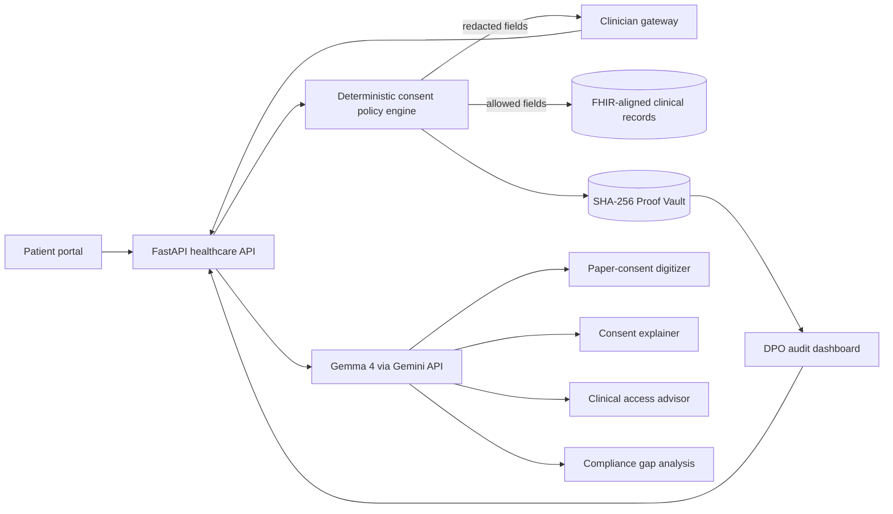

# Vajra Health

<div align="center">

**A consent-aware healthcare data gateway that keeps patient choice enforceable, clinical access explainable, and every exceptional disclosure auditable.**

[](LICENSE)
[](frontend/)
[](backend/)
[](docker-compose.yml)
[](#open-weight-ai-and-model-terms)

Built for **Hacktoberfest x MOSS Hack Day Udupi 2026**<br>
Tracks: **Best Open-Source AI Project** and **Best Use of Gemma 4**

</div>

> [!IMPORTANT]
> This is a hackathon prototype, not a medical device or a substitute for legal, clinical, or information-security advice. The healthcare demo uses synthetic records and must not be given real patient data.

## Why Vajra Health

Healthcare teams need fast access to records, but access should never silently exceed a patient's consent. Vajra Health places a policy-enforcement layer between an EHR/EMR and the people or systems requesting data. It evaluates the purpose of access, reveals only permitted clinical categories, redacts protected fields, and seals the decision in a tamper-evident proof chain.

The hack-day experience focuses on three people:

- **Patient:** grants purpose-specific consent, withholds sensitive categories, reads a plain-language explanation, and digitizes a paper form.
- **Clinician:** requests a record for a declared purpose, sees allowed data and explicit redactions, and can invoke a tightly logged emergency override.
- **Data Protection Officer:** reviews every access decision and emergency event, checks the SHA-256 proof chain, and inspects AI-assisted compliance findings.

## What we built

| Capability | What it demonstrates |
| --- | --- |
| Granular patient consent | Separate grants for treatment, diagnostics, research, insurance, and emergency use, with category-level allow/deny choices. |
| Consent-aware record access | A deterministic policy engine returns allowed records and `[REDACTED]` placeholders instead of leaking non-consented fields. |
| Break-the-glass workflow | Emergency access requires a justification, is limited to the active session, and is queued for DPO review. |
| Proof Vault | Every consent change and access decision is linked with SHA-256 hashes so tampering can be detected. |
| Paper consent digitization | A multimodal AI workflow turns a consent-form image into a patient-reviewable structured draft. |
| Patient-friendly explanations | AI rewrites dense consent language into concise explanations in Indian languages. |
| Clinical access advisor | AI explains why a category is allowed or denied while the deterministic policy engine remains authoritative. |
| Compliance analysis | AI summarizes possible DPDPA gaps and recommended actions for a human reviewer. |

The healthcare UI lives in [`frontend/src/app/healthcare`](frontend/src/app/healthcare), its typed API adapter is [`frontend/src/lib/api/healthcare.ts`](frontend/src/lib/api/healthcare.ts), and the broader compliance platform remains available around the hack-day workflow.


## How it works



The safety boundary is intentional: **Gemma explains and extracts; deterministic application logic decides access.** An AI response cannot grant consent, bypass a denial, or erase an audit event.

## Open-weight AI and model terms

The hackathon configuration targets **Gemma 4 26B A4B instruction-tuned** (`gemma-4-26b-a4b-it`) through the Gemini API. It is used for multimodal consent-form extraction, multilingual explanations, access-decision explanations, and compliance review.

- Model overview: [Gemma 4 documentation](https://ai.google.dev/gemma/docs/core)
- Hosted API instructions and supported model IDs: [Run Gemma with the Gemini API](https://ai.google.dev/gemma/docs/core/gemma_on_gemini_api)
- Model card: [Gemma 4 model card](https://ai.google.dev/gemma/docs/core/model_card_4)
- License/usage terms: [Gemma 4 license](https://ai.google.dev/gemma/terms)
- Prohibited-use policy: [Gemma prohibited-use policy](https://ai.google.dev/gemma/prohibited_use_policy)

The model is open-weight, not OSI-licensed application code. Vajra's source code is MIT-licensed separately.

## Repository layout

```text
.
├── frontend/                 React, TypeScript, Vite application
│   └── src/app/healthcare/   Hack-day patient, clinician, and DPO views
├── backend/                  FastAPI, SQLAlchemy, Alembic application
│   ├── app/                  Routers, schemas, services, models, and config
│   └── platform_docs/        Retrieval corpus for the compliance copilot
├── packages/vajra-python/    Consent-enforcement Python SDK
├── docs/                     Product and operator documentation
├── docker-compose.yml        Local full-stack services
├── SRS2.md                   Hackathon system requirements
└── LICENSE                   MIT license for this repository
```


### Fastest path: frontend with synthetic data

Requirements: Node.js 20+ and Corepack (or pnpm installed globally).

```bash
git clone https://github.com/shreyv7/hack.git
cd hack
corepack enable
pnpm --dir frontend install
pnpm --dir frontend dev
```

Open <http://localhost:5173> and sign in through the normal Vajra flow. Healthcare requests use local synthetic data unless `VITE_USE_HEALTHCARE_MOCKS=false` is set.

### Full local stack

Requirements: Python 3.12, Node.js 20+, Docker, and pnpm.

1. Start PostgreSQL with pgvector and Redis:

   ```bash
   docker compose -f backend/docker-compose.db.yml up -d
   ```

2. Configure and start the API:

   ```bash
   cd backend
   python3.12 -m venv .venv
   source .venv/bin/activate
   pip install -r requirements.txt
   playwright install chromium
   python -m spacy download en_core_web_sm
   cp .env.example .env
   alembic upgrade heads
   uvicorn app.main:app --reload
   ```

3. In another terminal, start the frontend:

   ```bash
   cd frontend
   corepack enable
   pnpm install
   printf 'VITE_API_BASE_URL=http://localhost:8000/api\nVITE_USE_HEALTHCARE_MOCKS=false\n' > .env.local
   pnpm dev
   ```

4. Open:

   - App: <http://localhost:5173>
   - API health: <http://localhost:8000/api/health>
   - Swagger UI: <http://localhost:8000/docs>

Windows activation command: `.venv\Scripts\Activate.ps1`. Copy `.env.example` with `copy .env.example .env`.

> [!CAUTION]
> Keep `.env`, cloud credentials, SMTP secrets, and patient data out of Git. The committed environment files contain placeholders only.

## Configuration

| Variable | Purpose | Default/example |
| --- | --- | --- |
| `DATABASE_URL` | PostgreSQL connection used by SQLAlchemy and Alembic | `postgresql+psycopg2://...` |
| `SECRET_KEY` | JWT signing and local secret derivation | Required; generate a random value |
| `REDIS_URL` | Short-lived consent-decision cache | `redis://localhost:6379/0` |
| `VITE_API_BASE_URL` | Browser-facing API base | `http://localhost:8000/api` |
| `VITE_USE_HEALTHCARE_MOCKS` | `false` calls the healthcare backend; any other value uses synthetic demo data | Demo mode enabled |
| `AI_PROVIDER` | Existing Vajra provider switch | `vertex` or `bedrock` |
| `GOOGLE_CLOUD_PROJECT` | Google Cloud project for the current Vertex path | Required for Vertex |
| `VERTEX_MODEL_ID` | Existing Vajra chat/vision model | `gemini-2.5-flash` |
| `VERTEX_EMBED_MODEL_ID` | RAG embedding model | `gemini-embedding-001` |
| `BEDROCK_MODEL_ID` | Optional AWS Bedrock chat model | Empty until configured |

See [`backend/.env.example`](backend/.env.example) and [`frontend/.env.example`](frontend/.env.example) for the complete templates. Do not use the Gemini 2.5 configuration as evidence of Gemma 4 integration; the hackathon path must call a supported Gemma 4 model ID through the Gemini API.

## Open-source tools and libraries

The following is the complete direct dependency inventory declared by this repository. Exact versions are pinned in [`frontend/package.json`](frontend/package.json), [`frontend/pnpm-lock.yaml`](frontend/pnpm-lock.yaml), [`backend/requirements.txt`](backend/requirements.txt), and [`packages/vajra-python/pyproject.toml`](packages/vajra-python/pyproject.toml). Transitive packages are recorded in the lockfiles.

### Application, data, and infrastructure

| Tool | Role |
| --- | --- |
| [React](https://react.dev/) (`react`, `react-dom`), [TypeScript](https://www.typescriptlang.org/), [Vite](https://vite.dev/) | Browser application, static typing, and build system |
| [FastAPI](https://fastapi.tiangolo.com/), [Uvicorn](https://www.uvicorn.org/), [Pydantic](https://docs.pydantic.dev/) | API framework, ASGI server, and request/config validation |
| [PostgreSQL](https://www.postgresql.org/), [pgvector](https://github.com/pgvector/pgvector), [SQLAlchemy](https://www.sqlalchemy.org/), [Alembic](https://alembic.sqlalchemy.org/) | Relational storage, vector search, ORM, and migrations |
| [Redis](https://redis.io/) | Short-lived consent-decision caching |
| [Docker Compose](https://docs.docker.com/compose/) and [Nginx](https://nginx.org/) | Reproducible local services and production SPA serving |
| [pnpm](https://pnpm.io/), [npm](https://www.npmjs.com/), [setuptools](https://setuptools.pypa.io/) | JavaScript workspace and Python SDK packaging |

### Frontend runtime dependencies

- **UI primitives and styling:** Emotion (`@emotion/react`, `@emotion/styled`), Material UI (`@mui/material`, `@mui/icons-material`), Popper (`@popperjs/core`, `react-popper`), all declared Radix UI React packages, `class-variance-authority`, `clsx`, `tailwind-merge`, `tw-animate-css`, `next-themes`, and the shadcn/ui-derived component layer.
- **Interaction and layout:** `cmdk`, `embla-carousel-react`, `input-otp`, `motion`, `react-day-picker`, `react-dnd`, `react-dnd-html5-backend`, `react-hook-form`, `react-resizable-panels`, `react-responsive-masonry`, `react-slick`, `sonner`, `vaul`, and `canvas-confetti`.
- **Navigation, content, and data display:** `react-router`, `react-markdown`, `remark-gfm`, `recharts`, `date-fns`, and `lucide-react`.
- **Evidence exports and capture:** `html2canvas`, `modern-screenshot`, and `jspdf`.
- **Frontend development:** Tailwind CSS (`tailwindcss`, `@tailwindcss/vite`), `@vitejs/plugin-react`, `terser`, `@types/canvas-confetti`, `@types/node`, `@types/react`, `@types/react-dom`, `@types/react-slick`, Knip, and depcheck.

For completeness, the Radix declarations are: `@radix-ui/react-accordion`, `@radix-ui/react-alert-dialog`, `@radix-ui/react-aspect-ratio`, `@radix-ui/react-avatar`, `@radix-ui/react-checkbox`, `@radix-ui/react-collapsible`, `@radix-ui/react-context-menu`, `@radix-ui/react-dialog`, `@radix-ui/react-dropdown-menu`, `@radix-ui/react-hover-card`, `@radix-ui/react-label`, `@radix-ui/react-menubar`, `@radix-ui/react-navigation-menu`, `@radix-ui/react-popover`, `@radix-ui/react-progress`, `@radix-ui/react-radio-group`, `@radix-ui/react-scroll-area`, `@radix-ui/react-select`, `@radix-ui/react-separator`, `@radix-ui/react-slider`, `@radix-ui/react-slot`, `@radix-ui/react-switch`, `@radix-ui/react-tabs`, `@radix-ui/react-toggle`, `@radix-ui/react-toggle-group`, and `@radix-ui/react-tooltip`.

### Backend and SDK dependencies

- **API and validation:** `fastapi`, `uvicorn[standard]`, `pydantic`, `pydantic-settings`, `email-validator`, `python-multipart`, `python-dotenv`, and `httpx`.
- **Persistence:** `sqlalchemy`, `alembic`, `psycopg2-binary`, `pgvector`, and `redis`.
- **Authentication and cryptography:** `python-jose[cryptography]`, `cryptography`, `passlib[bcrypt]`, and `bcrypt`.
- **PII discovery and anonymisation:** Microsoft Presidio (`presidio-analyzer`, `presidio-anonymizer`) and spaCy with `en_core_web_sm`.
- **Document ingestion and generation:** `openpyxl`, `pypdf`, `python-docx`, `reportlab`, and `python-pptx`.
- **AI SDKs:** Google's `google-genai` and AWS's `boto3`.
- **Database/data-source connectors:** `pymysql`, `pymongo`, `oracledb`, `pymssql`, `paramiko`, `azure-storage-blob`, `azure-identity`, `azure-monitor-query`, `google-cloud-storage`, `google-cloud-logging`, `google-auth`, and `playwright` with Chromium.
- **Messaging:** `twilio`; email delivery uses standard SMTP.
- **Python SDK:** `setuptools`, `python-jose[cryptography]`, optional `fastapi`, and `pytest` for development.
- **Code-quality tools:** Vulture and deptry (documented developer installs).

### External APIs and hosted services

These services are not presented as open-source dependencies. They are listed because the rulebook also requires APIs used by the project:

- **Gemini API** — planned hosted access to `gemma-4-26b-a4b-it` for the hackathon AI workflows.
- **Google Cloud Vertex AI** — the existing Vajra AI provider path and Gemini embedding service.
- **AWS Bedrock** — optional alternate AI provider.
- **Twilio and SMTP** — optional SMS/email notification delivery.
- **Google Cloud Storage/Logging and Azure Blob/Monitor** — optional enterprise data-source connectors.

### Datasets and demo data

No external training or benchmark dataset is bundled or used. The healthcare demo records (including the fictional patient **Priya Sharma**) are synthetic and live in the frontend mock adapter. Gemma 4 is consumed as a hosted pre-trained model; this project does not train or fine-tune it on patient information.

See [`ATTRIBUTIONS.md`](ATTRIBUTIONS.md) for UI and media attribution notes. Package authors retain their own copyrights and licenses; the MIT license for Vajra does not replace third-party terms.

## AI-assisted development disclosure

Hackathon rules allow AI build tools but require exact disclosure. The following tools are evidenced in this repository/session:

| Tool | What it produced or assisted with |
| --- | --- |
| **OpenAI Codex** | Repository/rulebook audit, dependency inventory, README structure and wording, MIT license-file addition, and verification commands. The team remains responsible for reviewing and explaining every change. |
| **Figma Make** | Earlier UI/component scaffolding and design composition; the retained shadcn/ui and Unsplash attributions are documented in `ATTRIBUTIONS.md`. |

If another coding assistant, chat assistant, or image generator was used, add it here **before submission**, together with the specific files or assets it produced. Omitting a build tool can disqualify the project under the event rules.


## Useful commands

```bash
# Frontend checks
pnpm --dir frontend typecheck
pnpm --dir frontend build

# Backend import/startup smoke check
cd backend
.venv/bin/python -c "import app.main"

```


## License

Vajra is released under the [MIT License](LICENSE). Gemma models remain governed by Google's linked model terms, and all third-party libraries and services remain governed by their own licenses and terms.

Security issues should be reported through [`SECURITY.md`](SECURITY.md), not a public issue.
