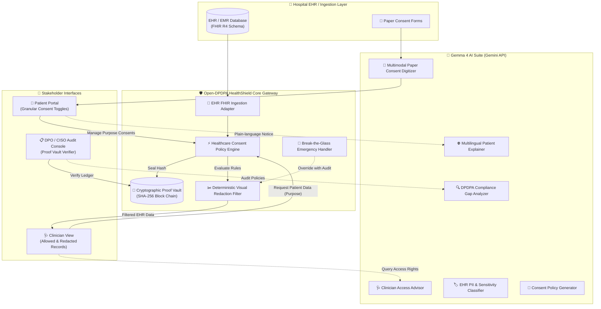
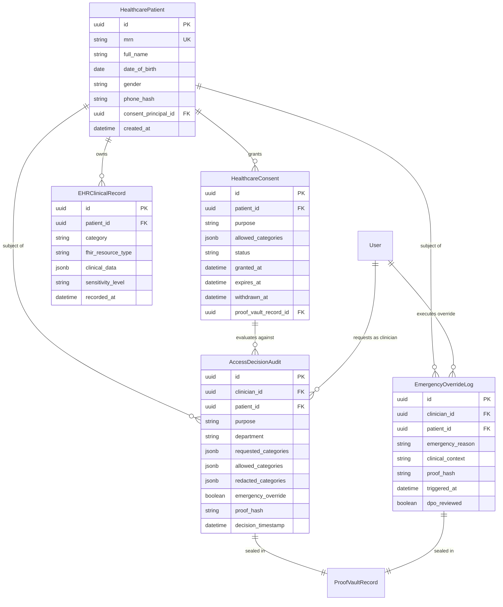

# 🏥 Software Requirements Specification (SRS) & System Architecture
## Open-DPDPA HealthShield — Universal Healthcare Consent & Data Governance Gateway

**Document Version:** 2.0.0  
**Event:** Hacktoberfest × MOSS Hack Day Udupi (Sunday, 25 October 2026, 9:00 AM – 7:30 PM IST)  
**Challenges Targeted:**  
1. 🏆 **Best Open-Source AI Project** (OSI-approved MIT License, Open-weight AI)  
2. 🏆 **Best Use of Gemma 4** (Multimodal Gemma 4 via Google Gen AI SDK / Gemini API)  
**Foundation Base:** [dpdpa_shield](file:///Users/shreyvashistha/Desktop/DPDPHACK/dpdpa_shield)  
**License:** MIT License (100% Open Source)

---

## 1. Executive Summary & Vision

### 1.1 The Problem
In modern multi-specialty hospitals, health networks, and diagnostic centers, a patient's longitudinal Electronic Health Record (EHR) aggregates highly sensitive data: psychiatric therapy notes, HIV/STD screening results, oncological diagnoses, reproductive health records, and prescription histories.

Under India's **Digital Personal Data Protection Act (DPDPA), 2023**:
- **Section 5 (Notice):** Data Fiduciaries must inform Data Principals of the specific purposes for data processing.
- **Section 6 (Consent):** Consent must be free, specific, informed, unconditional, and unambiguous with clear affirmative action.
- **Section 7 (Certain Legitimate Uses):** Data processing without prior consent is permitted strictly for responding to medical emergencies involving a threat to the life or immediate health of the Data Principal.

Currently, hospital systems operate with an **"All-or-Nothing" access paradigm**: when an orthopedist, dermatologist, or radiologist opens a patient's chart, they gain unrestricted visibility into their entire psychiatric and reproductive history. This violates DPDPA Section 6, exposes hospitals to regulatory penalties up to ₹250 Crores, and destroys patient trust.

### 1.2 The Solution: Open-DPDPA HealthShield
**HealthShield** is a zero-trust, open-source Healthcare Consent Enforcement Gateway and Audit Vault that sits between hospital EHR/EMR databases and healthcare providers. It provides:
1. **Dynamic Purpose-Based Consent Filtering:** Automatically evaluates patient consent against the clinician's stated clinical purpose (`treatment`, `diagnostics`, `research`, `insurance`, `emergency`, `public_health`), deterministically redacting unconsented categories with visible badges (`[REDACTED — no consent for {purpose}]`).
2. **Break-the-Glass Emergency Protocol:** Enables life-saving access under DPDPA Section 7 with mandatory justification, ephemeral tokens, high-priority audit flagging, and patient notifications.
3. **Cryptographic Proof Vault:** Every consent grant, withdrawal, and clinical data access decision is sealed in an immutable SHA-256 block-chained audit ledger with Merkle tree verification.
4. **Multimodal Gemma 4 AI Suite:** Powers paper consent digitization, multilingual patient explanations, clinician real-time access advisory, EHR sensitivity auto-classification, compliance gap analysis, and policy generation.
5. **Universal Hospital Interoperability:** Implements a lightweight, pragmatic FHIR R4-aligned data model and REST API capable of integrating with any hospital EHR/EMR.



---

## 2. Universal Healthcare Scope & Department Neutrality

HealthShield is designed as a **universal, department-agnostic healthcare data gateway**. It does not constrain roles to a single specialty (such as a dentist or single clinic); instead, it models any medical institution:
- **Institution Types:** Multi-specialty hospitals, tertiary trauma centers, independent clinics, diagnostic laboratories, health research institutes, and telemedicine platforms.
- **Dynamic Departments:** General Medicine, Cardiology, Oncology, Psychiatry, Emergency Medicine, Surgery, Orthopedics, Obstetrics & Gynecology, Pediatrics, Pathology, Dermatology, Dental Care.
- **Universal Personas:**
  - **Data Principal (Patient / Guardian):** Controls purpose-based data-sharing preferences and reviews access logs.
  - **Healthcare Provider (Clinician / Specialist / Nurse / Paramedic):** Accesses patient clinical data strictly bounded by the purpose of the current encounter.
  - **Hospital Data Protection Officer (DPO / CISO):** Audits cryptographic proof records, monitors break-the-glass events, and validates DPDPA compliance.

---

## 3. Existing Component Reuse Matrix

HealthShield maximizes development velocity and production reliability by leveraging the robust, battle-tested foundations of `dpdpa_shield`.

| Existing Component in `dpdpa_shield` | Source Path | Reused For in HealthShield | Modifications / Additions |
|---|---|---|---|
| **Proof Vault & Hash Chain** | [models/proof_vault.py](file:///Users/shreyvashistha/Desktop/DPDPHACK/dpdpa_shield/backend/app/models/proof_vault.py)<br>[services/proof_vault_service.py](file:///Users/shreyvashistha/Desktop/DPDPHACK/dpdpa_shield/backend/app/services/proof_vault_service.py) | Tamper-evident logging of every clinical data access decision, consent grant/withdrawal, and break-the-glass emergency event. | Add event types: `HEALTHCARE_ACCESS_EVALUATION`, `BREAK_THE_GLASS_OVERRIDE`, `EHR_CONSENT_DIGITIZATION`. |
| **Consent Lifecycle & Principal** | [models/consent.py](file:///Users/shreyvashistha/Desktop/DPDPHACK/dpdpa_shield/backend/app/models/consent.py)<br>[models/consent_principal.py](file:///Users/shreyvashistha/Desktop/DPDPHACK/dpdpa_shield/backend/app/models/consent_principal.py) | Core patient representation as Data Principal, consent state machine (`active`, `revoked`, `expired`). | Linked to `HealthcarePatient` entity with Medical Record Number (MRN). |
| **Anonymisation & Masking Engine** | [services/anonymisation_service.py](file:///Users/shreyvashistha/Desktop/DPDPHACK/dpdpa_shield/backend/app/services/anonymisation_service.py)<br>[models/masking.py](file:///Users/shreyvashistha/Desktop/DPDPHACK/dpdpa_shield/backend/app/models/masking.py) | Dynamic redaction of unconsented clinical record fields and PII tokenization for research purposes. | Integrated into `HealthcareConsentEngine` for deterministic field masking. |
| **Compliance Scoring & Obligation Registry** | [models/compliance.py](file:///Users/shreyvashistha/Desktop/DPDPHACK/dpdpa_shield/backend/app/models/compliance.py)<br>[services/compliance_service.py](file:///Users/shreyvashistha/Desktop/DPDPHACK/dpdpa_shield/backend/app/services/compliance_service.py) | Real-time DPDPA compliance rating for hospital organizations. | Added healthcare-specific compliance rules (emergency justification, pediatric guardian verification). |
| **Authentication & User Roles** | [core/security.py](file:///Users/shreyvashistha/Desktop/DPDPHACK/dpdpa_shield/backend/app/core/security.py)<br>[models/user.py](file:///Users/shreyvashistha/Desktop/DPDPHACK/dpdpa_shield/backend/app/models/user.py) | JWT authentication, clinician role-based permissions, hospital department scoping. | Added `role="clinician"`, `role="patient"`, `role="dpo"` scopes and department claims. |
| **Frontend UI Foundation & Theme** | `frontend/src/index.css`<br>`frontend/src/components/*` | Modern dark-mode glassmorphic interface, layout containers, interactive modals, toasts, and navigation. | Added medical color tokens (teal `#0891b2`, clinical emerald `#059669`, redacted crimson `#dc2626`). |

---

## 4. Gemma 4 AI Architecture (via Gemini API)

Per the Hackathon requirements, **Gemma 4** (`gemma-4-27b-it` or `gemma-4-12b-it`) is utilized directly through the **Google Gen AI SDK (`google-genai`)** using the Gemini API Developer key (`GEMINI_API_KEY`). All AWS Bedrock / legacy Vertex dependencies are replaced with direct, high-performance Gemma 4 endpoints.

### 4.1 The 6 Gemma 4 Healthcare Capabilities

```
┌──────────────────────────────────────────────────────────────────────────────────┐
│                      Gemma 4 Multimodal AI Suite Architecture                     │
├────────────────────────────────────────┬─────────────────────────────────────────┤
│ 1. Multimodal Paper Consent Digitizer  │ 2. Multilingual Patient Explainer       │
│    Input: Scanned Consent Form (JPG/PNG│    Input: Complex Legal Consent Notice  │
│    Output: Structured FHIR Consent JSON│    Output: 8th-grade Hindi/Eng/Regional │
├────────────────────────────────────────┼─────────────────────────────────────────┤
│ 3. Clinician Real-time Access Advisor  │ 4. DPDPA Healthcare Gap Analyzer        │
│    Input: "Can Dr. Smith see Psych?"   │    Input: Hospital EHR Access Policies  │
│    Output: Policy Verdict + DPDPA Sec  │    Output: High/Med/Low Gaps + Remediate│
├────────────────────────────────────────┼─────────────────────────────────────────┤
│ 5. EHR PII & Sensitivity Classifier    │ 6. Healthcare Policy Generator          │
│    Input: Raw Clinical Note / EHR blob │    Input: Department & Clinical Context │
│    Output: Classified Standard/Sens/HS │    Output: Granular DPDPA Policy Matrix │
└────────────────────────────────────────┴─────────────────────────────────────────┘
```

#### Feature 1: Multimodal Paper Consent Form Digitizer
- **Purpose:** In Indian hospitals, over 80% of patient consents are gathered on paper clipboards. Gemma 4's multimodal vision capabilities read the physical paper consent form, extract patient details, declared purposes, and signature validations, and convert them directly into structured digital consent records.
- **Endpoint:** `POST /api/v1/healthcare/ai/digitize-consent`
- **Model:** `gemma-4-27b-it` (multimodal image + prompt)
- **Prompt Structure:**
  ```text
  You are an expert healthcare privacy parser. Analyze the uploaded patient paper consent form image.
  Extract:
  1. Patient Name and MRN
  2. Authorized Purposes (treatment, diagnostics, research, insurance, emergency)
  3. Explicitly Excluded Categories
  4. Validity Period and Date
  5. Signature Presence (true/false)
  Output STRICT JSON matching the HealthcareConsentDraft schema.
  ```

#### Feature 2: Multilingual Patient Consent Explainer
- **Purpose:** DPDPA Section 5 requires notice to be comprehensible. Most consent notices are impenetrable legalese. Gemma 4 translates the legal notice into clear, jargon-free explanations in 8th-grade language across 8 Indian languages (Hindi, Kannada, Tamil, Telugu, Marathi, Bengali, Gujarati, English).
- **Endpoint:** `POST /api/v1/healthcare/ai/explain-consent`
- **Output:** Structured key points: "What you are sharing", "Who sees it", "Why they need it", "Your right to withdraw anytime".

#### Feature 3: Clinician Access Advisor
- **Purpose:** Clinicians facing ambiguous scenarios can query the AI advisor in natural language (e.g., *"Can I view Priya's past psychiatric prescriptions for managing her pre-op anesthesia?"*).
- **Endpoint:** `POST /api/v1/healthcare/ai/advise-access`
- **Logic:** Gemma 4 cross-references active consent grants, clinical record categories, and DPDPA Sections 6 & 7 to produce an authoritative verdict with statutory citations.

#### Feature 4: DPDPA Healthcare Compliance Gap Analyzer
- **Purpose:** Analyzes the hospital's data processing activities, EHR storage retention, and departmental consent policies to flag non-compliance risks under DPDPA 2023 with remediation steps.
- **Endpoint:** `POST /api/v1/healthcare/ai/analyze-compliance-gaps`

#### Feature 5: EHR PII & Sensitivity Auto-Classifier
- **Purpose:** Parses unstructured clinical encounter notes, diagnostic reports, and discharge summaries to identify and classify data elements into three sensitivity tiers:
  - `standard`: Demographics, vital signs, general consultations.
  - `sensitive`: Chronic prescriptions, allergies, past surgeries.
  - `highly_sensitive`: Mental health therapy notes, HIV/STD status, oncology staging, reproductive health.
- **Endpoint:** `POST /api/v1/healthcare/ai/classify-ehr`

#### Feature 6: Healthcare Consent Policy Generator
- **Purpose:** Generates custom, legally compliant consent notices tailored to specific clinical departments (e.g., Oncology Clinical Trials, Pediatric Surgery) incorporating purpose limitation, retention schedules, and grievance officer contacts.
- **Endpoint:** `POST /api/v1/healthcare/ai/generate-policy`

---

## 5. EHR/EMR Interoperability Layer (FHIR R4 Aligned)

To enable seamless adoption across hospitals without forcing proprietary data lock-in, HealthShield adopts a **lightweight, pragmatic FHIR R4 JSON schema**.

### 5.1 Clinical Data Categories & Sensitivity Mapping

| Category Identifier | Description | Default Sensitivity | Sample FHIR Resource |
|---|---|---|---|
| `demographics` | Name, Age, Gender, Contact | `standard` | `Patient` |
| `vitals` | BP, Heart Rate, SpO2, Temperature | `standard` | `Observation` (vital-signs) |
| `clinical_notes` | General consultation notes | `standard` | `Encounter` |
| `medications` | Active & historical prescriptions | `sensitive` | `MedicationStatement` |
| `allergies` | Drug and food allergies | `sensitive` | `AllergyIntolerance` |
| `lab_results` | Routine blood work, metabolic panels | `sensitive` | `DiagnosticReport` |
| `mental_health` | Psychiatric evaluations, counseling | `highly_sensitive` | `Condition` / `DocumentReference` |
| `reproductive` | Obstetric history, contraception | `highly_sensitive` | `Observation` / `Condition` |
| `hiv_std_status` | Infectious disease screening | `highly_sensitive` | `Observation` (laboratory) |
| `surgical_history`| Past operative procedures | `sensitive` | `Procedure` |

### 5.2 Purpose-Based Access Control Matrix

When a healthcare provider accesses an EHR record, the gateway enforces this policy matrix:

| Clinical Purpose | Allowed Data Categories | Denied Categories (Visually Redacted) |
|---|---|---|
| `treatment` (General) | demographics, vitals, clinical_notes, medications, allergies, surgical_history | mental_health, reproductive, hiv_std_status *(unless explicitly consented)* |
| `diagnostics` | demographics, vitals, lab_results, medications, allergies | mental_health, reproductive, hiv_std_status, clinical_notes |
| `research` | vitals, lab_results *(all PII demographics anonymized)* | mental_health, reproductive, hiv_std_status *(strictly blocked)* |
| `insurance` | demographics, vitals, surgical_history, billing encounters | mental_health, reproductive, clinical_notes |
| `emergency` | **ALL CATEGORIES UNLOCKED** via Break-The-Glass Protocol | None (Full view for resuscitation/survival) |
| `public_health` | anonymized vitals, infectious disease flags | all personal identifiers, mental_health, reproductive |

---

## 6. Deterministic Redaction & Break-the-Glass Emergency Protocol

### 6.1 Deterministic Redaction UX
Judges and clinicians will see a clear, high-contrast visual redaction system:
- Consented fields render with a **green status indicator** (`Allowed under Purpose: {purpose}`).
- Unconsented fields render as high-visibility **crimson cards** with:
  ```text
  🔒 [REDACTED — no consent for {category} under purpose '{purpose}']
  DPDPA 2023 Section 6 Protection: This category requires explicit patient authorization.
  ```
- This prevents dangerous "silent omission" (where a doctor doesn't know data exists) while strictly upholding data confidentiality.

### 6.2 "Break-the-Glass" (BTG) Protocol (DPDPA Section 7)
In life-threatening situations (e.g., unconscious polytrauma patient, cardiac arrest):
1. **Clinician Trigger:** Clinician clicks `🚨 Break The Glass (Emergency Override)`.
2. **Mandatory Justification:** Clinician must submit an emergency rationale (e.g., *"Patient unconscious in ER with acute anaphylaxis; immediate allergy and toxicology history required"*).
3. **Instant Ephemeral Decryption:** All categories are temporarily unlocked for the clinician for 30 minutes.
4. **Cryptographic Proof Vault Immutability:**
   - An emergency event is sealed into the Proof Vault:
     $$\text{Block Hash} = \text{SHA256}(\text{PrevHash} + \text{ClinicianID} + \text{PatientMRN} + \text{Timestamp} + \text{ReasonHash})$$
5. **High-Priority DPO Alert & Patient SMS:** An automated notification is queued for the Hospital DPO and sent to the patient/guardian post-facto as mandated by DPDPA rules.

---

## 7. Data Models & Database Schema

### 7.1 Entity Relationship Diagram



---

## 8. REST API Endpoints Specification

### 8.1 Healthcare Gateway Endpoints (`routers/healthcare.py`)

| Method | Endpoint | Description |
|---|---|---|
| `GET` | `/api/v1/healthcare/patients/{id}` | Retrieve patient profile by ID or MRN |
| `GET` | `/api/v1/healthcare/patients/{id}/consents` | List all active, expired, and revoked consents |
| `POST` | `/api/v1/healthcare/patients/{id}/consents` | Grant new purpose-based consent with allowed categories |
| `POST` | `/api/v1/healthcare/patients/{id}/consents/{cid}/revoke` | Revoke an existing consent immediately |
| `POST` | `/api/v1/healthcare/access/evaluate` | **Core Gateway:** Clinician requests patient record under specific purpose; returns filtered data with redacting indicators and proof hash |
| `POST` | `/api/v1/healthcare/access/break-the-glass` | Execute Section 7 Emergency Override with reason and proof logging |
| `GET` | `/api/v1/healthcare/audit/decisions` | Stream of access decision audits with cryptographic integrity checks |
| `POST` | `/api/v1/healthcare/seed-demo` | One-click setup: seeds demo patient "Priya Sharma" with multi-category records |

### 8.2 Gemma 4 AI Endpoints (`routers/healthcare_ai.py`)

| Method | Endpoint | Description |
|---|---|---|
| `POST` | `/api/v1/healthcare/ai/digitize-consent` | Multimodal upload: parses paper consent image to structured JSON |
| `POST` | `/api/v1/healthcare/ai/explain-consent` | Generates plain-language explanation of consent notice in patient's language |
| `POST` | `/api/v1/healthcare/ai/advise-access` | Answers clinician access queries based on active patient consents and DPDPA |
| `POST` | `/api/v1/healthcare/ai/analyze-compliance-gaps` | Analyzes hospital consent policy for DPDPA gaps and penalties |
| `POST` | `/api/v1/healthcare/ai/classify-ehr` | Scans clinical notes and classifies data into standard/sensitive/highly sensitive |
| `POST` | `/api/v1/healthcare/ai/generate-policy` | Generates custom hospital consent policies tailored by specialty |

---

## 9. Frontend User Experience & Views

The frontend is built in React 18 with TypeScript and Tailwind/Vanilla CSS tokens, adhering to dark-mode glassmorphic aesthetics.

### 9.1 View 1: Universal Patient Consent Portal (`/healthcare/patient`)
- **Granular Purpose Cards:** Intuitive switch toggles for each purpose (`Treatment`, `Diagnostics`, `Research`, `Insurance`, `Emergency`).
- **Data Category Chips:** Shows exactly which data categories are included or excluded under each purpose.
- **Multilingual Explainer Drawer:** One-click "Explain My Rights" powered by Gemma 4 in Hindi, Kannada, Tamil, or English.
- **Paper Consent Form Uploader:** Drag-and-drop physical form photo; displays live AI extraction side-by-side with instant confirm button.

### 9.2 View 2: Clinician Access View (`/healthcare/clinician`)
- **Patient Lookup & Specialty Context:** Select department (`Cardiology`, `Oncology`, `Dentistry`, `Psychiatry`, `General Medicine`) and clinical purpose.
- **Interactive Split Records View:**
  - **Allowed Cards (Emerald Glow):** Full clinical detail (e.g., Vitals, Dental Chart, Blood Tests).
  - **Redacted Cards (Crimson Glow):** Bold `[REDACTED — no consent for {purpose}]` labels preserving structural awareness without leaking content.
- **Clinician Access Advisor Chat:** Embedded Gemma 4 assistant answering questions about permissible access.
- **Emergency "Break The Glass" Button:** Prominent red button opening the Section 7 override modal with justification requirement.

### 9.3 View 3: Hospital DPO & Compliance Audit Vault (`/healthcare/audit`)
- **Cryptographic Timeline:** Real-time stream of all access events, showing block index, timestamp, clinician, patient MRN, and SHA-256 hash.
- **Merkle Tree Integrity Verifier:** One-click verification button that runs down the proof chain and displays `✅ Proof Vault Intact — 0 Tampering Detected`.
- **Emergency Review Queue:** Flagged Break-The-Glass incidents with clinician notes and time windows for DPO sign-off.
- **Gemma 4 Compliance Scanner Widget:** Live hospital-wide DPDPA compliance health score.

---

## 10. Demo Script & Presentation Strategy (5-Minute Hackathon Demo)

| Timeline | Stage | Live Action & Display | Rubric Addressed |
|---|---|---|---|
| **0:00 – 0:45** | **The Problem** | Explain the hospital privacy paradox: why should an orthopedist or dentist see HIV status or psychiatric notes? Cite DPDPA Section 6. | *Usefulness & Impact* |
| **0:45 – 1:45** | **Patient Portal** | Show patient Priya Sharma's portal. She has granted consent for `treatment` but explicitly blocked `mental_health` and `hiv_std_status`. Demonstrate Gemma 4 Multilingual Explainer in Hindi. | *Design & UX, Open-Source AI* |
| **1:45 – 2:45** | **Clinician Gateway** | Clinician logs in under `General Treatment`. Fetches Priya's chart. Allowed records show cleanly; Mental Health and HIV cards show **red `[REDACTED]`** badges. Ask Gemma 4 Advisor: *"Can I view psychiatric notes?"* AI answers: *"No, denied under active consent."* | *Technical Implementation (Core IP)* |
| **2:45 – 3:30** | **Break The Glass** | Simulate an acute trauma emergency. Clinician triggers `Break The Glass`, inputs emergency reason. Records unlock instantly. High-priority audit block is immediately sealed. | *Creativity, Domain Expertise* |
| **3:30 – 4:15** | **Multimodal Paper Digitizer** | Upload a photo of a hospital paper consent form. Gemma 4 parses it in real-time, displays structured JSON draft, and saves it into the patient's record. | *Best Use of Gemma 4 (Multimodal)* |
| **4:15 – 5:00** | **Proof Vault & Architecture** | Open DPO Audit Dashboard. Show the unbroken SHA-256 hash chain and click `Verify Integrity`. Summarize open-source MIT license and modular architecture. | *Learning, Clarity & Compliance* |

---

## 11. README & Submission Compliance Checklist

- [x] **Project Name:** Open-DPDPA HealthShield
- [x] **License:** MIT License (in root `LICENSE`)
- [x] **Open-Weight AI Model:** Gemma 4 (`gemma-4-27b-it` / `gemma-4-12b-it`) via Gemini API
- [x] **Model Terms Linked:** Linked to Google Gemma Open Model terms
- [x] **Pre-existing Code Attributed:** `dpdpa_shield` explicitly credited as open-source foundation
- [x] **AI Coding Tools Credited:** Listed in README with specific components produced
- [x] **One-Line Execution:** `docker compose up` or simple start script
- [x] **OrganizerHQ Submission:** Marked for both *Best Open-Source AI Project* and *Best Use of Gemma 4*
