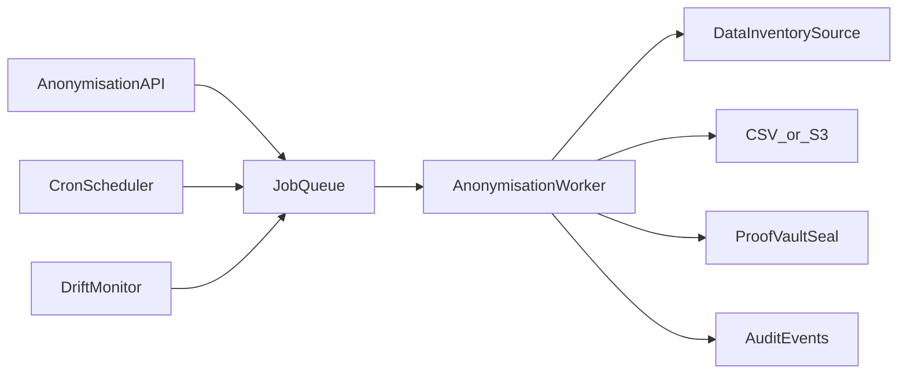

# Data Anonymisation — Enterprise Hardening Roadmap

This document defines the second-pass reliability and scale work for the dataset anonymisation module (`AnonymisationService`). The first rework pass clarifies legal semantics, governance metadata, playbook UX, and Proof Vault evidence. This roadmap covers production-grade execution.

## Current architecture (Phase 1–3)

- Jobs created via `POST /anonymisation/jobs` and executed in-process via FastAPI `BackgroundTasks`.
- Recurring runs and drift monitoring via `anonymisation_engine_loop()` (hourly asyncio task in `main.py`).
- Output capped at **50,000 rows** per job (`MAX_ROWS`); risk preview samples **5,000 rows**.
- Export-only: CSV local file or optional S3 upload — **not** the same path as retention/DSAR in-place anonymise.

## Target architecture

## Hardening phases

### Phase A — Durable job queue (priority: high)

| Item | Detail |
|------|--------|
| Queue | Celery + Redis (already approved for enforcement cache) or dedicated worker process |
| States | `queued`, `running`, `completed`, `failed`, `cancelled`, `superseded` |
| Idempotency | Job re-run creates new output version; prior output retained with `superseded` flag |
| Restart safety | Worker crash mid-job → job returns to `queued` or `failed` with resumable checkpoint |

**Acceptance:** API restart does not lose in-flight jobs; horizontal scale via multiple workers.

### Phase B — Scale & connectors (priority: high)

| Item | Detail |
|------|--------|
| Streaming | Chunked read/write for tables >50k rows |
| Connectors | BigQuery, Snowflake, Redshift, Parquet on S3 |
| Memory | Bounded batch transforms; no full-table load in API process |
| Progress | `records_processed` / `records_total` exposed via job poll endpoint |

**Acceptance:** 1M-row pilot completes without OOM; progress visible in UI.

### Phase C — Governance & approvals (priority: medium)

| Item | Detail |
|------|--------|
| Approval workflow | High-risk / external-sharing jobs require DPO approval before queue |
| Legal hold | Block jobs touching assets with `mandatory_retention` fields unless explicit override |
| Children’s data | Stricter default k-threshold when asset `contains_child_data` |
| Cross-border | Link to Cross-Border Transfer module when `cross_border_expected` |

**Acceptance:** Job blocked when evidentiary fields would be exported without override record.

### Phase D — Evidence & reporting (priority: medium)

| Item | Detail |
|------|--------|
| Proof Vault | Seal on every completed job (implemented in governance pass) |
| DPDPA Map | Evidence count = completed jobs + download audit entries |
| REQ9 reports | Include anonymisation job summary in retention/regulatory pack |
| Security Safeguards | Feed anonymised export counts into safeguards dashboard |

### Phase E — Platform integration (priority: lower)

| Item | Detail |
|------|--------|
| Retention path | Optional: route export-style retention policies through `AnonymisationService` instead of in-place mask |
| DSAR | Document that DSAR anonymization right uses retention pseudonymize; link from job UI |
| Webhooks | `anonymisation.job.completed`, `anonymisation.drift.detected` |

## Operational SLOs (enterprise target)

| Metric | Target |
|--------|--------|
| Job queue latency (p95) | < 30s from create to worker start |
| Risk preview (p95) | < 5s for 5k sample |
| Full job (100k rows) | < 15 min |
| Drift check cadence | Every 12h per completed job (configurable) |
| Evidence availability | Proof Vault seal within 60s of job completion |

## Testing matrix (before claiming enterprise readiness)

- Unit: k/l enforcement, field rule alignment, technique defaults
- Integration: create → poll → download with justification → audit log
- Integration: recurring schedule re-run + drift flag
- Integration: Proof Vault seal present on completed job
- Load: concurrent job creation (10 jobs, 3 workers)
- Security: non-admin cannot create/download; cross-org isolation

## Rollout recommendation

1. Ship governance UX + legal semantics (current rework).
2. Add Celery worker + `queued` state (Phase A) before any large-customer pilot.
3. Raise row cap with streaming (Phase B) for analytics customers.
4. Enable approval gates (Phase C) for regulated industries (banking/Fino).

**Owner:** Platform / Data Protection Engineering  
**Related modules:** Data Masking, Retention Policies, Proof Vault, Compliance Map
