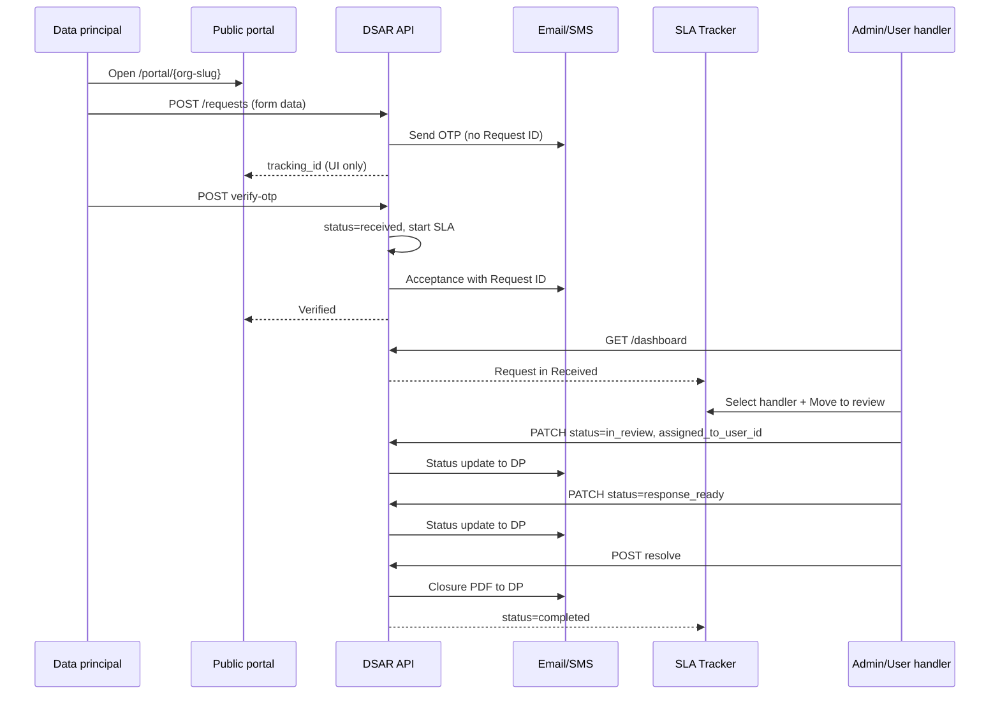

# Data Rights Portal & DSAR SLA Tracker

Org-scoped **public data-principal portal** and **internal SLA tracker** for DPDPA Sections 11–14 (access, correction, erasure, nomination, grievance, consent withdrawal). Requests are created without login, verified by OTP (email or SMS), then processed through a kanban workflow with SLA clocks, handler assignment, and closure notifications.

## Legal mapping

| DPDPA | Feature | Enforcement |
|-------|---------|-------------|
| §11 Right to access | Portal right type `access` | Customizable request form + SLA |
| §12 Correction & erasure | `correction`, `erasure` | Per-right SLA from org settings |
| §13 Grievance | `grievance` | Acknowledgement deadline + resolve SLA |
| §6 Identity / contact | OTP verification | Request not “received” until verified |
| Proof / closure | Closure letter + PDF | Emailed on resolve; admin can download |

## Architecture overview

```
┌─────────────────────┐     ┌──────────────────────┐     ┌─────────────────────┐
│  Public portal UI   │     │   FastAPI /dsar/*    │     │  PostgreSQL         │
│  /portal/{slug}     │────▶│   DsarService        │────▶│  data_rights_requests│
│  (no auth)          │     │   dsar_portal_forms  │     │  organization_settings│
└─────────────────────┘     │   dsar_email / sms   │     └─────────────────────┘
                            └──────────┬───────────┘
                                       │
┌─────────────────────┐                │
│  DSAR SLA Tracker   │────────────────┘
│  (JWT: admin/user/  │
│   superadmin)       │
└─────────────────────┘
```

### Key backend modules

| Path | Role |
|------|------|
| `app/routers/dsar.py` | HTTP routes |
| `app/services/dsar_service.py` | Portal, OTP, dashboard, SLA engine, resolve |
| `app/services/dsar_portal_forms.py` | Per-org customizable forms (JSON in `organization_settings.dsar_portal_forms`) |
| `app/services/dsar_email.py` | OTP, acceptance, status, closure emails |
| `app/services/dsar_sms.py` | OTP / notification SMS (log-only until provider wired) |
| `app/utils/india_phone.py` | `+91` + exactly 10 digits normalization |
| `app/models/dsar.py` | `DataRightsRequest`, enums, reminder events |

### Key frontend modules

| Path | Role |
|------|------|
| `frontend/src/app/components/pages/DataRightsPortalPublic.tsx` | Public + in-app portal |
| `frontend/src/app/components/pages/DSARSLATracker.tsx` | Kanban SLA dashboard |
| `frontend/src/lib/api/dsar.ts` | API client |
| `frontend/src/lib/dsar/portalSlug.ts` | Public URL `/portal/{org-slug}` |
| `frontend/src/hooks/useDsarSlaManagement.ts` | Tracker state & RBAC helpers |

---

## Public portal

### URL & org isolation

- **Public URL:** `{origin}/portal/{organization-slug}` (e.g. `/portal/demo-org`)
- Every API call is scoped by `org_slug` in the path; the backend resolves `Organization` and sets `organization_id` on the request.
- Status check, OTP verify, and resend all require matching `organization_id` + `tracking_id`.
- **Admin / superadmin** (in-app preview only) see a copyable public URL banner; regular **users** do not.

### Right types

| Portal ID | API `right_type` |
|-----------|------------------|
| access | `access` |
| correct | `correction` |
| erase | `erasure` |
| nominate | `nomination` |
| grievance | `grievance` |
| withdraw | `withdraw_consent` |

### Customizable forms

- Stored per org in `organization_settings.dsar_portal_forms` (JSON).
- **Admin** and **user** (not superadmin) can customize forms in-app via `PortalFormBuilder`.
- Core fields: `requester_name`, `requester_email`, `requester_phone`, `request_details`.
- At least one of email or phone must remain on the form for verification.
- Phone fields: Indian format `+91XXXXXXXXXX` (10 digits after `+91`).

### Verification channels

| Form has | Behaviour |
|----------|-----------|
| Email only | Email OTP (`verification_method: email`) |
| Phone only | SMS OTP (`verification_method: sms`) |
| Both | Data principal chooses email or SMS at submit |

---

## Data flow: request lifecycle

### 1. Submit (unauthenticated)

```
Data principal → POST /dsar/portal/{org_slug}/requests
              → status: pending_verification
              → due_at: null (SLA not started)
              → OTP issued (email or SMS)
```

- OTP message contains **only the code** (no Request ID).
- Response includes `tracking_id` for the portal UI / status check (not in OTP body).

### 2. Verify OTP

```
POST /dsar/portal/{org_slug}/requests/{tracking_id}/verify-otp
→ verification_status: verified
→ status: received
→ SLA clock started (received_at, due_at, grievance ack_due_at if applicable)
→ Acceptance email/SMS sent WITH Request ID
```

**Pending verification requests do not appear** on the DSAR SLA Tracker kanban.

### 3. Internal workflow (authenticated)

Kanban columns (verified requests only):

```
received → in_review → response_ready → completed
```

| Stage transition | Data principal notification |
|------------------|----------------------------|
| OTP verified → `received` | Acceptance (includes Request ID) |
| → `in_review` | “Your request is now being reviewed…” |
| → `response_ready` | “A response to your request is ready…” |
| → `completed` (resolve) | Closure email with PDF attachment (+ SMS notice if SMS channel) |

### 4. Handler assignment

- **Dropdown** selects a handler locally; **assignment is saved only when an action button is clicked** (Move to review, Mark response ready, Resolve & close, Acknowledge grievance).
- Admins must select a handler before advancing; buttons are disabled until a handler is chosen.
- **Org admin:** sees unassigned requests + requests assigned to **self**; delegating to another user removes the request from their queue.
- **Superadmin:** sees **all** requests for the selected org.
- **User (handler):** sees only requests `assigned_to_user_id == self`.

### 5. Resolve / close

```
POST /dsar/requests/{id}/resolve
→ status: completed
→ closure_text generated
→ PDF closure letter emailed to data principal
→ No auto-download in UI; completed cards offer manual PDF download
```

### 6. Status check (public)

```
POST /dsar/portal/{org_slug}/requests/{tracking_id}/status-check
Body: email OR phone (+91 format for phone)
→ If unverified: prompts for OTP (may resend)
→ If verified: status, SLA days remaining, closure_available when completed
```

---

## Request status model

| Status | Visible on SLA tracker | SLA active |
|--------|------------------------|------------|
| `pending_verification` | No | No |
| `received` | Yes (after verify) | Yes |
| `in_review` | Yes | Yes |
| `response_ready` | Yes | Yes |
| `completed` | Yes | No |
| `rejected` | Rare / no dedicated column | No |

---

## API endpoints

Base prefix: `/api/dsar`

### Public (no JWT)

| Method | Path | Description |
|--------|------|-------------|
| GET | `/portal/{org_slug}/branding` | Org name, DPO contact |
| GET | `/portal/{org_slug}/forms/{right_type}` | Dynamic form schema |
| POST | `/portal/{org_slug}/requests` | Create request |
| POST | `/portal/{org_slug}/requests/{tracking_id}/verify-otp` | Verify OTP |
| POST | `/portal/{org_slug}/requests/{tracking_id}/resend-otp` | Resend OTP |
| POST | `/portal/{org_slug}/requests/{tracking_id}/status-check` | Status / trigger OTP |

### Authenticated

| Method | Path | Who | Description |
|--------|------|-----|-------------|
| GET | `/portal-forms` | Member | List editable form schemas |
| PUT | `/portal-forms/{right_type}` | Admin, user | Update form schema |
| GET | `/dashboard` | Admin, user, superadmin | Kanban + metrics |
| PATCH | `/requests/{request_id}` | Admin, user, superadmin | Status, assign, grievance ack |
| POST | `/requests/{request_id}/resolve` | Admin, user, superadmin | Close request |
| POST | `/admin/sla/run-once` | Admin, superadmin | Run SLA reminder/breach job |

Superadmin: append `?org_id=<uuid>` to authenticated routes.

---

## Dashboard visibility (RBAC)

| Role | Requests shown |
|------|----------------|
| **Superadmin** | All verified requests in org |
| **Org admin** | Unassigned + assigned to self |
| **User** | Assigned to self only |

| Role | Can assign handlers | Can advance stages |
|------|---------------------|-------------------|
| Superadmin | Yes | Yes (any request) |
| Org admin | Yes (unassigned queue) | Yes (own + unassigned) |
| User | No | Yes (assigned in_review / response_ready) |

---

## SLA engine

- Config loaded per org via `dsar_sla_config` (from `organization_settings`).
- **SLA clock starts** only at OTP verification (`received_at`).
- `POST /dsar/admin/sla/run-once` processes reminders and marks breaches (`breached_at`, `ack_breached_at`).
- Reminder emails to DPO/admin; separate from data-principal stage notifications.

---

## Notifications summary

| Event | Email | SMS |
|-------|-------|-----|
| OTP | Code only (no Request ID) | Code only (dev: logged) |
| Request accepted (after verify) | Request ID + right type | Request ID message |
| Stage: in_review / response_ready | Status update | Status update |
| Completed | Closure PDF attached | Short closure notice |
| SLA reminder (internal) | To configured admin/DPO | — |

SMTP required for real email delivery. SMS uses `dsar_sms.py` stub until a provider (e.g. MSG91, Twilio) is configured.

---

## Database

### Primary table: `data_rights_requests`

Key columns: `organization_id`, `tracking_id`, `right_type`, requester contact fields, `verification_method`, `verification_status`, OTP fields, `status`, SLA timestamps, `assigned_to_user_id`, `closure_text`, `resolved_at`.

### Phone constraints

- `requester_phone`: CHECK `^\+91[0-9]{10}$` (nullable)
- `organization_settings.dpo_phone`: same format when set

### Portal forms

- `organization_settings.dsar_portal_forms` — JSON map keyed by `right_type`

---

## Sequence diagram (happy path)



---

## Tests

```bash
# From backend/
python -m app.scripts.test_dsar_api
```

Requires running API on `:8000` and a seeded org/admin.

---

## Related frontend routes

| Route | Component |
|-------|-----------|
| `/portal/{slug}` | `DataRightsPortalPublic` (public, no shell) |
| In-app: Data Principal Rights → Rights Portal | `DataRightsPortalPublic` (preview + form editor) |
| In-app: DSAR SLA Tracker | `DSARSLATracker` |
