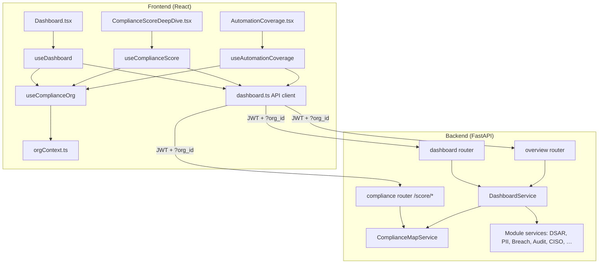
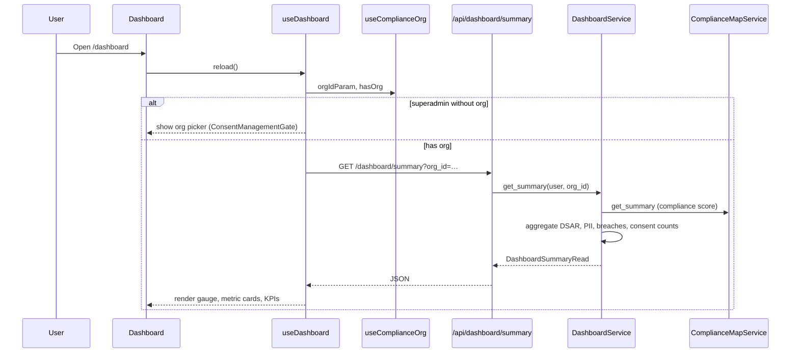
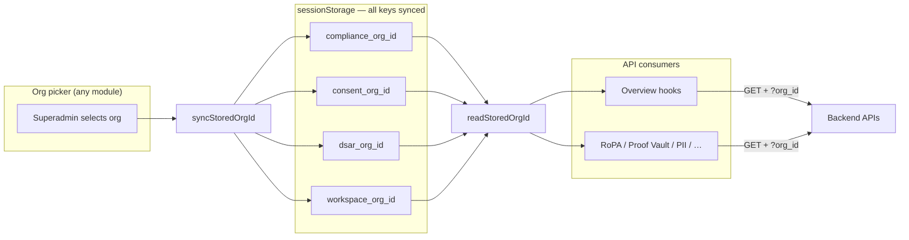

# Overview Module — Implementation Report

**Date:** 8 June 2026  
**Scope:** Dashboard, Compliance Score Deep Dive, Automation Coverage (Overview section)  
**Status:** Implemented end-to-end with real APIs, multi-tenant org context, and cross-module org sync fixes

---

## 1. Executive summary

The Overview module plan called for replacing mock dashboard data with live backend aggregation, wiring three primary surfaces (Dashboard, Compliance Score, Automation Coverage), supporting multi-tenancy for superadmin users, and making controls navigable to their owning modules.

This work is **complete for v1**. All three pages load from authenticated REST APIs. The logged-in user's display name appears on the Dashboard. Superadmins select a tenant organization once; that context propagates to Overview APIs and—after org-sync hardening—to dependent modules (RoPA, Proof Vault, PII Scanner, Data Inventory, etc.).

---

## 2. Plan scope vs. delivery

| Plan item | Delivered | Notes |
|-----------|-----------|-------|
| Dashboard with real KPIs | Yes | 7 API endpoints + 9 widgets |
| Compliance Score deep dive | Yes | Score, breakdown, trend, recalculate, PDF export |
| Automation Coverage | Yes | Donut stats + per-section status from statute mappings |
| Multi-tenancy (`org_id`) | Yes | `useComplianceOrg()` + shared `orgContext` |
| No mock data on Overview pages | Yes | All hooks call `/api/dashboard/*`, `/api/compliance/score/*`, `/api/overview/*` |
| Clickable navigation | Yes | Metric cards, module health, deadlines link to module routes |
| Logged-in user greeting | Yes | `displayName(user)` on Dashboard |
| Test script + docs | Yes | `test_dashboard_api.py`, `OVERVIEW_MODULE_IMPLEMENTATION.md` |
| GDPR readiness metric | Deferred | Shows `—` in v1 |
| Historical score snapshots | Deferred | Trend approximated from audit activity |
| Signed auditor share links | Deferred | Not in v1 |

---

## 3. Architecture overview



### Request flow (single widget example)



---

## 4. Backend implementation

### 4.1 Routers registered in `app/main.py`

| Router | Prefix | File |
|--------|--------|------|
| Dashboard | `/api/dashboard` | `app/routers/dashboard.py` |
| Overview | `/api/overview` | `app/routers/overview.py` |
| Compliance score | `/api/compliance/score` | `app/routers/compliance.py` (extended) |

All endpoints require authentication (`get_current_user`). Superadmins must pass `?org_id=<uuid>`; admins and other roles resolve organization from the JWT via `ComplianceBaseService._resolve_org_id`.

### 4.2 Dashboard APIs (`GET /api/dashboard/*`)

| Endpoint | Service method | Primary data sources |
|----------|----------------|----------------------|
| `/summary` | `get_summary` | Compliance map, DSAR dashboard, PII summary, breach incidents, consent receipts, RoPA recipients |
| `/module-health` | `get_module_health` | Compliance map, security safeguards, DSAR metrics, PII findings |
| `/activity-feed` | `get_activity_feed` | Audit log, DSAR events, integration events (merged, time-sorted) |
| `/deadlines` | `get_deadlines` | DSAR SLA due dates, breach notification windows |
| `/processing-trend` | `get_processing_trend` | Consent receipts + DSAR volume by month |
| `/risk-heatmap` | `get_risk_heatmap` | CISO control domains × severity |
| `/onboarding-status` | `get_onboarding_status` | Workspace profile, purposes, notices, safeguards gaps |

**Aggregation layer:** `app/services/dashboard_service.py` — composes existing module services rather than duplicating business logic. Route paths for deep links are centralized in `PAGE_ROUTE_PATHS`.

### 4.3 Compliance score APIs

| Endpoint | Method | Service | Purpose |
|----------|--------|---------|---------|
| `/compliance/score` | GET | `ComplianceMapService.get_compliance_score` | Overall score, status label, penalty exposure, days since incident |
| `/compliance/score/breakdown` | GET | `get_score_breakdown` | Per-statute-section rows with controls and gaps |
| `/compliance/score/trend` | GET | `get_score_trend` | v1 approximated trend from audit activity |
| `/compliance/score/recalculate` | POST | `recalculate_score` | Admin: refresh review timestamp and recompute |

Scoring reuses the compliance map formula (documented controls + RoPA deductions). RoPA-related deductions are wrapped in try/except with `db.rollback()` so missing RoPA tables do not break the entire score endpoint.

### 4.4 Automation coverage API

| Endpoint | Service method | Logic |
|----------|----------------|-------|
| `GET /overview/automation-coverage` | `get_automation_coverage` | Reads `DpdpaStatuteSection` + `DpdpaFeatureMapping`; classifies each section as `fully`, `partial`, `manual`, or `na` based on evidence counts |

Returns donut totals and per-chapter section rows for the Coverage Map tab.

### 4.5 Schemas

Pydantic models in `app/schemas/dashboard.py`:

- `DashboardSummaryRead`, `DashboardMetricCard`, `DashboardSidebarKpi`
- `ModuleHealthItem`, `ActivityFeedItem`, `DeadlineItem`
- `ProcessingTrendPoint`, `RiskHeatmapCell`, `OnboardingStatusRead`
- `ComplianceScoreRead`, `ComplianceScoreBreakdownRead`, `ComplianceScoreTrendRead`
- `AutomationCoverageRead`, `AutomationCoverageSectionRow`, `AutomationCoverageChapterSummary`

---

## 5. Frontend implementation

### 5.1 Routes

| Page | Route | Component |
|------|-------|-----------|
| Dashboard | `/dashboard` | `Dashboard.tsx` |
| Compliance Score | `/compliance/score` | `ComplianceScoreDeepDive.tsx` |
| Automation Coverage | `/overview/automation` | `AutomationCoverage.tsx` |

Registered in `frontend/src/router/index.tsx` and `pathMap.ts`.

### 5.2 API client and types

| File | Role |
|------|------|
| `frontend/src/lib/api/dashboard.ts` | All Overview API calls with `withOrgQuery()` |
| `frontend/src/types/dashboard.ts` | TypeScript interfaces mirroring backend schemas |

### 5.3 Hooks

| Hook | APIs consumed | Resilience |
|------|---------------|------------|
| `useDashboard` | 7 dashboard endpoints + recalculate | `Promise.allSettled` — summary required; other widgets degrade gracefully |
| `useComplianceScore` | score, breakdown, trend + recalculate | `Promise.allSettled` — score required; breakdown/trend optional |
| `useAutomationCoverage` | automation-coverage | Standard error handling |
| `useComplianceOrg` | `listOrganizations` (superadmin) | Org picker state + `orgIdParam` |

All hooks gate loading on `hasOrg` and pass `orgIdParam` for superadmin.

### 5.4 Dashboard widgets (wired to live data)

| Widget | Component | Data source |
|--------|-----------|-------------|
| Hero gauge + status | `ComplianceGauge`, penalty chips | `summary.compliance_score`, penalties |
| Metric cards (4) | `MetricCard` | Consent records, PII findings, open DSARs, active breaches |
| Module health grid | `ModuleHealth` | `/dashboard/module-health` |
| Compliance trend chart | `ComplianceTrend` | Score from summary (trend tab uses score APIs on deep dive) |
| Upcoming deadlines | `UpcomingDeadlines` | `/dashboard/deadlines` |
| Recent activity | `RecentActivity` | `/dashboard/activity-feed` |
| Risk heatmap | `RiskHeatmap` | `/dashboard/risk-heatmap` |
| Data processing chart | `DataProcessingChart` | `/dashboard/processing-trend` |
| Onboarding alerts | `AlertBanner` | `/dashboard/onboarding-status` |
| Copilot panel | `CopilotPanel` | Static assistant shell (no mock metrics) |

**User experience:** Greeting uses `displayName(user)`. Recalculate and Export PDF actions call real endpoints / client-side PDF generators (`scorePdf.ts`, `automationCoveragePdf.ts`). Cards and module rows navigate via `react-router` to `route_path` values from the API.

### 5.5 Compliance Score deep dive

- **Overview tab:** Live score, penalties, days since incident, recalculate button
- **Breakdown tab:** Section rows from `/compliance/score/breakdown` with configure links
- **Trend tab:** Points from `/compliance/score/trend` (v1 approximation)
- **Rationale tab:** Educational copy (static reference content per plan)
- **Export:** `downloadComplianceScorePdf()` generates a client-side PDF from API data

### 5.6 Automation Coverage

- **Summary tab:** Donut chart from API totals (`fully`, `partial`, `manual`, `na`)
- **Coverage Map tab:** `CoverageMapTab.tsx` — per-section automation status from API
- **Export:** `downloadAutomationCoveragePdf()`
- Footer links navigate to related module routes

### 5.7 Superadmin org gate

`ConsentManagementGate` wraps Dashboard, Compliance Score, Automation Coverage, and RoPA. When `isSuperadmin && !hasOrg`, users see an organization picker. When org is selected, a banner allows switching tenant without leaving the page.

---

## 6. Multi-tenancy and org context (cross-cutting)

### 6.1 Backend pattern

`ComplianceBaseService._resolve_org_id(user, org_id)`:

- **Admin / org user:** Organization from JWT (`user.organization_id`)
- **Superadmin:** Must supply `?org_id=` or receives 403 — *"Compliance operations require an organization context"*

The same pattern applies across DSAR, PII, data inventory, workspace, consent, and RoPA services.

### 6.2 Frontend org sync (post-Overview hardening)

**Problem found during QA:** Overview stored the selected tenant in `compliance_org_id`, while many legacy pages read only `consent_org_id`. Superadmin users saw "Failed to load" on RoPA, Proof Vault, PII Scanner, and Data Inventory even after picking an org on the Dashboard.

**Solution:** `frontend/src/lib/compliance/orgContext.ts`

```text
Storage keys (kept in sync):
  compliance_org_id  ← primary (Overview / useComplianceOrg)
  consent_org_id
  dsar_org_id
  workspace_org_id
```

| Function | Purpose |
|----------|---------|
| `readStoredOrgId()` | First non-empty key across all module keys |
| `syncStoredOrgId(id)` | Write or clear all keys together |
| `getOrgIdParamForRole(role)` | Returns org id only for `superadmin` |

**Updated hooks:** `useComplianceOrg`, `useConsentManagement` call `syncStoredOrgId` on org change.

**Updated pages** (representative): RoPA, Proof Vault, PII Scanner, Data Inventory, Data Sources, Data Masking, Retention, Children's Data, Banner Builder, DPIA, Vendor Risk, Tag Manager, Cookie Tracker.

**RoPA-specific:** Added `useComplianceOrg`, `ConsentManagementGate`, and `orgIdParam` on all list/fetch/mutate calls.



---

## 7. Operational prerequisites

During implementation and QA, load failures were also traced to:

1. **Database migrations behind head** — missing tables (`processing_activities`, `ciso_controls`, etc.) caused 500 errors. Resolved with `alembic upgrade head`.
2. **Stale backend process** — uvicorn must be restarted after router/service changes so new routes are served.

**Dev defaults:**

- Backend: `http://127.0.0.1:8000` (`uvicorn app.main:app --reload`)
- Frontend: `http://localhost:5173`

**API client:** `frontend/src/lib/api/client.ts` returns a clearer message when the API is unreachable (distinct from generic browser "Failed to fetch").

---

## 8. Testing

### Automated script

```bash
cd backend
python -m app.scripts.test_dashboard_api
```

**Requires:** Running API and `.env` values `TEST_ADMIN_EMAIL`, `SUPERADMIN_PASSWORD` (optional `TEST_API_BASE`).

**Covers:** Login, dashboard summary, module health, activity feed, deadlines, processing trend, risk heatmap, onboarding, compliance score (+ breakdown, trend, recalculate), automation coverage.

### Manual QA checklist

- [ ] Login as admin — Dashboard loads without org picker; metrics reflect org data
- [ ] Login as superadmin — pick org; all three Overview pages load
- [ ] Click each metric card and module health row — navigates to correct module
- [ ] Recalculate score — score and timestamp update
- [ ] Export PDF on Dashboard and Automation Coverage — file downloads
- [ ] After org pick on Dashboard, open RoPA / Proof Vault / PII — no org-context errors

---

## 9. Known limitations (v1)

| Area | Limitation |
|------|------------|
| GDPR readiness | Not computed; UI shows em dash |
| Score trend history | No `compliance_score_snapshots` table; trend derived from audit activity |
| Compliance trend tabs | Do not filter underlying data by time range |
| Rationale tab | Static educational content |
| Copilot panel | UI shell without live LLM integration |
| Metric card trends | Some trend strings are heuristic (e.g. consent "+12% this month" when count &gt; 0) |

---

## 10. File inventory

### Backend (new or materially extended)

```
app/routers/dashboard.py
app/routers/overview.py
app/services/dashboard_service.py
app/schemas/dashboard.py
app/routers/compliance.py          # score endpoints
app/services/compliance_map_service.py  # score/breakdown/trend/recalculate
app/scripts/test_dashboard_api.py
docs/OVERVIEW_MODULE_IMPLEMENTATION.md
docs/OVERVIEW_MODULE_IMPLEMENTATION_REPORT.md   # this file
```

### Frontend (new or materially extended)

```
src/types/dashboard.ts
src/lib/api/dashboard.ts
src/lib/compliance/orgContext.ts
src/hooks/useDashboard.ts
src/hooks/useComplianceScore.ts
src/hooks/useAutomationCoverage.ts
src/hooks/useComplianceOrg.ts     # syncStoredOrgId
src/hooks/useConsentManagement.ts # syncStoredOrgId
src/lib/dashboard/scorePdf.ts
src/lib/dashboard/automationCoveragePdf.ts
src/app/components/pages/Dashboard.tsx
src/app/components/pages/ComplianceScoreDeepDive.tsx
src/app/components/pages/AutomationCoverage.tsx
src/app/components/dashboard/*    # 9 widgets wired to props/API data
```

### Org-context fixes (dependent modules)

```
RoPAModule.tsx, ProofVault.tsx, PIIScannerDashboard.tsx, DataInventory.tsx,
DataSources.tsx, DataMasking.tsx, RetentionPolicyManager.tsx, ChildrensData.tsx,
BannerBuilderDashboard.tsx, CreateBannerWizard.tsx, DPIAModule.tsx,
VendorRiskIntelligence.tsx, TagManager.tsx, CookieTrackerManager.tsx,
DataRightsPortalPublic.tsx
```

---

## 11. Related documentation

- `backend/docs/OVERVIEW_MODULE_IMPLEMENTATION.md` — concise API and widget reference
- `backend/docs/COMPLIANCE_MODULE_SUMMARY.md` — compliance map and statute model
- `backend/docs/RUNBOOK.md` — environment and migration runbook

---

*End of report.*
