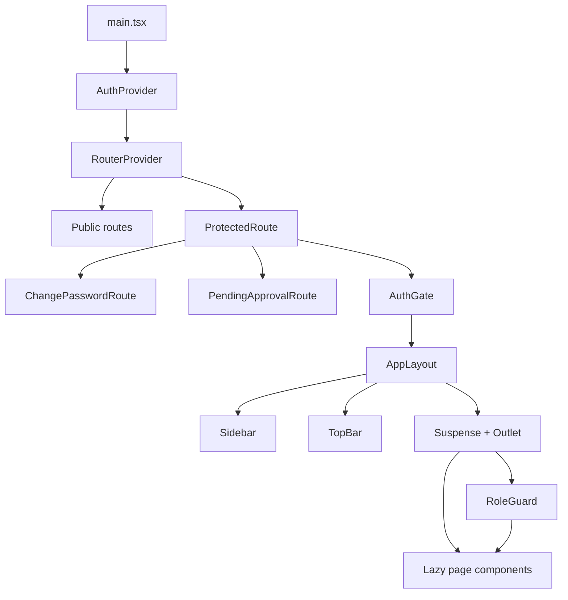

# Route-Based Navigation — Plan & Implementation Report

> **Scope:** Frontend migration from state-based page switching to URL-based navigation  
> **Package:** `react-router` v7.13.0 (data router API — not `react-router-dom`)  
> **Status:** Implemented (June 2026)

---

## Executive summary

Vajra previously rendered pages by storing a `Page` string in React state inside `App.tsx` and switching on ~80 cases. Sidebar and TopBar were coupled to that enum.

The application now uses **URL-based navigation** via React Router v7’s data router (`createBrowserRouter`, `RouterProvider`, `Outlet`, `Navigate`). Every major screen has a bookmarkable path. Authentication, role checks, and special auth states (forced password change, pending approval) are enforced at the route layer instead of inline conditionals in `App.tsx`.

**Entry point:** `frontend/src/main.tsx` → `AuthProvider` → `RouterProvider router={router}`

**Legacy shell removed:** `frontend/src/app/App.tsx` no longer contains the page switch; it is a deprecated stub.

---

## Before vs after


| Aspect                | Before                                                | After                                                    |
| --------------------- | ----------------------------------------------------- | -------------------------------------------------------- |
| Navigation trigger    | `setCurrentPage('dashboard')`                         | `navigate('/dashboard')` or sidebar click                |
| Deep links            | Not supported (URL ignored)                           | Full support — refresh and share URLs                    |
| Browser back/forward  | Broken / inconsistent                                 | Works via browser history                                |
| Auth gating           | Inline in `App.tsx`                                   | `ProtectedRoute`, `AuthGate`, dedicated auth routes      |
| Public DSAR portal    | `isPublicPortalPath()` check before auth in `App.tsx` | Public route `/portal/:orgSlug` outside `ProtectedRoute` |
| Sidebar active item   | Local `useState('Dashboard')`                         | Derived from `location.pathname` via `pathMap`           |
| Breadcrumbs           | `BREADCRUMB_MAP[Page]`                                | `getBreadcrumbs(pathname)` from `pathMap`                |
| Selected IDs in state | e.g. `selectedIncidentId`, `selectedPropertyId`       | URL params (`:incidentId`, `:propertyId`, etc.)          |


---

## Architecture

### High-level flow




### Layer responsibilities

1. `**AuthProvider**` (`frontend/src/contexts/AuthContext.tsx`)
  Unchanged in role: login, logout, session restore, `mustChangePassword`, user object.
2. `**ProtectedRoute**`
  Fast token check via `getAccessToken()` from `frontend/src/lib/auth/storage.ts` (key: `dpdpa_access_token`). No token → redirect to `/login` with `state.from`ener` preserving the intended path.
3. `**ChangePasswordRoute` / `PendingApprovalRoute`**
  Rendered **outside** `AppLayout` (no sidebar). Only accessible when the corresponding auth state is active; otherwise redirect to `/dashboard`.
4. `**AuthGate`**
  Wraps all authenticated app pages inside the shell. Redirects:
  - `mustChangePassword` → `/change-password`
  - `user.status === 'pending_approval'` → `/pending-approval`
5. `**AppLayout**`
  Composes existing `Sidebar` + `TopBar` + `<Suspense><Outlet /></Suspense>`. Wraps content in `NavigationGuardProvider` for dirty-form protection on consent notice editor.
6. `**RoleGuard**`
  Checks `useAuth().user.role`, with JWT decode fallback (`frontend/src/lib/auth/jwt.ts`) before `fetchMe` completes. Denied → toast + redirect to `/dashboard`.
7. **Route wrappers**
  Thin components bridging URL params and `useNavigate` to existing prop-driven page components (notices, breach, integrations, banner, copilot).

---

## Files created

### Router core (`frontend/src/router/`)


| File                         | Purpose                                                                                    |
| ---------------------------- | ------------------------------------------------------------------------------------------ |
| `index.tsx`                  | Single `createBrowserRouter` tree; all lazy page imports                                   |
| `ProtectedRoute.tsx`         | Token gate; login redirect with `state.from`                                               |
| `RoleGuard.tsx`              | Role allow-list with notify toast                                                          |
| `AuthGate.tsx`               | Must-change-password and pending-approval redirects                                        |
| `AuthRoutes.tsx`             | `LoginRoute`, `SignupRoute`, `ChangePasswordRoute`, `PendingApprovalRoute`, `RootRedirect` |
| `pathMap.ts`                 | Sidebar label ↔ path, breadcrumbs, `Page` → path legacy map                                |
| `NavigationGuardContext.tsx` | Async navigation guard for unsaved consent notice drafts                                   |


### Route wrappers (`frontend/src/router/wrappers/`)


| Wrapper                           | Bridges                                     |
| --------------------------------- | ------------------------------------------- |
| `ConsentNoticesManagerRoute.tsx`  | Create/edit notice → URL navigation         |
| `NewConsentNoticeRoute.tsx`       | URL params + navigation guard registration  |
| `BreachIncidentsListRoute.tsx`    | List → `/breach/:incidentId`                |
| `IncidentDetailRoute.tsx`         | Detail back + wizard → `/breach/:id/wizard` |
| `BannerBuilderDashboardRoute.tsx` | Banner → property detail URL resolution     |
| `ConsentCopilotRoute.tsx`         | Copilot deep-links → `pageToPath()`         |
| `IntegrationsOverviewRoute.tsx`   | Integration hub cards → integration paths   |
| `PropertyManagementRoute.tsx`     | Property list → `/:propertyId`              |
| `PropertyDetailRoute.tsx`         | Property detail back + cross-links          |


### Layout & shared


| File                                     | Purpose                                      |
| ---------------------------------------- | -------------------------------------------- |
| `frontend/src/layouts/AppLayout.tsx`     | Sidebar + TopBar + Suspense outlet           |
| `frontend/src/components/PageLoader.tsx` | Full-page spinner for lazy route fallback    |
| `frontend/src/lib/auth/jwt.ts`           | Client-side JWT payload decode for role hint |


### Auth placeholders


| File                                                      | Purpose                            |
| --------------------------------------------------------- | ---------------------------------- |
| `frontend/src/app/components/auth/ForgotPasswordPage.tsx` | Placeholder until reset API exists |
| `frontend/src/app/components/auth/ResetPasswordPage.tsx`  | Placeholder until reset API exists |


---

## Files modified


| File                                                   | Change                                                                                |
| ------------------------------------------------------ | ------------------------------------------------------------------------------------- |
| `frontend/src/main.tsx`                                | `RouterProvider` replaces direct `<App />` render                                     |
| `frontend/src/app/App.tsx`                             | Deprecated stub; routing lives in `router/index.tsx`                                  |
| `frontend/src/app/components/shell/Sidebar.tsx`        | `useLocation` + `getPathForLabel` + `guardedNavigate`; removed `Page` enum navigation |
| `frontend/src/app/components/shell/TopBar.tsx`         | Breadcrumbs from `getBreadcrumbs(pathname)`; removed `currentPage` prop               |
| `frontend/src/app/components/auth/LoginPage.tsx`       | Added “Forgot password?” link to `/forgot-password`                                   |
| `frontend/src/app/components/pages/IncidentDetail.tsx` | Added optional `onOpenWizard` → disclosure wizard route                               |


---

## Complete route map

### Public routes (no token required)


| Path               | Component                | Notes                                 |
| ------------------ | ------------------------ | ------------------------------------- |
| `/`                | `RootRedirect`           | Token → `/dashboard`, else → `/login` |
| `/portal/:orgSlug` | `DataRightsPortalPublic` | Public DSAR portal; real API-backed   |
| `/login`           | `LoginRoute`             | Redirects if already authenticated    |
| `/signup`          | `SignupRoute`            | Redirects if already authenticated    |
| `/forgot-password` | `ForgotPasswordPage`     | Placeholder UI                        |
| `/reset-password`  | `ResetPasswordPage`      | Placeholder UI                        |
| `*`                | `RootRedirect`           | Catch-all fallback                    |


### Protected routes without shell (token required, no sidebar)


| Path                | Component              | Condition                                      |
| ------------------- | ---------------------- | ---------------------------------------------- |
| `/change-password`  | `ChangePasswordRoute`  | Only when `mustChangePassword`                 |
| `/pending-approval` | `PendingApprovalRoute` | Only when `user.status === 'pending_approval'` |


### Protected routes with shell (`AppLayout`)

#### Overview


| Path                   | Component                 |
| ---------------------- | ------------------------- |
| `/dashboard`           | `Dashboard`               |
| `/compliance/score`    | `ComplianceScoreDeepDive` |
| `/overview/automation` | `AutomationCoverage`      |


#### Consent management


| Path                                         | Component                        |
| -------------------------------------------- | -------------------------------- |
| `/consent/banner`                            | `BannerBuilderDashboardRoute`    |
| `/consent/notices`                           | `ConsentNoticesManagerRoute`     |
| `/consent/notices/new`                       | `NewConsentNoticeRoute` (create) |
| `/consent/notices/:noticeId/edit/:versionId` | `NewConsentNoticeRoute` (edit)   |
| `/consent/purposes`                          | `PurposeRegistryNew`             |
| `/consent/languages`                         | `MultiLanguageEditor`            |
| `/consent/withdrawal`                        | `ConsentWithdrawalFlow`          |
| `/consent/channels`                          | `NoticeDeliveryChannels`         |
| `/consent/integration`                       | `ConsentManagerIntegration`      |
| `/consent/proof-vault`                       | `ProofVault`                     |
| `/scanner/cookies/manager`                   | `CookieTrackerManager`           |
| `/scanner/cookies`                           | `CookieScanner`                  |


#### Integrations


| Path                                | Component                                  |
| ----------------------------------- | ------------------------------------------ |
| `/integrations`                     | `IntegrationsOverviewRoute`                |
| `/integrations/website`             | `PropertyManagementRoute` (website filter) |
| `/integrations/website/:propertyId` | `PropertyDetailRoute` (website)            |
| `/integrations/mobile`              | `PropertyManagementRoute` (mobile filter)  |
| `/integrations/mobile/:propertyId`  | `PropertyDetailRoute` (mobile)             |
| `/integrations/api`                 | `ApiWebhooks`                              |
| `/integrations/tag-manager`         | `TagManager`                               |
| `/integrations/consent-managers`    | `DPDPAConsentManagers`                     |


#### Data protection


| Path                     | Component                |
| ------------------------ | ------------------------ |
| `/data/inventory`        | `DataInventory`          |
| `/scanner/pii`           | `PIIScannerDashboard`    |
| `/data/masking`          | `DataMasking`            |
| `/scanner/anonymisation` | `DataAnonymisation`      |
| `/data/sources`          | `DataSources`            |
| `/data/retention`        | `RetentionPolicyManager` |
| `/data/children`         | `ChildrensData`          |


#### Data principal rights (DSAR)


| Path              | Component                | Access                                    |
| ----------------- | ------------------------ | ----------------------------------------- |
| `/rights/portal`  | `DataRightsPortalPublic` | Admin preview mode (no `:orgSlug` in URL) |
| `/rights/tracker` | `DSARSLATracker`         | All authenticated roles                   |
| `/rights/logs`    | `DsarActivityLog`        | **Admin + superadmin only** (`RoleGuard`) |


#### Compliance & governance


| Path                         | Component                    |
| ---------------------------- | ---------------------------- |
| `/compliance/map`            | `DPDPAComplianceMap`         |
| `/security/safeguards`       | `SecuritySafeguardsHub`      |
| `/breach`                    | `BreachIncidentsListRoute`   |
| `/breach/:incidentId`        | `IncidentDetailRoute`        |
| `/breach/:incidentId/wizard` | `BreachDisclosureWizard`     |
| `/audit/log`                 | `AuditLog`                   |
| `/compliance/dashboards`     | `ComplianceDashboardBuilder` |
| `/data/dpia`                 | `DPIAModule`                 |
| `/data/ropa`                 | `RoPAModule`                 |
| `/security/ciso`             | `CISOCommandCenter`          |
| `/data/policies`             | `PolicyManager`              |
| `/data/vendors`              | `VendorRiskIntelligence`     |
| `/security/monitoring`       | `MonitoringScheduling`       |


#### Settings


| Path                     | Component            |
| ------------------------ | -------------------- |
| `/settings/workspace`    | `WorkspaceInfo`      |
| `/settings/deployment`   | `DeploymentSettings` |
| `/settings/industry`     | `IndustryConfig`     |
| `/settings/role-mapping` | `DPDPRoleMapping`    |


#### Vajra AI


| Path          | Component             | UI note       |
| ------------- | --------------------- | ------------- |
| `/ai/copilot` | `ConsentCopilotRoute` | TopBar hidden |


#### Superadmin / administration


| Path                    | Component                | Allowed roles         |
| ----------------------- | ------------------------ | --------------------- |
| `/superadmin/tenants`   | `OrganizationManagement` | `superadmin`          |
| `/superadmin/users`     | `TeamManagement`         | `admin`, `superadmin` |
| `/superadmin/approvals` | `PendingApprovals`       | `superadmin`          |


---

## Authentication flows (detailed)

### 1. Unauthenticated user visits protected URL

```
User → /consent/notices
  → ProtectedRoute: no token
  → Navigate /login (state.from = "/consent/notices")
  → LoginRoute renders LoginPage
  → User logs in successfully
  → LoginRoute effect: navigate(state.from ?? "/dashboard")
  → User lands on /consent/notices
```

### 2. Login with forced password change

```
User → /login → credentials OK, mustChangePassword = true
  → AuthContext: user = null, mustChangePassword = true
  → LoginRoute: Navigate /change-password
  → ChangePasswordRoute renders ChangePasswordPage (no sidebar)
  → User sets new password
  → AuthContext: user loaded, mustChangePassword = false
  → ChangePasswordRoute: Navigate /dashboard
```

### 3. Self-signup pending approval

```
User → /signup → account created + logged in, status = pending_approval
  → AuthGate on any shell route: Navigate /pending-approval
  → PendingApprovalRoute renders PendingApprovalPage (no sidebar)
  → Superadmin approves (separate flow)
  → User refreshes or re-login → AuthGate allows /dashboard
```

### 4. Logout

```
User clicks Logout in Sidebar
  → AuthContext.logout() clears dpdpa_access_token
  → navigate("/login", { replace: true })
```

### 5. Public DSAR portal (no login)

```
External user → /portal/acme-corp
  → Public route (outside ProtectedRoute)
  → DataRightsPortalPublic reads :orgSlug from URL
  → Submit request, OTP verify, status check (existing DSAR API)
```

### 6. Role-gated page

```
Org user → /rights/logs (or /superadmin/tenants)
  → ProtectedRoute: token OK
  → AuthGate: OK
  → AppLayout renders
  → RoleGuard: role not in allowedRoles
  → notify("You don't have permission...")
  → Navigate /dashboard
```

---

## Navigation flows (detailed)

### Sidebar navigation

1. Sidebar reads `activeItem` from `getLabelForPath(location.pathname)` (longest prefix match).
2. On item click, `getPathForLabel(label)` resolves the URL.
3. `guardedNavigate(path)` runs (from `NavigationGuardContext`):
  - If a consent notice draft guard is registered and returns `false`, navigation is blocked (modals in `NewConsentNotice` handle save/discard).
  - Otherwise `navigate(path)`.

Nested integration items use labels like `Technical Integration - Website` mapped in `pathMap.ts` to `/integrations/website`.

### TopBar breadcrumbs

`TopBar` calls `getBreadcrumbs(location.pathname)`:

- Primary match: `ROUTE_ENTRIES` in `pathMap.ts` (longest path wins).
- Special patterns: `EXTRA_BREADCRUMBS` for notice editor, property detail, breach detail/wizard, cookie scanner sub-path.

TopBar is hidden on `/ai/copilot` via `shouldHideTopBar()`.

### Consent notice editor flow

```
/consent/notices
  → "Create" → /consent/notices/new
  → "Edit"   → /consent/notices/:noticeId/edit/:versionId

NewConsentNoticeRoute:
  - Reads noticeId, versionId from useParams()
  - onCancel / onPublished → /consent/notices
  - onOpenMultiLanguageEditor → /consent/languages
  - registerNavigationGuard → NavigationGuardContext (blocks sidebar nav when dirty)
```

### Breach incident flow

```
Sidebar "Breach Disclosure Wizard" → /breach (incident list)
  → View incident → /breach/:incidentId (detail)
  → "Open Disclosure Wizard" → /breach/:incidentId/wizard
```

### Integrations / property flow

```
/integrations → card clicks → /integrations/website | /integrations/mobile | etc.
/integrations/website → select property → /integrations/website/:propertyId
Property detail → back to list | banner builder | tag manager
```

### Banner builder → property link

`BannerBuilderDashboardRoute` resolves a banner ID to a property via integrations API, then navigates to `/integrations/website/:propertyId` (falls back to list on failure).

### Consent Copilot deep links

`ConsentCopilotRoute` maps legacy `Page` IDs from copilot context panel to URLs via `pageToPath()` (e.g. `notices` → `/consent/notices`, `pii-scanner` → `/scanner/pii`).

---

## Plan deviations (intentional)


| Plan item                           | Implementation                              | Reason                                                 |
| ----------------------------------- | ------------------------------------------- | ------------------------------------------------------ |
| Use `react-router-dom` v6           | Used `react-router` v7.13.0                 | Already installed; same data-router API                |
| Token key `access_token`            | `dpdpa_access_token` via `getAccessToken()` | Matches existing auth storage                          |
| `/superadmin/users` superadmin only | `admin` + `superadmin`                      | Preserves pre-migration `canManageUsers` behavior      |
| Pages in `src/pages/`               | Pages stay at `app/components/pages/`       | No mass file move                                      |
| `Page` union removed                | Still in `types/index.ts`                   | Marked optional follow-up; used by copilot/legacy maps |


---

## Post-implementation fixes

These were identified during review and applied after the initial migration:

1. `**/rights/portal**` — Switched from mock `DataRightsPortal` to `DataRightsPortalPublic` so the sidebar item “Rights Portal (Public)” shows the live API-backed admin preview (matches pre-migration behavior).
2. **Breach wizard link** — `IncidentDetail` gained `onOpenWizard`; route wrapper navigates to `/breach/:incidentId/wizard`.
3. **Forgot password link** — `LoginPage` links to `/forgot-password`.
4. **AuthGate cleanup** — Removed unreachable redirect logic for paths that never pass through `AuthGate` (`/change-password`, `/pending-approval` are siblings, handled by dedicated route wrappers).

---

## Lazy loading & performance

- All page components under `AppLayout` are `React.lazy()` imports in `router/index.tsx`.
- `AppLayout` wraps `<Outlet />` in `<Suspense fallback={<PageLoader />}>`.
- Public lazy routes (portal, forgot/reset password) use a `withSuspense()` helper at the route definition level.
- Auth route wrappers (`LoginRoute`, `ChangePasswordRoute`, etc.) are not lazy — small and needed immediately on auth transitions.

---

## Known limitations & follow-ups


| Item                                   | Status                                                                                       |
| -------------------------------------- | -------------------------------------------------------------------------------------------- |
| Forgot / reset password API            | Placeholder pages only; no backend endpoints wired                                           |
| `/consent/banner/new` standalone route | Not added; `CreateBannerWizard` remains embedded in banner dashboard                         |
| `Page` enum deprecation                | Optional; still used in `pathMap.PAGE_TO_PATH` and copilot                                   |
| Pre-migration demo pages               | `welcome-setup`, diagram pages, empty states not given routes (not in sidebar)               |
| Build typecheck                        | Unrelated failure: missing `react-markdown` / `remark-gfm` for Copilot `MarkdownMessage.tsx` |


---

## Testing checklist

Use this list to verify routing in a running dev server (`npm run dev` in `frontend/`):

- [ ] `/` redirects to login or dashboard based on token
- [ ] `/portal/:orgSlug` loads without login
- [ ] Login redirects to `state.from` after visiting a protected URL while logged out
- [ ] Forced password change flow lands on `/change-password` without sidebar
- [ ] Pending approval user cannot reach `/dashboard` until approved
- [ ] Sidebar active state matches current URL
- [ ] Browser back/forward works across sidebar navigation
- [ ] Deep link `/consent/notices/new` loads notice editor
- [ ] Dirty notice draft blocks sidebar navigation (guard modal)
- [ ] `/rights/logs` blocked for org `user` role
- [ ] `/superadmin/tenants` blocked for non-superadmin
- [ ] Breach: list → detail → wizard
- [ ] Logout returns to `/login`
- [ ] Copilot deep link navigates to correct module URL

---

## Related documentation

- [AUTH_DESIGN.md](./AUTH_DESIGN.md) — Backend auth and roles
- [DATA_RIGHTS_PORTAL_AND_DSAR_SLA.md](./DATA_RIGHTS_PORTAL_AND_DSAR_SLA.md) — DSAR portal and SLA tracker
- [CONSENT_NOTICES_AND_PURPOSE_REGISTRY_SUMMARY.md](./CONSENT_NOTICES_AND_PURPOSE_REGISTRY_SUMMARY.md) — Consent module pages

---

*Document generated to record the Route-Based Navigation plan and its implementation in the Vajra frontend.*