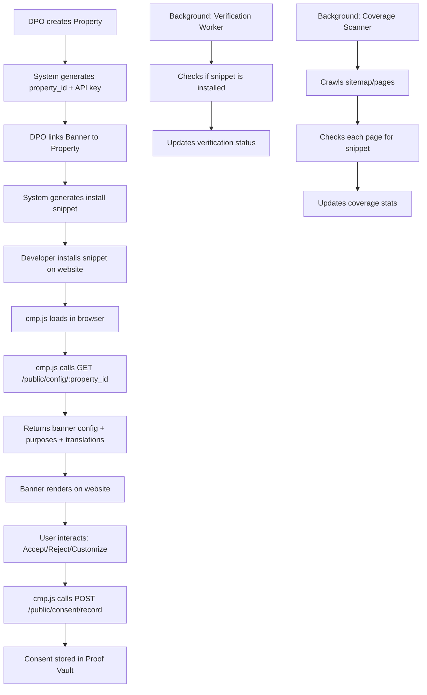
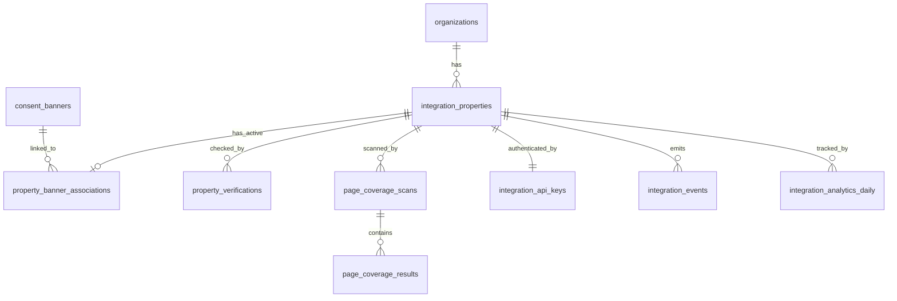

# 🛡️ Vajra — Integrations Module: Website Integration Blueprint

## User Review Required

> [!IMPORTANT]
> **CDN Strategy Decision**: The blueprint proposes serving `cmp.js` via a CDN (CloudFront/Cloudflare). This requires infrastructure investment. If you want to start simpler (FastAPI static file serving), the architecture supports that — but I recommend the CDN path for production. Please confirm.

> [!IMPORTANT]
> **Module Location**: Your request says `backend/modules/integrations/`. The existing codebase uses `backend/app/routers/`, `backend/app/models/`, `backend/app/services/` — a flat structure. I propose a **hybrid**: keep files in the existing `app/` directories but with a clear `integrations_` prefix convention, matching the patterns your co-developer has already established. A full `modules/` restructure would break every existing import. Please confirm your preference.

> [!WARNING]
> **Frontend Structure**: Similarly, the existing frontend uses `src/app/components/pages/` with flat files. Moving to `src/features/integrations/` would be a major refactor of the routing system in `App.tsx`. I propose adding the new files under the existing structure with clear naming, and deferring the `features/` restructure to a later sprint. Please confirm.

## Open Questions

> [!IMPORTANT]
> **Q1: Multi-tenant property isolation** — Should properties be scoped to `organization_id` (current tenant model) or do you envision sub-accounts / workspaces within a single organization? This affects table design.

> [!IMPORTANT]  
> **Q2: Banner Builder ownership** — The existing `BannerBuilderDashboard.tsx` and `CreateBannerWizard.tsx` live outside the Integrations module. The current UI in `TechnicalIntegration.tsx` references banners by ID (`BANNER-2026-A8B3`). Do banners already have a backend table? If not, do we build a `consent_banners` table now, or do we mock the banner association until that module is built?

> [!IMPORTANT]
> **Q3: cmp.js script** — Is there an existing consent management script, or does it need to be built from scratch? This is a separate deliverable (a client-side JavaScript SDK) and is a significant body of work on its own.

---

## 1. Architecture Overview

### Architecture Challenge: Why the Current UI Design Is Incomplete

The existing [TechnicalIntegration.tsx](file:///Users/shreyvashistha/Desktop/VAJRA-DPDPA/dpdpa_shield/frontend/src/app/components/pages/TechnicalIntegration.tsx) has a fundamental gap: **it has no concept of "Properties"**. It jumps straight to banner selection and snippet generation. But an enterprise compliance platform needs:

```
Organization (Acme Corp)
  └── Property (acme.com)          ← missing from current UI
        ├── Banner Association     ← banner linked to property, not standalone
        ├── Snippet (generated)    ← derived from property + banner
        ├── Verification Status    ← per-property verification
        └── Page Coverage          ← per-property crawl results
  └── Property (shop.acme.com)
        ├── Banner Association
        └── ...
```

**My recommendation**: Add a **Property Management** layer as the entry point. Properties are the foundational entity. Everything else (snippets, verification, coverage) hangs off a property. This matches how OneTrust, Usercentrics, and Cookiebot all work.

### High-Level Data Flow



### Domain Model



---

## 2. Module Ownership Boundaries

### ✅ What belongs INSIDE Integrations

| Entity | Reason |
|--------|--------|
| **Properties** (domains/subdomains) | Core integration entity |
| **Property ↔ Banner associations** | Which banner is active on which property |
| **Snippet generation** | Derived from property + banner config |
| **Installation verification** | Technical check: is the snippet deployed? |
| **Page coverage scanning** | Technical check: which pages have the snippet? |
| **Integration API keys** | Per-property authentication for cmp.js |
| **Configuration delivery endpoint** | Public API: cmp.js fetches config from here |
| **Integration analytics** | Snippet loads, banner renders, consent rates per property |
| **Integration events** | property.created, verification.completed, etc. |

### ❌ What stays OUTSIDE (consumed via interfaces)

| Entity | Owner Module | How Integrations Consumes It |
|--------|-------------|------------------------------|
| **Banner design/config** | Consent / Banner Builder | Read banner by ID → get config JSON |
| **Consent Notices** | Consent Management | Read active notice for a banner |
| **Consent Purposes** | Consent Management | Read purposes linked to a notice |
| **Consent Records (Proof Vault)** | Consent Management | Write consent record when cmp.js fires |
| **Translations** | Consent Management | Read translations for a notice |
| **Cookie/Tracker categories** | Consent Management | Read cookie categories for blocking rules |
| **Audit Log entries** | Audit module | Emit audit events (Integrations is a producer) |

### Service Contracts (Interfaces)

```python
# Integrations module consumes these — they are NOT owned by Integrations
class BannerConfigContract:
    """Read-only access to banner configuration."""
    def get_banner_config(self, banner_id: UUID, org_id: UUID) -> BannerConfig | None: ...
    def get_banner_purposes(self, banner_id: UUID) -> list[Purpose]: ...
    def get_banner_translations(self, banner_id: UUID, lang: str) -> dict: ...

class ConsentRecordContract:
    """Write access to record consent events."""
    def record_consent(self, payload: ConsentRecordPayload) -> UUID: ...
```

Until those modules exist, Integrations will use **mock implementations** that return hardcoded data. When Consent Management is built, we swap in the real implementation.

---

## 3. Folder Structure

### Backend (fits existing `app/` structure)

```
backend/app/
├── models/
│   ├── integration_property.py          # Property (domain) entity
│   ├── integration_api_key.py           # API keys per property
│   ├── property_banner_association.py   # Banner ↔ Property link
│   ├── property_verification.py         # Verification check results
│   ├── page_coverage_scan.py            # Coverage scan + results
│   └── integration_event.py            # Event log for integrations
│
├── schemas/
│   ├── integration_property.py          # Request/response schemas
│   ├── integration_snippet.py           # Snippet generation schemas
│   ├── integration_verification.py      # Verification schemas
│   ├── integration_coverage.py          # Coverage scan schemas
│   ├── integration_analytics.py         # Analytics schemas
│   └── integration_public.py           # Public (unauthenticated) schemas
│
├── routers/
│   ├── integrations.py                  # Main integration CRUD routes
│   └── integrations_public.py           # Public routes (cmp.js config fetch)
│
├── services/
│   ├── property_service.py              # Property CRUD + API key management
│   ├── snippet_service.py               # Snippet generation logic
│   ├── verification_service.py          # Verification engine
│   ├── coverage_service.py              # Page coverage scanner
│   ├── integration_analytics_service.py # Analytics aggregation
│   └── config_delivery_service.py       # Public config assembly
│
├── workers/                             # NEW directory for background jobs
│   ├── __init__.py
│   ├── verification_worker.py           # Periodic verification checks
│   └── coverage_worker.py              # Page coverage crawler
│
└── contracts/                           # NEW directory for cross-module interfaces
    ├── __init__.py
    ├── banner_contract.py               # Interface to Banner Builder
    └── consent_contract.py              # Interface to Consent/Proof Vault
```

### Frontend (fits existing `src/` structure)

```
frontend/src/
├── app/components/pages/
│   ├── IntegrationsOverview.tsx          # EXISTING — update
│   ├── TechnicalIntegration.tsx          # EXISTING — major update
│   ├── PropertyManagement.tsx            # NEW — property list + create
│   ├── PropertyDetail.tsx                # NEW — single property detail view
│   └── DPDPAConsentManagers.tsx          # EXISTING
│
├── app/components/integrations/          # NEW — integration-specific components
│   ├── PropertyCard.tsx                  # Property summary card
│   ├── PropertyCreateModal.tsx           # Create/edit property modal
│   ├── SnippetCodeBlock.tsx              # Snippet display + copy
│   ├── VerificationPanel.tsx             # Verification status display
│   ├── CoveragePanel.tsx                 # Page coverage display
│   ├── BannerAssociationSelector.tsx     # Banner picker for a property
│   ├── PropertyAnalyticsChart.tsx        # Analytics charts
│   └── InstallationGuide.tsx            # Step-by-step install guide
│
├── lib/api/
│   └── integrations.ts                  # NEW — API client for integrations
│
├── hooks/
│   ├── useProperties.ts                 # NEW — property CRUD hook
│   ├── usePropertyVerification.ts       # NEW — verification polling hook
│   └── usePropertyCoverage.ts           # NEW — coverage data hook
│
└── types/
    └── integrations.ts                  # NEW — TypeScript types
```

---

## 4. Database Design

### Table 1: `integration_properties`

The foundational entity. One per domain/subdomain.

```sql
CREATE TABLE integration_properties (
    id              UUID PRIMARY KEY DEFAULT gen_random_uuid(),
    organization_id UUID NOT NULL REFERENCES organizations(id) ON DELETE CASCADE,
    
    -- Domain identification
    domain          VARCHAR(255) NOT NULL,        -- e.g. "acme.com"
    display_name    VARCHAR(255),                  -- human-friendly: "Acme Main Site"
    environment     VARCHAR(20) NOT NULL DEFAULT 'production',  -- production | staging | development
    
    -- Status
    status          VARCHAR(20) NOT NULL DEFAULT 'pending_setup',
    -- pending_setup | active | paused | archived
    
    -- Configuration
    blocker_mode    VARCHAR(20) NOT NULL DEFAULT 'strict',  -- strict | standard | off
    auto_language   BOOLEAN NOT NULL DEFAULT true,
    default_language VARCHAR(10) NOT NULL DEFAULT 'en',
    geo_targeting    JSONB DEFAULT '{}',           -- country/region-specific rules
    
    -- Metadata
    created_by      UUID REFERENCES users(id),
    created_at      TIMESTAMPTZ NOT NULL DEFAULT now(),
    updated_at      TIMESTAMPTZ NOT NULL DEFAULT now(),
    
    UNIQUE(organization_id, domain, environment)
);

-- Indexes
CREATE INDEX idx_ip_org_id ON integration_properties(organization_id);
CREATE INDEX idx_ip_domain ON integration_properties(domain);
CREATE INDEX idx_ip_status ON integration_properties(status);
```

**Why this table exists**: Every integration starts with a property. Without it, you can't generate snippets, run verifications, or track coverage. The `environment` column lets organizations test in staging before going to production — critical for enterprise customers who won't deploy untested scripts.

**Scaling consideration**: The `UNIQUE(organization_id, domain, environment)` constraint prevents duplicate properties. The `domain` index supports lookups when cmp.js calls the config endpoint with a domain parameter. For multi-thousand-org scale, partition by `organization_id` if needed.

---

### Table 2: `integration_api_keys`

Per-property authentication keys used by cmp.js.

```sql
CREATE TABLE integration_api_keys (
    id              UUID PRIMARY KEY DEFAULT gen_random_uuid(),
    property_id     UUID NOT NULL REFERENCES integration_properties(id) ON DELETE CASCADE,
    organization_id UUID NOT NULL REFERENCES organizations(id) ON DELETE CASCADE,
    
    key_prefix      VARCHAR(12) NOT NULL,          -- visible prefix: "zsk_live_a8b3"
    key_hash        VARCHAR(128) NOT NULL,          -- bcrypt hash of full key
    label           VARCHAR(100) DEFAULT 'Default',
    
    status          VARCHAR(20) NOT NULL DEFAULT 'active',  -- active | revoked
    
    last_used_at    TIMESTAMPTZ,
    expires_at      TIMESTAMPTZ,                   -- NULL = never expires
    
    created_at      TIMESTAMPTZ NOT NULL DEFAULT now(),
    revoked_at      TIMESTAMPTZ,
    
    UNIQUE(key_prefix)
);

CREATE INDEX idx_iak_property_id ON integration_api_keys(property_id);
CREATE INDEX idx_iak_prefix ON integration_api_keys(key_prefix);
```

**Why this table exists**: cmp.js needs to authenticate when fetching config. Using a `property_id` in the URL is NOT sufficient — anyone could guess IDs. The API key proves the request comes from an authorized domain. We hash the key (like a password) and only store the prefix for display.

**Why not reuse `property_id` as the key**: Security. Property IDs are UUIDs that appear in URLs, logs, and error messages. A separate key can be rotated independently without changing the property.

---

### Table 3: `property_banner_associations`

Links a banner to a property. Only ONE banner can be active per property at a time.

```sql
CREATE TABLE property_banner_associations (
    id              UUID PRIMARY KEY DEFAULT gen_random_uuid(),
    property_id     UUID NOT NULL REFERENCES integration_properties(id) ON DELETE CASCADE,
    organization_id UUID NOT NULL REFERENCES organizations(id) ON DELETE CASCADE,
    
    banner_id       UUID NOT NULL,                 -- FK to consent_banners (when that table exists)
    
    status          VARCHAR(20) NOT NULL DEFAULT 'active',  -- active | inactive | scheduled
    
    activated_at    TIMESTAMPTZ NOT NULL DEFAULT now(),
    deactivated_at  TIMESTAMPTZ,
    activated_by    UUID REFERENCES users(id),
    
    created_at      TIMESTAMPTZ NOT NULL DEFAULT now(),
    updated_at      TIMESTAMPTZ NOT NULL DEFAULT now()
);

-- Only ONE active banner per property
CREATE UNIQUE INDEX idx_pba_active ON property_banner_associations(property_id)
    WHERE status = 'active';
CREATE INDEX idx_pba_property_id ON property_banner_associations(property_id);
CREATE INDEX idx_pba_banner_id ON property_banner_associations(banner_id);
```

**Why a separate table instead of a column on `integration_properties`**: History. When a DPO switches banners, we need to know which banner was active when. This is critical for compliance audits: "Which banner was showing on acme.com on March 15th?" A junction table with timestamps gives us that audit trail. The partial unique index ensures exactly one active banner per property.

---

### Table 4: `property_verifications`

Results of installation verification checks.

```sql
CREATE TABLE property_verifications (
    id              UUID PRIMARY KEY DEFAULT gen_random_uuid(),
    property_id     UUID NOT NULL REFERENCES integration_properties(id) ON DELETE CASCADE,
    
    -- Check results
    snippet_detected    BOOLEAN NOT NULL DEFAULT false,
    banner_rendered     BOOLEAN NOT NULL DEFAULT false,
    loaded_before_trackers BOOLEAN NOT NULL DEFAULT false,
    ssl_valid           BOOLEAN NOT NULL DEFAULT false,
    correct_property_id BOOLEAN NOT NULL DEFAULT false,
    
    -- Diagnostics
    http_status_code    INTEGER,
    response_time_ms    INTEGER,
    detected_trackers   JSONB DEFAULT '[]',        -- trackers found before consent
    errors              JSONB DEFAULT '[]',        -- error messages
    screenshot_url      VARCHAR(500),              -- optional screenshot of the page
    
    -- Metadata
    check_type          VARCHAR(20) NOT NULL DEFAULT 'manual',  -- manual | scheduled | on_deploy
    checked_at          TIMESTAMPTZ NOT NULL DEFAULT now(),
    checked_by          UUID REFERENCES users(id),  -- NULL for automated checks
    
    created_at          TIMESTAMPTZ NOT NULL DEFAULT now()
);

CREATE INDEX idx_pv_property_id ON property_verifications(property_id);
CREATE INDEX idx_pv_checked_at ON property_verifications(checked_at DESC);
```

**Why this table exists**: Verification is NOT a single boolean — it's a multi-check process that must be repeatable and auditable. Storing each check as a row gives us a history: "Verification was passing on June 1st, failed on June 3rd because a developer removed the snippet."

**Architecture challenge**: The existing UI shows verification as a static list of checkmarks. In reality, verification should be **continuous** — a background worker re-checks every N hours and alerts if something breaks.

---

### Table 5: `page_coverage_scans`

Coverage scan metadata.

```sql
CREATE TABLE page_coverage_scans (
    id              UUID PRIMARY KEY DEFAULT gen_random_uuid(),
    property_id     UUID NOT NULL REFERENCES integration_properties(id) ON DELETE CASCADE,
    
    status          VARCHAR(20) NOT NULL DEFAULT 'pending',
    -- pending | running | completed | failed
    
    total_pages     INTEGER NOT NULL DEFAULT 0,
    covered_pages   INTEGER NOT NULL DEFAULT 0,
    
    scan_method     VARCHAR(20) NOT NULL DEFAULT 'sitemap',  -- sitemap | crawl | manual
    sitemap_url     VARCHAR(500),
    
    started_at      TIMESTAMPTZ,
    completed_at    TIMESTAMPTZ,
    error_message   TEXT,
    
    created_at      TIMESTAMPTZ NOT NULL DEFAULT now()
);

CREATE INDEX idx_pcs_property_id ON page_coverage_scans(property_id);
```

### Table 6: `page_coverage_results`

Per-page results within a coverage scan.

```sql
CREATE TABLE page_coverage_results (
    id              UUID PRIMARY KEY DEFAULT gen_random_uuid(),
    scan_id         UUID NOT NULL REFERENCES page_coverage_scans(id) ON DELETE CASCADE,
    
    page_url        VARCHAR(2000) NOT NULL,
    has_snippet     BOOLEAN NOT NULL DEFAULT false,
    snippet_version VARCHAR(20),                   -- detected cmp.js version
    
    http_status     INTEGER,
    load_time_ms    INTEGER,
    
    issues          JSONB DEFAULT '[]',            -- ["snippet_after_trackers", "wrong_property_id"]
    
    checked_at      TIMESTAMPTZ NOT NULL DEFAULT now()
);

CREATE INDEX idx_pcr_scan_id ON page_coverage_results(scan_id);
```

**Why two tables**: A scan is a point-in-time snapshot. The results table holds per-page detail. This lets us show "47/52 pages covered" (from the scan row) AND drill down to see which 5 pages are missing (from the results rows). Separating them also makes it cheap to delete old scans while keeping the latest.

---

### Table 7: `integration_events`

Event log for the integration module (internal, not the same as audit_logs).

```sql
CREATE TABLE integration_events (
    id              UUID PRIMARY KEY DEFAULT gen_random_uuid(),
    organization_id UUID NOT NULL REFERENCES organizations(id) ON DELETE CASCADE,
    property_id     UUID REFERENCES integration_properties(id) ON DELETE SET NULL,
    
    event_type      VARCHAR(50) NOT NULL,
    -- property.created | property.updated | property.archived
    -- banner.associated | banner.deassociated
    -- verification.passed | verification.failed
    -- coverage.completed | coverage.degraded
    -- api_key.created | api_key.revoked
    -- snippet.generated | snippet.copied
    
    payload         JSONB DEFAULT '{}',
    actor_id        UUID REFERENCES users(id),     -- NULL for system events
    
    created_at      TIMESTAMPTZ NOT NULL DEFAULT now()
);

CREATE INDEX idx_ie_org_id ON integration_events(organization_id);
CREATE INDEX idx_ie_property_id ON integration_events(property_id);
CREATE INDEX idx_ie_event_type ON integration_events(event_type);
CREATE INDEX idx_ie_created_at ON integration_events(created_at DESC);
```

---

### Table 8: `integration_analytics_daily`

Pre-aggregated daily analytics per property.

```sql
CREATE TABLE integration_analytics_daily (
    id              UUID PRIMARY KEY DEFAULT gen_random_uuid(),
    property_id     UUID NOT NULL REFERENCES integration_properties(id) ON DELETE CASCADE,
    
    date            DATE NOT NULL,
    
    script_loads    BIGINT NOT NULL DEFAULT 0,      -- times cmp.js loaded
    banner_renders  BIGINT NOT NULL DEFAULT 0,      -- times banner was shown
    consent_given   BIGINT NOT NULL DEFAULT 0,      -- accept events
    consent_denied  BIGINT NOT NULL DEFAULT 0,      -- reject events
    consent_custom  BIGINT NOT NULL DEFAULT 0,      -- customize events
    
    avg_load_time_ms INTEGER,
    
    created_at      TIMESTAMPTZ NOT NULL DEFAULT now(),
    updated_at      TIMESTAMPTZ NOT NULL DEFAULT now(),
    
    UNIQUE(property_id, date)
);

CREATE INDEX idx_iad_property_date ON integration_analytics_daily(property_id, date DESC);
```

**Why pre-aggregated**: Raw consent events belong in Proof Vault (not our module). We track aggregate metrics for the integration health dashboard. Pre-aggregating by day keeps queries fast even at scale. A background worker rolls up hourly counters into daily rows.

---

## 5. API Design

### Authenticated Routes — `POST /api` prefix

All routes require JWT. Organization-scoped via `current_user.organization_id`.

---

#### Properties

| Method | Path | Purpose | Auth |
|--------|------|---------|------|
| `GET` | `/integrations/properties` | List all properties for the org | any org member |
| `POST` | `/integrations/properties` | Create a new property | admin only |
| `GET` | `/integrations/properties/{id}` | Get property detail + latest verification + coverage | any org member |
| `PATCH` | `/integrations/properties/{id}` | Update property settings | admin only |
| `DELETE` | `/integrations/properties/{id}` | Archive (soft delete) a property | admin only |

**POST `/integrations/properties`**
```json
// Request
{
  "domain": "acme.com",
  "display_name": "Acme Main Site",
  "environment": "production",
  "blocker_mode": "strict",
  "default_language": "en"
}

// Response 201
{
  "id": "uuid",
  "domain": "acme.com",
  "display_name": "Acme Main Site",
  "environment": "production",
  "status": "pending_setup",
  "api_key": "zsk_live_a8b3c9d4e5f6g7h8",  // shown ONCE
  "api_key_prefix": "zsk_live_a8b3",
  "created_at": "..."
}
```

> [!WARNING]
> The full API key is returned **only** on creation. After that, only the prefix is ever shown. This matches Stripe/Twilio patterns.

---

#### API Keys

| Method | Path | Purpose | Auth |
|--------|------|---------|------|
| `GET` | `/integrations/properties/{id}/keys` | List API keys (prefix only) | admin |
| `POST` | `/integrations/properties/{id}/keys` | Generate new API key | admin |
| `DELETE` | `/integrations/properties/{id}/keys/{key_id}` | Revoke a key | admin |

---

#### Banner Association

| Method | Path | Purpose | Auth |
|--------|------|---------|------|
| `GET` | `/integrations/properties/{id}/banner` | Get current active banner association | any |
| `PUT` | `/integrations/properties/{id}/banner` | Set/change active banner | admin |
| `DELETE` | `/integrations/properties/{id}/banner` | Remove banner association | admin |

**PUT `/integrations/properties/{id}/banner`**
```json
// Request
{ "banner_id": "uuid-of-banner" }

// Response 200
{
  "property_id": "...",
  "banner_id": "...",
  "banner_name": "Acme Retail Main Banner",
  "banner_version": "v2.3",
  "activated_at": "...",
  "snippet": "<script async src=\"https://cdn.vajra.in/v4/cmp.js\" ...></script>"
}
```

---

#### Snippet

| Method | Path | Purpose | Auth |
|--------|------|---------|------|
| `GET` | `/integrations/properties/{id}/snippet` | Get the install snippet | any |
| `POST` | `/integrations/properties/{id}/snippet/email` | Email snippet to a developer | admin |

**GET `/integrations/properties/{id}/snippet`**
```json
{
  "html": "<script async src=\"https://cdn.vajra.in/v4/cmp.js\"\n  data-property-id=\"prop_a8b3c9d4\"\n  data-api-key=\"zsk_live_a8b3\"\n  data-banner-id=\"BANNER-2026-A8B3\"\n  data-language=\"auto\"\n  data-blocker-mode=\"strict\">\n</script>",
  "npm_install": "npm install @vajra/cmp",
  "gtm_template_url": "https://cdn.vajra.in/gtm/template.tpl"
}
```

---

#### Verification

| Method | Path | Purpose | Auth |
|--------|------|---------|------|
| `GET` | `/integrations/properties/{id}/verification` | Get latest verification result | any |
| `POST` | `/integrations/properties/{id}/verification` | Trigger a new verification check | admin |
| `GET` | `/integrations/properties/{id}/verification/history` | Verification history | any |

**POST `/integrations/properties/{id}/verification`** → Returns `202 Accepted` (async job)
```json
{
  "verification_id": "uuid",
  "status": "pending",
  "message": "Verification check queued"
}
```

---

#### Coverage

| Method | Path | Purpose | Auth |
|--------|------|---------|------|
| `GET` | `/integrations/properties/{id}/coverage` | Get latest coverage scan results | any |
| `POST` | `/integrations/properties/{id}/coverage/scan` | Trigger a new coverage scan | admin |
| `GET` | `/integrations/properties/{id}/coverage/{scan_id}/pages` | Get per-page results | any |

---

#### Analytics

| Method | Path | Purpose | Auth |
|--------|------|---------|------|
| `GET` | `/integrations/properties/{id}/analytics` | Get analytics for a property | any |
| `GET` | `/integrations/analytics/summary` | Org-wide integration analytics | any |

**GET `/integrations/properties/{id}/analytics?from=2026-05-01&to=2026-06-01`**
```json
{
  "property_id": "...",
  "period": { "from": "2026-05-01", "to": "2026-06-01" },
  "totals": {
    "script_loads": 142870,
    "banner_renders": 128583,
    "consent_given": 89607,
    "consent_denied": 38976,
    "consent_rate": 0.697
  },
  "daily": [
    { "date": "2026-05-01", "script_loads": 4200, "banner_renders": 3780, ... },
    ...
  ]
}
```

---

### Public Routes — No Auth (called by cmp.js from end-user browsers)

| Method | Path | Purpose | Auth |
|--------|------|---------|------|
| `GET` | `/public/integrations/config/{property_id}` | cmp.js config fetch | API key in header |
| `POST` | `/public/integrations/consent` | Record consent event | API key in header |
| `POST` | `/public/integrations/analytics/ping` | Lightweight analytics ping | API key in header |

**GET `/public/integrations/config/{property_id}`**
```
Headers: X-Vajra-Key: zsk_live_a8b3c9d4e5f6g7h8
```
```json
{
  "property_id": "prop_a8b3c9d4",
  "banner": {
    "id": "BANNER-2026-A8B3",
    "version": "v2.3",
    "config": { /* colors, text, layout, button labels */ },
    "purposes": [
      { "id": "p1", "name": "Strictly Necessary", "required": true },
      { "id": "p2", "name": "Analytics", "required": false },
      { "id": "p3", "name": "Marketing", "required": false }
    ],
    "translations": { /* current language translations */ }
  },
  "blocker_mode": "strict",
  "blocked_patterns": [
    "google-analytics.com",
    "facebook.net/tr",
    "doubleclick.net"
  ]
}
```

> [!TIP]
> This response should be **heavily cached** (CDN edge cache, 5-minute TTL). It's the most frequently called endpoint — every page load on every customer's website hits it. A 60-second stale-while-revalidate strategy keeps it fast while still propagating config changes within minutes.

---

## 6. Backend Services

### 6.1 PropertyService

Handles CRUD for properties and API key lifecycle.

```python
class PropertyService:
    def create_property(self, org_id: UUID, data: PropertyCreate) -> PropertyWithKey
    def list_properties(self, org_id: UUID, filters: PropertyFilter) -> list[Property]
    def get_property(self, org_id: UUID, property_id: UUID) -> PropertyDetail
    def update_property(self, org_id: UUID, property_id: UUID, data: PropertyUpdate) -> Property
    def archive_property(self, org_id: UUID, property_id: UUID) -> None
    
    # API Keys
    def generate_api_key(self, property_id: UUID) -> ApiKeyWithSecret
    def list_api_keys(self, property_id: UUID) -> list[ApiKeyRead]
    def revoke_api_key(self, property_id: UUID, key_id: UUID) -> None
    def validate_api_key(self, key: str) -> Property | None  # used by public routes
```

### 6.2 SnippetService

Generates installation snippets.

```python
class SnippetService:
    def generate_snippet(self, property: Property, banner_id: UUID | None) -> SnippetOutput
    def generate_npm_instructions(self, property: Property) -> str
    def generate_gtm_instructions(self, property: Property) -> str
    def email_snippet_to_developer(self, property: Property, email: str) -> None
```

### 6.3 VerificationService

Runs installation verification checks.

```python
class VerificationService:
    def run_verification(self, property: Property) -> VerificationResult
    # Internally:
    # 1. HTTP GET the property domain
    # 2. Parse HTML for the cmp.js script tag
    # 3. Check if it appears before tracker scripts
    # 4. Check if property_id matches
    # 5. Optionally: headless browser check for banner rendering
    
    def get_latest(self, property_id: UUID) -> VerificationResult | None
    def get_history(self, property_id: UUID, limit: int = 20) -> list[VerificationResult]
```

### 6.4 CoverageService

Scans pages for snippet presence.

```python
class CoverageService:
    def start_scan(self, property: Property, method: str = "sitemap") -> CoverageScan
    # Internally:
    # 1. Fetch sitemap.xml (or crawl from homepage)
    # 2. For each URL, check for cmp.js snippet
    # 3. Record results per page
    # 4. Calculate coverage percentage
    
    def get_latest_scan(self, property_id: UUID) -> CoverageScan | None
    def get_scan_pages(self, scan_id: UUID) -> list[PageResult]
```

### 6.5 ConfigDeliveryService

Assembles the config payload for cmp.js (public endpoint).

```python
class ConfigDeliveryService:
    def get_config(self, property_id: UUID) -> PublicConfig
    # Internally:
    # 1. Load property settings
    # 2. Load active banner association
    # 3. Call BannerConfigContract to get banner config
    # 4. Call BannerConfigContract to get purposes
    # 5. Call BannerConfigContract to get translations
    # 6. Assemble and return
    # 7. Cache result (Redis, 5-min TTL)
```

### 6.6 IntegrationAnalyticsService

Aggregates and queries analytics data.

```python
class IntegrationAnalyticsService:
    def record_ping(self, property_id: UUID, event_type: str) -> None  # fast write
    def get_property_analytics(self, property_id: UUID, from_: date, to: date) -> Analytics
    def get_org_summary(self, org_id: UUID) -> OrgAnalyticsSummary
    def rollup_hourly_to_daily(self) -> None  # called by background worker
```

---

## 7. Event Architecture

### Events Produced by Integrations

| Event | Trigger | Payload | Consumers |
|-------|---------|---------|-----------|
| `property.created` | New property added | `{property_id, domain, org_id}` | Audit Log, Compliance Score |
| `property.updated` | Settings changed | `{property_id, changes}` | Audit Log |
| `property.archived` | Property archived | `{property_id}` | Audit Log |
| `banner.associated` | Banner linked to property | `{property_id, banner_id}` | Audit Log, Compliance Score |
| `banner.deassociated` | Banner removed | `{property_id, old_banner_id}` | Audit Log |
| `verification.passed` | All checks pass | `{property_id, results}` | Dashboard, Compliance Score |
| `verification.failed` | One or more checks fail | `{property_id, failures}` | Dashboard, Alerts, Email |
| `coverage.completed` | Scan finished | `{property_id, covered, total}` | Dashboard |
| `coverage.degraded` | Coverage dropped below threshold | `{property_id, from_pct, to_pct}` | Alerts, Email |
| `api_key.created` | New key generated | `{property_id, key_prefix}` | Audit Log |
| `api_key.revoked` | Key revoked | `{property_id, key_prefix}` | Audit Log |

### Implementation Strategy (Phase 1: Simple)

For the MVP, events are written to `integration_events` table synchronously. No message broker needed yet.

```python
# app/services/event_emitter.py
class IntegrationEventEmitter:
    def emit(self, org_id: UUID, event_type: str, payload: dict, actor_id: UUID | None = None):
        db.add(IntegrationEvent(
            organization_id=org_id,
            event_type=event_type,
            payload=payload,
            actor_id=actor_id,
        ))
```

### Future (Phase 3: Event Bus)

When Redis/Celery is wired up, switch to pub/sub:

```python
class IntegrationEventEmitter:
    def emit(self, ...):
        # 1. Write to integration_events table (persistence)
        # 2. Publish to Redis channel (real-time consumers)
        redis.publish(f"events:{org_id}", json.dumps({...}))
```

---

## 8. Background Jobs

### Job 1: Periodic Verification Checker

```python
# Schedule: Every 6 hours for active properties
# Trigger: Also on-demand via API

class VerificationWorker:
    """Check all active properties for snippet installation."""
    
    def run(self):
        properties = db.query(IntegrationProperty).filter(
            IntegrationProperty.status == 'active'
        ).all()
        
        for prop in properties:
            result = verification_service.run_verification(prop)
            
            # Compare with previous result
            previous = verification_service.get_latest(prop.id)
            if previous and previous.all_passed and not result.all_passed:
                # Regression detected!
                event_emitter.emit(
                    org_id=prop.organization_id,
                    event_type='verification.failed',
                    payload=result.to_dict()
                )
                # TODO: Send alert email to property admins
```

### Job 2: Coverage Scanner

```python
# Schedule: Weekly (Sunday 2 AM UTC) for active properties
# Trigger: Also on-demand via API

class CoverageWorker:
    """Crawl property pages and check for snippet coverage."""
    
    def run(self, property_id: UUID):
        property = db.query(IntegrationProperty).get(property_id)
        scan = coverage_service.start_scan(property, method='sitemap')
        
        # If coverage dropped significantly
        previous_scan = coverage_service.get_latest_scan(property_id)
        if previous_scan and scan.coverage_pct < previous_scan.coverage_pct - 5:
            event_emitter.emit(
                org_id=property.organization_id,
                event_type='coverage.degraded',
                payload={
                    'from_pct': previous_scan.coverage_pct,
                    'to_pct': scan.coverage_pct,
                }
            )
```

### Job 3: Analytics Rollup

```python
# Schedule: Every hour
# Purpose: Aggregate hourly counters into daily rows

class AnalyticsRollupWorker:
    def run(self):
        analytics_service.rollup_hourly_to_daily()
```

### Execution Strategy (Phase 1)

Since Celery/Redis is not yet wired up (per the current `requirements.txt` — they're commented out), use **synchronous execution within API requests** for on-demand triggers, and **cron-triggered management commands** for periodic jobs:

```bash
# Add to crontab or systemd timer
0 */6 * * * cd /path/to/backend && .venv/bin/python -m app.workers.verification_worker
0 2 * * 0  cd /path/to/backend && .venv/bin/python -m app.workers.coverage_worker
0 * * * *  cd /path/to/backend && .venv/bin/python -m app.workers.analytics_rollup
```

### Execution Strategy (Phase 3: Celery)

```python
@celery_app.task
def run_verification(property_id: str):
    ...

@celery_app.task
def run_coverage_scan(property_id: str):
    ...

# Celery Beat schedule
CELERYBEAT_SCHEDULE = {
    'verify-all-properties': {
        'task': 'app.workers.verification_worker.verify_all',
        'schedule': crontab(minute=0, hour='*/6'),
    },
    ...
}
```

---

## 9. Frontend Design

### Pages & Routes

| Route (Page ID) | Component | Purpose |
|-----------------|-----------|---------|
| `integrations-overview` | `IntegrationsOverview` | Hub page — already exists, update with real property counts |
| `technical-integration` | `TechnicalIntegration` | Update to show property-centric view |
| `property-management` | `PropertyManagement` | **NEW** — List/create properties |
| `property-detail` | `PropertyDetail` | **NEW** — Single property: snippet, verification, coverage, analytics |

### Component Hierarchy

```
PropertyManagement (page)
├── PropertyCreateModal
│   ├── Domain input + validation
│   ├── Environment selector (production/staging/dev)
│   ├── Blocker mode selector
│   └── Language config
├── PropertyCard (repeated)
│   ├── Domain + status badge
│   ├── Active banner name
│   ├── Verification status indicator
│   ├── Coverage bar
│   └── Quick actions (View, Verify, Archive)
└── EmptyState (when no properties)

PropertyDetail (page)
├── PropertyHeader (domain, status, environment badge)
├── BannerAssociationSelector
│   ├── Current banner summary
│   ├── Banner dropdown/search
│   └── "Edit in Banner Builder →" link
├── SnippetCodeBlock
│   ├── HTML snippet with syntax highlighting
│   ├── Copy button
│   ├── Email to developer button
│   ├── Tab: HTML | npm | GTM
│   └── Warning: "Place BEFORE trackers"
├── VerificationPanel
│   ├── Check results (snippet detected, banner rendered, etc.)
│   ├── "Run verification" button
│   ├── Last checked timestamp
│   └── History expandable
├── CoveragePanel
│   ├── Progress bar (47/52)
│   ├── "Run scan" button
│   ├── Missing pages list (expandable)
│   └── Scan history
├── PropertyAnalyticsChart
│   ├── Script loads line chart
│   ├── Consent rate donut chart
│   └── Date range selector
└── APIKeyManager
    ├── Key list (prefix + last used)
    ├── Generate new key button
    └── Revoke button
```

### Hooks

```typescript
// useProperties.ts
function useProperties() {
  // Fetches GET /integrations/properties
  // Returns { properties, isLoading, error, createProperty, archiveProperty }
}

// usePropertyDetail.ts  
function usePropertyDetail(propertyId: string) {
  // Fetches GET /integrations/properties/{id}
  // Returns { property, banner, latestVerification, latestCoverage, ... }
}

// usePropertyVerification.ts
function usePropertyVerification(propertyId: string) {
  // Fetches GET /integrations/properties/{id}/verification
  // Provides triggerVerification() method
  // Polls for result when verification is pending
}

// usePropertyCoverage.ts
function usePropertyCoverage(propertyId: string) {
  // Fetches GET /integrations/properties/{id}/coverage
  // Provides triggerScan() method
}

// usePropertyAnalytics.ts
function usePropertyAnalytics(propertyId: string, dateRange: DateRange) {
  // Fetches GET /integrations/properties/{id}/analytics
}
```

### State Management

No global state store needed. Each hook manages its own state via React Query / SWR pattern (or simple `useState` + `useEffect` matching the existing codebase pattern).

```typescript
// Pattern matching existing useWorkspaceSettings.ts
function useProperties() {
  const [properties, setProperties] = useState<Property[]>([]);
  const [isLoading, setIsLoading] = useState(true);
  const [error, setError] = useState<string | null>(null);

  useEffect(() => {
    loadProperties();
  }, []);

  async function loadProperties() {
    setIsLoading(true);
    try {
      const data = await integrationsApi.listProperties();
      setProperties(data);
    } catch (err) {
      setError(err instanceof ApiError ? err.message : 'Failed to load properties');
    } finally {
      setIsLoading(false);
    }
  }

  return { properties, isLoading, error, refresh: loadProperties };
}
```

### API Layer

```typescript
// frontend/src/lib/api/integrations.ts
import { apiFetch } from './client';

export const integrationsApi = {
  // Properties
  listProperties: () => apiFetch<Property[]>('/integrations/properties'),
  createProperty: (data: PropertyCreate) => 
    apiFetch<PropertyWithKey>('/integrations/properties', {
      method: 'POST', body: JSON.stringify(data),
    }),
  getProperty: (id: string) => apiFetch<PropertyDetail>(`/integrations/properties/${id}`),
  updateProperty: (id: string, data: Partial<PropertyUpdate>) =>
    apiFetch<Property>(`/integrations/properties/${id}`, {
      method: 'PATCH', body: JSON.stringify(data),
    }),
  archiveProperty: (id: string) =>
    apiFetch<void>(`/integrations/properties/${id}`, { method: 'DELETE' }),

  // Banner association
  getPropertyBanner: (id: string) => apiFetch<BannerAssociation>(`/integrations/properties/${id}/banner`),
  setPropertyBanner: (id: string, bannerId: string) =>
    apiFetch<BannerAssociation>(`/integrations/properties/${id}/banner`, {
      method: 'PUT', body: JSON.stringify({ banner_id: bannerId }),
    }),

  // Snippet
  getSnippet: (id: string) => apiFetch<SnippetOutput>(`/integrations/properties/${id}/snippet`),
  emailSnippet: (id: string, email: string) =>
    apiFetch<void>(`/integrations/properties/${id}/snippet/email`, {
      method: 'POST', body: JSON.stringify({ email }),
    }),

  // Verification
  getVerification: (id: string) => apiFetch<VerificationResult>(`/integrations/properties/${id}/verification`),
  triggerVerification: (id: string) =>
    apiFetch<{ verification_id: string }>(`/integrations/properties/${id}/verification`, { method: 'POST' }),

  // Coverage
  getCoverage: (id: string) => apiFetch<CoverageScan>(`/integrations/properties/${id}/coverage`),
  triggerCoverageScan: (id: string) =>
    apiFetch<CoverageScan>(`/integrations/properties/${id}/coverage/scan`, { method: 'POST' }),
  getCoveragePages: (id: string, scanId: string) =>
    apiFetch<PageResult[]>(`/integrations/properties/${id}/coverage/${scanId}/pages`),

  // Analytics
  getPropertyAnalytics: (id: string, from: string, to: string) =>
    apiFetch<PropertyAnalytics>(`/integrations/properties/${id}/analytics?from=${from}&to=${to}`),
  getOrgAnalyticsSummary: () => apiFetch<OrgAnalyticsSummary>('/integrations/analytics/summary'),
};
```

### Types

```typescript
// frontend/src/types/integrations.ts

export interface Property {
  id: string;
  domain: string;
  display_name: string | null;
  environment: 'production' | 'staging' | 'development';
  status: 'pending_setup' | 'active' | 'paused' | 'archived';
  blocker_mode: 'strict' | 'standard' | 'off';
  auto_language: boolean;
  default_language: string;
  created_at: string;
  updated_at: string;
}

export interface PropertyWithKey extends Property {
  api_key: string;        // full key, shown once
  api_key_prefix: string;
}

export interface PropertyDetail extends Property {
  active_banner: BannerAssociation | null;
  latest_verification: VerificationResult | null;
  latest_coverage: CoverageScanSummary | null;
  api_keys: ApiKeyRead[];
}

export interface BannerAssociation {
  property_id: string;
  banner_id: string;
  banner_name: string;
  banner_version: string;
  status: 'active' | 'inactive';
  activated_at: string;
}

export interface VerificationResult {
  id: string;
  snippet_detected: boolean;
  banner_rendered: boolean;
  loaded_before_trackers: boolean;
  ssl_valid: boolean;
  correct_property_id: boolean;
  all_passed: boolean;
  errors: string[];
  check_type: 'manual' | 'scheduled' | 'on_deploy';
  checked_at: string;
}

export interface CoverageScanSummary {
  id: string;
  total_pages: number;
  covered_pages: number;
  coverage_pct: number;
  status: 'pending' | 'running' | 'completed' | 'failed';
  completed_at: string | null;
}

export interface PageResult {
  page_url: string;
  has_snippet: boolean;
  snippet_version: string | null;
  issues: string[];
}

export interface ApiKeyRead {
  id: string;
  key_prefix: string;
  label: string;
  status: 'active' | 'revoked';
  last_used_at: string | null;
  created_at: string;
}

export interface SnippetOutput {
  html: string;
  npm_install: string;
  gtm_template_url: string;
}

export interface PropertyAnalytics {
  property_id: string;
  period: { from: string; to: string };
  totals: {
    script_loads: number;
    banner_renders: number;
    consent_given: number;
    consent_denied: number;
    consent_rate: number;
  };
  daily: DailyMetric[];
}

export interface DailyMetric {
  date: string;
  script_loads: number;
  banner_renders: number;
  consent_given: number;
  consent_denied: number;
}
```

### Permissions

| Action | Admin | User | Superadmin |
|--------|-------|------|------------|
| View properties | ✅ | ✅ | ✅ (any org) |
| Create property | ✅ | ❌ | ✅ |
| Update property | ✅ | ❌ | ✅ |
| Archive property | ✅ | ❌ | ✅ |
| Manage API keys | ✅ | ❌ | ✅ |
| Set banner association | ✅ | ❌ | ✅ |
| Trigger verification | ✅ | ✅ | ✅ |
| Trigger coverage scan | ✅ | ❌ | ✅ |
| View analytics | ✅ | ✅ | ✅ |
| Email snippet | ✅ | ✅ | ✅ |

### Error Handling

```typescript
// Follow existing pattern from useWorkspaceSettings.ts
try {
  await integrationsApi.createProperty(data);
  notify.success('Property created');
} catch (err) {
  if (err instanceof ApiError) {
    if (err.status === 409) notify.error('A property with this domain already exists');
    else if (err.status === 403) notify.error('Only admins can create properties');
    else notify.error(err.message);
  } else {
    notify.error('Something went wrong');
  }
}
```

### Loading, Empty, and Error States

| State | Component | Behavior |
|-------|-----------|----------|
| Loading | Skeleton cards (3-4 placeholders) | Shimmer animation matching existing design |
| Empty | Empty state with illustration | "No properties yet — add your first website" CTA |
| Error | Error banner with retry | Red alert banner with "Retry" button |
| Verification pending | Spinner on verification panel | "Checking installation..." with cancel option |
| Coverage scan running | Progress indicator | "Scanning pages... 23/52" with real-time updates |

---

## 10. Infrastructure: CDN & Script Delivery

### cmp.js Delivery Architecture

```
Customer's website
    │
    │  <script src="https://cdn.vajra.in/v4/cmp.js" ...>
    │
    ▼
CloudFront / Cloudflare CDN (edge-cached, <50ms global)
    │
    │  Cache miss → origin
    │
    ▼
S3 bucket (or FastAPI static endpoint)
    │  /v4/cmp.js  (the actual script, versioned)
    │
    
cmp.js in browser:
    │
    │  GET https://api.vajra.in/public/integrations/config/{property_id}
    │  Header: X-Vajra-Key: zsk_live_...
    │
    ▼
CloudFront / Cloudflare (config response cached, 5-min TTL)
    │
    │  Cache miss → origin
    │
    ▼
FastAPI → ConfigDeliveryService → Redis cache → DB
```

### Why CDN is critical

cmp.js is loaded on **every page view** of **every customer's website**. Even a modest deployment (100 customers × 10,000 daily visitors) means **1 million cmp.js loads per day**. Without CDN:
- Each load hits your FastAPI server
- Latency is 200-500ms (unacceptable for a blocking script)
- Any server issue takes down consent banners for ALL customers

With CDN:
- Script cached at edge: <50ms globally
- Config response cached: 5-min TTL, <100ms globally
- Server can go down for 5 minutes without impact

### Phase 1 (MVP): No CDN

Serve cmp.js as a static file from FastAPI. Config endpoint is a regular API route. This works for development and a handful of early customers.

### Phase 2: CDN

Move cmp.js to S3 + CloudFront. Add cache headers to config response. Add Redis caching for config assembly.

---

## 11. Future Expansion Strategy

The architecture is designed so Website Integration becomes one adapter in a larger integration platform:

```
backend/app/
├── models/
│   ├── integration_property.py          # SHARED base for all integration types
│   ├── integration_api_key.py           # SHARED
│   │
│   ├── # Website-specific
│   ├── property_banner_association.py
│   ├── property_verification.py
│   ├── page_coverage_scan.py
│   │
│   ├── # Mobile SDK (future)
│   ├── mobile_app_registration.py
│   ├── sdk_version_check.py
│   │
│   ├── # Tag Manager (future)
│   ├── tag_manager_connection.py
│   ├── consent_mode_mapping.py
│   │
│   └── # API & Webhooks (future)
│       ├── webhook_endpoint.py
│       └── api_credential.py
```

**Key design decision**: `integration_properties` is intentionally named generically. A "property" can be a website domain, a mobile app bundle ID, a GTM container, or an API endpoint. The `environment` + domain fields work for all of these. When we add Mobile SDK, we add a `platform` column (or a separate `mobile_app_registrations` table that references `integration_properties`).

---

## 12. Recommended Development Phases

### Phase 1: Foundation (3-4 days)

- [ ] Database tables: `integration_properties`, `integration_api_keys`, `property_banner_associations`
- [ ] Alembic migration
- [ ] Models + Pydantic schemas
- [ ] `PropertyService` (CRUD + API key generation)
- [ ] `SnippetService` (snippet generation)
- [ ] Router: `/integrations/properties` CRUD
- [ ] Router: `/integrations/properties/{id}/snippet`
- [ ] Frontend: `PropertyManagement` page (list + create)
- [ ] Frontend: `PropertyDetail` page (snippet display)
- [ ] Wire into `App.tsx` routing

### Phase 2: Verification & Banner (2-3 days)

- [ ] Database tables: `property_verifications`
- [ ] `VerificationService` (HTTP-based check)
- [ ] Router: verification endpoints
- [ ] Banner association CRUD
- [ ] Mock `BannerConfigContract` (until Banner Builder has a backend)
- [ ] Frontend: `VerificationPanel` component
- [ ] Frontend: `BannerAssociationSelector` component
- [ ] Background: verification management command

### Phase 3: Coverage & Analytics (2-3 days)

- [ ] Database tables: `page_coverage_scans`, `page_coverage_results`, `integration_analytics_daily`
- [ ] `CoverageService` (sitemap-based scanner)
- [ ] `IntegrationAnalyticsService`
- [ ] Router: coverage + analytics endpoints
- [ ] Frontend: `CoveragePanel` component
- [ ] Frontend: `PropertyAnalyticsChart` component
- [ ] Background: coverage scanner management command

### Phase 4: Public API & Events (2 days)

- [ ] Database table: `integration_events`
- [ ] Public routes: config delivery, consent recording, analytics ping
- [ ] Event emitter
- [ ] Redis caching for config responses (if Redis is available)
- [ ] API key validation middleware for public routes

### Phase 5: Polish & Integration (1-2 days)

- [ ] Update `IntegrationsOverview` with real property counts
- [ ] Update `TechnicalIntegration` to use property-centric flow
- [ ] Email snippet to developer functionality
- [ ] Error states, loading states, empty states
- [ ] API tests (pytest)

**Total estimate: 10-14 days**

---

## 13. Risks & Architecture Concerns

| Risk | Impact | Mitigation |
|------|--------|------------|
| **Banner Builder has no backend yet** | Can't link real banners to properties | Use mock contract; store `banner_id` as UUID, validate later |
| **Consent recording endpoint doesn't exist** | cmp.js can't actually store consent | Phase 4 creates a thin proxy that calls Proof Vault (or mocks it) |
| **No Celery/Redis in current stack** | Background jobs must be cron-based | Use management commands; refactor to Celery when Redis is added |
| **Verification requires HTTP requests** | Slow, unreliable, can be blocked by firewalls | Timeout at 10s, retry once, mark as "unable to verify" |
| **Coverage scanner at scale** | Scanning 1000+ pages per property is slow | Limit to 200 pages per scan, use async/concurrent requests |
| **Public config endpoint under high load** | Every page view hits this endpoint | CDN caching + Redis caching + response compression |
| **cmp.js doesn't exist yet** | Can't test end-to-end | Build backend first; cmp.js is a separate deliverable |

---

## 14. Suggested Improvements Beyond Current UI

### 14.1 Property Health Score

The current UI shows disconnected metrics. Add a computed **Property Health Score** (0-100):

```
Health Score = weighted average of:
  - Verification passing (30%)
  - Page coverage > 95% (25%)
  - Banner linked and active (20%)
  - Consent rate > 50% (15%)
  - Script load time < 200ms (10%)
```

Show as a colored badge on each property card. This gives the DPO an instant "is this property compliant?" signal.

### 14.2 Domain Auto-Discovery

When an organization signs up, offer to scan their DNS for subdomains and suggest properties:

```
"We found 5 domains associated with acme.com:
  - acme.com ← Add as property
  - shop.acme.com ← Add as property
  - blog.acme.com ← Add as property
  - staging.acme.com ← Add as staging property
  - api.acme.com ← Skip (not a website)
```

### 14.3 Competitor Comparison

The current UI mentions competitors but doesn't differentiate. Add a **"How Vajra differs"** section that highlights India-specific capabilities:

- DPDPA Section 6(7) Consent Manager integration (Sahamati, Setu) — **no competitor has this**
- Hindi + 21 Indian language translations built-in
- DPB notification integration
- ₹ penalty exposure calculation

### 14.4 Real-Time Verification via Webhook

Instead of polling verification status, let the customer's website ping back when cmp.js loads successfully:

```javascript
// Inside cmp.js
fetch('https://api.vajra.in/public/integrations/heartbeat', {
  method: 'POST',
  body: JSON.stringify({ property_id, version, timestamp })
});
```

This gives real-time "snippet is working" confirmation without needing to crawl the site.

### 14.5 Deployment Previews

Before making a banner change live, let the DPO preview it on the actual website using a URL parameter:

```
https://acme.com?vajra_preview=BANNER-DRAFT-XYZ
```

cmp.js detects this parameter and loads the draft banner config instead of the production one. Only works when the viewer is an authenticated DPO.

---

## Verification Plan

### Automated Tests

```bash
# Backend API tests
cd backend
.venv/bin/pytest tests/test_integrations.py -v

# Test cases:
# - Create property → 201 + API key returned
# - Create duplicate property → 409
# - List properties → filtered by org
# - Non-admin cannot create → 403
# - Generate snippet → correct HTML
# - Set banner → association created
# - Trigger verification → 202 + job queued
# - Public config endpoint → returns config
# - Public config with invalid key → 401
```

### Manual Verification

1. Create a property in the UI → see it in the list
2. Copy snippet → paste into a test HTML page → verify cmp.js loads
3. Run verification → see check results update
4. Run coverage scan → see page list
5. Switch banner → snippet updates
6. Revoke API key → public config returns 401
