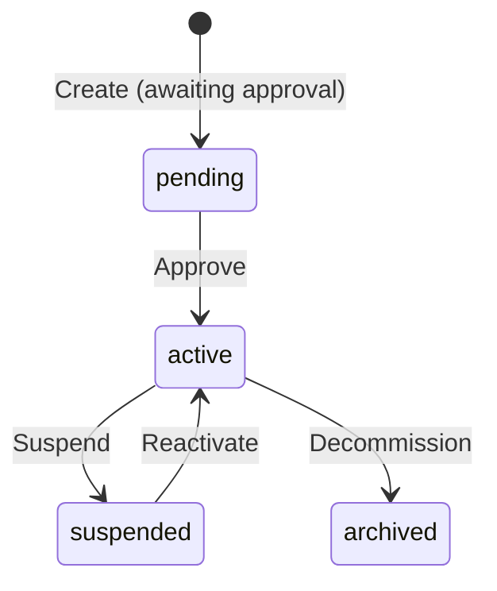

# DPDPA Shield — Organizations (Tenant Management) Technical Specification

This document covers the **Organizations** administration page for superadmin users.

**Route:** `/superadmin/tenants`
**Access:** Superadmin only

---

## 1. Module Overview

### 1.1 Purpose
Enable ZeroShield platform superadmins to manage multi-tenant organizations — create new tenants, configure subscription tiers, monitor usage, and manage organization lifecycle.

### 1.2 Business Objective
As a SaaS platform serving multiple enterprise customers, superadmins need a central control plane for tenant provisioning, suspension, and configuration without accessing tenant data.

---

## 2. Detailed Screen Specification

### 2.1 Organization List
*   Table: organization name, slug, subscription tier, status (active/suspended/pending), user count, created date.
*   Search by name or slug.
*   Filters: status, tier.

### 2.2 Organization Detail
*   Organization profile (name, slug, primary industry, region)
*   Subscription tier (Enterprise, Professional, Starter)
*   User count and role distribution
*   Module usage summary (consent receipts, data sources, DSARs)
*   Created/last active timestamps

### 2.3 Actions
*   **Create Organization** — provision new tenant with admin user invite.
*   **Suspend** — disable all access for the organization (emergency).
*   **Reactivate** — restore suspended organization.
*   **Edit Settings** — update tier, industry, region.
*   **View Users** — navigate to Team & Users filtered by organization.

---

## 3. Organization Lifecycle

New organizations created via signup flow start in `pending` status until approved in Pending Approvals.

---

## 4. Relationships

| Module | Relationship |
| :--- | :--- |
| **Pending Approvals** | New org signups awaiting approval |
| **Team & Users** | Users belong to organizations |
| **Workspace Info** | Each org has its own workspace settings |
| **Industry Config** | Per-org industry and SDF settings |

---

## 5. Security & Compliance Requirements

*   Superadmin role required for all operations.
*   Superadmin cannot view tenant data (consent receipts, PII) — only metadata.
*   Organization suspension is immediate and logged in platform audit log.
*   Cross-organization data isolation enforced at database query level.

---

## 6. QA Verification Matrix

*   **TC-01**: Create organization; appears in list with pending status.
*   **TC-02**: Suspend organization; all users lose access immediately.
*   **TC-03**: Non-superadmin user receives 403 on organizations page.
*   **TC-04**: Reactivate restores user access.
