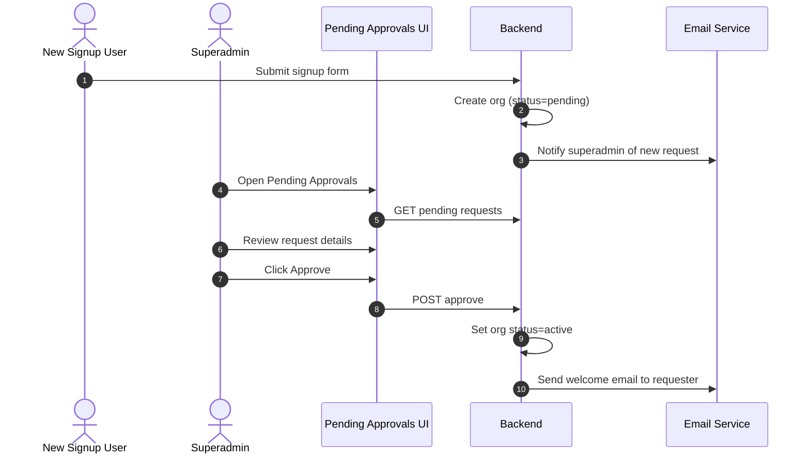

# Vajra — Pending Approvals Technical Specification

This document covers the **Pending Approvals** administration page for superadmin users.

**Route:** `/superadmin/approvals`
**Access:** Superadmin only

---

## 1. Module Overview

### 1.1 Purpose
Review and approve new organization signup requests before they are activated on the platform. Ensures controlled tenant provisioning for enterprise SaaS deployments.

### 1.2 Business Objective
Prevent unauthorized or spam signups from accessing the platform. Superadmins review each request, verify legitimacy, and approve or reject with optional notes.

---

## 2. Detailed Screen Specification

### 2.1 Approval Queue
Table of pending requests:
*   Organization name
*   Requester name and email
*   Requested industry
*   Submission date
*   Status (pending / approved / rejected)

### 2.2 Approval Detail
*   Full signup form data (org name, industry, estimated data principal volume)
*   Requester contact details
*   Approve button (creates organization, sends welcome email)
*   Reject button (with reason field, sends rejection notification)

### 2.3 Actions
*   **Approve** — organization status changes to `active`; admin user receives login credentials.
*   **Reject** — request marked rejected; requester notified with reason.
*   **Request More Info** — send email requesting additional details before decision.

---

## 3. Approval Workflow

---

## 4. Relationships

| Module | Relationship |
| :--- | :--- |
| **Organizations** | Approved requests become active organizations |
| **Team & Users** | Approved org's admin user can invite team members |

---

## 5. Security & Compliance Requirements

*   Superadmin role required.
*   Approval/rejection actions logged in platform audit log.
*   Rejected requests cannot be re-submitted with same email for 24 hours.

---

## 6. QA Verification Matrix

*   **TC-01**: New signup appears in pending queue.
*   **TC-02**: Approve activates organization; user can log in.
*   **TC-03**: Reject sends notification with reason.
*   **TC-04**: Non-superadmin cannot access approvals page.
