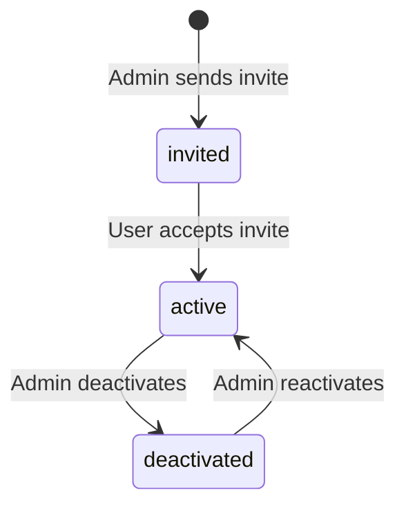

# Vajra — Team & Users Technical Specification

This document covers the **Team & Users** administration page for admin and superadmin users.

**Route:** `/superadmin/users`
**Access:** Admin, Superadmin

---

## 1. Module Overview

### 1.1 Purpose
Manage team members within an organization — invite users, assign roles, deactivate accounts, and monitor access. Ensures appropriate RBAC for DPDPA compliance responsibilities.

### 1.2 Business Objective
DPDPA requires clear accountability (Section 8(1)). Team management ensures the right people have the right access to compliance tools — DPOs can manage consent, IT admins can configure data sources, viewers can monitor dashboards.

---

## 2. Detailed Screen Specification

### 2.1 User List
Table of organization users:
*   Full name, email
*   Role badge (viewer, admin, superadmin)
*   DPDP role mapping (DPO, IT Admin, Compliance Manager, etc.)
*   Status (active, invited, deactivated)
*   Last login timestamp

### 2.2 Invite User
*   Email address
*   Role selector (viewer, admin)
*   DPDP role mapping (optional, from DPDP Role Mapping config)
*   Send invite button

### 2.3 User Detail / Edit
*   Change role
*   Update DPDP role mapping
*   Deactivate account (preserves audit trail)
*   Reactivate account
*   Reset password (sends reset email)

### 2.4 Role Permissions Summary

| Permission | Viewer | Admin | Superadmin |
| :--- | :--- | :--- | :--- |
| View dashboards & reports | Yes | Yes | Yes |
| Manage consent modules | No | Yes | Yes |
| Configure data sources | No | Yes | Yes |
| Manage team users | No | Yes | Yes |
| Manage organizations | No | No | Yes |
| Approve signups | No | No | Yes |
| Re-index Vajra AI docs | No | No | Yes |

---

## 3. DPDP Role Mapping Integration

Users can be assigned DPDP-specific roles (configured in Settings → DPDP Role Mapping):
*   **Data Protection Officer (DPO)** — primary compliance accountability
*   **IT Administrator** — data source and integration management
*   **Compliance Manager** — audit and reporting
*   **Legal Counsel** — notice review and policy approval
*   **CISO** — security safeguards and breach response

DPDP roles appear in audit logs and are used for workflow assignments (e.g., DPIA sign-off requires DPO role).

---

## 4. User Lifecycle

---

## 5. Relationships

| Module | Relationship |
| :--- | :--- |
| **DPDP Role Mapping** | DPDP roles assigned to users |
| **Organizations** | Users belong to one organization |
| **Audit Log** | All user actions logged with user ID |
| **Workspace Info** | DPO contact info linked to DPO-role user |

---

## 6. Security & Compliance Requirements

*   Admin can only manage users within their own organization.
*   Superadmin can manage users across all organizations.
*   Deactivated users cannot log in but their audit history is preserved.
*   Role changes logged in audit trail.
*   Password reset tokens expire after 24 hours.

---

## 7. QA Verification Matrix

*   **TC-01**: Admin invites user; invite email sent; user can accept and log in.
*   **TC-02**: Change user role from viewer to admin; user gains write access.
*   **TC-03**: Deactivate user; login fails; audit history preserved.
*   **TC-04**: Admin cannot manage users in another organization.
*   **TC-05**: Viewer cannot access Team & Users page.
