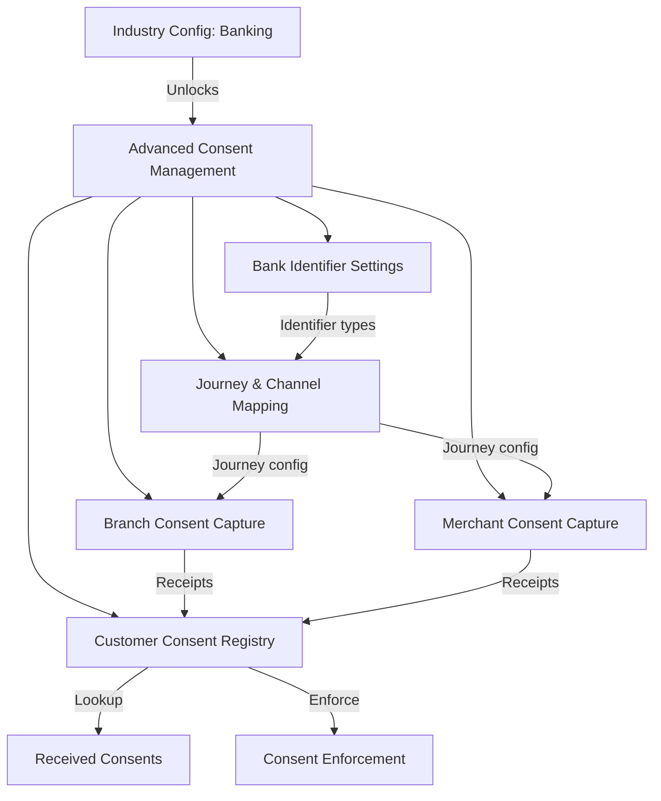

# DPDPA Shield — Advanced Consent Management (Banking) Overview

This document serves as the **single source of truth** for the **Advanced Consent Management** module cluster — available when the organization's primary industry is set to **Banking & Financial Services** in Industry Config.

---

## 1. Module Overview

### 1.1 Purpose
Banking organizations face unique consent challenges: multi-channel capture (branch, ATM, merchant, digital), regulated identifier types (CIF, account numbers, PAN), journey-based consent requirements, and offline capture with later sync. The Advanced Consent Management cluster extends the standard consent platform with banking-specific identifier configuration, journey mapping, and channel-specific capture workflows.

### 1.2 Business Objective
To enable banks and NBFCs to capture, store, and enforce consent across all customer touchpoints — branch counters, merchant POS terminals, mobile banking apps, and internet banking — while maintaining DPDPA compliance and RBI-adjacent data minimization requirements.

### 1.3 DPDPA Compliance Objective
*   **Section 6(1)**: Consent must be specific and informed — journey-level purpose mapping ensures customers know what they're consenting to at each touchpoint.
*   **Section 6(3)**: Notice must be presented at point of collection — branch and merchant capture flows display linked notices.
*   **Section 8(1)**: Fiduciary accountability — customer consent registry provides auditable record per identifier.
*   **Section 9**: Children's data — banking journeys can flag minor accounts for verifiable parental consent.

### 1.4 Sidebar Unlock Condition
The **Advanced Consent Management** section appears in the sidebar when:
```
organization_settings.primary_industry === 'Banking & Financial Services'
```
Configured in **Settings → Industry Config** (`/settings/industry`).

### 1.5 Module Pages

| Page | Route | Doc |
| :--- | :--- | :--- |
| Bank Identifier Settings | `/consent/banking/identifiers` | `bank_identifier_settings.md` |
| Journey & Channel Mapping | `/consent/banking/journeys` | `journey_channel_mapping.md` |
| Branch Consent Capture | `/consent/banking/branch-capture` | `branch_consent_capture.md` |
| Merchant Consent Capture | `/consent/banking/merchant-capture` | `merchant_consent_capture.md` |
| Customer Consent Registry | `/consent/banking/registry` | `customer_consent_registry.md` |

### 1.6 Architectural Context



### 1.7 Target Users
*   **Bank DPOs**: Configure identifier types, journey mappings, and consent policies.
*   **Branch operations**: Capture consent at branch counters via assisted flow.
*   **Merchant/POS teams**: Capture consent at merchant terminals.
*   **Digital banking teams**: Configure journey-based consent for mobile/internet banking.

---

## 2. DPDPA Mapping & Compliance Matrix

| DPDPA Section | Requirement | Banking Implementation |
| :--- | :--- | :--- |
| **Section 6(1)** | Specific, informed consent | Journey-level purpose mapping per channel |
| **Section 6(3)** | Notice at collection point | Notice displayed in branch/merchant capture UI |
| **Section 8(1)** | Fiduciary accountability | Customer Consent Registry with identifier linkage |
| **Section 9** | Children's data | Minor account flagging in identifier config |
| **Section 6(6)** | Cease on withdrawal | Standard enforcement + remediation pipeline |

---

## 3. Banking Identifier Types

Configured in **Bank Identifier Settings**:

| Identifier | Storage | Description |
| :--- | :--- | :--- |
| Email | Normalized email | Standard contact identifier |
| Phone | E.164 normalized | SMS OTP and contact |
| CIF | Token (hashed) | Customer Information File number |
| Account Number | Token (hashed) | Bank account number |
| PAN | Token (hashed) | Permanent Account Number |
| Custom | Token (hashed) | Organization-defined identifier |

Each identifier type can be set to **required**, **optional**, or **disabled** per journey (data minimization).

---

## 4. Journey & Channel Concepts

A **journey** represents a customer interaction flow (e.g., "Account Opening", "Credit Card Application", "Merchant Onboarding"). Each journey defines:
*   Which identifier types are collected
*   Which purposes require consent
*   Whether OTP verification is required
*   Which notice version is displayed
*   Offline capture allowance

**Channels**: branch, merchant, mobile, internet_banking, atm, call_center

---

## 5. Relationships with Standard Consent Modules

| Standard Module | Banking Extension |
| :--- | :--- |
| Purpose Registry | Same purposes; journey-level filtering |
| Consent Notices Manager | Same notices; journey-specific notice assignment |
| Received Consents | Banking receipts include journey and identifier context |
| Consent Enforcement | Decision API accepts banking identifiers |
| Proof Vault | Banking consent events sealed with journey metadata |

---

## 6. Backend Architecture

*   **Config model**: `ConsentIndustryConfig` — identifier types, journey definitions
*   **Banking schemas**: `app/schemas/consent_banking.py`
*   **Industry pack**: `app/utils/industry_packs.py` — `ensure_banking_config()`, `is_banking_industry()`
*   **Capture session**: `ConsentCaptureSessionService` — OTP verification, offline sync
*   **Public API**: Banking identifier input on consent capture endpoint

---

## 7. Security & Compliance Requirements

*   Banking identifiers (CIF, account number, PAN) stored as hashed tokens only.
*   OTP verification required for sensitive journeys (configurable per journey).
*   Offline capture sessions synced with integrity checks on reconnect.
*   Branch staff actions logged with staff user ID in audit trail.

---

## 8. QA Verification Matrix

*   **TC-01**: Set industry to Banking; verify Advanced Consent Management sidebar appears.
*   **TC-02**: Configure CIF identifier; capture consent at branch with CIF; receipt in registry.
*   **TC-03**: Journey with OTP required blocks finalize until OTP verified.
*   **TC-04**: Offline capture syncs correctly on reconnect.
*   **TC-05**: Merchant capture creates receipt linked to merchant channel.
