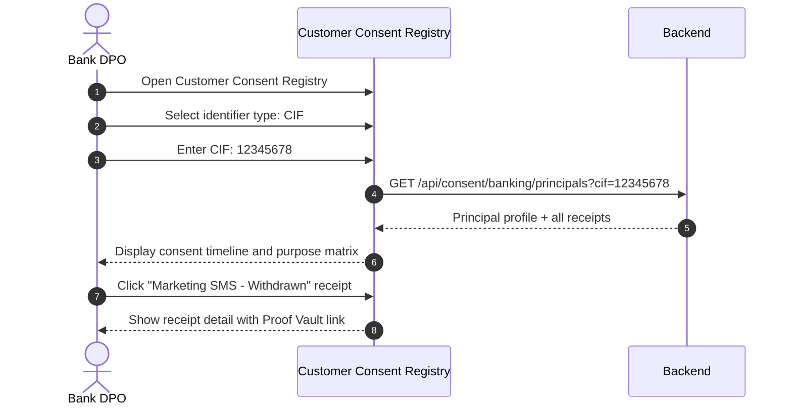

# Vajra — Customer Consent Registry Technical Specification

This document covers the **Customer Consent Registry** page (`/consent/banking/registry`) within the Advanced Consent Management cluster.

---

## 1. Module Overview

### 1.1 Purpose
The **Customer Consent Registry** is a banking-specific lookup and audit view that lets DPOs and compliance teams search consent records by any configured banking identifier (CIF, account number, PAN, phone, email) and view the complete consent history for a customer across all channels and journeys.

### 1.2 Business Objective
Banks need to answer "what has this customer consented to?" across branch, merchant, mobile, and internet banking channels — in one unified view keyed to banking identifiers rather than just email/phone.

### 1.3 DPDPA Compliance Objective
*   **Section 6(10)**: Burden of proof — complete consent timeline per customer identifier.
*   **Section 11**: Right to obtain summary — registry provides data for DSAR access requests.
*   **Section 6(6)**: Withdrawal status visible per purpose per customer.

---

## 2. Detailed Screen Specification

**Route:** `/consent/banking/registry`

### 2.1 Search Panel
*   Identifier type selector (CIF, account number, PAN, phone, email)
*   Identifier value input
*   Search button
*   Recent searches (session-local)

### 2.2 Customer Consent Profile
After search, displays:

**Customer Summary Card**
*   Matched identifier(s) and type
*   Principal fingerprint (internal ID)
*   Total consent events
*   Active purposes / withdrawn purposes count
*   Last activity timestamp

**Consent Timeline**
Chronological list of all consent events:
*   Timestamp
*   Channel (branch, merchant, mobile, web)
*   Journey name
*   Purpose decisions (granted/denied per purpose)
*   Notice version
*   Staff ID (for assisted captures)
*   Proof Vault link
*   Status (active / withdrawn)

**Purpose Status Matrix**
Table showing current consent state per purpose:
| Purpose | Current Status | Last Changed | Channel | Action |
| :--- | :--- | :--- | :--- | :--- |
| Marketing SMS | Withdrawn | 2026-07-15 | Mobile | View receipt |
| KYC Verification | Active | 2026-01-10 | Branch | View receipt |
| Account Services | Active | 2026-01-10 | Branch | View receipt |

### 2.3 Actions
*   Export customer consent profile (PDF/JSON)
*   Initiate withdrawal on behalf of customer (admin action, logged)
*   View linked enforcement events
*   View remediation tasks for this customer

---

## 3. User Journey

---

## 4. Relationships

| Module | Relationship |
| :--- | :--- |
| **Received Consents** | Same underlying receipts; banking-enriched view |
| **Branch/Merchant Capture** | Source of assisted capture receipts |
| **Consent Enforcement** | Enforcement events linked to principal |
| **DSAR SLA Tracker** | Registry data used for access DSAR responses |
| **Proof Vault** | All events link to sealed records |

---

## 5. Backend Architecture

*   **API**: `GET /api/consent/banking/principals` — search by identifier
*   **API**: `GET /api/consent/banking/principals/{id}` — full profile with receipts
*   **Service**: `ConsentPrincipalService` — identifier normalization and lookup
*   **Fingerprinting**: Server-side hash of `org_id:type:normalized_token`

---

## 6. Security & Compliance Requirements

*   Search requires admin/DPO role.
*   Identifier values masked in audit logs (show type only).
*   Export actions logged with user ID and timestamp.
*   Cross-tenant search returns empty (not 404, to prevent enumeration).

---

## 7. QA Verification Matrix

*   **TC-01**: Search by CIF returns all receipts for that customer.
*   **TC-02**: Purpose matrix shows correct current status per purpose.
*   **TC-03**: Timeline ordered chronologically with channel badges.
*   **TC-04**: Export generates valid PDF with Proof Vault references.
*   **TC-05**: Cross-tenant CIF search returns empty results.
