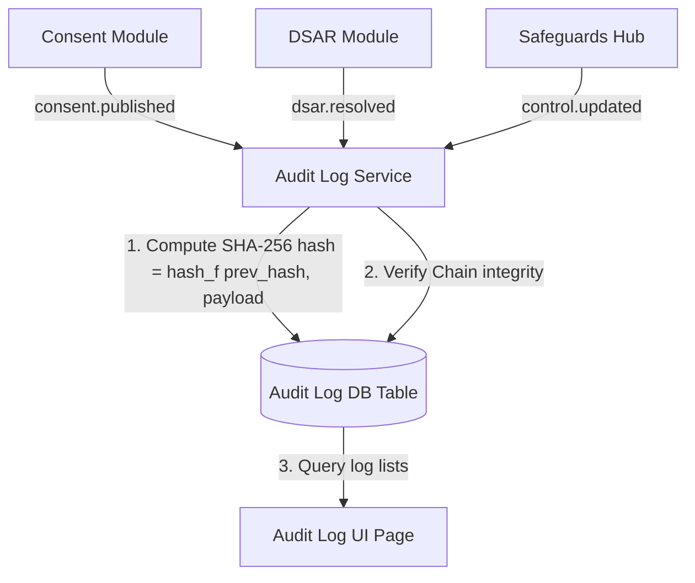
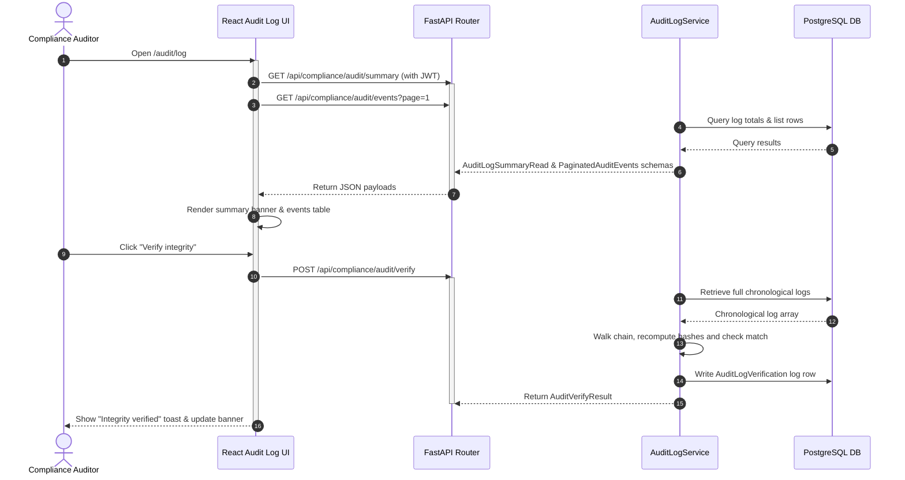
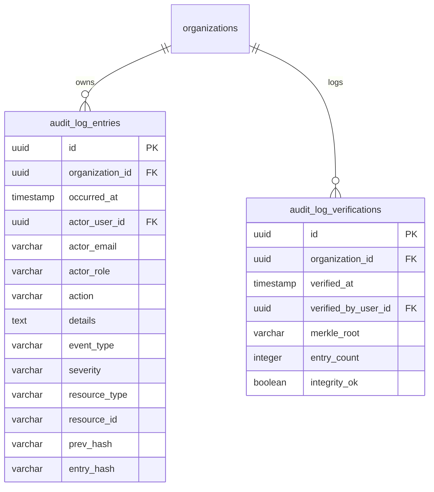

# DPDPA Shield — Audit Log Technical Specification

This document serves as the **single source of truth** for the **Audit Log** (Immutable Tamper-Evident Ledger) module of the ZeroShield DPDPA compliance platform. It provides the detailed frontend, backend, database, integration, and compliance specifications required to build, test, and maintain the audit trail interface.

---

## 1. Module Overview

### 1.1 Purpose
The **Audit Log** module maintains an append-only, cryptographically chained ledger of all significant actions taken across the ZeroShield platform (notices published, DSARs resolved, controls updated, data deleted, breaches logged).

### 1.2 Business Objective
To provide corporate legal teams, independent auditors, and regulators with an indisputable, tamper-evident record of compliance activities recorded contemporaneously.

### 1.3 DPDPA Compliance Objective
*   Directly satisfies **Section 8 obligations** regarding record maintenance and auditing.
*   Acts as the primary repository for **Section 6(10) burden of proof** items (demonstrating that consent notice publications and user choices occurred at specific timestamps).

### 1.4 Architectural Context
The Audit Log acts as a centralized event broker. Subsystems invoke the logging service, which computes a SHA-256 hash for each new record using the hash of the preceding record (blockchain-style hash chaining):



### 1.5 Target Users
*   **Chief Compliance Officers & SIRT leads**: Consult logs during post-incident reviews or system audits.
*   **Independent Compliance Auditors**: Run cryptographic verification routines directly in the interface and download event certificates.

---

## 2. DPDPA Mapping & Compliance Matrix

| DPDPA Section | Regulatory Requirement | Audit Log Implementation |
| :--- | :--- | :--- |
| **Section 6(10)** | Burden of proof lies on the Data Fiduciary to show compliance. | Logs notice publications, consent banner updates, and system state histories. |
| **Section 8(5)** | Obligation to maintain audit logs and operational evidence. | Records all configuration modifications, role mappings, and database scans. |
| **Section 8(7)** | Duty to erase data when purpose finishes or consent is withdrawn. | Logs the successful execution of secure data deletion tasks with cryptographic erasure marks. |
| **Section 11, 12 & 13** | Obligations to process Data Principal Rights requests. | Records the intake, verification, response prep, and closure of DSAR requests. |

---

## 3. End-to-End User Journey



---

## 4. Detailed Screen Specification

The Audit Log page (Route: `/audit/log`) includes:

1.  **Header Actions & Metadata**:
    *   *Metadata*: Action Chip (Security Safeguards) and label (Evidence Tool).
    *   *Actions*: "Verify Integrity" (runs backend hash verification) and "Export Evidence Pack" (downloads full log PDF).
2.  **Integrity Status Banner**:
    *   Highlights the current cryptographic Merkle root hash (e.g. `00c2834b9...`), entry count, and last verification timestamp.
3.  **Search & Filtering Panel**:
    *   *Search*: Text input filters actions and details.
    *   *Type Dropdown*: Configuration, Consent, Deletion, Access, Rights, Breach.
    *   *Buttons*: "Apply filters" re-fetches logs.
4.  **Log Data Table**:
    *   *Columns*: Time (toLocaleString format), Actor (email/role), Action, Type (colored badges), Severity.
    *   *Row Action*: Click row to open details modal.
5.  **Event Details Modal**:
    *   Displays full details, actor context, and raw hashes (current hash vs previous hash).
    *   "Export Event Certificate (PDF)" generates a client-safe verification document.

---

## 5. Chaining Algorithm & Schemas

### 5.1 Canonical Payload Formatting
To prevent hash mismatches due to whitespace differences, payloads are serialized using strict key sorting:
```python
data = {
    "organization_id": str(organization_id),
    "occurred_at": occurred_at.isoformat(),
    "actor_email": actor_email,
    "actor_role": actor_role,
    "action": action,
    "details": details,
    "event_type": event_type,
    "severity": severity,
    "resource_type": resource_type,
    "resource_id": resource_id,
    "prev_hash": prev_hash,
}
# Serialized to JSON with sorted keys and no spaces
payload = json.dumps(data, sort_keys=True, separators=(",", ":"))
```

### 5.2 Hash Calculation
The entry hash is computed using SHA-256 over the concatenated previous hash and current payload:
$$\text{Entry Hash} = \text{SHA-256}(\text{prev\_hash} + \text{":"} + \text{payload})$$
*   *Genesis Hash*: The very first log entry uses a hardcoded hash string of sixty-four zeros (`"0" * 64`).

---

## 6. Frontend Architecture

### 6.1 Page Component Structure
```
AuditLog.tsx (Main Ledger Table Wrapper)
  └── ConsentManagementGate
        ├── Header panel & Actions buttons
        ├── Merkle Root status banner (blue indicator block)
        ├── Search & Filter inputs card
        ├── Table Grid (Rows with type badges)
        └── EventDetailsModal.tsx (Triggered on row click)
```

---

## 7. Backend Architecture

### 7.1 Files & Modules Layout
*   **Router**: `app/routers/compliance.py` maps the `/audit/events`, `/audit/verify`, and `/audit/summary` routes.
*   **Service**: `app/services/audit_log_service.py` houses the entry hashing, pagination retrieval, and loop verification algorithms.

---

## 8. Database Design



---

## 9. QA Verification Matrix

### 9.1 Positive Test Cases
*   **TC-AU-01 (Hash Chain Generation)**: Add multiple actions. Verify that each record's `prev_hash` matches the preceding record's `entry_hash`.
*   **TC-AU-02 (Integrity Verification SUCCESS)**: Click "Verify Integrity" on an unaltered ledger. Verify that the API returns `integrity_ok: true` and logs a verification row.
*   **TC-AU-03 (Export Certificates)**: Trigger single event certificate export. Ensure PDF downloads successfully and contains correct hashes.

### 9.2 Negative Test Cases
*   **TC-AU-04 (Chain Tamper Detection)**: Manually alter an `entry_hash` value in the database. Run `POST /audit/verify`. Verify that verification service flags `integrity_ok: false` and identifies the tampered root.
*   **TC-AU-05 (Genesis Re-initialization Prevent)**: Call `record_event` on an already active organization. Verify that genesis initialization is bypassed and the record links to the active tip hash.
