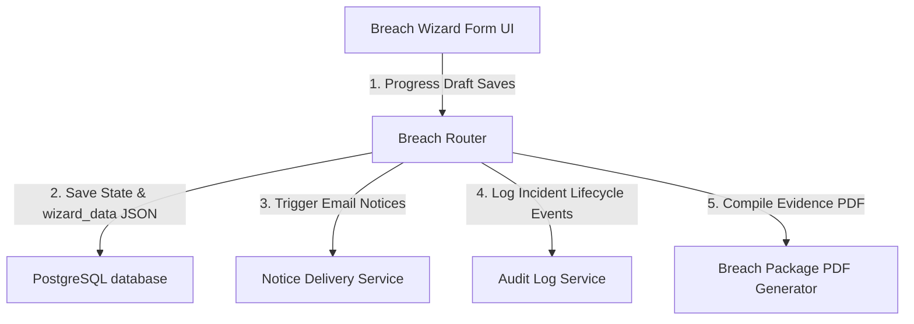
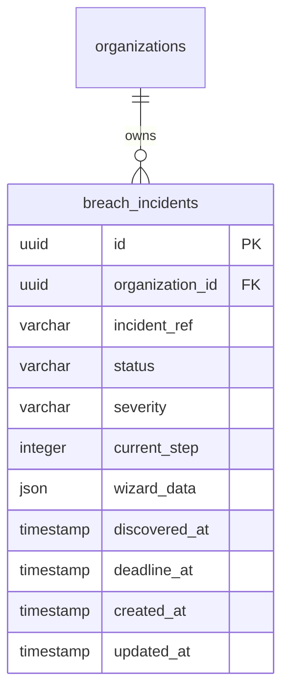

# DPDPA Shield — Breach Disclosure Wizard Technical Specification

This document serves as the **single source of truth** for the **Breach Disclosure Wizard** module of the ZeroShield DPDPA compliance platform. It provides the detailed frontend, backend, database, integration, and compliance specifications required to build, test, and maintain the breach response interface.

---

## 1. Module Overview

### 1.1 Purpose
The **Breach Disclosure Wizard** is a guided incident response module designed to assist organizations in assessing data breaches, compiling notifications, and executing disclosures within the statutory timelines.

### 1.2 Business Objective
To provide a structured, defensible workflow that ensures security teams can rapidly analyze personal data breach impacts, pre-fill official Data Protection Board (DPB) disclosures, draft data principal communications, and submit complete incident packages under high-pressure conditions.

### 1.3 DPDPA Compliance Objective
*   Directly addresses the **Section 8(6) mandate** requiring the Data Fiduciary to notify the Board and affected data principals of any personal data breach.
*   Enforces the regulatory **72-hour window** for reporting, tracking countdown states directly in the interface.

### 1.4 Architectural Context
The Breach Disclosure Wizard aggregates manual threat details, logs scans from the PII scanner, integrates with notice delivery channels for email/SMS dispatches, and saves cryptographic receipts in the central audit ledger:



### 1.5 Target Users
*   **Security Incident Response Team (SIRT)**: Fill out impact assessments, verify affected user counts, and coordinate mitigation actions.
*   **DPOs and Legal Counsel**: Review official DPB and data principal notifications, verify severity ratings, and authorize final submissions.

---

## 2. DPDPA Mapping & Compliance Matrix

| DPDPA Section | Regulatory Requirement | Wizard Implementation |
| :--- | :--- | :--- |
| **Section 8(6)** | Obligation to notify the Data Protection Board of a personal data breach. | **Step 2: DPB Notification** pre-fills the official reporting template, including incident summaries and remediation steps. |
| **Section 8(6)** | Obligation to notify affected Data Principals of the breach. | **Step 3: DP Notification** drafts direct email and SMS disclosures, sending them through configured delivery channels. |
| **Section 9** | Heightened obligation to protect children's personal data. | **Step 1: Impact Assessment** flags special categories, triggering high-severity alerts if child data records are compromised. |
| **Schedule 1** | Penalty for failure to notify Board/Principals of breach. | Tracks SLA countdown timers to avoid penalties of up to ₹150 Crores. |

---

## 3. End-to-End User Journey

The wizard follows a structured 5-step stepper layout:


### 3.1 Scenario Workflows
*   **Breach Containment Flow**:
    *   SIRT discovers an incident, navigates to `/breach` and clicks "Create Incident", starting a 72-hour countdown timer.
    *   **Step 1**: Assesses severity, tags affected categories (e.g. Health, children), and asks Shield AI to verify affected records from audit logs.
    *   **Step 2**: Enters DPB summary details.
    *   **Step 3**: Drafts notification email. If no active SMTP/SES provider is active, the wizard displays a warning banner alerting the admin to configure the notice delivery channel.
    *   **Step 4**: Skips or enters company website announcement statement.
    *   **Step 5**: Submits package, triggering PDF compilation, archiving draft versions, sending emails, and writing audit logs.

---

## 4. Detailed Screen Specification

The interface (Route: `/breach`) is split into a **Form Input Column** (left) and a **Live Preview Column** (right):

1.  **Header SLA Countdown Bar**:
    *   Displays a countdown timer in hours and minutes (`XXh YYm remaining`) tracking the 72-hour statutory deadline since the breach occurred.
2.  **Form Input Column**:
    *   **Step 1 (Impact Assessment)**: Radio options for Severity (Low, Medium, High, Critical), input for Affected Data Principals count, checkboxes for Special Categories (Children, Health, Financial, Biometric), tags for Affected Data Types, and textarea for Mitigation Actions.
    *   **Step 2 (DPB Notification)**: Dropdowns for Board selector and delivery method, textarea fields for incident summary and remediation steps.
    *   **Step 3 (DP Notification)**: Warning indicator if email provider is offline. Checkboxes for channels (Email, SMS, physical). Text inputs for Subject, Message Body, and DPO Contact Info.
    *   **Step 4 (Public Disclosure)**: Toggle for public statement requirement, channels (company website, press release), and Statement textarea.
    *   **Step 5 (Submit & Track)**: Shows verification checkmarks for Steps 1-4, and the "Submit Breach Disclosure Package" action button.
3.  **Live Preview Column**:
    *   **DPB Form Preview**: Renders real-time inputs into a formatted official Board report mockup (reference code, reporting entity name, severity badge, and data type tags).
    *   **Email Notice Mockup**: Interactive mail viewer rendering the email subject and message body.

---

## 5. Data Schemas

### 5.1 BreachWizardData Schema

| Field Name | Type | Description | Example Value |
| :--- | :--- | :--- | :--- |
| `affected_count` | String | Count of affected users | `"287"` |
| `incident_summary` | String | Description of breach details | `"Exposed API endpoint leaked health logs."` |
| `remediation_steps`| String | Remediation activities taken | `"Rotated API keys and patched ingress rule."` |
| `mitigation_actions`| String | Immediate actions taken | `"Disabled affected microservice session."` |
| `dp_email_subject` | String | Data Principal email subject | `"Important Security Notice from Acme"` |
| `dp_message_body` | String | Data Principal email body | `"Dear user, we detected an incident..."` |
| `dp_contact` | String | Contact details for inquiries | `"compliance@acme.in"` |

---

## 6. Frontend Architecture

### 6.1 Page Component Structure
```
BreachDisclosureWizard.tsx (Stepper Controller)
  └── ConsentManagementGate
        ├── Header layout & Countdown timer component
        ├── Wizard Stepper (Clickable circles showing status)
        ├── Form Column
        │     ├── Step 1: Impact assessment form
        │     ├── Step 2: DPB notification form
        │     ├── Step 3: DP notification (checks notice delivery providers)
        │     ├── Step 4: Public disclosure form
        │     └── Step 5: Submission details checklist
        └── Preview Column
              ├── DPB official form preview
              └── Email notification template layout
```

---

## 7. Backend Architecture

### 7.1 Files & Modules Layout
*   **Router**: `app/routers/compliance.py` maps the `/breaches` routes.
*   **Service**: `app/services/breach_disclosure_service.py` manages draft status updates, severity checks, and notification dispatch pipelines.

---

## 8. Database Design



---

## 9. API Design

### 9.1 Create Breach Incident Draft
*   **Method / Route**: `POST /api/compliance/breaches`
*   **Request Body**:
    ```json
    {
      "discovered_at": "2026-06-25T13:00:00Z"
    }
    ```
*   **Response Body (201 Created)**:
    ```json
    {
      "id": "c1387d89-9831-419b-a010-8b630f9a2de0",
      "incident_ref": "INC-2026-06-25-001",
      "status": "draft",
      "severity": "high",
      "current_step": 1,
      "wizard_data": {},
      "discovered_at": "2026-06-25T13:00:00Z",
      "deadline_at": "2026-06-28T13:00:00Z"
    }
    ```

---

## 10. QA Verification Matrix

### 10.1 Positive Test Cases
*   **TC-BR-01 (Create Draft)**: Verify that starting a breach incident sets status to `draft` and computes a 72-hour `deadline_at` timestamp.
*   **TC-BR-02 (Step Saves)**: Progress through steps 1-4 saving drafts. Verify the `wizard_data` JSON updates in the database.
*   **TC-BR-03 (Submission Processing)**: Submit the package. Verify that status changes to `submitted`, email dispatches are triggered, and a tamper-proof PDF is downloadable.

### 10.2 Negative Test Cases
*   **TC-BR-04 (Unauthorized Submit)**: Attempt to call `/submit` using a `viewer` role token. Verify response is `403 Forbidden`.
*   **TC-BR-05 (SLA Countdown Expiry)**: Set `discovered_at` to a date 80 hours in the past. Verify the UI displays `0h 0m remaining (Breached)` in red.
