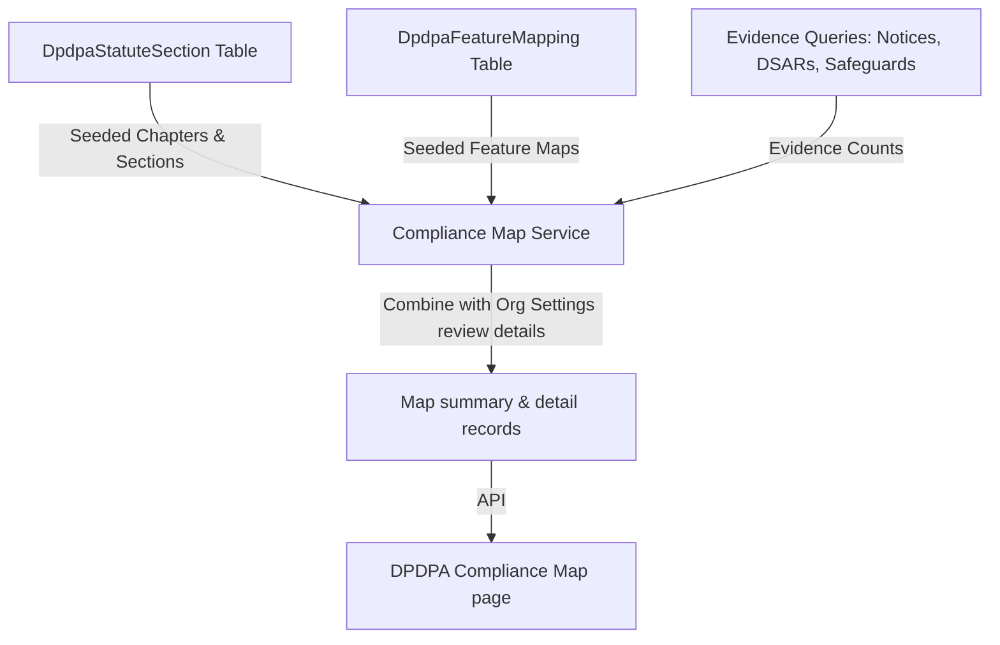
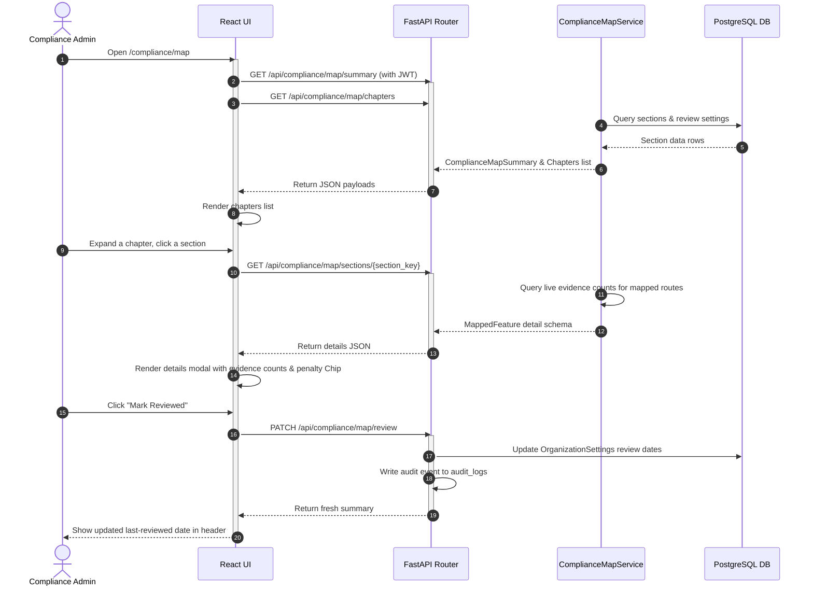
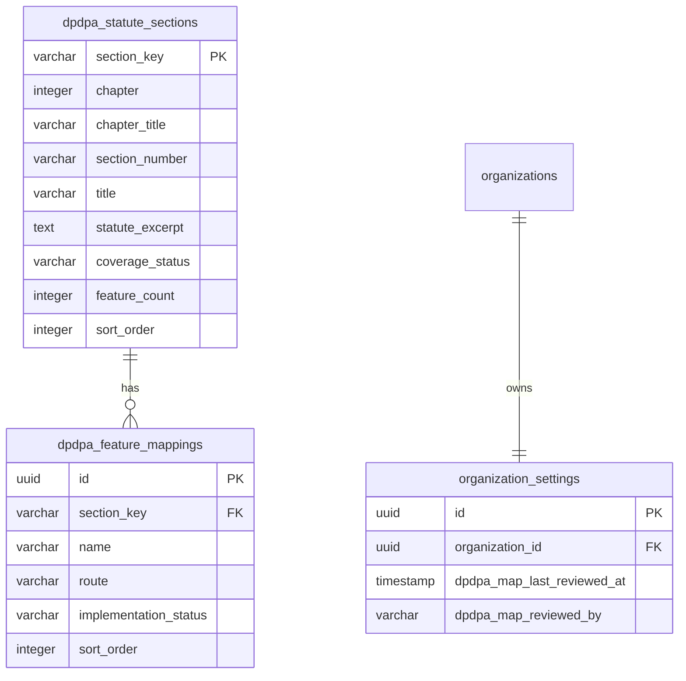

# DPDPA Shield — DPDPA Map Technical Specification

This document serves as the **single source of truth** for the **DPDPA Map** (Compliance Coverage Map) module of the ZeroShield DPDPA compliance platform. It provides the detailed frontend, backend, database, integration, and compliance specifications required to build, test, and maintain this module.

---

## 1. Module Overview

### 1.1 Purpose
The **DPDPA Map** provides an interactive compliance coverage mapping of the chapters and sections of the Digital Personal Data Protection Act, 2023 (DPDPA) against implemented (or planned) platform features, with live evidence counts and administrative review timestamps.

### 1.2 Business Objective
To provide corporate boards, auditors, and regulators with a consolidated, proof-backed compliance index demonstrating exactly how system features satisfy each statutory requirement.

### 1.3 DPDPA Compliance Objective
*   Establishes documented proof of compliance processes across the whole Act.
*   Enforces accountability by highlighting exactly which sections are covered by which controls and who verified them.

### 1.4 Architectural Context
The DPDPA Map matches seeded statute rules with operational data (e.g., active notices count, recorded consents count, configured security controls count):



### 1.5 Target Users
*   **Chief Compliance Officers & Auditors**: Review system alignments, audit verification logs, and export evidence packages.
*   **Administrators**: Mark sections as reviewed to register compliance signatures in the database settings.

---

## 2. DPDPA Mapping & Compliance Matrix

| DPDPA Chapter | Statute Scope | Map Implementation |
| :--- | :--- | :--- |
| **Chapter I** | Preliminary definitions & scope (Sections 1-3). | Mapped as `Not Applicable` (definitional only). |
| **Chapter II** | Obligations of Data Fiduciary (Sections 4-10). | Mapped to Consent Notices, Consent Banners, Breach Disclosure, Safeguards, DPIA, and RoPA modules. |
| **Chapter III** | Rights & Duties of Data Principals (Sections 11-15). | Mapped to DSAR Tracker, Data Rights Portal, and Consent Withdrawal modules. |
| **Chapter IV** | Special Provisions (Sections 16-17). | Mapped to Vendor Risk and Policy Manager modules. |
| **Chapter VIII** | Penalties & Adjudication (Section 33 & Schedule 1). | Mapped to the scoring and penalty mitigation calculator. |

---

## 3. End-to-End User Journey



---

## 4. Detailed Screen Specification

The DPDPA Map page (Route: `/compliance/map`) follows a list-accordion layout:

1.  **Header Actions & Metadata**:
    *   *Metadata*: Shows covered sections ratio, mapped features count, posture score, last reviewed timestamp, and reviewed by signature.
    *   *Actions*: Click "Mark Reviewed" to launch the review dialog; click "Export PDF" to trigger the download.
2.  **Chapter & Section Accordion**:
    *   Lists all DPDPA chapters.
    *   *Row*: Chapter number, title, and section count.
    *   *Sub-Rows (Expanded Sections)*: Section reference code, section title, mapped features count, and Status badge (Implemented, Partial, Advisory, NA).
3.  **Section Detail Panel (Slide-out Drawer or Modal)**:
    *   Renders the full statute text.
    *   *Columns*: Mapped ZeroShield feature name, current implementation status (e.g. `implemented` if evidence count > 0), last verified date, evidence count, and "Configure" link.
    *   *Footer*: Displays statutory maximum penalty exposure.

---

## 5. Data Schemas

### 5.1 ComplianceMapSummary Schema

| Field Name | Type | Description | Example Value |
| :--- | :--- | :--- | :--- |
| `sections_covered` | Integer | Sections with active feature coverage | `20` |
| `sections_total` | Integer | Total sections cataloged | `34` |
| `features_mapped` | Integer | Mapped software features count | `23` |
| `compliance_score` | Integer | Overall score percentage | `84` |
| `penalty_mitigated_crores`| Integer | Avoided penalty estimates | `125` |
| `penalty_worst_crores` | Integer | Max statutory penalty exposure | `250` |
| `last_reviewed_at` | DateTime | Timestamp of last admin review | `"2026-06-25T13:00:00Z"` |
| `last_reviewed_by` | String | Email or name of reviewer | `"compliance@zeroshield.in"` |

---

## 6. Frontend Architecture

### 6.1 Page Component Structure
```
DPDPAComplianceMap.tsx (Main View Container)
  └── ConsentManagementGate
        ├── Header panel (Status summaries & action buttons)
        ├── Chapter Accordion rows
        │     └── Section rows (Pills & counts)
        └── SectionDetailModal.tsx (Slide-out drawer detailing mapped evidence)
```

---

## 7. Backend Architecture

### 7.1 Files & Modules Layout
*   **Router**: `app/routers/compliance.py` maps the `/map/summary`, `/map/chapters`, `/map/sections/{section_key}`, and `/map/review` endpoints.
*   **Service**: `app/services/compliance_map_service.py` houses database retrieval and live evidence query routines.

### 7.2 Evidence Query Mapping (`_evidence_for_route`)
The service queries active modules dynamically to report evidence counts:
*   `consent-notices-manager` ➜ Counts rows in `consent_notice_versions` linked to the organization.
*   `proof-vault` ➜ Counts rows in `consent_receipts`.
*   `audit-log` ➜ Counts rows in `audit_log_entries`.
*   `dsar-sla-tracker` ➜ Counts rows in `data_rights_requests` where status is `verified`.
*   `security-safeguards-hub` ➜ Counts rows in `security_controls` marked `documented`.

---

## 8. Database Design



---

## 9. API Design

### 9.1 Fetch Section Detail
*   **Method / Route**: `GET /api/compliance/map/sections/{section_key}`
*   **Response Body (200 OK)**:
    ```json
    {
      "section_key": "sec_5_notice",
      "title": "Section 5 — Notice",
      "statute": "Every request for consent shall be accompanied or preceded by a notice...",
      "features": [
        {
          "name": "Consent Notice Creator",
          "status": "implemented",
          "last_verified": "2026-06-25",
          "evidence_count": 4,
          "route": "consent-notices-manager"
        }
      ],
      "penalty": "₹150 Cr per occurrence"
    }
    ```

---

## 10. QA Verification Matrix

### 10.1 Positive Test Cases
*   **TC-MAP-01 (Review Update)**: Verify that submitting a patch to `/api/compliance/map/review` successfully commits the reviewer's signature to the settings table and triggers an audit log.
*   **TC-MAP-02 (Evidence Counting)**: Add a new notice. Hit the map section details route for Section 5. Verify the evidence count incremented by 1.

### 10.2 Negative Test Cases
*   **TC-MAP-03 (Review RBAC Guard)**: Send `/map/review` request using a `viewer` token. Verify response is `403 Forbidden`.
*   **TC-MAP-04 (Invalid Section Key)**: Request `/map/sections/invalid_key`. Verify response is `404 Not Found`.
