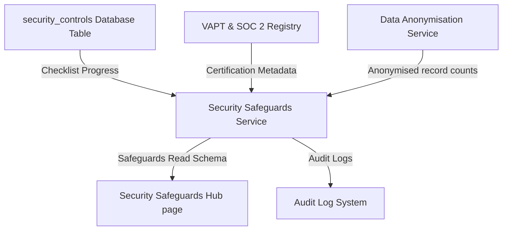
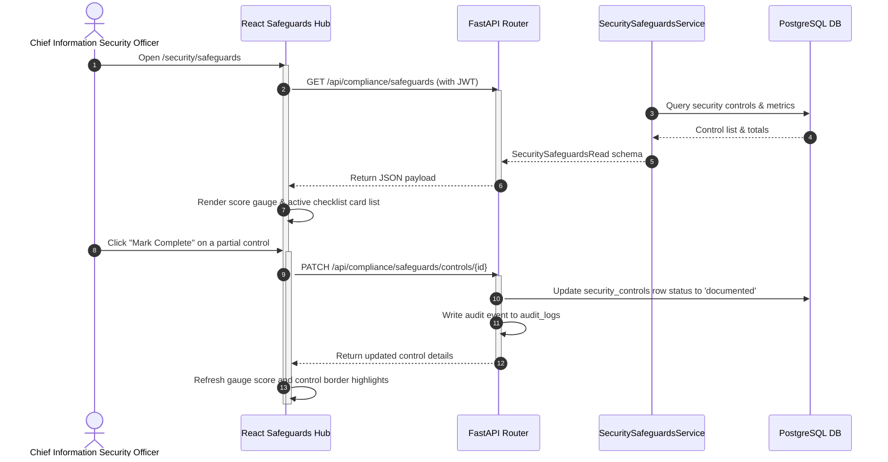
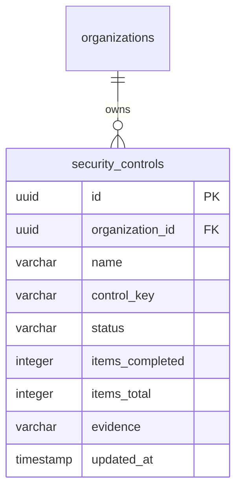

# Vajra — Security Safeguards Technical Specification

This document serves as the **single source of truth** for the **Security Safeguards Hub** module of the Vajra DPDPA compliance platform. It provides the detailed frontend, backend, database, integration, and compliance specifications required to build, test, and maintain the safeguards controls interface.

---

## 1. Module Overview

### 1.1 Purpose
The **Security Safeguards Hub** tracks and manages the organization's information security controls, demonstrating compliance with the **reasonable security safeguards** mandate of the DPDPA.

### 1.2 Business Objective
To convert abstract corporate security policies into a trackable, verifiable checklists of operational controls—complete with implementation notes, evidence uploads, and certifications (e.g., VAPT, SOC 2)—that can be directly exported for regulatory audits.

### 1.3 DPDPA Compliance Objective
*   Directly satisfies **Section 8(5) obligations** to protect personal data using reasonable security safeguards.
*   Mitigates the largest statutory penalty liability category: failure to prevent personal data breaches (up to ₹250 Crores).

### 1.4 Architectural Context
The Safeguards Hub aggregates manual control reports, live application configurations, VAPT records, and real-time security alerts into a unified posture gauge:



### 1.5 Target Users
*   **Chief Information Security Officers (CISOs)**: Review real-time security postures, verify control statuses, and monitor VAPT/SOC 2 expirations.
*   **Compliance Officers & Auditors**: Review documented security evidence and export compliance certification reports.

---

## 2. DPDPA Mapping & Compliance Matrix

| DPDPA Section | Regulatory Requirement | Safeguards Hub Implementation |
| :--- | :--- | :--- |
| **Section 8(5)** | Obligation to protect personal data with reasonable security safeguards. | Tracks core security controls (Database Encryption, MFA, Audit Logging, Secure Deletion). |
| **Section 8(7)** | Duty to erase personal data upon purpose completion or consent withdrawal. | Verifies the implementation of secure deletion protocols (multi-pass overwrite, crypto-erasure). |
| **Section 8(10)** | Duty to establish a grievance redressal mechanism. | Mapped to the central grievance logging and SLA alerts channel. |
| **Schedule 1** | Penalty bands for failure to protect personal data. | Computes current exposure penalty chips (mitigated vs worst case). |

---

## 3. End-to-End User Journey



---

## 4. Detailed Screen Specification

The Safeguards Hub page (Route: `/security/safeguards`) includes:

1.  **Header Metrics & Export Triggers**:
    *   *Metadata*: Action Chip (DPDPA Section 8(5)) and statutory penalty indicator (₹250 Cr).
    *   *Actions*: "Export Evidence Pack" (downloads all control metadata) and "Generate Auditor Report PDF" (auditor-facing PDF summary).
2.  **Hero Posture Gauge**:
    *   Circular gauge showing safeguards score.
    *   Displays current penalty exposure (e.g. ₹125 Cr mitigated if 4 of 7 controls are active).
3.  **Controls Checklist Accordion**:
    *   Interactive cards for key controls:
        1.  **Database Encryption**: AES-256 encryption at rest, TLS 1.2+ in transit, backup encryption.
        2.  **Access Management & MFA**: SSO, SAML, 100% MFA enforcement on admin roles.
        3.  **Audit Logging**: Centralized log aggregation, precision timestamps, 7-year retention.
        4.  **Secure Deletion**: Crypto-erasure, multi-pass overwrite, deletion verification tests.
    *   *Status Badges*: Documented (Green), Partial (Yellow), Not started (Red).
4.  **Data Anonymisation Summary Card**:
    *   Grid stats showing: Datasets anonymised count, records processed, active rules, and re-identification risk percentage (e.g., 0.02% risk).
    *   Details of active techniques: k-Anonymity (k >= 50), Differential Privacy (ε=1.0), and Pseudonymization.
5.  **Security Certifications Grid**:
    *   Displays valid independent compliance attestations:
        *   **VAPT Application Test**: Auditor name, test date, findings count, valid until.
        *   **SOC 2 Type II**: Auditor, period, trust criteria, valid until.
        *   **SAR for Cloud**: Assessment date, cloud provider location, framework (CSA STAR Level 2).
6.  **Real-Time Security Posture Widgets**:
    *   Status trackers: Failed logins (24h), privileged sessions, unencrypted assets, MFA-bypass users, anomalies count.

---

## 5. Data Schemas

### 5.1 SecurityControlRead Schema

| Field Name | Type | Description | Example Value |
| :--- | :--- | :--- | :--- |
| `id` | UUID | Unique control identifier | `"a9a460b1-4bb2-466d-961f-cfa8448f2b1d"` |
| `name` | String | Control description label | `"Database Encryption at Rest"` |
| `control_key` | String | Identifier for code logic mapping | `"encryption"` |
| `status` | String | Progress status | `"documented"` |
| `items_completed`| Integer | Completed checklist sub-items | `4` |
| `items_total` | Integer | Total checklist sub-items required | `4` |
| `evidence` | String | Attached evidence file label | `"db_encryption_policy_2026"` |

---

## 6. Frontend Architecture

### 6.1 Page Component Structure
```
SecuritySafeguardsHub.tsx (Page Orchestrator)
  └── ConsentManagementGate
        ├── Header layout & Export buttons
        ├── Hero Gauge (ComplianceGauge component)
        ├── Control Checklist Cards (Status-dependent border highlighting)
        │     └── Detailed sub-items grid (Check/X status rows)
        ├── Anonymisation Card (Metrics cards & rationale list)
        ├── Certifications grid (SOC 2, VAPT, SAR cloud cards)
        └── Real-time Posture counters (failed logins, anomalies)
```

---

## 7. Backend Architecture

### 7.1 Files & Modules Layout
*   **Router**: `app/routers/compliance.py` maps the `/safeguards`, `/safeguards/summary`, and `/safeguards/controls/{control_id}` routes.
*   **Service**: `app/services/security_safeguards_service.py` handles fetching and updating safeguards control matrices.

### 7.2 Score Calculation (`get_summary`)
The safeguards progress score is computed as:
$$\text{Safeguards Score} = \frac{\text{Completed Controls}}{\text{Total Controls}} \times 100$$
Each completed control contributes equally to the core safeguards score.

---

## 8. Database Design



---

## 9. API Design

### 9.1 Update Control Status
*   **Method / Route**: `PATCH /api/compliance/safeguards/controls/{control_id}`
*   **Request Body**:
    ```json
    {
      "status": "documented",
      "items_completed": 4,
      "evidence_label": "db_encryption_policy_2026"
    }
    ```
*   **Response Body (200 OK)**:
    ```json
    {
      "id": "a9a460b1-4bb2-466d-961f-cfa8448f2b1d",
      "name": "Database Encryption at Rest",
      "control_key": "encryption",
      "status": "documented",
      "items_completed": 4,
      "items_total": 4,
      "evidence": "db_encryption_policy_2026"
    }
    ```

---

## 10. QA Verification Matrix

### 10.1 Positive Test Cases
*   **TC-SF-01 (Update Status)**: Patch a control status from `partial` to `documented`. Verify that the items count updates and the posture score increases.
*   **TC-SF-02 (Auditor Report Export)**: Trigger auditor report generation. Ensure a valid PDF is downloaded with matching certification dates.

### 10.2 Negative Test Cases
*   **TC-SF-03 (Update Control RBAC Guard)**: Send a patch request to controls using a `viewer` role token. Verify that server returns `403 Forbidden`.
*   **TC-SF-04 (Negative Items count)**: Attempt to patch `items_completed` with value `-1`. Verify API throws validation error.
