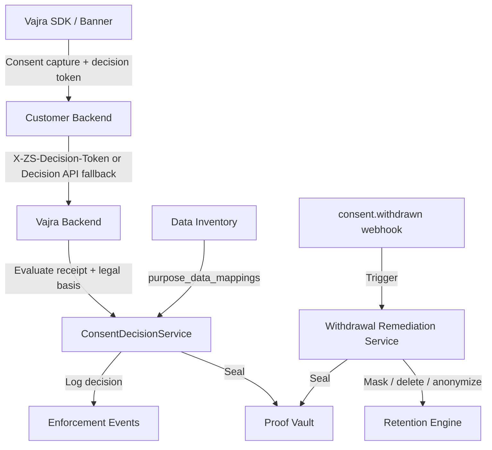
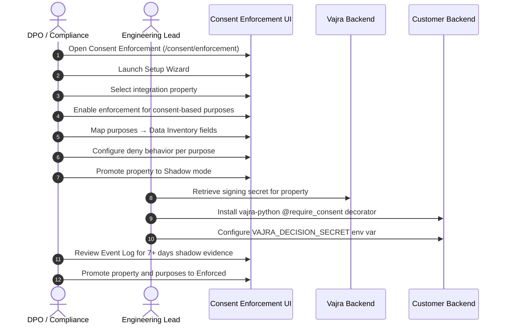
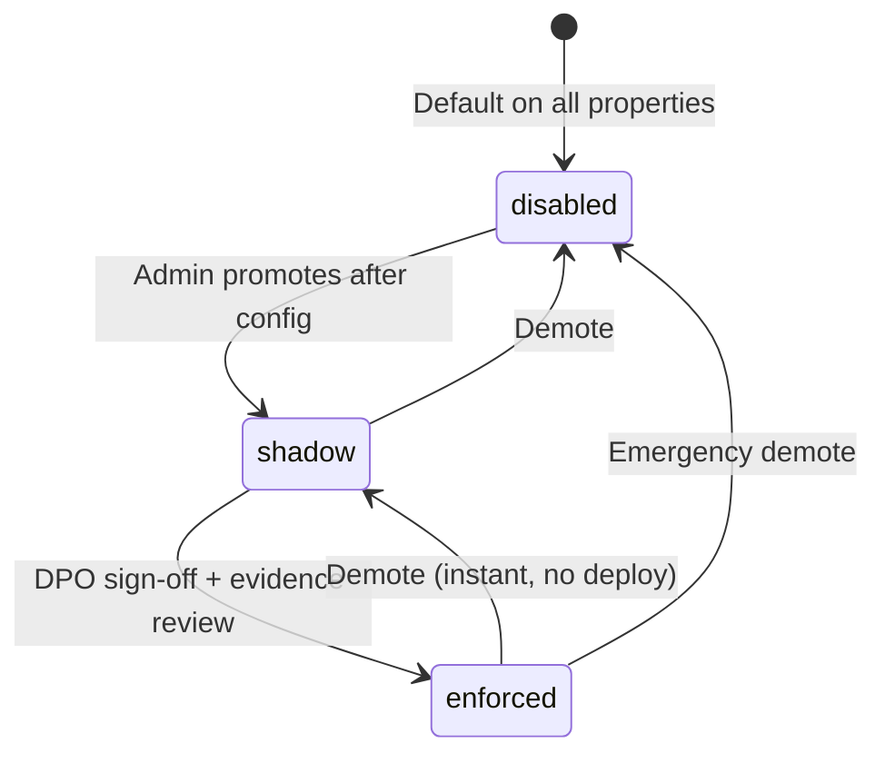
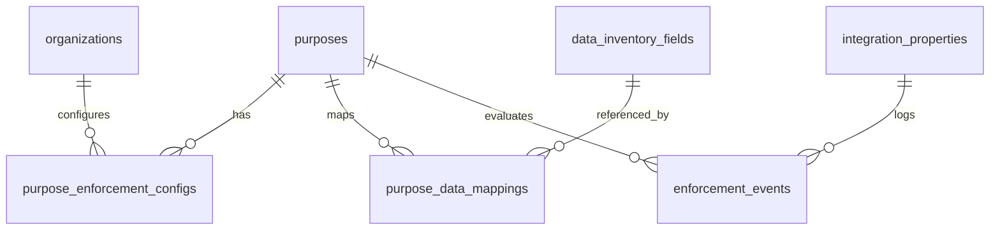

# Vajra — Consent Enforcement Technical Specification

This document serves as the **single source of truth** for the **Consent Enforcement** module of the Vajra DPDPA compliance platform. It explains how consent decisions made in the banner or preference centre change what happens to a **write** in the customer's own backend systems — not just whether a tracker script fires — and how every enforcement action is provable in the Proof Vault.

---

## 1. Module Overview

### 1.1 Purpose
**Consent Enforcement** bridges the gap between consent capture (banner, SDK, branch capture) and operational data processing. When a data principal denies or withdraws consent for a purpose, the platform provides a verifiable, low-latency answer to *"is this specific purpose currently consented for this specific person?"* at the moment of collection, and triggers automated remediation when the answer changes to "no."

### 1.2 Business Objective
To ensure that marketing opt-outs, analytics denials, and purpose withdrawals are enforced **server-side** in the customer's own databases and APIs — not only in the browser. This prevents the common compliance gap where a user withdraws consent in a preference centre but their data continues to be processed in backend systems.

### 1.3 DPDPA Compliance Objective
*   **Section 6(1)**: Consent must be obtained before processing for consent-based purposes — enforced at collection points via Decision API and decision tokens.
*   **Section 6(6)**: Processing must cease when consent is withdrawn — withdrawal remediation (mask, anonymize, delete) is triggered automatically via purpose→field mappings.
*   **Section 6(10)**: Burden of proof — every enforcement decision and remediation action is sealed in the Proof Vault.
*   **Section 7**: Legitimate-use and contract purposes are **never blockable** — structurally guaranteed in code, not by admin configuration.
*   **Section 8(5)**: Per-property signing secrets, server-side identifier hashing, no raw PII in enforcement event logs.

### 1.4 Architectural Context



### 1.5 Target Users
*   **Data Protection Officers (DPOs)**: Configure enforcement modes, review shadow-mode evidence, approve promotion to enforced mode, sign off on purpose→field mappings.
*   **Engineering / Integration leads**: Install `vajra-python` middleware, configure signing secrets, annotate collection points.
*   **Compliance engineers**: Monitor coverage metrics, event logs, and pending remediation tasks.

---

## 2. DPDPA Mapping & Compliance Matrix

| DPDPA Section | Regulatory Requirement | Consent Enforcement Implementation |
| :--- | :--- | :--- |
| **Section 6(1)** | Consent before processing for stated purpose | Decision API + decision token checked at each collection point |
| **Section 6(6)** | Cease processing on withdrawal | `ConsentWithdrawalRemediationService` wired to retention engine via `purpose_data_mappings` |
| **Section 6(10)** | Burden of proof on Data Fiduciary | Every decision and remediation action sealed in Proof Vault |
| **Section 7** | Legitimate-use / contract carve-outs | Non-consent purposes always return `allowed: true` — code-level guarantee |
| **Section 8(5)** | Reasonable security safeguards | Per-property HS256 signing secrets (encrypted at rest), server-side hashing only |

---

## 3. End-to-End User Journey

### 3.1 Admin Setup Journey



### 3.2 Runtime Enforcement Journey

1. User grants or denies consent via banner/SDK → consent receipt stored in Proof Vault.
2. SDK mints a short-lived **decision token** (15-minute TTL) bound to principal fingerprint and purpose decisions.
3. Customer backend receives write request with `X-ZS-Decision-Token` header.
4. `vajra-python` middleware verifies token locally (no network call on hot path).
5. If token missing/expired → fallback to Decision API (`POST /public/v1/integrations/{property_id}/consent/decision`).
6. If purpose denied and mode is `enforced` → reject (403), strip fields, or queue pending per `deny_behavior`.
7. Every evaluation logged to `enforcement_events` (fingerprint only, never raw email/phone).

### 3.3 Withdrawal Remediation Journey

1. Data principal withdraws consent via preference centre or DSAR.
2. `consent.withdrawn` webhook fires.
3. System queries `purpose_data_mappings` for withdrawn purposes.
4. For each mapped inventory field: create targeted retention run (mask/anonymize/delete) or manual remediation task.
5. Remediation completion sealed in Proof Vault.

---

## 4. Detailed Screen Specification

**Route:** `/consent/enforcement`

### 4.1 Summary Cards Row
| Card | Meaning |
| :--- | :--- |
| **Coverage** | % of consent-based purposes with at least one inventory field mapped |
| **Protected Endpoints** | Purposes where both property and purpose are in `enforced` mode |
| **Denied Today** | Decisions that blocked or shadow-flagged a write today |
| **Pending Remediations** | Withdrawal-triggered tasks awaiting completion |
| **Decision API p95** | 95th-percentile latency for server-side consent decisions |

### 4.2 Collection Points Table
Lists each consent-based purpose with:
*   Purpose name and legal basis badge
*   Enforcement mode (`disabled` / `shadow` / `enforced`)
*   Mapping status (`Mapped` / `Unmapped` amber badge)
*   Deny behavior (`reject`, `strip_fields`, `queue_pending`)
*   Actions: open Purpose Enforcement panel, promote/demote mode

### 4.3 Setup Wizard (7 Steps)
1. **Select property** — website, mobile, or API integration property
2. **Register collection points** — enable enforcement per consent-based purpose
3. **Map inventory fields** — link purposes to Data Inventory fields for withdrawal remediation
4. **Generate signing secret** — per-property secret for local token verification
5. **Configure deny behavior** — per-purpose reject/strip/queue settings
6. **Run test cases** — granted, denied, expired token, withdrawal, contract-purpose carve-out
7. **Promote to shadow** — begin observing real traffic without blocking

### 4.4 Purpose Enforcement Panel
Accessible from collection points table or Purpose Registry Enforcement tab:
*   Current mode with promote/demote controls (gated by checklist)
*   Mapped data fields with withdrawal action dropdown (mask, anonymize, delete, pseudonymize, flag manual review)
*   Signing secret reveal (admin only)

### 4.5 Event Log
Searchable table of enforcement decisions:
*   Principal fingerprint (never raw PII)
*   Purpose, decision (`allowed` / `denied` / `shadow_would_deny`)
*   Legal basis, effective mode, latency, timestamp
*   Expandable row detail

### 4.6 Withdrawal Remediation Queue
Kanban-style board (same visual pattern as DSAR SLA Tracker):
*   Columns: Pending → In Progress → Completed
*   Tasks created from `consent.withdrawn` events
*   Links to mapped inventory fields and retention runs

### 4.7 In-App Playbook
Right-drawer **Enforcement Playbook** covers:
*   Prerequisites (purposes, notices, properties, inventory, DPO sign-off)
*   Rollout phases (Disabled → Shadow → Enforced)
*   Implementation steps (7-step wizard mirror)
*   Metric definitions
*   Troubleshooting (unmapped purposes, 0% coverage, false denials, token failures, checkout blocks)

---

## 5. Enforcement Mode State Machine



**Effective mode** = weaker of property mode and purpose mode. Both must be `enforced` before writes are actually blocked.

| Mode | Behavior |
| :--- | :--- |
| **disabled** | Decisions computed for visibility; middleware never blocks |
| **shadow** | Logs `shadow_would_deny` events; no blocking |
| **enforced** | Middleware acts on deny per `deny_behavior` |

**Promotion to enforced requires:**
1. At least 7 days of shadow data (recommended)
2. Zero denials on any purpose with `legal_basis ≠ consent`
3. DPO/legal sign-off on purpose→field mappings
4. Engineering confirmation of middleware integration

---

## 6. Decision Token & API Concepts

### 6.1 Decision Token (Hot Path)
*   HS256 JWT signed with per-property secret (never global app secret)
*   Payload: principal fingerprint (`prn`), purpose decisions (`prp`), property ID (`prop`)
*   TTL: 15 minutes (configurable via `DECISION_TOKEN_TTL_SECONDS`)
*   Minted on consent capture and via `GET /consent/decision-token`
*   Verified locally by `vajra-python` — no network call per request

### 6.2 Decision API (Fallback Path)
*   Accepts **raw** `principal_email` and `principal_phone` (server hashes — never client-side)
*   Returns per-purpose decisions, legal basis, effective mode, and fresh decision token
*   Rate limit: 600 req/min per property (default)
*   Redis cache for decision latency when `REDIS_URL` configured

### 6.3 Deny Behaviors
| Behavior | Effect |
| :--- | :--- |
| **reject** | Return HTTP 403 on denied purpose |
| **strip_fields** | Remove mapped fields from payload, allow request |
| **queue_pending** | Hold request until consent obtained |

### 6.4 Contract / Legitimate-Use Guarantee
Purposes with `legal_basis` of `contract`, `legitimate_use`, or `legal_obligation` always return `allowed: true` regardless of receipt state. This is enforced in `ConsentDecisionService` and cannot be overridden by admin configuration.

---

## 7. Relationships with Other Modules

| Module | Relationship |
| :--- | :--- |
| **Purpose Registry** | Defines purposes, legal bases, and enforcement tab per purpose |
| **Data Inventory** | Supplies fields for `purpose_data_mappings`; shows purpose badges on fields |
| **Proof Vault** | Seals enforcement decisions and withdrawal remediation events |
| **Retention Policies** | `TriggerEvent.consent_withdrawal` obligations created from mappings |
| **Integrations (Website/Mobile/API)** | Integration properties carry `enforcement_mode` and signing secrets |
| **Received Consents** | Source of consent receipts evaluated by Decision API |
| **Consent Withdrawal Flow** | UI copy for withdrawal; real remediation runs via enforcement engine |
| **vajra-python package** | Reference middleware (`@require_consent` decorator) for customer backends |

---

## 8. SDK Integration (Customer-Facing)

### 8.1 CMP SDK Additions
```javascript
Vajra.getDecisionToken()           // cached token, refreshes if expired
Vajra.hasConsent(purpose)          // client-side purpose check
Vajra.guardSubmit(form, purpose)   // blocks submit + inline JIT prompt if denied
```

### 8.2 Form Annotation
```html
<form data-zs-collect-purpose="marketing_newsletter">
```
Only optional/marketing forms should be annotated. Checkout and fulfillment forms must **never** carry this attribute.

### 8.3 Python Middleware
```python
from vajra import require_consent

@app.post("/newsletter/subscribe")
@require_consent("marketing_newsletter")
def subscribe(...):
    ...
```

---

## 9. Backend Architecture

### 9.1 Key Services
*   `ConsentDecisionService` — evaluates consent per purpose, writes enforcement events
*   `ConsentDecisionTokenService` — mints and verifies HS256 decision tokens
*   `ConsentWithdrawalRemediationService` — creates retention runs and manual tasks on withdrawal
*   `decision_cache` (Redis) — short-TTL cache for decision API responses

### 9.2 Routers
*   `app/routers/enforcement.py` — admin config (property mode, purpose configs, mappings, event log, remediation queue)
*   `app/routers/integrations_public.py` — public Decision API, token mint/verify endpoints

### 9.3 Data Model
*   `integration_properties.enforcement_mode` — property-level mode
*   `integration_properties.decision_signing_secret_encrypted` — Fernet-encrypted per-property secret
*   `purpose_enforcement_configs` — per-purpose mode and deny behavior
*   `purpose_data_mappings` — purpose → inventory field + withdrawal action
*   `enforcement_events` — partitioned decision log (monthly range partitions)
*   `withdrawal_remediation_tasks` — kanban remediation queue

---

## 10. Database Design



---

## 11. API Design

### 11.1 Public Decision API
*   `POST /public/v1/integrations/{property_id}/consent/decision` — evaluate consent (fallback path)
*   `GET /public/v1/integrations/{property_id}/consent/decision-token` — mint fresh token
*   `POST /public/v1/integrations/{property_id}/consent/decision/verify` — verify token server-side

### 11.2 Admin Enforcement APIs
*   `GET/PATCH /api/enforcement/properties/{property_id}` — property enforcement mode
*   `GET /api/enforcement/properties/{property_id}/signing-secret` — reveal signing secret
*   `GET/PUT /api/enforcement/purpose-configs` — per-purpose mode and deny behavior
*   `GET/PUT /api/enforcement/purpose-mappings` — purpose→field mappings
*   `GET /api/enforcement/events` — paginated event log
*   `GET /api/enforcement/remediation-tasks` — withdrawal remediation queue

---

## 12. Security & Compliance Requirements

*   **Server-side hashing only**: Clients send raw email/phone over TLS; `ConsentPrincipalService.fingerprint` hashes server-side. Never reimplement the hash client-side.
*   **Per-property secrets**: A compromised secret affects only one property.
*   **No raw PII in event log**: Only `principal_fingerprint` stored in `enforcement_events`.
*   **RBAC**: `CONSENT_READ` / `CONSENT_WRITE` permissions for admin endpoints.
*   **Fail-safe default**: All properties start in `disabled` mode — zero behavior change on migration.
*   **Instant rollback**: Demote property or purpose to `shadow`/`disabled` via UI — takes effect on next API call, no redeploy.

---

## 13. QA Verification Matrix

### 13.1 Positive Test Cases
*   **TC-01**: Contract-purpose always returns `allowed: true` regardless of receipt state
*   **TC-02**: Shadow mode logs `shadow_would_deny` but middleware does not block
*   **TC-03**: Enforced mode with denied consent returns 403 (reject behavior)
*   **TC-04**: Expired token falls back to Decision API correctly
*   **TC-05**: `consent.withdrawn` creates remediation task for every mapped field
*   **TC-06**: Cross-property token rejected when verified against wrong secret

### 13.2 Negative Test Cases
*   **TC-07**: Viewer role cannot reveal signing secret
*   **TC-08**: Purpose with no mapping shows Unmapped badge; cannot promote to enforced without mapping
*   **TC-09**: Client-side hash mismatch results in consistent deny (documented anti-pattern)
