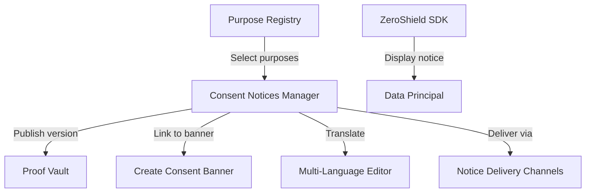
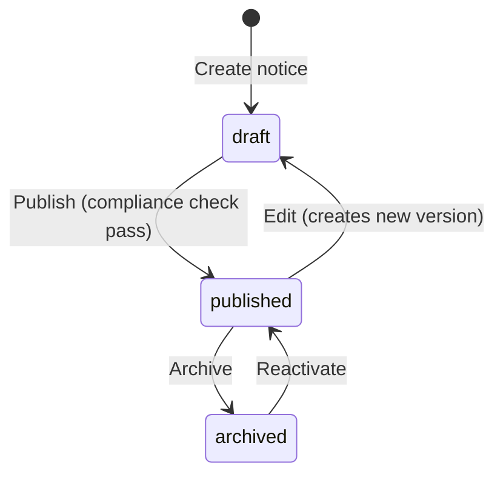

# DPDPA Shield — Consent Notices Manager Technical Specification

This document serves as the **single source of truth** for the **Consent Notices Manager** module of the ZeroShield DPDPA compliance platform.

---

## 1. Module Overview

### 1.1 Purpose
The **Consent Notices Manager** is where organizations author, version, validate, and publish legally compliant **Consent Notices** under DPDPA. A notice defines what personal data is collected, for which purposes, how long it is retained, and how data principals can exercise their rights.

### 1.2 Business Objective
To provide an enterprise-ready workflow for compliance teams to create DPDPA-compliant notices without code changes — with built-in compliance checks, multi-language support, and version control.

### 1.3 DPDPA Compliance Objective
*   **Section 6(1)**: Consent must be free, specific, informed, unconditional, and unambiguous.
*   **Section 6(3)**: Notice must specify data categories, purposes, retention, and grievance mechanism.
*   **Section 6(3)(a)**: Right to withdraw consent must be disclosed.
*   **Section 6(3)(b)**: Grievance redressal mechanism including DPBI complaint right.
*   **Section 6(3)(c)**: DPO or authorized representative contact details.
*   **Section 6(10)**: Burden of proof — published versions sealed in Proof Vault.

### 1.4 Architectural Context



### 1.5 Target Users
*   **DPOs**: Author notices, oversee compliance scores, approve drafts.
*   **Legal / Compliance teams**: Configure notice text, legal bases, audit criteria.
*   **Administrators**: Configure language localizations and delivery channels.

---

## 2. DPDPA Mapping & Compliance Matrix

| DPDPA Section | Requirement | Implementation |
| :--- | :--- | :--- |
| **Section 6(1)** | Specific, informed consent | Links explicit purposes from registry |
| **Section 6(3)** | Notice content requirements | Mandatory fields: data categories, purposes, retention, DPO contact |
| **Section 6(3)(a)** | Withdrawal right disclosure | `rights_exercise` field with compliance check |
| **Section 6(3)(b)** | Grievance mechanism | `complaint_process` field citing DPBI |
| **Section 6(10)** | Burden of proof | Version snapshots sealed in Proof Vault |

---

## 3. End-to-End User Journey

```mermaid
sequenceDiagram
    autonumber
    actor DPO as Compliance Manager
    participant FE as Notices Manager UI
    participant BE as Backend
    participant PV as Proof Vault

    DPO->>FE: Click "Create Notice" (/consent/notices/new)
    FE->>BE: GET /consent/purposes (active purposes)
    DPO->>FE: Step 1: Basic info (title, DPO contact)
    DPO->>FE: Step 2: Select purposes from registry
    DPO->>FE: Step 3: Author notice text sections
    DPO->>FE: Step 4: Run compliance checks
    FE->>BE: POST /consent/notices (create draft)
    DPO->>FE: Review compliance score; fix warnings
    DPO->>FE: Click "Publish"
    FE->>BE: POST /consent/notices/{id}/publish
    BE->>PV: Seal version snapshot
    BE-->>FE: Notice status = published
```

### 3.1 Scenario Workflows
*   **New notice from scratch**: Create → select purposes → author text → compliance check → publish.
*   **Shield AI draft**: Upload policy document or answer questions → Shield AI generates notice fields → DPO reviews and edits → publish.
*   **Version update**: Edit published notice → new draft version → re-publish → linked banners show update indicator.
*   **Multi-language**: Publish English version → open Multi-Language Editor → add Hindi/Tamil translations.

---

## 4. Detailed Screen Specification

**Route:** `/consent/notices`

### 4.1 Notice List View
*   Cards/table: notice title, status (draft/published/archived), version number, linked purposes count, compliance score, last updated.
*   Filters: status, search, sort by date.
*   Actions: Create new, edit, duplicate, archive, view Proof Vault record.

### 4.2 Notice Editor (`/consent/notices/new` or `/consent/notices/{id}/edit`)
Multi-step wizard:

**Step 1 — Basic Information**
*   Notice title (internal name)
*   Display name (user-facing)
*   Contact email, contact website
*   DPO name, DPO email

**Step 2 — Purposes & Data Categories**
*   Multi-select from Purpose Registry
*   Auto-populated data categories from selected purposes
*   Legal basis summary per purpose

**Step 3 — Notice Content**
*   Opening statement
*   Rights exercise description (withdrawal mechanism)
*   Complaint process (grievance + DPBI)
*   Retention policy description
*   Rich text editor with compliance keyword detection

**Step 4 — Compliance Review**
*   Automated compliance score (0–100)
*   Warning list: missing withdrawal keywords, missing DPO contact, no purposes linked, etc.
*   Publish button (enabled when score ≥ threshold)

### 4.3 Compliance Checks
| Check | Trigger |
| :--- | :--- |
| Withdrawal keywords | `rights_exercise` must mention withdraw/revoke |
| DPO contact | `dpo_email` or `contact_email` required |
| Purposes linked | At least one purpose selected |
| Grievance process | `complaint_process` must mention DPBI/Board |
| Retention stated | `retention_policy` non-empty |

---

## 5. Notice Lifecycle



---

## 6. Relationships with Other Modules

| Module | Relationship |
| :--- | :--- |
| **Purpose Registry** | Notices link to purposes; purposes drive content |
| **Create Consent (Banner)** | Banners link to published notices |
| **Multi-Language Editor** | Translations stored on notice versions |
| **Proof Vault** | Published versions sealed as immutable snapshots |
| **Notice Delivery Channels** | Notices delivered via email/SMS campaigns |
| **Shield AI** | Can draft notice content from documents or Q&A |
| **Received Consents** | Consent receipts reference notice version |

---

## 7. Backend Architecture

*   **Models**: `consent_notices`, `consent_notice_versions`
*   **Service**: Notice authoring, compliance scoring, publish workflow
*   **Proof Vault integration**: Snapshot on publish

---

## 8. API Design

*   `GET /api/consent/notices` — list notices
*   `POST /api/consent/notices` — create draft
*   `GET /api/consent/notices/{id}` — detail with versions
*   `PATCH /api/consent/notices/{id}` — update draft version
*   `POST /api/consent/notices/{id}/publish` — publish with compliance check
*   `POST /api/consent/notices/{id}/archive` — archive notice
*   `GET /api/consent/notices/{id}/compliance-score` — run compliance checks

---

## 9. Security & Compliance Requirements

*   Published versions are immutable — edits create new draft versions.
*   Only admin/superadmin can publish or archive.
*   All publish events logged in audit log and Proof Vault.

---

## 10. QA Verification Matrix

*   **TC-01**: Create notice with all required fields; compliance score ≥ 80.
*   **TC-02**: Publish notice; Proof Vault record created.
*   **TC-03**: Missing withdrawal keywords blocks publish.
*   **TC-04**: Edit published notice creates new draft version without affecting live version.
*   **TC-05**: Viewer role cannot publish notices.
