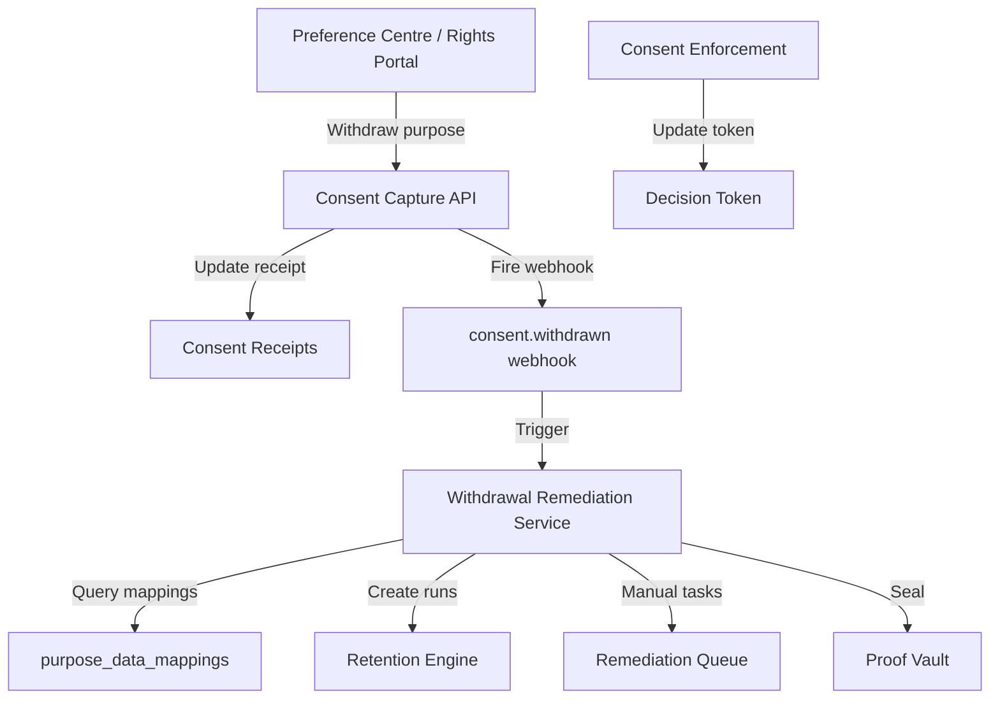
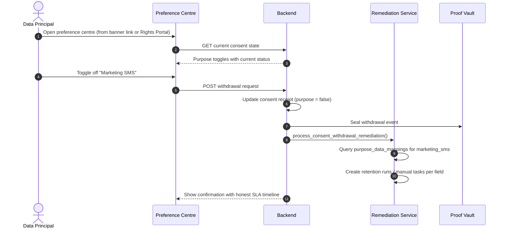
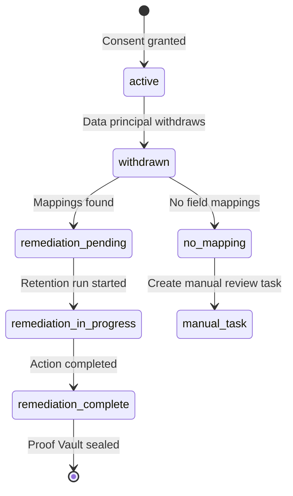

# Vajra — Consent Withdrawal Flow Technical Specification

This document serves as the **single source of truth** for the **Consent Withdrawal Flow** module of the Vajra DPDPA compliance platform.

---

## 1. Module Overview

### 1.1 Purpose
The **Consent Withdrawal Flow** module documents and configures how data principals can withdraw consent as easily as they gave it — a core DPDPA requirement. It covers the preference centre UX, withdrawal confirmation messaging, and the automated remediation pipeline that processes data when consent is withdrawn.

### 1.2 Business Objective
To ensure withdrawal is not a dead-end UI copy exercise but a fully wired compliance workflow: withdrawal triggers server-side enforcement changes, data remediation (mask/delete/anonymize), Proof Vault sealing, and webhook notifications to downstream systems.

### 1.3 DPDPA Compliance Objective
*   **Section 6(4)**: Withdrawal must be as easy as giving consent.
*   **Section 6(6)**: Data Fiduciary must cease processing upon withdrawal.
*   **Section 6(10)**: Withdrawal events must be provable in Proof Vault.
*   **Section 11**: Withdrawal is a data principal right exercisable via the Rights Portal.

### 1.4 Architectural Context

### 1.5 Target Users
*   **DPOs**: Configure withdrawal messaging, review remediation SLAs.
*   **Compliance teams**: Monitor withdrawal compliance and remediation completion.
*   **Data principals**: Exercise withdrawal via preference centre or Rights Portal.

---

## 2. DPDPA Mapping & Compliance Matrix

| DPDPA Section | Requirement | Implementation |
| :--- | :--- | :--- |
| **Section 6(4)** | Easy withdrawal | Preference centre link in every banner; one-click purpose toggle off |
| **Section 6(6)** | Cease processing | Automated remediation via purpose→field mappings |
| **Section 6(10)** | Burden of proof | Withdrawal sealed in Proof Vault; remediation completion sealed |
| **Section 11** | Right to erasure | Withdrawal triggers data deletion/masking per mapped action |

---

## 3. End-to-End User Journey

### 3.1 Data Principal Withdrawal

### 3.2 Admin Monitoring Journey
1. DPO opens Consent Enforcement → Remediation Queue.
2. Views pending/in-progress/completed withdrawal tasks.
3. Verifies each mapped field has a remediation action assigned.
4. Confirms Proof Vault seals for completed remediations.

---

## 4. Detailed Screen Specification

**Route:** `/consent/withdrawal`

### 4.1 Withdrawal Flow Configuration Page
This page documents the withdrawal workflow and provides configuration for:

**Withdrawal UX Settings**
*   Preference centre URL (auto-generated or custom)
*   Confirmation message template (must state honest remediation timeline)
*   Per-purpose withdrawal descriptions (what happens when withdrawn)
*   Re-consent prompt settings (when to re-ask after withdrawal)

**Withdrawal Messaging Guidelines**
*   Never promise "immediately deleted" unless mapped action is `delete` with no retention override
*   State SLA-backed timeline (e.g., "within 72 hours")
*   Explain which data categories are affected per purpose
*   Provide contact for grievance if withdrawal processing is delayed

### 4.2 Preference Centre (Customer-Facing)
Delivered via SDK, accessible from banner footer link:
*   Purpose-level on/off toggles
*   Current consent status per purpose
*   Withdrawal confirmation dialog with remediation timeline
*   Receipt download link
*   DSAR shortcut (link to Rights Portal)
*   Contact DPO link

### 4.3 Remediation Queue (in Consent Enforcement)
Kanban board for withdrawal-triggered tasks:
*   **Pending**: Task created, awaiting execution
*   **In Progress**: Retention run executing or manual review assigned
*   **Completed**: Remediation done, Proof Vault sealed
*   Each task shows: principal fingerprint, purpose, mapped field, action (mask/delete/anonymize), SLA deadline

---

## 5. Withdrawal Remediation Actions

| Action | Effect | When to Use |
| :--- | :--- | :--- |
| **suppress** | Stop future processing; retain existing data | Marketing lists, analytics flags |
| **mask** | Mask field values in connected data source | PII fields in databases |
| **anonymize** | Irreversibly anonymize field values | Analytics data, logs |
| **delete** | Permanently delete records/fields | Optional marketing data |
| **pseudonymize** | Replace with pseudonymous identifier | Research datasets |
| **flag_manual_review** | Create manual task for unconnected systems | Legacy systems without API |

Actions configured per field in `purpose_data_mappings` (Purpose Registry Enforcement tab or Consent Enforcement Setup Wizard).

---

## 6. Withdrawal Lifecycle

---

## 7. Relationships with Other Modules

| Module | Relationship |
| :--- | :--- |
| **Consent Enforcement** | Remediation queue, purpose→field mappings |
| **Retention Policies** | `TriggerEvent.consent_withdrawal` creates targeted runs |
| **Data Inventory** | Fields mapped for remediation |
| **Proof Vault** | Withdrawal and remediation completion sealed |
| **Rights Portal** | Alternative withdrawal channel for data principals |
| **Received Consents** | Receipt status updated on withdrawal |
| **Notice Delivery Channels** | Withdrawal confirmation can be sent via email/SMS |

---

## 8. Backend Architecture

*   **Service**: `ConsentWithdrawalRemediationService` — orchestrates remediation
*   **Hook**: `process_consent_withdrawal_remediation()` in `consent_withdrawal_hooks.py`
*   **Webhook**: `consent.withdrawn` event dispatched to configured endpoints
*   **Retention**: `RetentionObligationService` with `TriggerEvent.consent_withdrawal`

---

## 9. API Design

*   `POST /public/v1/integrations/{property_id}/consent` — withdrawal via SDK (purpose=false)
*   `POST /api/rights/portal/withdraw` — withdrawal via Rights Portal
*   `GET /api/enforcement/remediation-tasks` — admin remediation queue
*   Webhook payload: `consent.withdrawn` with principal_id, withdrawn_purposes[], timestamp

---

## 10. Security & Compliance Requirements

*   Withdrawal must be authenticated (session token or verified OTP for banking).
*   Remediation tasks scoped to organization; no cross-tenant access.
*   SLA tracking: default 72-hour remediation window; configurable per organization.
*   All withdrawal events immutable in Proof Vault.

---

## 11. QA Verification Matrix

*   **TC-01**: Withdraw purpose via preference centre; receipt status updated.
*   **TC-02**: Withdrawal creates remediation task for each mapped field.
*   **TC-03**: Proof Vault seal created for withdrawal event.
*   **TC-04**: Decision token reflects withdrawal on next mint.
*   **TC-05**: Unmapped purpose withdrawal creates manual review task only.
*   **TC-06**: Confirmation message shows honest SLA (not "immediately deleted").
