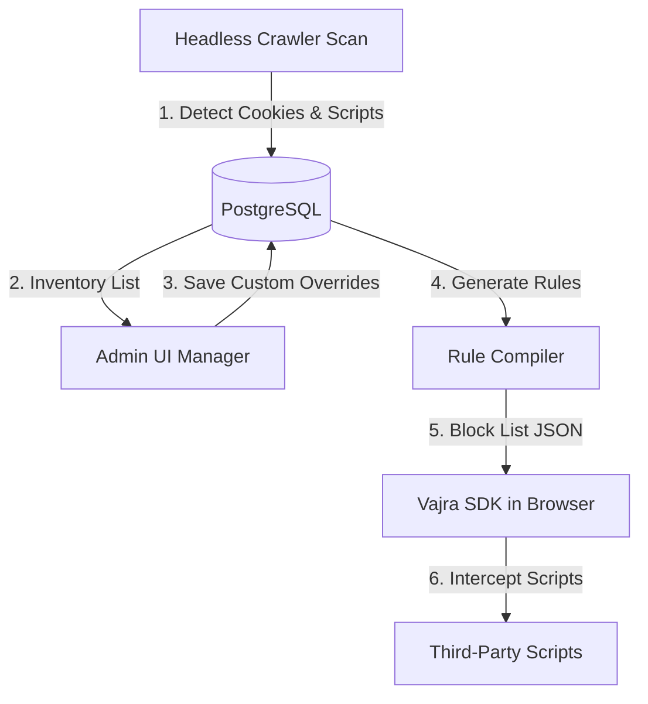
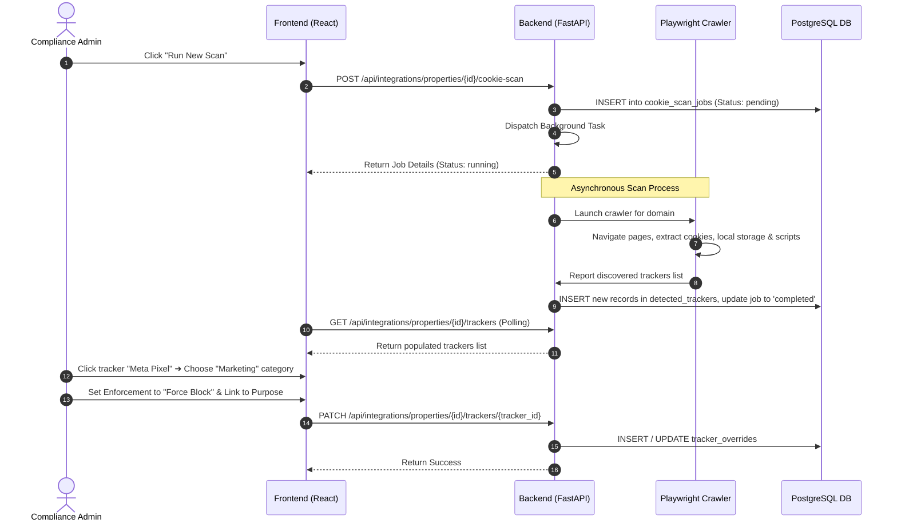
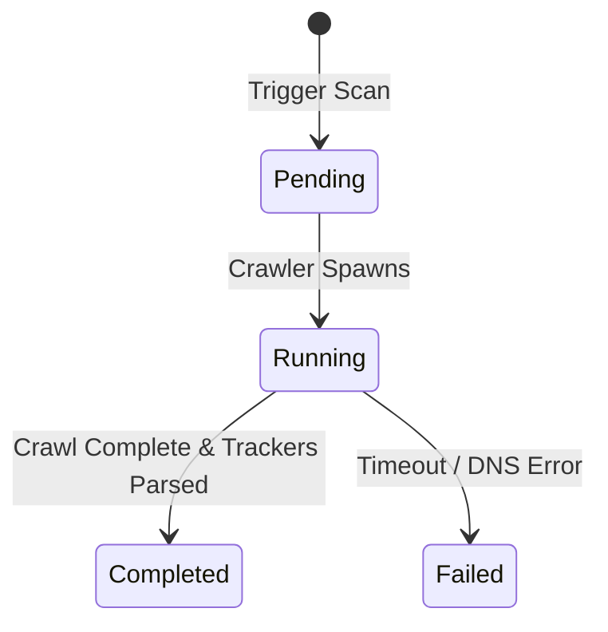
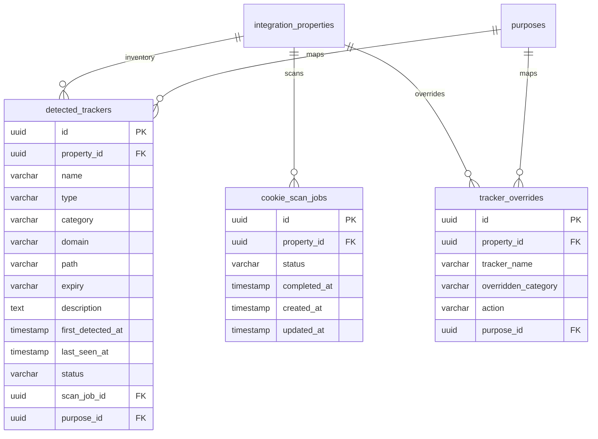

# Vajra — Cookie & Tracker Manager Technical Specification

This document serves as the **single source of truth** for the **Cookie & Tracker Manager** module of the Vajra DPDPA compliance platform. It provides the detailed frontend, backend, database, integration, and compliance specifications required to build, test, and maintain this module.

---

## 1. Module Overview

### 1.1 Purpose
The **Cookie & Tracker Manager** allows organizations to scan their web properties, audit cookies and trackers, assign them to compliance categories, map them to DPDPA processing purposes, and configure script enforcement rules.

### 1.2 Business Objective
To provide a central interface for managing third-party scripts (e.g., Google Analytics, Meta Pixel) and first-party cookies. This ensures that no non-essential trackers fire on a user's browser before they provide active, informed consent.

### 1.3 DPDPA Compliance Objective
*   **Prior Consent (Section 6)**: Consent must be obtained before processing begins. Trackers (except strictly necessary ones) must remain blocked until the user opts in.
*   **Purpose Specification**: Trackers must be linked to specific, stated processing purposes in the Consent Notice, matching the requirements of Section 6(3).
*   **Audit Readiness**: Maintain a categorized registry of all active trackers to demonstrate compliance to the Data Protection Board of India (DPBI) and avoid penalties (up to ₹150 Crore for processing without valid consent).

### 1.4 Architectural Context
The Cookie & Tracker Manager sits between web crawler scanning and the SDK blocking engine:



### 1.5 Target Users
*   **DPOs & Compliance Managers**: Audit cookie lists, review categorizations, and verify compliance scores.
*   **Web Developers**: Integrate the Vajra SDK, configure blocking overrides, and verify that analytics/marketing tags align with user preferences.

---

## 2. DPDPA Mapping & Compliance Matrix

| DPDPA Section | Regulatory Requirement | Cookie & Tracker Manager Implementation |
| :--- | :--- | :--- |
| **Section 6(1)** | Consent must be specific and informed. | Cookies/trackers are mapped to explicit DPDPA `purposes` rather than using a general site-wide consent toggle. |
| **Section 6(3)** | Notice must state what personal data categories are collected and why. | Trackers are grouped by category (Essential, Analytics, Marketing, Functional) and mapped to data attributes in the Consent Notice. |
| **Section 6(10)** | Fiduciaries must prove compliance. | Reports detailing scanner results, categorized lists, and active overrides can be exported as PDF compliance evidence. |
| **Section 15** | Penalties for non-compliance (up to ₹150 Crore). | Interactive penalty risk indicator alerts administrators if uncategorized or unmapped trackers are actively running. |

---

## 3. End-to-End User Journey



### 3.1 Scenario Workflows
*   **Cookie Scanning Flow**: Admin triggers scan ➜ Crawler visits pages in background ➜ Discovered scripts, cookies, and storage entities are written to the database ➜ Admin interface refreshes.
*   **Manual Classification Flow**: Admin reviews "Uncategorized" list ➜ Map tracker to Category (Analytics/Marketing) and DPDPA Purpose ➜ Update saved.
*   **SDK Enforcement Compilation**: When the SDK requests configuration, the backend resolves overrides, checks if the linked notice is live, resolves fallback mappings, and generates a structured block list mapping purpose IDs to script patterns.

---

## 4. Detailed Screen Specification

The Cookie & Tracker Manager features a unified view with tabs for each property:

### 4.1 Stats Dashboard HUD
*   **Purpose**: Display inventory counts and category metrics at a glance.
*   **UI Components**:
    *   **Detected Trackers**: Total item count.
    *   **Categorized**: Checkmark chip showing count of classified trackers.
    *   **Uncategorized**: Warning chip indicating remaining backlog.
    *   **Explicitly Blocked**: Shield chip showing overridden block rules.
    *   **Enforcement Engine HUD**: Show active Blocker Mode (`Strict` vs `Standard`) and last crawl timestamp.

### 4.2 Tracker Inventory Table
*   **Purpose**: Browse and select discovered cookies and scripts.
*   **Columns**:
    1.  **Tracker Name**: Unique string identifier (e.g., `_ga`, `fbp`, `csrftoken`).
    2.  **Type**: Displays `cookie`, `local_storage`, `session_storage`, or `pixel`.
    3.  **Active Category**: Color-coded pill (Blue: Analytics, Purple: Marketing, Gray: Essential, Yellow: Unknown).
    4.  **Domain**: Origin host of the tracker.
    5.  **Enforcement**: Action status (Auto-SDK, Force Allowed, Force Blocked).

### 4.3 Tracker Details Drawer
*   **Purpose**: Action drawer to override classifications, link purposes, and change SDK blocking rules.
*   **Form Fields**:
    *   **Categorization**: Select dropdown (Essential, Analytics, Marketing, Functional, Unknown).
    *   **DPDPA Purpose Mapping**: Link the cookie directly to a dynamic purpose from the Purpose Registry.
    *   **SDK Enforcement**: Tab selector to choose action (`Auto`, `Force Allow`, `Force Block`).
    *   **Metadata Pane**: Show first detected time, last seen time, file path, and cookie expiry.

---

## 5. Form Schema (Tracker Override)

| Field Name | Type | Description | Validation | Example Value |
| :--- | :--- | :--- | :--- | :--- |
| `overridden_category` | String | Compliance classification override | `essential`, `analytics`, `marketing`, `functional`, or `unknown` | `"analytics"` |
| `action` | String | Custom SDK script enforcement action | `allow`, `block`, or `auto` | `"block"` |
| `purpose_id` | UUID | Associated registry processing purpose | Must map to an active Purpose ID, Optional | `"a9a460b1-4bb2-466d-961f-cfa8448f2b1d"` |

---

## 6. Scanner & Job Lifecycle

A scanning job transitions through these states during crawl executions:



*   **Pending**: Job queued in database, waiting for execution.
*   **Running**: Crawler is navigating target domain and analyzing local assets.
*   **Completed**: Discovered items reconciled with database records. `last_seen_at` timestamps updated.

---

## 7. Relationships with Other Modules

*   **Consent Banner Builder (Key Integration)**:
    *   *Categorization sync*: The classifications configured in this module (Necessary, Analytics, Marketing, Functional) determine which category cards display on Step 4 (Privacy Categories) of the Consent Banner Builder Wizard.
    *   *Enforcement Rules*: Banners rendered by the SDK pull the compiled block list JSON generated from `DetectedTracker` and `TrackerOverride` models. If a category is toggled OFF on the banner, scripts matching the patterns are blocked from executing.
    *   *Pre-Consent warning*: If crawler finds a tracker running before user consent (e.g. `fbp`), the Banner Builder shows an alarm chip: *"⚠ fbp loaded before consent — needs fixing"*, and lists it in compliance check stats.
*   **Consent Notices Manager**: Notices run compliance warnings if active integration properties contain trackers not mapped to active notice purposes.
*   **Purpose Registry**: Feeds purposes to link with trackers, enabling the SDK to block scripts if consent is denied.
*   **Technical Integration (Properties)**: Feeds property domains and manages API deployment credentials.
*   **Compliance Dashboard**: Exports compliance metrics and scanning reports.

---

## 8. Frontend Architecture

### 8.1 Page Component Structure
```
CookieTrackerManager.tsx (Tabs list & Property selector)
  ├── ScanHUD.tsx (Trigger button, Scan status & progress bar)
  ├── TrackersTable.tsx (Filterable lists & pagination)
  └── TrackerDetailsDrawer.tsx (Override controls & Purpose selector)
```

---

## 9. Backend Architecture

### 9.1 Files & Modules Layout
*   **Router**: `app/routers/integrations.py` exposes endpoints for starting scans, checking status, fetching trackers, and saving overrides.
*   **Service**: `app/services/tracker_service.py` houses database queries, override reconciliations, and compiler logic for script-blocking configurations.
*   **Crawler**: `app/services/cookie_crawler.py` launches a headless browser to record storage items and network script requests.

### 9.2 SDK Blocking Rule Compiler
When the client SDK requests configuration, `TrackerService.get_blocking_rules` compiles the rules:
1.  Verify the property has an active `ConsentNotice` linked to it.
2.  Retrieve all `DetectedTracker` rows and map any active `TrackerOverride` entries.
3.  If a tracker has `action == "allow"`, omit it from blocking.
4.  **Purpose Resolution Engine**:
    *   If a tracker is mapped to an active purpose in the live notice version, keep that mapping.
    *   If mapped to an inactive purpose or unmapped: scan active notice purposes for category keywords (e.g. "analytics", "marketing", "ads"). Map the tracker to the matching purpose.
    *   If no keyword matches: fall back to the first non-essential active purpose.
5.  Generate a JSON dictionary mapping the resolved purpose IDs to their corresponding list of cookie/script patterns:
    ```json
    {
      "a9a460b1-4bb2-466d-961f-cfa8448f2b1d": ["_ga", "_gid", "google-analytics.com"],
      "5fdc2e17-b70d-45db-9580-ff6df710c01a": ["_fbp", "facebook.net"]
    }
    ```

---

## 10. Database Design



### 10.1 Constraints & Indexes
*   **Unique Override Constraint**:
    ```sql
    ALTER TABLE tracker_overrides 
    ADD CONSTRAINT uq_override_property_tracker UNIQUE (property_id, tracker_name);
    ```
*   **Foreign Key Indexes**: Indicated on `property_id`, `tracker_name`, and `purpose_id` columns to optimize SDK blocking rule queries.

---

## 11. API Design

### 11.1 Trigger Cookie Scan
*   **Method / Route**: `POST /api/integrations/properties/{property_id}/cookie-scan`
*   **Response Body (200 OK)**:
    ```json
    {
      "id": "e58d234a-9e12-42bb-92f7-7b89d4cb8a2b",
      "property_id": "b32810a9-3d12-4d1a-be10-8b63a0ef62cb",
      "status": "pending",
      "completed_at": null,
      "created_at": "2026-06-24T23:43:00Z"
    }
    ```

### 11.2 List Property Trackers
*   **Method / Route**: `GET /api/integrations/properties/{property_id}/trackers`
*   **Response Body (200 OK)**:
    ```json
    [
      {
        "id": "d1a87d89-9831-419b-a010-8b630f9a2de0",
        "property_id": "b32810a9-3d12-4d1a-be10-8b63a0ef62cb",
        "name": "_ga",
        "type": "cookie",
        "category": "analytics",
        "domain": ".vajra.in",
        "path": "/",
        "expiry": "730 days",
        "description": "Google Analytics identifier",
        "first_detected_at": "2026-06-24T18:00:00Z",
        "last_seen_at": "2026-06-24T23:40:00Z",
        "status": "active",
        "scan_job_id": "e58d234a-9e12-42bb-92f7-7b89d4cb8a2b",
        "purpose_id": "a9a460b1-4bb2-466d-961f-cfa8448f2b1d",
        "override_action": "auto",
        "active_category": "analytics",
        "active_purpose_id": "a9a460b1-4bb2-466d-961f-cfa8448f2b1d"
      }
    ]
    ```

### 11.3 Save Tracker Override
*   **Method / Route**: `PATCH /api/integrations/properties/{property_id}/trackers/{tracker_id}`
*   **Request Body**:
    ```json
    {
      "overridden_category": "marketing",
      "action": "block",
      "purpose_id": "5fdc2e17-b70d-45db-9580-ff6df710c01a"
    }
    ```
*   **Response Body (200 OK)**:
    ```json
    {
      "status": "success"
    }
    ```

---

## 12. Security & Isolation Requirements

*   **RBAC Policy**: Only users with roles `admin` or `superadmin` can save overrides or trigger crawler scans.
*   **Crawler Isolation**: The crawler engine runs headless browser instances in sandboxed subprocess containers to prevent local script execution from compromising the host server.

---

## 13. QA Verification Matrix

### 13.1 Positive Test Cases
*   **TC-01 (Trigger Scan)**: Trigger a new scan. Verify the job transitions from `pending` to `running`, and finally to `completed`.
*   **TC-02 (Save Custom Override)**: Save an override setting the category to `marketing` and enforcement action to `Force Block`. Check that subsequent requests compile the tracker name into the blocking list.
*   **TC-03 (Resolution Fallback)**: Test the fallback resolver. Link a tracker to an inactive purpose, verify that the compiled rules fall back to matching categories or non-essential active purposes.

### 13.2 Negative Test Cases
*   **TC-04 (Scan on Archived Property)**: Attempt to trigger a scan on an archived property. Verify response code `404 Not Found`.
*   **TC-05 (Invalid Override Category)**: Try to save an override with a category name that does not exist. Verify validation error `422 Unprocessable Entity`.
