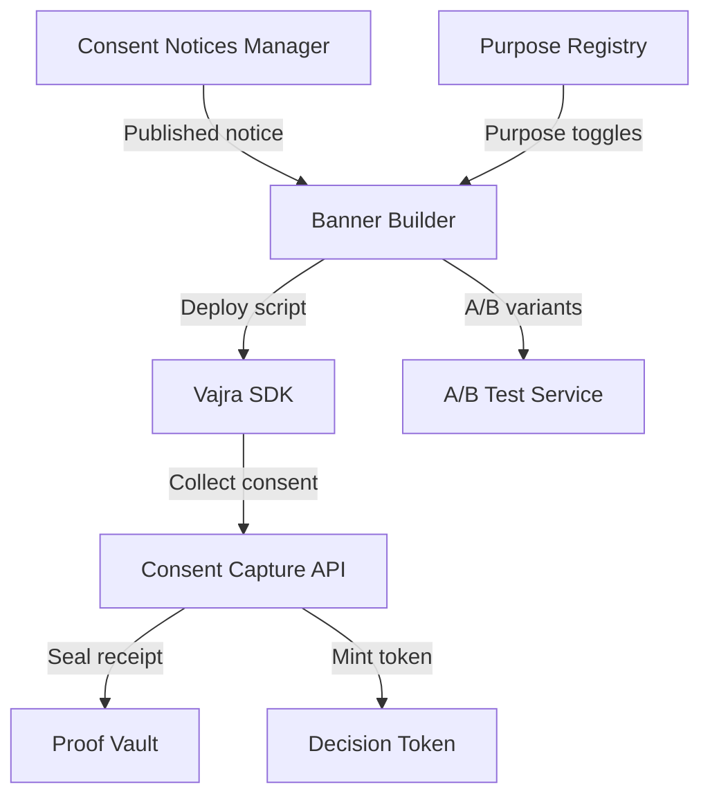
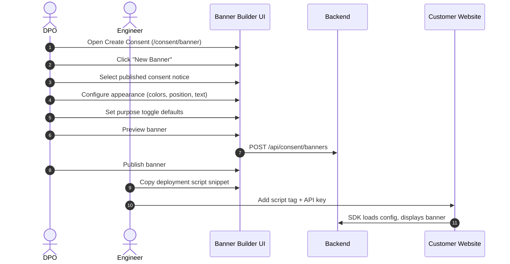
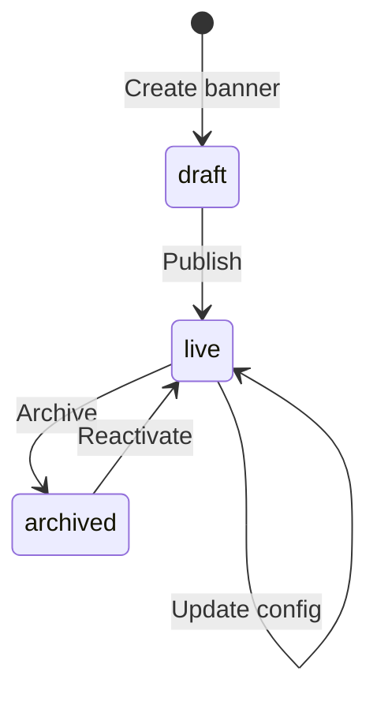

# Vajra — Create Consent (Banner Builder) Technical Specification

This document serves as the **single source of truth** for the **Create Consent** module — the **Consent Banner Builder** — of the Vajra DPDPA compliance platform.

> **Note:** This module (`/consent/banner`) is distinct from the **Consent Notices Manager** (`/consent/notices`). The Banner Builder creates deployable consent banners/widgets that display a published notice and collect consent. The Notices Manager authors the legal notice content itself. See `consent_notices_manager.md` for notice authoring.

---

## 1. Module Overview

### 1.1 Purpose
The **Create Consent** (Banner Builder) module allows organizations to design, configure, and deploy interactive **consent banners** and preference centres that display published consent notices, collect granular purpose-level consent, and integrate with the Vajra SDK on websites, mobile apps, and APIs.

### 1.2 Business Objective
To provide a no-code banner designer that compliance teams can configure and engineering teams can deploy with a single script tag — enabling DPDPA-compliant consent collection without custom frontend development.

### 1.3 DPDPA Compliance Objective
*   **Section 6(1)**: Granular purpose-level toggles (not blanket consent).
*   **Section 6(3)**: Banner displays linked notice with all required disclosures.
*   **Section 6(4)**: Easy withdrawal via preference centre link.
*   **Section 6(10)**: Every consent decision sealed in Proof Vault via consent receipt.

### 1.4 Architectural Context



### 1.5 Target Users
*   **DPOs / Compliance**: Configure banner appearance, link notices, set purpose defaults.
*   **Marketing / Product**: Design banner UX, A/B test variants.
*   **Engineering**: Deploy SDK script, configure property API keys.

---

## 2. DPDPA Mapping & Compliance Matrix

| DPDPA Section | Requirement | Banner Builder Implementation |
| :--- | :--- | :--- |
| **Section 6(1)** | Specific, informed consent | Per-purpose toggles from Purpose Registry |
| **Section 6(3)** | Notice presentation | Links to published consent notice |
| **Section 6(4)** | Easy withdrawal | Preference centre link in banner footer |
| **Section 6(10)** | Burden of proof | Consent receipts with cryptographic seals |

---

## 3. End-to-End User Journey



### 3.1 Scenario Workflows
*   **First banner**: Create → link notice → configure → publish → deploy script.
*   **A/B testing**: Create variant B → configure different copy/layout → SDK auto-assigns variant.
*   **Update notice**: Publish new notice version → banner shows update indicator → user re-consent on next visit.
*   **Enforcement integration**: Banner mints decision tokens on consent capture for server-side enforcement.

---

## 4. Detailed Screen Specification

**Route:** `/consent/banner`

### 4.1 Banner List View
*   Cards: banner name, linked notice, status (draft/live), property associations, consent count.
*   Actions: Create, edit, duplicate, archive, view analytics.

### 4.2 Banner Creation Wizard (`/consent/banner/new`)
**Step 1 — Select Notice**
*   Dropdown of published consent notices
*   Preview notice content

**Step 2 — Appearance**
*   Banner position (bottom bar, center modal, side panel)
*   Colors (primary, background, text)
*   Logo upload
*   Button labels (Accept All, Reject All, Customize)

**Step 3 — Purpose Configuration**
*   Purpose toggles from linked notice
*   Default state per purpose (on/off)
*   Required vs optional purpose indicators
*   Contract/legitimate-use purposes shown as informational (no toggle)

**Step 4 — Advanced Settings**
*   Re-consent interval (days)
*   Geo-targeting rules
*   A/B test variant configuration
*   Preference centre URL
*   Cookie consent mode integration (GTM consent mode v2)

**Step 5 — Preview & Publish**
*   Live preview panel
*   Mobile/desktop toggle
*   Compliance checklist
*   Publish button

### 4.3 Deployment Snippet
After publish, displays:
```html
<script src="https://cdn.vajra.io/cmp.js"
        data-property-id="YOUR_PROPERTY_ID"
        data-api-key="YOUR_API_KEY"></script>
```

---

## 5. Banner Lifecycle



---

## 6. Relationships with Other Modules

| Module | Relationship |
| :--- | :--- |
| **Consent Notices Manager** | Banner displays a published notice |
| **Purpose Registry** | Purpose toggles sourced from notice's linked purposes |
| **Integrations (Website/Mobile)** | Banner associated with integration properties |
| **Proof Vault** | Consent receipts sealed on capture |
| **Consent Enforcement** | Decision tokens minted on consent capture |
| **Cookie & Tracker Manager** | GTM consent mode integration |
| **Received Consents** | Captured consents appear in received consents table |
| **Tag Manager** | Tracker blocking rules respect banner consent state |

---

## 7. SDK Integration

### 7.1 Key SDK Methods
```javascript
Vajra.showBanner()           // display banner
Vajra.getConsent()          // current consent state
Vajra.getDecisionToken()     // for server-side enforcement
Vajra.hasConsent(purpose)    // check specific purpose
Vajra.guardSubmit(form, purpose)  // form-level gating
```

### 7.2 Form Annotation
```html
<form data-zs-collect-purpose="marketing_newsletter">
```

---

## 8. Backend Architecture

*   **Models**: `consent_banners`, `property_banner_associations`
*   **Service**: Banner config, A/B variant assignment, consent capture
*   **Public API**: Config endpoint, consent capture, decision token minting

---

## 9. API Design

*   `GET /api/consent/banners` — list banners
*   `POST /api/consent/banners` — create banner
*   `PATCH /api/consent/banners/{id}` — update config
*   `POST /api/consent/banners/{id}/publish` — publish banner
*   `GET /public/v1/integrations/{property_id}/config` — SDK config endpoint
*   `POST /public/v1/integrations/{property_id}/consent` — consent capture

---

## 10. Security & Compliance Requirements

*   API keys scoped per integration property.
*   Origin allowlist validation on public endpoints.
*   Consent receipts include cryptographic proof chain.
*   Decision tokens use per-property signing secrets.

---

## 11. QA Verification Matrix

*   **TC-01**: Create banner linked to published notice; deploy script loads config.
*   **TC-02**: Consent capture creates receipt in Proof Vault.
*   **TC-03**: Purpose toggles reflect Purpose Registry definitions.
*   **TC-04**: Contract purposes shown without toggle (informational only).
*   **TC-05**: A/B variant assignment persists via cookie.
