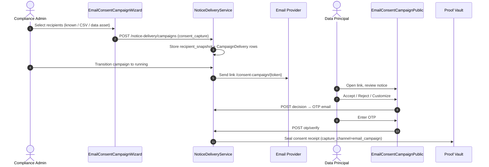

# DPDPA Shield — Email Consent Campaign Technical Specification

This document covers the **Email Consent Campaign** channel — a general-purpose (non-banking-only) module for sending OTP-verified consent capture links to selected recipients.

---

## 1. Module Overview

### 1.1 Purpose
Enable any organisation to run email-based consent campaigns: pick recipients from known contacts, CSV upload, or a mapped Data Asset, send personalized secure links, and collect Accept / Reject / Customize decisions with OTP verification before persisting a Proof-Vault-sealed consent receipt.

### 1.2 DPDPA Compliance Objective
* **§6(1) / §6(3)**: Full notice shown before consent choice on the public capture page.
* **§6(4)**: Free, specific, informed, unambiguous choice — equal-weight Accept / Customize / Reject actions.
* **§6(10)**: OTP-bound identity + delivery token ties decision to the targeted recipient; receipt sealed in Proof Vault.
* **§6(6)**: Post-capture link to Data Rights Portal for withdrawal.

---

## 2. Architecture

---

## 3. Recipient Sources

| Source | Admin UI | Backend |
| :--- | :--- | :--- |
| Known contacts | Searchable checkbox table | `GET /notice-delivery/recipients/search` |
| CSV upload | Drag-drop + column mapping | `POST /notice-delivery/recipients/upload` |
| Data asset | Asset picker + field mapping | `POST /notice-delivery/recipients/from-asset/preview` |

All sources normalize to `{ id, name, email, phone }` and are snapshotted on campaign creation (`recipient_snapshot` JSONB) so the audience cannot drift between draft and send.

---

## 4. Public Capture Flow

**Route:** `/consent-campaign/:token` (no login, outside AppLayout)

**API:** `/public/v1/consent-campaign/{token}`

| Step | Endpoint | Action |
| :--- | :--- | :--- |
| Load | GET `/{token}` | Notice + purposes + masked contact |
| Decision | POST `/{token}/decision` | Store choice, send OTP email |
| Verify | POST `/{token}/otp/verify` | Create receipt, seal proof, update delivery |
| Resend | POST `/{token}/otp/resend` | Resend OTP (cooldown enforced) |

Required/contract purposes are shown as notice lines only — no checkbox (same rule as SDK banners).

---

## 5. Database Changes

* `notice_campaigns`: `campaign_purpose`, `recipient_source`, `recipient_source_config`, `property_id`, `recipient_snapshot`
* `campaign_deliveries`: `delivery_token`, `capture_session_id`, `consent_decision`, `consent_receipt_id`
* `campaign_recipient_uploads`: CSV staging + field mapping

Migration: `20260731_email_consent_campaign`

---

## 6. QA Verification Matrix

| ID | Test |
| :--- | :--- |
| TC-01 | Create consent_capture campaign with known contacts; verify recipient_snapshot stored |
| TC-02 | CSV upload with column mapping; invalid rows warned, deduped |
| TC-03 | Data asset preview returns bounded row count (≤ 5000) |
| TC-04 | Public page: accept → OTP → receipt in Proof Vault |
| TC-05 | Expired / tampered token rejected |
| TC-06 | Already-responded link shows graceful message |
| TC-07 | OTP max attempts lockout |
| TC-08 | Required purposes have no checkbox on public page |

---

## 7. Admin UI

* **Email Consent Campaign** button on Notice Delivery Channels page
* Multi-step wizard: Basics → Recipients (3 tabs) → Message → Review → Confirm
* Delivery table shows **Consent Decision** column for `consent_capture` campaigns
