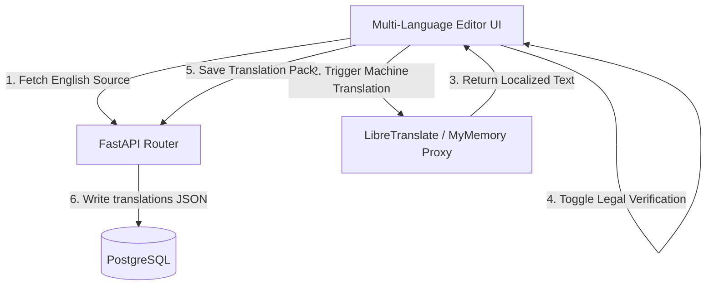
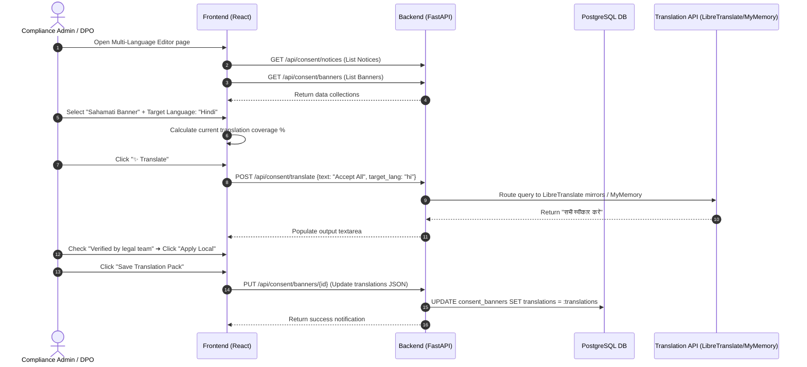

# Vajra — Multi-Language Editor Technical Specification

This document serves as the **single source of truth** for the **Multi-Language Editor** module of the Vajra DPDPA compliance platform. It provides the detailed frontend, backend, database, integration, and compliance specifications required to build, test, and maintain this module.

---

## 1. Module Overview

### 1.1 Purpose
The **Multi-Language Editor** allows compliance teams to localize consent banners, notices, and purpose descriptors from English into any of India's **22 official languages** listed in the Eighth Schedule of the Constitution of India. It integrates with machine-translation services (LibreTranslate/MyMemory) and offers a legal review/verification workflow.

### 1.2 Business Objective
To support multi-lingual operations inside India's diverse demographic. Compliance and product teams can write content once in English and automatically translate and verify it across regional languages without manual translation agencies.

### 1.3 DPDPA Compliance Objective
*   **Preferred Language Notice (Section 5)**: The DPDPA mandates that notice must be provided in English or any of the languages specified in the Eighth Schedule, depending on the preference of the Data Principal.
*   **Verifiability**: Ensure translations undergo legal checks before publication. This ensures that terms are not altered in translation to become misleading (satisfying Section 6(1) unambiguous/informed criteria).

### 1.4 Architectural Context
The Multi-Language Editor acts as a localization translation manager for both banners and notices:



### 1.5 Target Users
*   **DPOs & Compliance Admins**: Draft translations, audit coverage percentages, and toggle the legal verification checkbox.
*   **Regional Translators / Legal Advisors**: Log in to review machine translations, make manual edits, and verify that the translation is accurate and compliant.

---

## 2. DPDPA Mapping & Compliance Matrix

| DPDPA Section | Regulatory Requirement | Multi-Language Editor Implementation |
| :--- | :--- | :--- |
| **Section 5** | Notice must be presented in the preferred language of the Data Principal (English + 22 Scheduled Languages). | Support for 22 Scheduled Indian Languages with localization coverage tracking. |
| **Section 6(1)** | Consent must be specific, informed, and unambiguous. | Legal verification field tracking (`verified_fields` list in JSON metadata) to ensure legal reviews are complete. |
| **Section 6(10)** | Fiduciaries must prove compliance. | Localized notice versions are hashed and recorded in the Proof Vault when consent is obtained under a specific language view. |

---

## 3. End-to-End User Journey



### 3.1 Scenario Workflows
*   **Automatic Translation Flow**: Admin selects target language ➜ Clicks "Translate" ➜ System queries LibreTranslate mirrors, falls back to MyMemory API, then to local dictionary ➜ Local translation state updated.
*   **Manual Refinement & Legal Verification Flow**: Legal review member logs in ➜ Inspects translation side-by-side ➜ Modifies terms manually ➜ Checks "Verified by legal team" ➜ Click "Apply Local" ➜ Saves translation pack.
*   **Runtime SDK Delivery**: The Vajra SDK detects the user's browser language. If a localized translation exists, it displays the banner in their preferred language. If no translation is found, it falls back to the default language.

---

## 4. Detailed Screen Specification

The editor is split into a single-pane dashboard layout:

### 4.1 Target Selector Bar
*   **Purpose**: Select which banner or notice version is being edited.
*   **UI Components**:
    *   **Component Toggle**: Switch between "Consent Banner UI" and "Consent Notice".
    *   **Target Dropdown**: Select box listing notices or banners.

### 4.2 Language Coverage Grid
*   **Purpose**: Grid of cards showing translation completion status across regional languages.
*   **UI Components**:
    *   Interactive cards for languages (English, Hindi, Bengali, Tamil, Telugu, Marathi, Kannada, Malayalam, Gujarati, Punjabi, Urdu, Odia, Assamese, Konkani, Nepali, Sanskrit, Sindhi).
    *   **Status Indicators**: Show complete (`✓ 100%`), draft (`✏ Draft X%`), or missing (`⚠ Missing`).
    *   Grayed-out cards represent unsupported dialects.

### 4.3 Side-by-Side Editor HUD
*   **Purpose**: Side-by-side editing interface for English source versus target language.
*   **UI Components**:
    *   **Source Field Selector**: Dropdown to select active field (e.g. `heading`, `body_text`, `cta_accept` for banners; `display_name`, `opening_statement`, `rights_exercise` for notices).
    *   **Source Box**: Read-only container displaying the English text.
    *   **Target Box**: Text area to write/edit the localized translation.
    *   **Legal Verification**: Checkbox label: `"Verified by legal team"`.
    *   **Apply Local Button**: Saves modifications to the local page translation payload.

---

## 5. Form Schema (Translation JSON Metadata)

The translations are stored in a nested JSON structure keyed by ISO language codes:

```json
{
  "hi": {
    "heading": "कुकी सहमति",
    "body_text": "हम आपकी सहमति से व्यक्तिगत डेटा संसाधित करते हैं।",
    "cta_accept": "सभी स्वीकार करें",
    "cta_reject": "सभी अस्वीकार करें",
    "cta_customize": "अनुकूलित करें",
    "verified_fields": ["heading", "cta_accept", "cta_reject"]
  },
  "ta": {
    "heading": "குக்கீ ஒப்புதல்",
    "cta_accept": "அனைத்தையும் ஏற்றுக்கொள்",
    "verified_fields": ["heading"]
  }
}
```

---

## 6. Language Support List

Pre-configured languages in the translation catalog:
*   **Fully Supported (Standard Registry)**: English (`en`), Hindi (`hi`), Bengali (`bn`), Tamil (`ta`), Telugu (`te`), Marathi (`mr`), Kannada (`kn`), Malayalam (`ml`), Gujarati (`gu`), Punjabi (`pa`), Urdu (`ur`), Odia (`or`), Assamese (`as`), Konkani (`kok`), Nepali (`ne`), Sanskrit (`sa`), Sindhi (`sd`).
*   **Draft / Manual Only (Crawler Limit)**: Bodo (`brx`), Dogri (`doi`), Kashmiri (`ks`), Maithili (`mai`), Manipuri (`mni`), Santali (`sat`).

---

## 7. Relationships with Other Modules

*   **Consent Banner Builder (Key Integration)**:
    *   *Step 5 Integration*: The Consent Banner Builder features a multi-lingual checkbox cloud during Step 5 (Languages) of the Create Banner Wizard.
    *   *Deep Linking*: If the administrator wants to refine button translations or customize header texts for specific regional targets, clicking the "Edit Translations" button redirects/deep-links them directly to the Multi-Language Editor.
    *   *Live Syncing*: Saving translation maps inside this editor directly impacts the banner layout JSON payload. Banners loaded in browser client containers auto-detect browser configurations and swap displayed button texts based on active translations configured here.
*   **Consent Notices Manager**: Feeds the English source notice texts (`opening_statement`, `rights_exercise`, etc.) for translation.
*   **Consent Banners**: Feeds banner labels (`cta_accept`, `body_text`) for widget display translation.
*   **Proof Vault**: Synced consent receipts include the active language code utilized by the client browser to verify the language the user accepted.

---

## 8. Frontend Architecture

### 8.1 Page Component Structure
```
MultiLanguageEditor.tsx (Layout container & target selectors)
  ├── LanguageGrid.tsx (Cards displaying coverage %)
  ├── SideBySidePanel.tsx (Source vs Target textarea inputs)
  └── TranslationDialog.tsx (Popup modal showing field grids)
```

---

## 9. Backend Architecture

### 9.1 Router & Translation Proxy
*   Exposes `POST /api/consent/translate` routing through `app/routers/consent.py`.
*   **Mirror Failure Recovery**:
    1.  **LibreTranslate Mirrors (Post-Request)**:
        *   `https://translate.terraprint.co/translate`
        *   `https://libretranslate.de/translate`
        *   `https://translate.fedilab.app/translate`
        *   `https://lt.vern.cc/translate`
    2.  **MyMemory Translation API (Fallback)**:
        *   `https://api.mymemory.translated.net/get?q={text}&langpair=en|{target_lang}`
    3.  **Local Mapping (Hardcoded fallback)**:
        *   `app.services.contracts.banner_contract.clean_and_translate` returns pre-translated standard labels if APIs are offline.

---

## 10. Database Design

Translations are stored in PostgreSQL inside the JSON `translations` columns of target tables:
1.  `consent_banners.translations`: For banner buttons and interface text.
2.  `consent_notice_versions.translations`: For notice legal agreements, grievance text, and statements.

---

## 11. API Design

### 11.1 Trigger Translation Proxy
*   **Method / Route**: `POST /api/consent/translate`
*   **Request Body**:
    ```json
    {
      "text": "Accept All",
      "target_lang": "hi"
    }
    ```
*   **Response Body (200 OK)**:
    ```json
    {
      "translatedText": "सभी स्वीकार करें"
    }
    ```

### 11.2 Save Banner Translations
*   **Method / Route**: `PUT /api/consent/banners/{banner_id}`
*   **Request Body**: Include the full banner config along with the `translations` object containing localized language structures.
*   **Response Body (200 OK)**: Returns the updated banner schema.

---

## 12. QA Verification Matrix

### 12.1 Positive Test Cases
*   **TC-01 (Load Target Coverage)**: Load the editor page. Select a notice, verify that the language cards correctly calculate completion percentages.
*   **TC-02 (Machine Translation)**: Trigger a translation for the string `"Accept All"` to `"hi"`. Assert output text area updates to `"सभी स्वीकार करें"`.
*   **TC-03 (Toggle Verification)**: Check `"Verified by legal team"` and click save. Verify the translation JSON updates the `verified_fields` array in the database.

### 12.2 Negative Test Cases
*   **TC-04 (Empty Translation Request)**: Post translation request with empty string. Verify response is empty without triggering external APIs.
*   **TC-05 (Mirror Failures)**: Simulate connection timeout to LibreTranslate mirrors. Verify the proxy falls back to MyMemory API.
