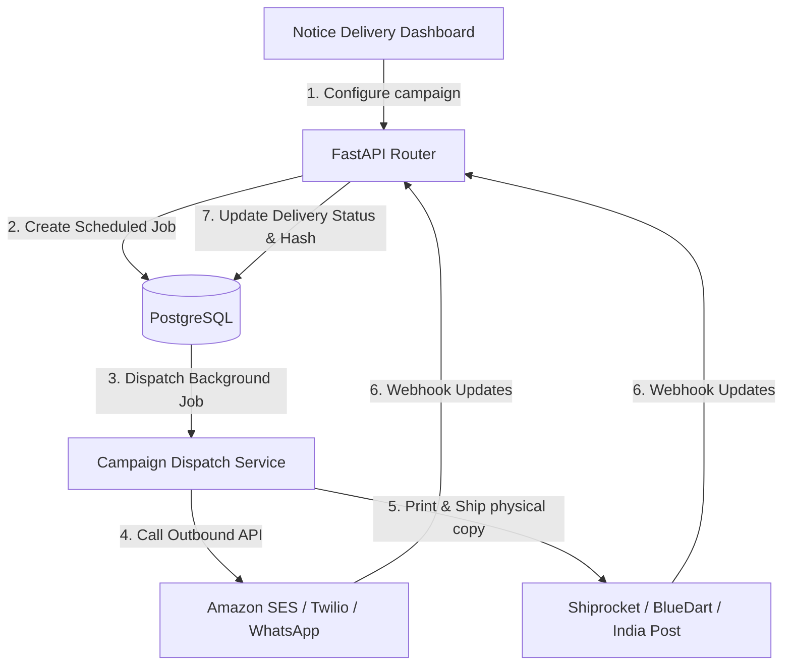
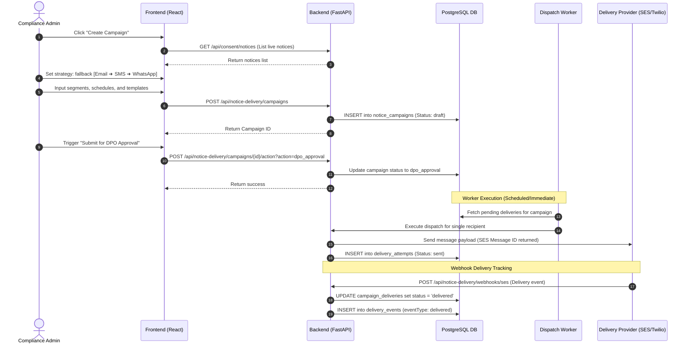
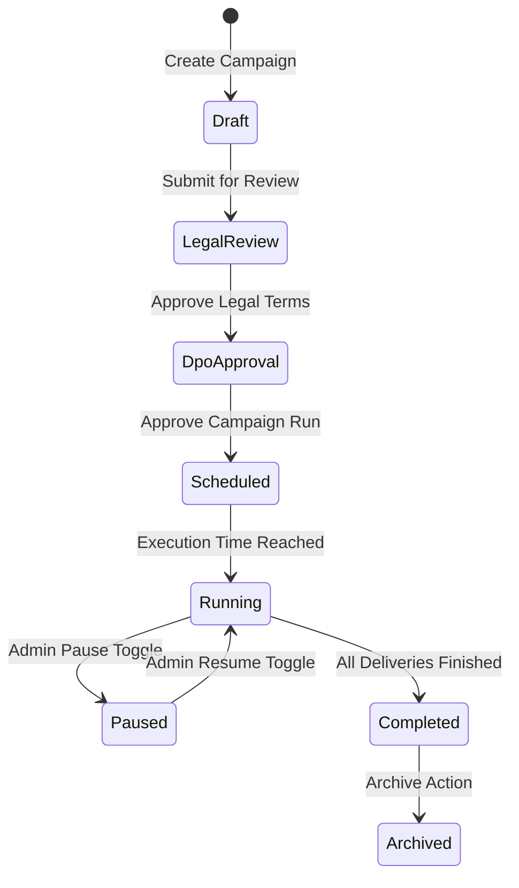
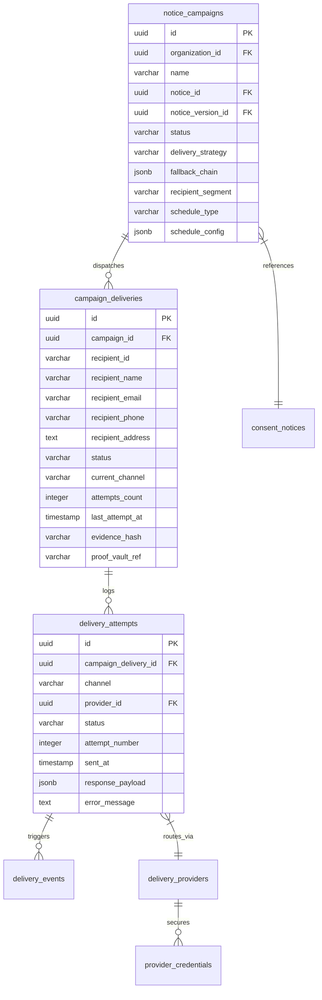

# DPDPA Shield — Notice Delivery Channels Technical Specification

This document serves as the **single source of truth** for the **Notice Delivery Channels** module of the ZeroShield DPDPA compliance platform. It provides the detailed frontend, backend, database, integration, and compliance specifications required to build, test, and maintain this module.

---

## 1. Module Overview

### 1.1 Purpose
The **Notice Delivery Channels** module handles the delivery of Consent Notices, updates, and consent renewals to recipients through digital channels (Email, SMS, WhatsApp) and physical post. It includes campaign creation, delivery status tracking, and provider configuration (Amazon SES, Twilio, Shiprocket, BlueDart, BluePost).

### 1.2 Business Objective
To establish a verifiable, multi-channel communication pathway that ensures users are notified of what data is collected and how it is processed, tracking their acknowledgment status directly in the central compliance audit logs.

### 1.3 DPDPA Compliance Objective
*   **Preferred Language Delivery**: Presents notices matching the recipient's language preferences under Section 5.
*   **Consent Renewals**: Dispatches notices when processing purposes change, requiring a fresh consent opt-in.
*   **Grievance and Contact Integrity**: Connects recipients to the DPO contact channels specified in the notice template.

### 1.4 Architectural Context
The Notice Delivery module orchestrates outbound notification campaigns and registers delivery receipts:



### 1.5 Target Users
*   **DPOs & Compliance Managers**: Design campaigns, approve drafts, trace delivery statuses, and review analytics dashboards.
*   **Operations & System Admins**: Configure API connections for mail and messaging providers.

---

## 2. DPDPA Mapping & Compliance Matrix

| DPDPA Section | Regulatory Requirement | Notice Delivery Implementation |
| :--- | :--- | :--- |
| **Section 5** | Notice must be presented in the preferred language of the Data Principal. | Selects corresponding localized notice version translation format before dispatch. |
| **Section 6** | Prior notice must accompany consent requests. | Dispatches transactional notices before opt-ins are registered, tracking delivery before options are presented. |
| **Section 6(10)** | Fiduciaries must prove compliance. | Every delivery records a SHA-256 hash snapshot of the sent content, generating an audit ledger trail. |

---

## 3. End-to-End User Journey



### 3.1 Scenario Workflows
*   **Immediate Email/SMS Campaign**: User uploads segment list ➜ Defines template ➜ Sets strategy to "fallback" (SMS if email bounces) ➜ Triggers dispatch ➜ Delivery statuses update in real time based on webhooks.
*   **Physical Mail Notice (Hardcopy)**: For regulatory high-risk segments, the strategy is set to `physical_only` ➜ API pushes address payloads to Shiprocket ➜ Tracking runs via AWB codes and updates to `delivered` when BlueDart completes the courier drop.

---

## 4. Detailed Screen Specification

The Notice Delivery dashboard contains three tabs:

### 4.1 Campaigns List
*   **Purpose**: Create and manage communication campaigns.
*   **UI Components**:
    *   **Status Badges**: `draft`, `dpo_approval`, `scheduled`, `running`, `paused`, `completed`.
    *   **Campaign Details Table**: Lists campaign name, linked notice, audience segment, delivery strategy, and completion percentage.
    *   **Actions Menu**: Pause, Resume, Archive, View analytics.

### 4.2 Channels & Providers Registry
*   **Purpose**: Configure credentials for communication APIs.
*   **UI Components**:
    *   **Provider Cards**: Configured instances for Amazon SES, Twilio SMS, MSG91, Meta WhatsApp Business, Shiprocket, and India Post.
    *   **Form Dialog**: Fields to enter host, port, API keys, credentials, and webhook endpoints.
    *   **Test Connection**: Triggers a magic ping toTwilio/SES using test values.

### 4.3 Campaign Analytics & Timeline
*   **Purpose**: Chart deliverability metrics and view recipient statuses.
*   **UI Components**:
    *   **Overview Stats**: Sent, Delivered, Bounced, Opened, Clicked.
    *   **Deliveries Table**: Searchable list of recipient IDs, contact channels, current attempt number, and cryptographic evidence hashes.

---

## 5. Form Schema (Campaign Setup)

| Field Name | Type | Description | Validation | Example Value |
| :--- | :--- | :--- | :--- | :--- |
| `name` | String | Campaign identifier | Min 1, Max 255 | `"Q2 Privacy Notice Update"` |
| `notice_id` | UUID | Associated notice registry ID | Must reference active Notice | `"e294cfbf-d018..."` |
| `delivery_strategy`| String | Outbound routing sequence | `email_only`, `fallback`, `smart` | `"fallback"` |
| `recipient_segment`| String | Target demographic filter | `all`, `marketing`, `premium` | `"all"` |
| `schedule_type` | String | Trigger model | `immediate`, `scheduled` | `"immediate"` |
| `fallback_chain` | Array | Sequence of channels to attempt | JSON list of channels | `["email", "sms"]` |

---

## 6. Notice Campaign States

A campaign moves through these states:



---

## 7. Relationships with Other Modules

*   **Consent Banner Builder (Key Integration)**:
    *   *Re-consent trigger*: When a delivery campaign registers successful delivery of a new Notice version to a recipient, the database maps this to `recipient_delivery_status`. If that recipient logs into the client website/app, the SDK banner detects a version mismatch between their last accepted version and the newly delivered version, automatically displaying the banner for fresh consent.
    *   *In-App Prompts*: Outbound notice delivery runs in parallel with active cookie banners. If a customer ignores banner prompts, the delivery campaigns trigger outbound SMS/emails with deep links directly to the client properties to prompt collection.
*   **Proof Vault**: Successful deliveries record cryptographic proofs, saving tracking histories as tamper-resistant files.
*   **Multi-Language Editor**: Resolves regional templates based on recipient preferences.

---

## 8. Frontend Architecture

### 8.1 Page Component Structure
```
NoticeDeliveryChannels.tsx (Main dashboard tabs)
  ├── CampaignsGrid.tsx (List active operations)
  ├── ProviderConfigPanel.tsx (Add/Edit provider parameters)
  ├── DeliveriesTimeline.tsx (Logs and recipient search bar)
  └── AnalyticsHUD.tsx (Charts showing deliverability %)
```

---

## 9. Backend Architecture

### 9.1 Router & Webhook Callbacks
*   Exposes endpoints for campaigns and provider management under `app/routers/notice_delivery.py`.
*   **Provider Callback Parsers**:
    1.  `/webhooks/ses`: Intercepts events from AWS SNS. Updates attempts and sets status based on `"Bounce"`, `"Complaint"`, or `"Delivery"`.
    2.  `/webhooks/twilio`: Receives `SmsSid` status posts. Matches local attempt payload to update status to `delivered` or `failed`.
    3.  `/webhooks/shiprocket`: Reads tracking status for couriers (AWB code). Updates physical deliverability flags.

---

## 10. Database Design



---

## 11. API Design

### 11.1 Create Campaign
*   **Method / Route**: `POST /api/notice-delivery/campaigns`
*   **Request Body**:
    ```json
    {
      "name": "Notice Update Campaign",
      "notice_id": "e294cfbf-d018-47bc-ad74-3ee2f507b51b",
      "notice_version_id": "c1387d89-9831-419b-a010-8b630f9a2de0",
      "delivery_strategy": "fallback",
      "fallback_chain": ["email", "sms"],
      "recipient_segment": "all",
      "schedule_type": "immediate",
      "schedule_config": {}
    }
    ```
*   **Response Body (201 Created)**: Returns the initialized `NoticeCampaignRead` schema.

### 11.2 Trigger Campaign Status Action
*   **Method / Route**: `POST /api/notice-delivery/campaigns/{campaign_id}/action`
*   **Parameters**: `action` (e.g. `dpo_approval`, `running`, `paused`)
*   **Response Body (200 OK)**: Returns the campaign details with updated status.

### 11.3 Test Provider Connection
*   **Method / Route**: `GET /api/notice-delivery/providers/{provider_id}/test`
*   **Response Body (200 OK)**:
    ```json
    {
      "success": true,
      "message": "Connection test succeeded!",
      "response": {
        "provider_message_id": "sm_92831aef"
      }
    }
    ```

---

## 12. Event Architecture

Outbound campaigns dispatch messages to the central event hub:
*   `campaign.created`: Logged when a draft is created.
*   `campaign.running`: Emitted when dispatch operations begin.
*   `campaign.delivery_failed`: Dispatched when all retry attempts fail, flagging the recipient for alternative delivery.

---

## 13. Security & Isolation Requirements

*   **Credential Encryption**: API keys and passwords for Twilio, Amazon SES, or Shiprocket are encrypted using AES-256 before being written to the database.
*   **IP Whitelisting**: Endpoints receiving webhook callbacks (`/webhooks/ses`, `/webhooks/twilio`) enforce IP range checks or check webhook signatures.

---

## 14. QA Verification Matrix

### 14.1 Positive Test Cases
*   **TC-01 (Create Campaign)**: Create a campaign draft. Verify it references the correct notice and version.
*   **TC-02 (Test Provider Connection)**: Run the connection test for a provider. Verify it returns success and triggers a test dispatch.
*   **TC-03 (Fallback Trigger)**: Simulate an email bounce event via webhook. Verify that the campaign falls back to SMS for that recipient.

### 14.2 Negative Test Cases
*   **TC-04 (Double Transition)**: Try to approve a campaign that is already running. Verify it returns an error.
*   **TC-05 (Invalid Segment)**: Create a campaign with an unsupported recipient segment. Verify validation error `422 Unprocessable Entity`.
