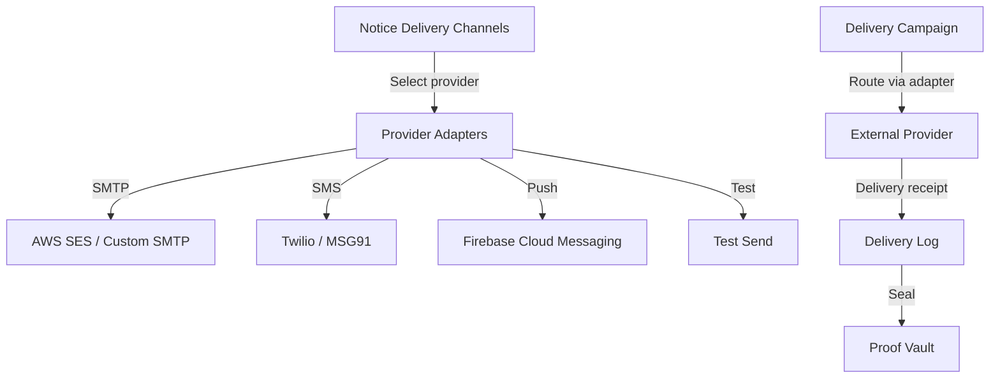
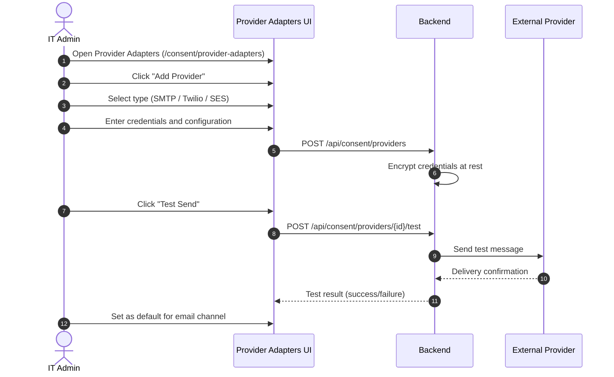
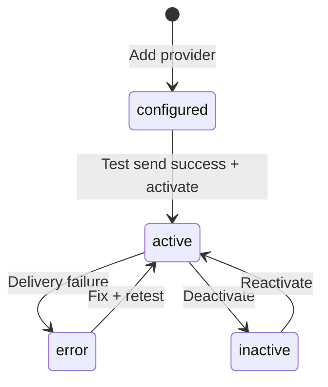

# Vajra — Pluggable Provider Adapters Technical Specification

This document serves as the **single source of truth** for the **Pluggable Provider Adapters** module of the Vajra DPDPA compliance platform.

---

## 1. Module Overview

### 1.1 Purpose
**Pluggable Provider Adapters** enable organizations to connect their own email, SMS, and push notification infrastructure for delivering consent notices, withdrawal confirmations, DSAR updates, and breach notifications — without routing sensitive communications through Vajra's shared infrastructure.

### 1.2 Business Objective
To support enterprise customers who require consent-related communications to originate from their own verified domains, SMTP relays, Twilio accounts, or AWS SES configurations — maintaining brand trust and meeting internal security policies.

### 1.3 DPDPA Compliance Objective
*   **Section 6(3)**: Notice must be communicated to data principals — delivery channels must be reliable and auditable.
*   **Section 8(5)**: Provider credentials encrypted at rest; delivery logs maintained for audit.
*   **Section 6(4)**: Withdrawal confirmations must reach the data principal — adapter ensures delivery.

### 1.4 Architectural Context

### 1.5 Target Users
*   **IT Administrators**: Configure SMTP, API keys, and webhook endpoints for delivery providers.
*   **DPOs**: Verify delivery channel compliance and test notice delivery.
*   **DevOps**: Manage credential rotation and provider health monitoring.

---

## 2. DPDPA Mapping & Compliance Matrix

| DPDPA Section | Requirement | Implementation |
| :--- | :--- | :--- |
| **Section 6(3)** | Notice communication | Configurable email/SMS/push adapters |
| **Section 8(5)** | Security safeguards | Credentials encrypted with Fernet; never returned in API responses |
| **Section 6(10)** | Proof of delivery | Delivery logs sealed in Proof Vault |

---

## 3. End-to-End User Journey

### 3.1 Supported Provider Types
| Type | Providers | Use Case |
| :--- | :--- | :--- |
| **Email (SMTP)** | Custom SMTP, AWS SES, SendGrid | Notice delivery, withdrawal confirmations |
| **SMS** | Twilio, MSG91, AWS SNS | OTP verification, SMS consent notices |
| **Push** | Firebase Cloud Messaging | Mobile app consent notifications |

---

## 4. Detailed Screen Specification

**Route:** `/consent/provider-adapters`

### 4.1 Provider List
*   Cards per configured provider: name, type badge, status (active/inactive/error), last test result.
*   Default provider indicator per channel type.
*   Actions: Configure, test, set default, deactivate, delete.

### 4.2 Add/Edit Provider Form

**SMTP Provider**
*   Host, port, username, password (encrypted)
*   TLS/SSL toggle
*   From address, from name
*   Reply-to address

**AWS SES Provider**
*   AWS region, access key, secret key
*   Verified sender email/domain
*   Configuration set (optional)

**Twilio Provider**
*   Account SID, auth token (encrypted)
*   From phone number
*   Messaging service SID (optional)

**MSG91 Provider**
*   Auth key, sender ID, route type

### 4.3 Test Send Panel
*   Recipient email/phone input
*   Test message template selector
*   Send button with result display (delivered/bounced/failed)
*   Delivery log entry created on success

### 4.4 Provider Health Dashboard
*   Delivery success rate (last 7/30 days)
*   Bounce/complaint rates
*   Last successful delivery timestamp
*   Credential expiry warnings

---

## 5. Provider Lifecycle

---

## 6. Relationships with Other Modules

| Module | Relationship |
| :--- | :--- |
| **Notice Delivery Channels** | Campaigns route through configured providers |
| **Consent Notices Manager** | Notices delivered via provider adapters |
| **Consent Withdrawal Flow** | Withdrawal confirmations sent via adapters |
| **Breach Disclosure Wizard** | Breach notifications sent via adapters |
| **DSAR SLA Tracker** | DSAR status updates sent via adapters |
| **Banking Consent Capture** | OTP delivery via SMS provider |

---

## 7. Backend Architecture

*   **Model**: `consent_providers` — provider config with encrypted credentials
*   **Encryption**: Fernet encryption for API keys, passwords, auth tokens
*   **Service**: Provider routing, test send, delivery logging
*   **Delivery log**: `notice_delivery_logs` with Proof Vault sealing

---

## 8. API Design

*   `GET /api/consent/providers` — list providers
*   `POST /api/consent/providers` — create provider
*   `PATCH /api/consent/providers/{id}` — update config
*   `POST /api/consent/providers/{id}/test` — test send
*   `POST /api/consent/providers/{id}/activate` — activate provider
*   `DELETE /api/consent/providers/{id}` — delete provider

---

## 9. Security & Compliance Requirements

*   Credentials encrypted at rest; never returned in GET responses.
*   Only admin/superadmin can configure providers.
*   Test sends logged in audit trail.
*   Provider credentials rotatable without downtime (update + test + activate).

---

## 10. QA Verification Matrix

*   **TC-01**: Configure SMTP provider; test send delivers email.
*   **TC-02**: Configure Twilio provider; test SMS delivers.
*   **TC-03**: Credentials not visible in API GET response.
*   **TC-04**: Inactive provider not used for campaign delivery.
*   **TC-05**: Delivery failure sets provider status to error.
