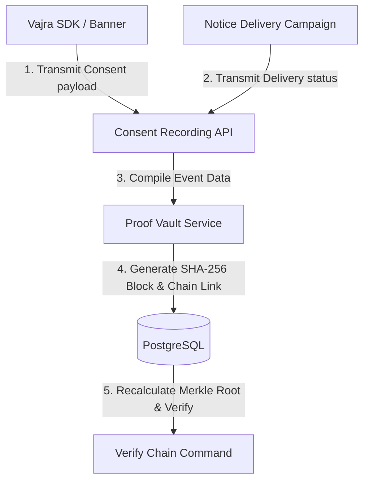
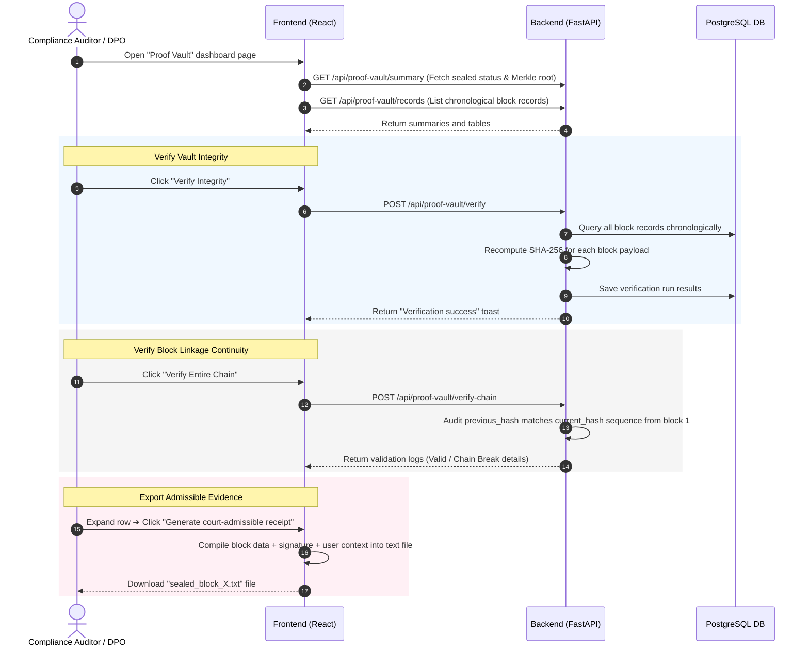
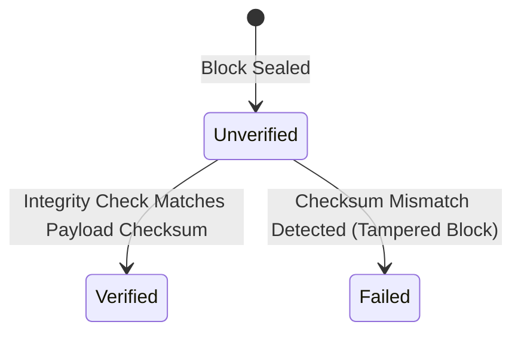
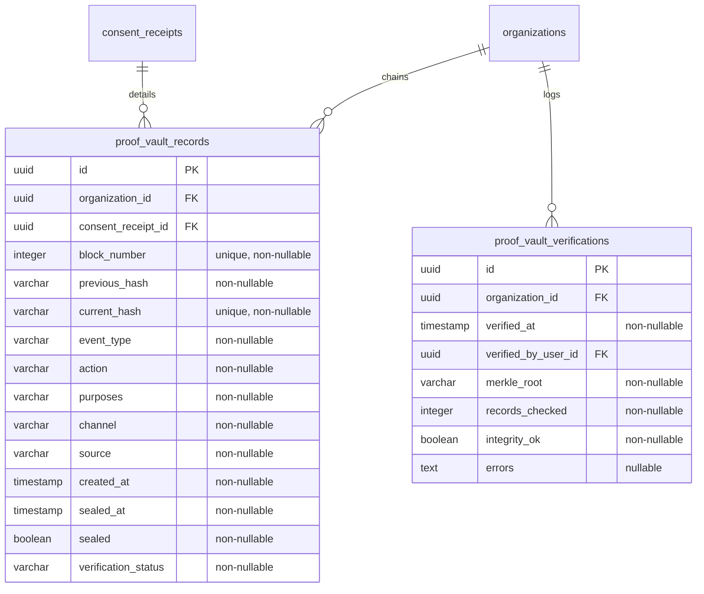
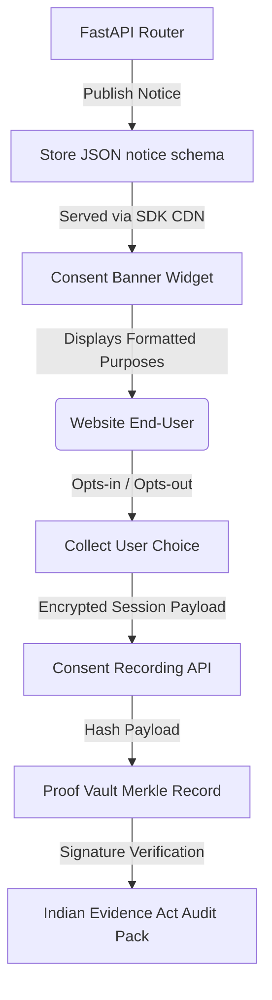

# Vajra — Proof Vault Technical Specification

This document serves as the **single source of truth** for the **Proof Vault** module of the Vajra DPDPA compliance platform. It provides the detailed frontend, backend, database, integration, and compliance specifications required to build, test, and maintain this module.

---

## 1. Module Overview

### 1.1 Purpose
The **Proof Vault** is a cryptographically secured, write-once-read-many (WORM) audit ledger that records and seals every consent event (grants, renewals, withdrawals) and notice delivery confirmation. It compiles user choice context, client signatures, and notice states into sequentially chained blocks, generating verifiable, court-admissible receipts.

### 1.2 Business Objective
To establish absolute non-repudiation of consent compliance. In case of user disputes, complaints, or regulatory inquiries by the Data Protection Board of India (DPBI), the platform can prove that a specific data principal consented to specific processing purposes under a specific version of the notice—without any possibility of database tampering, backdating, or unauthorized retroactive modifications.

### 1.3 DPDPA Compliance Objective
*   **Burden of Proof (Section 6(10))**: In any proceeding, the Data Fiduciary bears the burden of proving that valid consent was obtained in accordance with the law.
*   **Admissibility under Indian Law**: Aligns with Section 65B of the Indian Evidence Act, 1872 (and corresponding sections of the Bharatiya Sakshya Adhiniyam, 2023), requiring cryptographic authenticity certificates and chain-of-custody verification for electronic records to be admissible in a court of law.

### 1.4 Architectural Context
The Proof Vault acts as the immutable backend ledger for all consent transactions:



### 1.5 Target Users
*   **Data Protection Officers (DPOs)**: Verify blockchain integrity, search consent logs, and export legally binding "Proof Packs" for regulators.
*   **Legal Counsel & Auditors**: Review individual record hashes, verify cryptographic signatures, and audit historical timeline sequences.
*   **System Administrators**: Monitor vault health, verify background integrity tasks, and manage credential access.

---

## 2. DPDPA Mapping & Compliance Matrix

| DPDPA Section | Regulatory Requirement | Proof Vault Implementation |
| :--- | :--- | :--- |
| **Section 6(10)** | Burden of proof lies on the Data Fiduciary to show compliant consent was obtained. | Generates SHA-256 hashes of client contexts, signatures, and notice states to verify opt-ins. |
| **Section 8(5)** | Secure personal data using standard security safeguards to prevent breaches. | Chained cryptographic ledger blocks. Any database tampering immediately breaks the hashes and triggers integrity alerts. |
| **Sec 65B (Indian Evidence Act)** | Electronic evidence must have a certificate of integrity to be admissible in Indian courts. | "Export Legal Proof Pack" button packs database tables, signatures, and exports metadata into a verifiable ZIP package. |

---

## 3. End-to-End User Journey



### 3.1 Scenario Workflows
*   **Cryptographic Sealing Flow (Automated)**:
    1. User clicks "Accept All" on a web banner.
    2. Vajra SDK compiles choices, browser agent, and fingerprint, posting it to the Consent Recording API.
    3. Backend locks the sequence generator and retrieves the `current_hash` from the last written block.
    4. Concatenates fields: `block_number | previous_hash | event_type | action | purposes | channel | source | timestamp`.
    5. Computes the SHA-256 hash.
    6. Commits the new `ProofVaultRecord` to the PostgreSQL database under a database transaction.
*   **Tamper-Detection Flow**:
    1. A malicious actor with direct database access alters the `purposes` of a historical record to hide a compliance violation.
    2. A daily cron job triggers `/api/proof-vault/verify` or the DPO clicks "Verify Integrity".
    3. Backend iterates through the blocks, re-hashing the columns.
    4. A mismatch is detected at the altered block. The verification fails.
    5. The system emits `proof_vault.tamper_detected`, locks further automated sealing, alerts the DPO via email, and marks the block status as `failed`.
*   **Legal Receipt Export & Verification Flow**:
    1. DPO locates the disputed transaction block in the Records Table.
    2. Clicks "Export Court-Admissible Receipt".
    3. The backend generates a signed PDF/text document containing the block sequence, parent block hash, child signature, notice version text snapshot, and the IP/User-Agent metadata.
    4. DPO signs the Section 65B Electronic Certificate validating the origin and server custody logs of the proof vault.

---

## 4. Detailed Screen Specification

The Proof Vault dashboard is a single-pane administration center containing:

### 4.1 Header Controls
*   **Sync Button**: Refreshes the active table query.
*   **Verify Integrity Button**: Executes an inline SHA-256 payload audit. Shows a spinning progress bar and returns a pass/fail toast.
*   **Export Legal Proof Pack**: Triggers creation and download of a ZIP file containing the full encrypted audit trails.

### 4.2 Hero Metrics Strip
*   **Total Records Sealed**: Total block count (active count).
*   **Vault Integrity Score**: Percentage of blocks matching their cryptographic checksums (ideally `100.00%`).
*   **Cryptographic Chain Length**: The highest sequential block number written.
*   **Tamper Alerts**: Numeric counter of mismatch alerts. Red warning badge if > 0.

### 4.3 Merkle Root Alert Panel
*   **Visual Layout**: Warning/Info box style depending on state.
*   **Components**:
    *   **Merkle Root Display**: A monospace string display: `e3b0c44298fc1c149afbf4c8996fb92427ae41e4649b934ca495991b7852b855` with click-to-copy utility.
    *   **Verify Entire Chain Button**: Triggers full previous-to-current hash validation.

### 4.4 Cryptographic Records Table
*   **Search and Filters**:
    *   Search by Data Principal ID, Client IP, or Block Hash.
    *   Filter by Event Type (`consent_receipt`, `notice_delivered`, `consent_withdrawn`) and Verification Status (`verified`, `failed`, `unverified`).
*   **Table Columns**:
    1. `Block #` (Integer, Monospace)
    2. `Timestamp` (ISO-8601 UTC)
    3. `Data Principal ID` (UUID / Masked Phone/Email)
    4. `Action` (e.g. GRANTED, WITHDREW, DELIVERED)
    5. `Purposes` (Comma-separated list of purpose names)
    6. `Channel` (e.g. website, sms, email)
    7. `Source IP` (String)
    8. `Current Hash` (Truncated SHA-256 string, click to copy full)
    9. `Verification` (Badge status: Green/Verified, Red/Failed, Grey/Unverified)
    10. `Actions` (Chevron Expand/Collapse)
*   **Expanded Row Drawer**:
    *   **Receipt Details Grid**:
        *   `Session ID`: UUID
        *   `User Agent`: Monospace browser identification string
        *   `Fingerprint Hash`: SHA-256 client hardware fingerprint
        *   `Consent Signature`: The client-calculated signature string
        *   `Notice Snapshot`: Clicking this opens a modal showing the exact text of the notice version that was active when consent was recorded.
    *   **Linkage Details**:
        *   `Previous Hash`: `a9a460b1-4bb2-466d-961f-cfa8448f2b1d...`
        *   `Current Block Payload String`: The exact pipe-delimited payload hashed to produce the `current_hash`.
    *   **Action Button**: "Generate court-admissible receipt" (downloads the receipt pack for that block).

---

## 5. Form Schema (Merkle Block Payload)

The block payload must be built using a strict, deterministic sequence before hashing. The payload string is concatenated using pipe (`|`) delimiters.

### 5.1 Format
```
block_number | previous_hash | event_type | action | purposes | channel | source | created_at
```

### 5.2 Fields Specification
| Field Name | Type | Description | Validation | Example Value |
| :--- | :--- | :--- | :--- | :--- |
| `block_number` | Integer | Chronological sequence index | Mandatory, unique, sequential | `142` |
| `previous_hash` | String | SHA-256 hash of the preceding block | Must match block (n-1) current_hash | `"a9a460b1-4bb2-466d-961f-cfa8448f2b1d..."` |
| `event_type` | String | Event category | Must be: `consent_receipt`, `delivery_receipt` | `"consent_receipt"` |
| `action` | String | Action state | Must be: `GRANTED`, `WITHDREW`, `DELIVERED` | `"GRANTED"` |
| `purposes` | String | Stated purposes mapping | CSV list of purpose keys | `"Analytics, Marketing"` |
| `channel` | String | Outbound channel | Max 50 chars | `"website"` |
| `source` | String | Context origin | Valid IP address | `"192.168.1.1"` |
| `created_at` | String | Timestamp of record generation | ISO-8601 UTC string format | `"2026-06-25T00:00:00Z"` |

---

## 6. Record Verification Status

Each block maps to one of three verification states:



---

## 7. Relationships with Other Modules

*   **Consent Notices Manager**: Pulls active notice version text and IDs to write metadata into the block payload. A change in notices triggers new block entries.
*   **Consent Banners**: The browser-facing widget passes the configuration layout hash (`banner_snapshot`) which is recorded inside the expanded receipt metadata.
*   **Notice Delivery Campaigns**: Every SMS, email, or physical mail notification dispatch records a `delivery_receipt` event to the Proof Vault, establishing proof of notice delivery.
*   **Cookie Tracker blocker**: Consumed purposes are mapped directly to categories blocked or allowed by the local cookie block rules.

---

## 8. Frontend Architecture

### 8.1 Page Component Structure
```
ProofVault.tsx (Main View & Search Form)
  ├── MetricsStrip.tsx (Summary counters)
  ├── RecordsTable.tsx (Chained block listings)
  │     ├── TableFilters.tsx (Search by Hash, IP, Filter by Status)
  │     └── ExpandedProofDrawer.tsx (Verifiable receipt export actions)
  └── VerificationHistoryPanel.tsx (Integrity checks log)
```

### 8.2 Client-Side State Management
*   **Filters State**: Uses a standard react hook `useState` to track parameters: `page`, `limit`, `search`, `event_type`, `verification_status`.
*   **Export Progress**: Uses an overlay spinner when downloading large ZIP proof packs to prevent multiple requests.

---

## 9. Backend Architecture

### 9.1 File Layout
*   `app/routers/proof_vault.py`: API route handlers for summary, records, verify, and export.
*   `app/services/proof_vault_service.py`: Cryptographic hash sequencing, Merkle tree math, verification routines, and WORM storage simulation.
*   `app/models/proof_vault.py`: SQLAlchemy models for database tables.

### 9.2 Service Layer Cryptographic Logic

#### 9.2.1 Merkle Root Calculation (Python Implementation Pattern)
```python
import hashlib

def compute_merkle_root(hashes: list[str]) -> str:
    """
    Recursively computes the Merkle Root hash from a list of record leaf hashes.
    """
    if not hashes:
        return hashlib.sha256(b"").hexdigest()
    
    if len(hashes) == 1:
        return hashes[0]
        
    next_level = []
    for i in range(0, len(hashes), 2):
        left = hashes[i]
        right = hashes[i+1] if i+1 < len(hashes) else hashes[i]
        combined = left + right
        next_level.append(hashlib.sha256(combined.encode('utf-8')).hexdigest())
        
    return compute_merkle_root(next_level)
```

#### 9.2.2 Block Sealing Logic
```python
def generate_block_payload(record) -> str:
    """
    Formats the record into a deterministic pipe-delimited payload.
    """
    return f"{record.block_number}|{record.previous_hash}|{record.event_type}|{record.action}|{record.purposes}|{record.channel}|{record.source}|{record.created_at.isoformat()}"

def seal_event(db, consent_receipt_id, event_type, action, purposes, channel, source) -> ProofVaultRecord:
    # 1. Acquire sequence lock (postgres table lock or select for update)
    # 2. Get latest block
    last_block = db.query(ProofVaultRecord).order_by(ProofVaultRecord.block_number.desc()).first()
    
    if not last_block:
        # Generate Genesis Block
        block_number = 1
        previous_hash = "GENESIS"
    else:
        block_number = last_block.block_number + 1
        previous_hash = last_block.current_hash
        
    # Create preliminary record
    new_record = ProofVaultRecord(
        block_number=block_number,
        previous_hash=previous_hash,
        consent_receipt_id=consent_receipt_id,
        event_type=event_type,
        action=action,
        purposes=purposes,
        channel=channel,
        source=source,
        sealed=False,
        verification_status="unverified"
    )
    
    # Generate current hash
    payload = generate_block_payload(new_record)
    new_record.current_hash = hashlib.sha256(payload.encode('utf-8')).hexdigest()
    new_record.sealed = True
    new_record.sealed_at = datetime.utcnow()
    
    db.add(new_record)
    db.commit()
    db.refresh(new_record)
    return new_record
```

---

## 10. Database Design

### 10.1 Database ER Diagram


### 10.2 Indexes and Constraints
1.  **Unique Indexes**:
    ```sql
    CREATE UNIQUE INDEX uq_proof_vault_block_number ON proof_vault_records (organization_id, block_number);
    CREATE UNIQUE INDEX uq_proof_vault_current_hash ON proof_vault_records (current_hash);
    ```
2.  **Delete/Update Database Rules**:
    To protect the logs, direct updates or deletions on `proof_vault_records` must be blocked at the database level.
    ```sql
    CREATE RULE protect_proof_vault_delete AS ON DELETE TO proof_vault_records DO INSTEAD NOTHING;
    CREATE RULE protect_proof_vault_update AS ON UPDATE TO proof_vault_records DO INSTEAD NOTHING;
    ```

---

## 11. API Design

All endpoints require authorization via JWT Bearer Token (`Authorization: Bearer <token>`).

### 11.1 Fetch Vault Summary
*   **Method / Route**: `GET /api/proof-vault/summary`
*   **Response Body (200 OK)**:
    ```json
    {
      "total_records": 1420,
      "verified_records": 1420,
      "chain_length": 1420,
      "tampering_attempts": 0,
      "current_merkle_root": "e3b0c44298fc1c149afbf4c8996fb92427ae41e4649b934ca495991b7852b855",
      "last_sealed_block": "#1420 at 2026-06-24 23:55:00 UTC",
      "last_verified_at": "2026-06-24T23:56:00Z"
    }
    ```

### 11.2 Fetch Chronological Records
*   **Method / Route**: `GET /api/proof-vault/records`
*   **Query Parameters**:
    *   `page`: Integer (default `1`)
    *   `limit`: Integer (default `20`)
    *   `search`: String (optional search keyword)
    *   `event_type`: String (optional filter)
    *   `verification_status`: String (optional filter)
*   **Response Body (200 OK)**:
    ```json
    {
      "records": [
        {
          "block_number": 1420,
          "timestamp": "2026-06-24T23:55:00Z",
          "data_principal_id": "8b9e67d4-89d8-4fbb-ba86-fa8ccff88c22",
          "action": "GRANTED",
          "purposes": "Analytics, Marketing",
          "channel": "website",
          "source": "192.168.1.1",
          "current_hash": "e3b0c44298fc1c149afbf4c8996fb92427ae41e4649b934ca495991b7852b855",
          "previous_hash": "8c5da44298fc1c149afbf4c8996fb92427ae41e4649b934ca495991b7852b834",
          "verification_status": "verified",
          "receipt_details": {
            "session_id": "c1387d89-9831-419b-a010-8b630f9a2de0",
            "user_agent": "Mozilla/5.0 (Macintosh; Intel Mac OS X 10_15_7)...",
            "fingerprint_hash": "9c1187d89-9831-419b-a010-8b630f9a2de0",
            "signature": "MEQCIE/1zEa0..."
          }
        }
      ],
      "total_records": 1420,
      "page": 1,
      "pages": 71
    }
    ```

### 11.3 Run Integrity Verification
*   **Method / Route**: `POST /api/proof-vault/verify`
*   **Response Body (200 OK)**:
    ```json
    {
      "success": true,
      "verified_count": 1420,
      "failed_count": 0,
      "checked_at": "2026-06-24T23:59:00Z",
      "errors": []
    }
    ```

### 11.4 Verify Entire Chain Continuity
*   **Method / Route**: `POST /api/proof-vault/verify-chain`
*   **Response Body (200 OK)**:
    ```json
    {
      "is_continuous": true,
      "highest_block": 1420,
      "checked_blocks": 1420,
      "chain_gaps": [],
      "mismatched_links": []
    }
    ```

### 11.5 Export Legal Proof Pack
*   **Method / Route**: `POST /api/proof-vault/export`
*   **Response Type**: Binary ZIP stream (`application/zip`) containing:
    *   `summary.json` (Total blocks, status, final root)
    *   `records.csv` (CSV dump of all block payloads)
    *   `verifications.json` (History of verification runs)
    *   `certificate_of_authenticity.txt` (Evidence Act Section 65B signature statement)

---

## 12. Event Architecture

The Proof Vault service emits transactional events to coordinate with logging and alert systems:

*   `proof_vault.block_sealed`: Emitted when a new block is successfully generated and hashed.
    *   *Payload*: `{ "block_number": 1421, "hash": "e3b0...", "timestamp": "..." }`
*   `proof_vault.tamper_detected`: Emitted when an integrity check fails.
    *   *Payload*: `{ "block_number": 1420, "expected_hash": "a1b2...", "calculated_hash": "f9e8...", "tampered_fields": ["purposes"] }`
*   `proof_vault.verification_completed`: Emitted when a manual or scheduled integrity check completes.

---

## 13. Integration Architecture

The following diagram details how client choices are compiled and written to the database through the Proof Vault ledger flow:



1.  **Banner Opt-In**: User interacts with banner, SDK hashes selection context and signs with client session key.
2.  **Transaction API**: Choice hits `/api/public/consent/record`.
3.  **WORM Sealing**: Proof Vault service calculates block SHA-256 and references the previous block hash before committing to the `proof_vault_records` table.

---

## 14. Security & Compliance Requirements

*   **Role-Based Access Control (RBAC)**:
    *   Only `admin`, `auditor`, and `superadmin` can initiate manual integrity verifications or export proof packs.
    *   No user role (including `superadmin`) can delete or update records once written (enforced via PostgreSQL database rules).
*   **Cryptographic Strength**:
    *   All hash algorithms must use **SHA-256** standard (256-bit hash value).
    *   Receipt signatures generated by client devices use ECDSA (Secp256r1) when keys are available in the browser keystore, otherwise falling back to server-side token hashes.
*   **Data at Rest / Transit**:
    *   Database connection strings must use SSL verification (`sslmode=verify-full`).
    *   Exports must be generated dynamically on request and never saved in cache folders on public web directories.

---

## 15. Analytics & Dashboard Metrics

*   **Vault Integrity Score**: Percentage metric shown on dashboard.
    $$\text{Vault Integrity Score} = \left( 1 - \frac{\text{Failed Blocks}}{\text{Total Sealed Blocks}} \right) \times 100$$
*   **Daily Sealed Timeline**: Line chart counting new blocks written per hour/day.
*   **Verification History**: List details of past checks: date, checker ID, number of blocks parsed, status.

---

## 16. QA Verification Matrix

### 16.1 Positive Test Cases
*   **TC-01 (Chained Insertion)**:
    *   *Action*: Seal a new consent event.
    *   *Result*: Assert `previous_hash` of new block matches `current_hash` of block `n-1` and `block_number` increments by 1.
*   **TC-02 (Successful Integrity Run)**:
    *   *Action*: Trigger verification on a clean dataset.
    *   *Result*: Verification returns `success=true`, checking all records with no mismatches.
*   **TC-03 (Export Proof Pack)**:
    *   *Action*: Trigger "Export Legal Proof Pack".
    *   *Result*: Download zip, extract files, verify CSV matches database state and contains certificate signature fields.

### 16.2 Negative Test Cases
*   **TC-04 (Detect Tampering)**:
    *   *Action*: Manually update the `purposes` column of a row in the database. Trigger verification.
    *   *Result*: Verification fails, identifies the tampered block number, updates block status to `failed`, and raises a tamper alarm.
*   **TC-05 (Chain Gap Detection)**:
    *   *Action*: Delete a middle block from the database (bypass protection if rule disabled). Run `/api/proof-vault/verify-chain`.
    *   *Result*: API detects gap in block numbers (e.g. sequence jumps from 14 to 16) and identifies link mismatches.
*   **TC-06 (SQL Parameterization)**:
    *   *Action*: Inject SQL injection queries (e.g. `' OR '1'='1`) into the records search filter.
    *   *Result*: Verify search executes query parameters safely without running arbitrary statements.
*   **TC-07 (RBAC Enforcement)**:
    *   *Action*: Request `/api/proof-vault/verify` using a `viewer` role token.
    *   *Result*: Assert API returns `403 Forbidden`.
