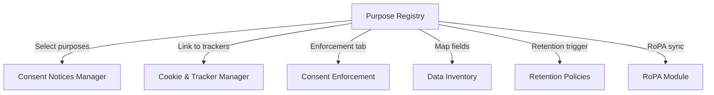
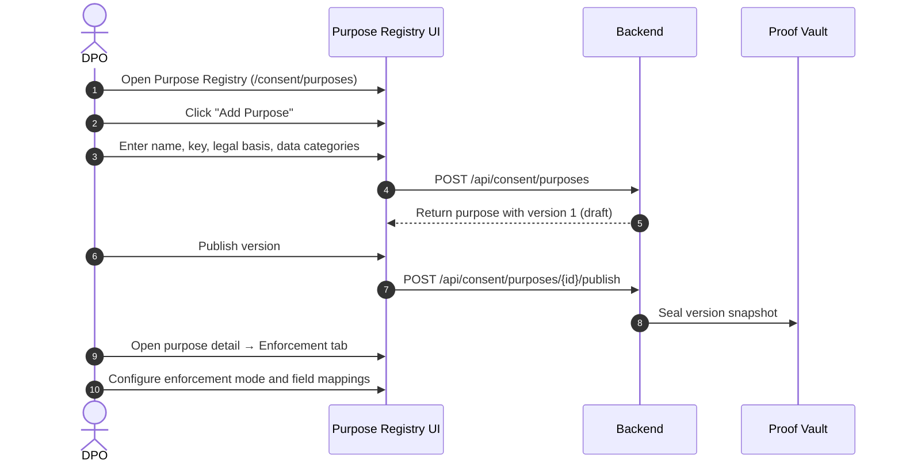
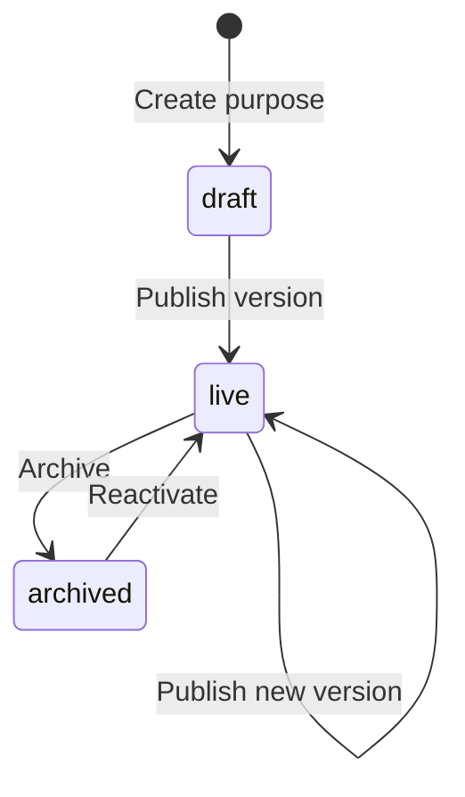

# Vajra — Purpose Registry Technical Specification

This document serves as the **single source of truth** for the **Purpose Registry** module of the Vajra DPDPA compliance platform.

---

## 1. Module Overview

### 1.1 Purpose
The **Purpose Registry** is the canonical catalog of **why** personal data is processed. Every consent notice, banner, enforcement rule, and retention policy references purposes defined here. A purpose describes a specific processing activity (e.g., "Order Fulfillment", "Marketing SMS", "Fraud Prevention") with its legal basis, data categories, and retention expectations.

### 1.2 Business Objective
To provide a single, versioned source of truth for processing purposes so that consent notices, cookie classifications, enforcement mappings, and RoPA entries all reference the same definitions — eliminating inconsistent purpose naming across the organization.

### 1.3 DPDPA Compliance Objective
*   **Section 6(1)**: Consent must be **specific** — distinct purposes prevent blanket consent.
*   **Section 6(3)**: Notice must specify purposes of processing — purposes drive notice content.
*   **Section 7**: Legitimate-use purposes must be clearly distinguished from consent-based purposes.
*   **Section 6(6)**: Withdrawal applies per purpose — granular purpose definitions enable precise cessation.

### 1.4 Architectural Context

### 1.5 Target Users
*   **DPOs / Legal**: Define purposes, assign legal bases, approve versions.
*   **Compliance teams**: Link purposes to notices and verify coverage.
*   **Engineering**: Reference purpose keys in SDK annotations and middleware.

---

## 2. DPDPA Mapping & Compliance Matrix

| DPDPA Section | Requirement | Purpose Registry Implementation |
| :--- | :--- | :--- |
| **Section 6(1)** | Consent must be specific and informed | Each purpose is a distinct, named processing activity with its own legal basis |
| **Section 6(3)** | Notice must list processing purposes | Purposes linked to consent notice versions |
| **Section 7** | Legitimate use carve-outs | `legal_basis` enum distinguishes consent vs contract vs legitimate_use |
| **Section 6(6)** | Withdrawal per purpose | Purpose-level granularity enables selective withdrawal |

---

## 3. End-to-End User Journey

### 3.1 Scenario Workflows
*   **Create consent-based purpose**: DPO adds "Marketing Newsletter" with `legal_basis = consent` → links to notice → enables enforcement mapping.
*   **Create contract purpose**: DPO adds "Order Fulfillment" with `legal_basis = contract` → always allowed by enforcement engine, never blockable.
*   **Archive purpose**: DPO archives unused purpose → removed from new notice linking but historical receipts preserved.
*   **Version update**: DPO edits purpose description → new version created → linked notices show update prompt.

---

## 4. Detailed Screen Specification

**Route:** `/consent/purposes`

### 4.1 Purpose List View
*   Table/grid of all purposes with: name, key (slug), legal basis badge, status (draft/live/archived), linked notices count, enforcement mode badge.
*   Filters: legal basis, status, search by name/key.
*   Actions: Create, edit, archive, view detail.

### 4.2 Purpose Detail Modal
Tabs: **Overview** | **Enforcement** | **Linked Notices**

#### Overview Tab
*   Purpose name, key, description
*   Legal basis selector (consent, contract, legitimate_use, legal_obligation)
*   Data categories (multi-select: identity, contact, financial, health, etc.)
*   Retention period description
*   Version history with publish/rollback controls
*   Compliance score impact indicator

#### Enforcement Tab
*(Visible for consent-based purposes)*
*   Current enforcement mode (`disabled` / `shadow` / `enforced`)
*   Promote/demote controls with safety checklist
*   Mapped Data Inventory fields (inline field picker)
*   Withdrawal action per field (mask, anonymize, delete, pseudonymize, flag manual review)
*   Deny behavior selector (reject, strip_fields, queue_pending)

#### Linked Notices Tab
*   List of consent notices referencing this purpose
*   Version compatibility status
*   Quick link to Consent Notices Manager

### 4.3 Legal Basis Badges
| Basis | Badge Color | Enforcement |
| :--- | :--- | :--- |
| Consent | Blue "Consent" | Enforceable (can block on deny) |
| Contract | Green "Contract" | Always allowed |
| Legitimate Use | Amber "Legit Use" | Always allowed |
| Legal Obligation | Grey "Legal" | Always allowed |

---

## 5. Purpose Lifecycle

---

## 6. Relationships with Other Modules

| Module | Relationship |
| :--- | :--- |
| **Consent Notices Manager** | Notices link to one or more purposes |
| **Create Consent (Banner)** | Banner displays purposes from linked notice |
| **Consent Enforcement** | Per-purpose enforcement mode and field mappings |
| **Data Inventory** | Fields show purpose badges; mappings reference inventory fields |
| **Cookie & Tracker Manager** | Trackers classified by purpose |
| **Retention Policies** | `source_purpose_id` links retention to purpose withdrawal |
| **RoPA Module** | Processing activities reference purpose definitions |
| **Proof Vault** | Purpose version snapshots sealed on publish |

---

## 7. Backend Architecture

*   **Model**: `app/models/consent.py` — `Purpose`, `PurposeVersion`
*   **Router**: Consent purposes endpoints under consent router
*   **Service**: Purpose versioning, publish workflow, legal basis validation
*   **Enforcement link**: `PurposeEnforcementConfig` and `PurposeDataMapping` in `app/models/enforcement.py`

---

## 8. Database Design

Key tables: `purposes`, `purpose_versions`
*   `purposes`: organization_id, name, key (unique per org), status
*   `purpose_versions`: purpose_id, version_number, legal_basis, data_categories (JSON), retention_description, published_at

---

## 9. API Design

*   `GET /api/consent/purposes` — list purposes
*   `POST /api/consent/purposes` — create purpose
*   `GET /api/consent/purposes/{id}` — detail with current version
*   `PATCH /api/consent/purposes/{id}` — update draft version
*   `POST /api/consent/purposes/{id}/publish` — publish version
*   `POST /api/consent/purposes/{id}/archive` — archive purpose

---

## 10. Security & Compliance Requirements

*   Only `admin` and `superadmin` roles can create, publish, or archive purposes.
*   Purpose keys are immutable after first publish (prevents breaking SDK integrations).
*   Legal basis changes require new version publish with audit trail.

---

## 11. QA Verification Matrix

*   **TC-01**: Create consent purpose with legal_basis=consent; verify enforcement tab visible.
*   **TC-02**: Create contract purpose; verify enforcement tab shows "always allowed" notice.
*   **TC-03**: Publish version; verify Proof Vault snapshot created.
*   **TC-04**: Archive purpose; verify removed from notice picker but receipts preserved.
*   **TC-05**: Cross-tenant purpose access returns 404.
