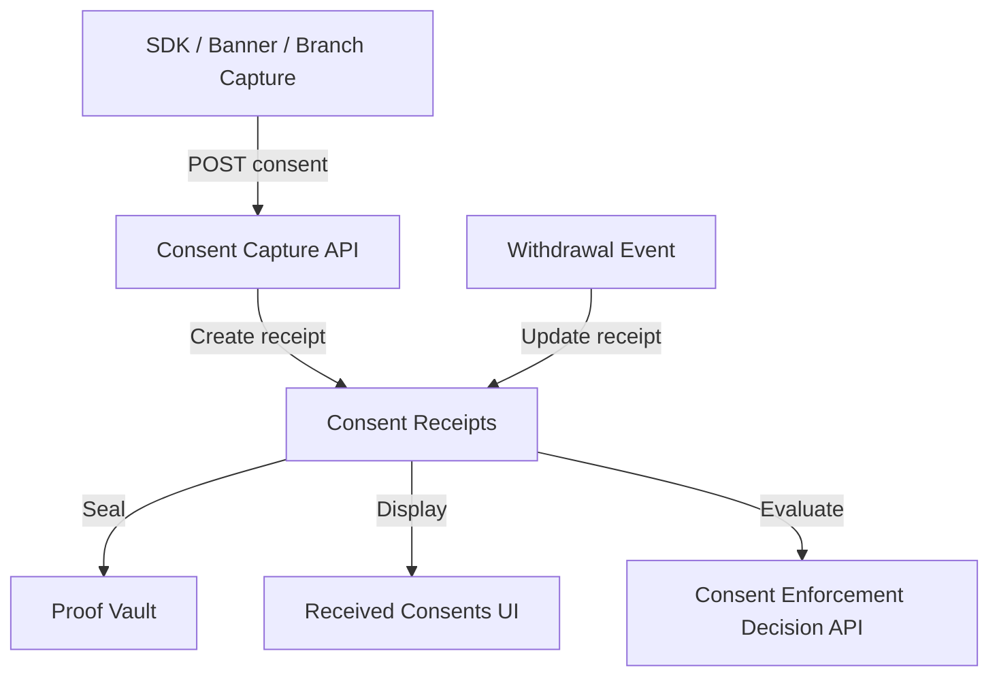
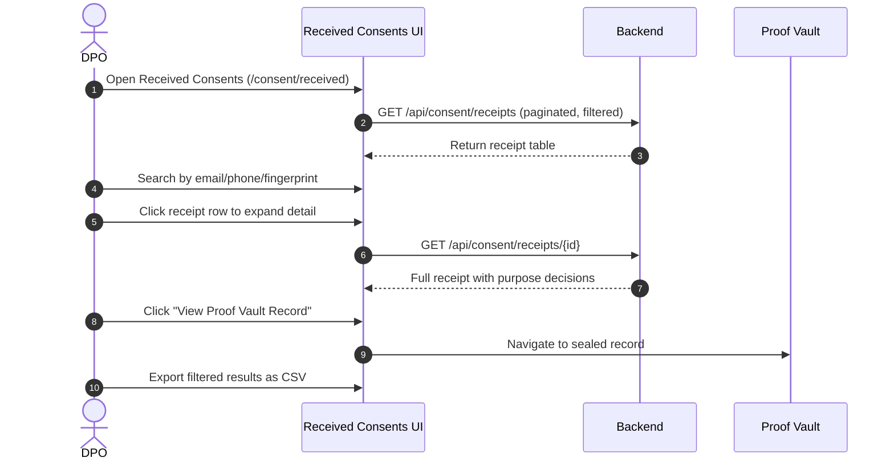

# Vajra — Received Consents Technical Specification

This document serves as the **single source of truth** for the **Received Consents** module of the Vajra DPDPA compliance platform.

---

## 1. Module Overview

### 1.1 Purpose
**Received Consents** is the operational dashboard for viewing, searching, and auditing all consent decisions captured across the organization's properties — website banners, mobile SDK, branch capture, API integrations, and offline sync sessions.

### 1.2 Business Objective
To give DPOs and compliance teams a single pane of glass for consent posture: who consented to what, when, through which channel, with full traceability to Proof Vault records.

### 1.3 DPDPA Compliance Objective
*   **Section 6(10)**: Burden of proof — every receipt links to a Proof Vault sealed record.
*   **Section 6(4)**: Withdrawal tracking — status changes from grant to withdrawal visible in timeline.
*   **Section 11**: Data principal right to obtain summary — receipts provide the data for DSAR responses.

### 1.4 Architectural Context

### 1.5 Target Users
*   **DPOs**: Monitor consent posture, investigate disputes, export records.
*   **Compliance auditors**: Verify consent coverage and withdrawal compliance.
*   **Customer support**: Look up individual consent status for grievance handling.

---

## 2. DPDPA Mapping & Compliance Matrix

| DPDPA Section | Requirement | Implementation |
| :--- | :--- | :--- |
| **Section 6(10)** | Burden of proof | Each receipt linked to Proof Vault record with hash chain |
| **Section 6(4)** | Withdrawal as easy as grant | Withdrawal events update receipt status with timestamp |
| **Section 11** | Right to obtain summary | Receipt data exportable for DSAR responses |

---

## 3. End-to-End User Journey

### 3.1 Scenario Workflows
*   **Daily monitoring**: DPO reviews today's consent grants/denials by property and purpose.
*   **Dispute investigation**: Search by principal identifier → view receipt timeline → export Proof Vault record.
*   **Withdrawal audit**: Filter by status=withdrawn → verify remediation tasks created.
*   **Channel analysis**: Filter by collection point (web, mobile, branch, merchant) to compare consent rates.

---

## 4. Detailed Screen Specification

**Route:** `/consent/received`

### 4.1 Summary Cards
*   Total receipts (all time / today)
*   Grant rate vs deny rate
*   Withdrawals today
*   Active properties with consent activity

### 4.2 Receipt Table
Columns:
*   Timestamp
*   Principal identifier (masked email/phone or fingerprint)
*   Property / channel
*   Purpose decisions (granted/denied badges per purpose)
*   Notice version
*   Status (active / withdrawn / expired)
*   Proof Vault link

### 4.3 Filters
*   Date range
*   Property / integration
*   Purpose (granted or denied)
*   Status (active, withdrawn)
*   Collection point
*   Search by principal identifier

### 4.4 Receipt Detail Panel
Expandable row or side drawer showing:
*   Full purpose decision map (JSON)
*   Notice version and banner ID
*   Client context (user agent, IP region — no raw IP stored)
*   Consent receipt ID and Proof Vault record ID
*   Timeline: grant → modifications → withdrawal events
*   Linked enforcement events (if enforcement enabled)
*   Export single receipt as JSON

### 4.5 Pagination
Uses `TablePager` component (0-indexed) for consistent pagination across the platform.

---

## 5. Consent Receipt Data Model

Each receipt contains:
*   `principal_id` — linked to `ConsentPrincipal` (server-side fingerprinted)
*   `consented_purposes` — map of purpose_key → boolean
*   `notice_version_id` — which notice version was displayed
*   `property_id` — which integration property captured consent
*   `collection_point` — specific form/page identifier
*   `proof_vault_record_id` — link to sealed Proof Vault block
*   `status` — active, withdrawn, superseded
*   Banking identifiers (when banking industry enabled): CIF, account number hash, journey ID

---

## 6. Relationships with Other Modules

| Module | Relationship |
| :--- | :--- |
| **Proof Vault** | Every receipt sealed with cryptographic proof |
| **Consent Enforcement** | Receipts evaluated by Decision API for server-side enforcement |
| **Purpose Registry** | Purpose keys in receipt map to registry definitions |
| **Consent Notices Manager** | Receipt references notice version |
| **DSAR SLA Tracker** | Receipt data used for access/erasure DSAR responses |
| **Banking Consent Registry** | Banking receipts include journey and identifier context |

---

## 7. Backend Architecture

*   **Model**: `consent_receipts`, `consent_principals`
*   **Service**: `ConsentCaptureService` — creates receipts, links principals
*   **Principal service**: `ConsentPrincipalService` — server-side fingerprinting

---

## 8. API Design

*   `GET /api/consent/receipts` — paginated list with filters
*   `GET /api/consent/receipts/{id}` — receipt detail
*   `GET /api/consent/receipts/export` — CSV export with filters
*   `GET /api/consent/receipts/summary` — summary card metrics

---

## 9. Security & Compliance Requirements

*   Principal identifiers masked in UI (show last 4 chars of email/phone).
*   Full identifiers never logged in audit trails.
*   Cross-tenant receipt access returns 404.
*   Export requires admin role; exports logged in audit log.

---

## 10. QA Verification Matrix

*   **TC-01**: Consent capture via SDK creates visible receipt in table.
*   **TC-02**: Withdrawal updates receipt status and creates remediation task.
*   **TC-03**: Search by email finds correct receipt (server-side fingerprint match).
*   **TC-04**: Proof Vault link navigates to correct sealed record.
*   **TC-05**: Cross-tenant receipt access returns 404.
