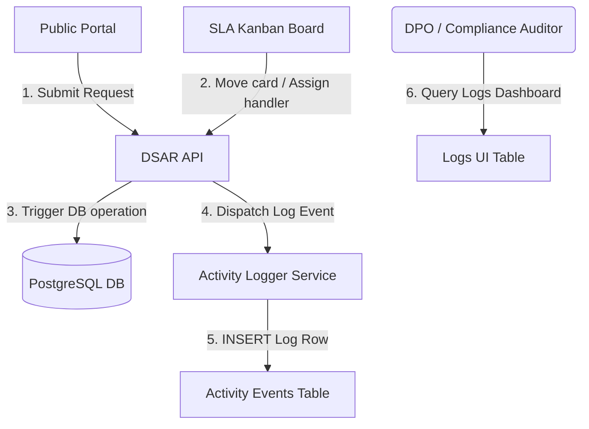
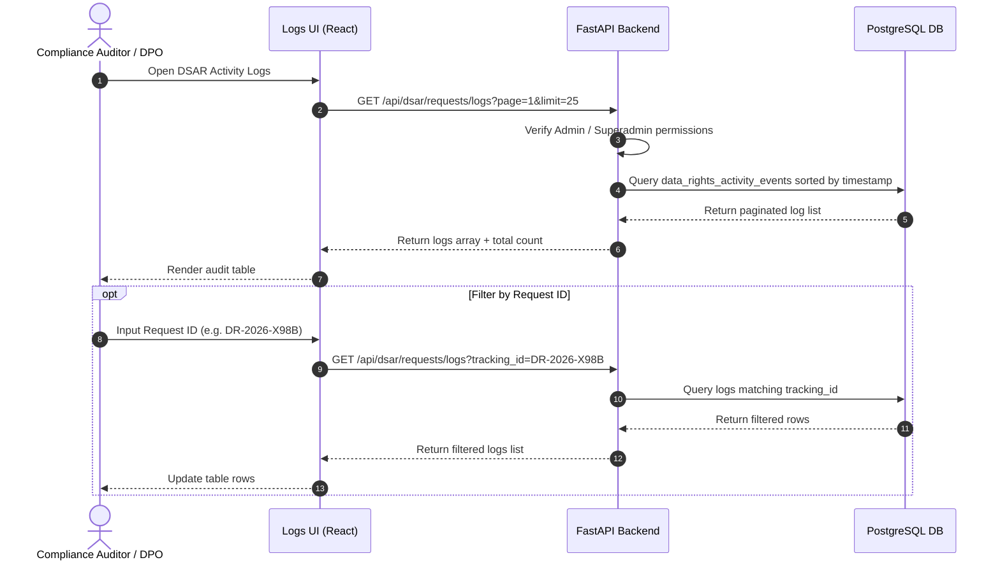
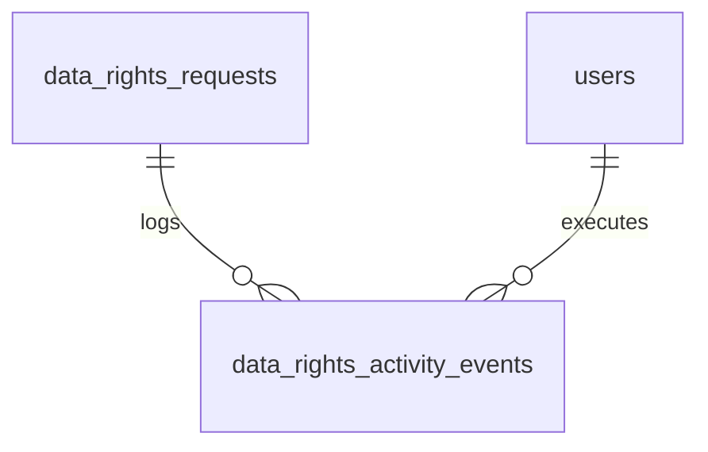

# DPDPA Shield — DSAR Activity Logs Technical Specification

This document serves as the **single source of truth** for the **DSAR Activity Logs** module of the ZeroShield DPDPA compliance platform. It provides the detailed frontend, backend, database, integration, and compliance specifications required to build, test, and maintain the request activity logger.

---

## 1. Module Overview

### 1.1 Purpose
The **DSAR Activity Logs** module is a live, read-only audit trail that logs every action taken on Data Subject Access Requests (DSAR). It captures request creation, identity verification, status transitions, handler assignments, grievance acknowledgements, and final closure events.

### 1.2 Business Objective
To provide a tamper-evident compliance history showing how the organization handles personal data rights. It acts as the evidence ledger for internal audits, security reviews, and regulatory inquiries.

### 1.3 DPDPA Compliance Objective
*   **Section 8(1)**: Provides Fiduciaries with an auditable proof history of their compliance with all parts of the DPDPA.
*   **Chapters III (Sections 11–14)**: Demonstrates to inspectors and the Data Protection Board of India (DPBI) that data principal requests were processed within the statutory timelines.

### 1.4 Architectural Context
The Activity Logs module is a passive event listener that documents all request operations:



### 1.5 Target Users
*   **Data Protection Officers (DPOs)**: Inspect compliance logs, audit handler performance, verify response timelines, and export logs during regulatory reviews.
*   **Compliance Auditors**: Check logs to verify security safeguards and confirm that identity checks are executed before details are released.

---

## 2. DPDPA Mapping & Compliance Matrix

| DPDPA Section | Regulatory Requirement | Logs Implementation |
| :--- | :--- | :--- |
| **Section 8(1)** | Data Fiduciary responsibility. | Registers an immutable event row (action, actor, timestamp, metadata) for every compliance task. |
| **Section 11** | Summaries of data processed. | Logs when an access summary is generated, who compiled it, and what categories were sent. |
| **Section 12** | Erasure / Correction tracking. | Logs when database scrub/update tasks are resolved. |
| **Section 13** | Grievance resolution. | Tracks and logs the exact time of grievance acknowledgements and resolutions. |

---

## 3. End-to-End User Journey



---

## 4. Detailed Screen Specification

The screen is built as a filterable datatable restricted to administrators.

### 4.1 Filters Panel
*   **Request ID Search**: Text input to filter logs by tracking ID.
*   **Action Filter**: Dropdown menu containing:
    - *Request Created*: Ingestion from portal.
    - *Identity Verified*: OTP successfully matched.
    - *Status Changed*: Stage transitions (received, in_review, response_ready, completed).
    - *Assigned*: Handlers associated with the request.
    - *Unassigned*: Assigned handlers removed.
    - *Grievance Acknowledged*: Grievance acknowledgment timestamp logged.
    - *Resolved*: Request marked closed.
*   **Right Type Filter**: Select menu (Access, Correction, Erasure, Nomination, Grievance, Consent Withdrawal).
*   **Actor Search**: Text input searching by actor name or email.

### 4.2 Activity Logs Table
*   **Table Columns**:
    1.  **When**: Formatted timestamp (e.g. `2026-06-25 13:00:00`).
    2.  **Request**: Tracking ID (monospace font) + Requester Name.
    3.  **Right**: Identified right type with badge.
    4.  **Action**: Color-coded action label (e.g. Green for `resolved`, Blue for `assigned`).
    5.  **Actor**: User name who executed the action.
    6.  **Assignee**: Handler assigned to the task.
    7.  **Details**: Text description summarizing the transaction (e.g. *"Status changed from received to in_review by Amit"*).

---

## 5. Event Schema Types (`DataRightsActivityAction`)

| Action Value | UI Label | Trigger Event |
| :--- | :--- | :--- |
| `request_created` | Request Created | Public form submitted. Status is `pending_verification`. |
| `identity_verified`| Identity Verified | Correct OTP entered. Status changes to `received`. |
| `status_changed` | Status Changed | Request advanced to a new Kanban stage. |
| `assigned` | Handler Assigned | Member assigned to the request. |
| `unassigned` | Handler Unassigned | Assignee removed from the request. |
| `grievance_acknowledged`| Grievance Acknowledged| Grievance request marked acknowledged by assignee. |
| `resolved` | Request Resolved | Resolution PDF dispatched and status set to `completed`. |

---

## 6. Relationships with Other Modules

*   **Public Portal**: Dispatches log updates upon form submission and OTP validation.
*   **SLA Kanban Tracker**: Dispatches log updates upon assignee updates, stage movements, and closures.

---

## 7. Frontend Architecture

### 7.1 Component Structure
```
DsarActivityLog.tsx (Logs dashboard panel)
  ├── DPDPAChip.tsx (Compliance reference panel)
  ├── SearchFilters.tsx (Search inputs, select dropdowns)
  └── LogsTable.tsx (Pagination grid)
```

---

## 8. Backend Architecture

### 8.1 Files & Layout
*   **Models**: `app/models/dsar.py` (defines `DataRightsActivityEvent` table).
*   **Router**: `app/routers/dsar.py` (exposes endpoints).
*   **Service**: `app/services/dsar_activity_service.py` (handles event logging writes and paginated search queries).

---

## 9. Database Design
Logged events are saved in `data_rights_activity_events` table.



---

## 10. API Design

All endpoints require authorization via JWT Bearer Token.

### 10.1 List Logs
*   **Method / Route**: `GET /api/dsar/requests/logs?page=1&limit=2&org_id=<org_id>`
*   **Response Body (200 OK)**:
    ```json
    {
      "total": 124,
      "items": [
        {
          "id": "e294cfbf-d018-47bc-ad74-3ee2f507b51b",
          "created_at": "2026-06-25T13:00:00Z",
          "tracking_id": "DR-2026-X98B",
          "requester_name": "Rajesh Kumar",
          "right_type": "access",
          "action": "resolved",
          "actor_name": "Amit Sharma",
          "assignee_name": "Amit Sharma",
          "message": "Closed request and emailed data principal summary report."
        }
      ]
    }
    ```

---

## 11. QA Verification Matrix

### 11.1 Positive Test Cases
*   **TC-01 (Creation Logging)**: Submitting a public request creates a `request_created` activity log.
*   **TC-02 (Verification Logging)**: Verifying OTP creates an `identity_verified` log.
*   **TC-03 (State Change Logging)**: Advancing Kanban stage creates a `status_changed` log documenting original and new states.
*   **TC-04 (Resolution Logging)**: Resolving request creates a `resolved` log.

### 11.2 Negative Test Cases
*   **TC-05 (Viewer Read-Only)**: Attempt to read logs as `viewer` role user. Verify access is allowed but modification options do not exist.
*   **TC-06 (Auditor Scoping)**: Log search results should exclude records outside the authenticated user's `organization_id`. Verify scoping.
*   **TC-07 (Manipulating Logs)**: Attempt to POST/PATCH/DELETE logs directly. Verify routes are read-only and block modifications.
