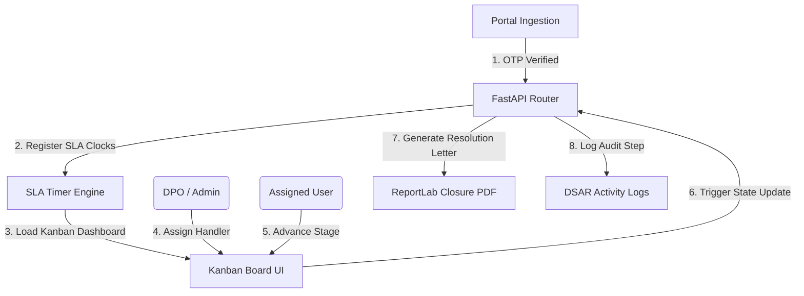
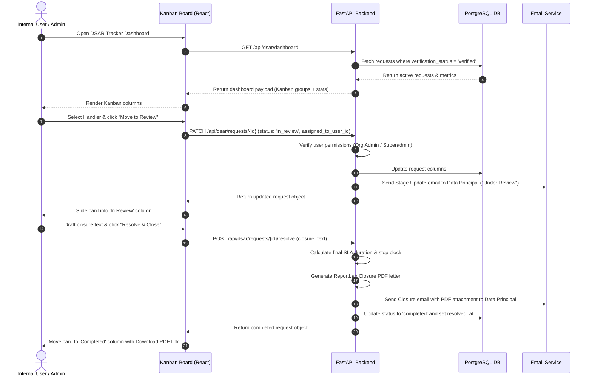
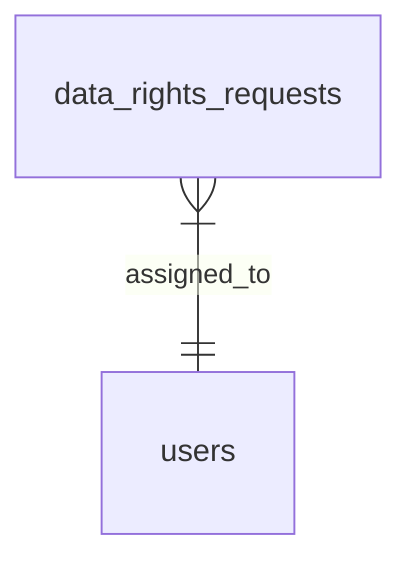

# DPDPA Shield — DSAR SLA Tracker Technical Specification

This document serves as the **single source of truth** for the **DSAR SLA Tracker** module of the ZeroShield DPDPA compliance platform. It provides the detailed frontend, backend, database, integration, and compliance specifications required to build, test, and maintain the internal request tracker.

---

## 1. Module Overview

### 1.1 Purpose
The **DSAR SLA Tracker** is an internal, role-based Kanban workflow dashboard designed to monitor and process verified Data Subject Access Requests (DSAR). It measures compliance deadlines (SLA clocks), delegates tasks to specific handler users, and generates final resolution letters.

### 1.2 Business Objective
To streamline organizational responses to data principal requests. By tracking remaining days per request, assigning accountability to handlers, and warning teams before breaches occur, the platform keeps the organization within legal processing limits.

### 1.3 DPDPA Compliance Objective
*   **Sections 11-14**: Resolves customer requests within the legally mandated timelines. 
*   **Section 8(1)**: Provides fiduciaries with a auditable, traceable record of how and when each data right request was received, acknowledged, and resolved.

### 1.4 Architectural Context
The SLA Tracker is the internal cockpit that coordinates actions upon ingestion from the public portal:



### 1.5 Target Users
*   **Compliance Officers (DPOs)**: Oversee the global dashboard, monitor breach alerts, assign requests to handlers, and verify resolution letters.
*   **Assigned Handlers (Internal Users)**: Move requests through the review pipeline, gather requested personal data summaries, and draft closure text.

---

## 2. DPDPA Mapping & Compliance Matrix

| DPDPA Section | Regulatory Requirement | SLA Tracker Implementation |
| :--- | :--- | :--- |
| **Section 11** | Right of Data Principal to access. | Tracks access requests against target SLAs (e.g. 30-day resolution timer). |
| **Section 12** | Right to correction,completion, and erasure. | Tracks correction and deletion requests, alerting handlers to perform manual inventory adjustments. |
| **Section 13** | Grievance redressal. | Tracks grievance requests against strict acknowledgement deadlines (e.g. 48-hour ack timer). |
| **Section 8(1)** | Accountability. | Logs handler name, comments, and decision date for every transaction. |

---

## 3. End-to-End User Journey



### 3.1 Scenario Workflows
*   **Handler Assignment Gate**: Dropdown selects a handler locally ➜ Action buttons ("Move to review", "Mark ready", "Resolve") are disabled until a handler is chosen ➜ Click action saves the assignment to the database.
*   **Grievance Acknowledgement Flow**: Request is a `grievance` ➜ Tracker displays an "Acknowledge Grievance" button on the card ➜ Click triggers `ack_due_at` check ➜ Status changes to `received` (or `in_review`) and logs `acknowledged_at` timestamp to satisfy audit guidelines.

---

## 4. Detailed Screen Specification

The workspace tracker is built as a Kanban board.

### 4.1 Statistics Header
*   **Active Requests**: Verified requests currently open.
*   **SLA Breached**: Count of open requests where `due_at < now`.
*   **Grievances Ack Pending**: Count of unacknowledged grievances.
*   **Resolved This Month**: Completed requests count.

### 4.2 Kanban Board columns
Only verified requests are shown in the tracker:
1.  **Received**: Newly verified requests. Contains "Acknowledge Grievance" actions if the right type is `grievance`.
2.  **In Review**: Requests currently being investigated by handlers.
3.  **Response Ready**: Inquiries where data summaries/resolutions have been compiled.
4.  **Completed / Closed**: Historical ledger. Cards in this column offer a "Download Closure PDF" link.

### 4.3 Kanban Request Card
*   **Headers**: Right type badge, tracking ID (e.g. `DR-2026-X98B`).
*   **Body**: Requester Name, date received, description snippet.
*   **Footer**:
    *   *SLA Timer*: Real-time countdown displaying remaining days or warning in red if overdue (e.g. `3 days remaining` or `OVERDUE`).
    *   *Handler Selector*: Dropdown displaying organization members.
    *   *Stage Actions*: Primary buttons to transition state (e.g. "Move to Review", "Acknowledge", "Resolve").

---

## 5. Role-Based Access Control (RBAC) Matrix

| Role | Requests Shown | Can Assign Handlers | Can Advance Stages |
| :--- | :--- | :--- | :--- |
| **Superadmin** | All verified requests in the selected organization | Yes (any request) | Yes (any request) |
| **Org Admin** | Unassigned queue + requests assigned to self | Yes (unassigned queue) | Yes (own + unassigned) |
| **User (Handler)**| Only requests explicitly assigned to self | No | Yes (assigned requests only) |

---

## 6. Relationships with Other Modules

*   **Public Portal**: Feeds incoming requests once verification codes are matched.
*   **DSAR Logs**: Automatically captures actions and generates timeline logs.

---

## 7. Frontend Architecture

### 7.1 Component Structure
```
DSARSLATracker.tsx (Main dashboard orchestrator)
  ├── SLAHeaderStats.tsx (Dashboard metrics)
  ├── KanbanBoard.tsx (Board grid container)
  │     ├── KanbanColumn.tsx (Individual status columns)
  │     │     └── RequestCard.tsx (Request item card)
  │     │           ├── SLACountdownTimer.tsx (Remaining time indicator)
  │     │           ├── HandlerSelectDropdown.tsx (Assign user picker)
  │     │           └── CardActionButtons.tsx (Transition triggers)
  └── ResolveRequestModal.tsx (Draft closure text popup)
```

---

## 8. Backend Architecture

### 8.1 Files & Layout
*   **Models**: `app/models/dsar.py` (defines `DataRightsRequest` schemas).
*   **Router**: `app/routers/dsar.py` (exposes tracker routes).
*   **Service**: `app/services/dsar_service.py` (calculates SLA clocks, evaluates breaches, and updates databases).

### 8.2 SLA Clock Logic
Deadlines are configured in settings (`dsar_sla_config`). The clock is started when the user verifies their OTP:

```python
# app/services/dsar_service.py
# SLA starts at OTP verification
request.received_at = now
request.due_at = now + timedelta(days=settings.sla_days_for(request.right_type))
if request.right_type == "grievance":
    request.ack_due_at = now + timedelta(hours=settings.grievance_ack_hours)
```

---

## 9. Database Design
Key columns are defined in the `data_rights_requests` table.



---

## 10. API Design

All endpoints require authorization via JWT Bearer Token.

### 10.1 Get Dashboard Kanban
*   **Method / Route**: `GET /api/dsar/dashboard?org_id=<org_id>`
*   **Response Body (200 OK)**:
    ```json
    {
      "summary": {
        "active_count": 8,
        "breached_count": 1,
        "pending_ack_count": 2,
        "resolved_month": 14
      },
      "requests": [
        {
          "id": "e294cfbf-d018-47bc-ad74-3ee2f507b51b",
          "tracking_id": "DR-2026-X98B",
          "right_type": "access",
          "requester_name": "Rajesh Kumar",
          "status": "received",
          "received_at": "2026-06-25T12:00:00Z",
          "due_at": "2026-07-25T12:00:00Z",
          "assigned_to_user_id": null
        }
      ]
    }
    ```

### 10.2 Resolve Request
*   **Method / Route**: `POST /api/dsar/requests/{request_id}/resolve`
*   **Request Body**:
    ```json
    {
      "closure_text": "All personal records have been collected and verified. Summary sent."
    }
    ```
*   **Response Body (200 OK)**:
    ```json
    {
      "id": "e294cfbf-d018-47bc-ad74-3ee2f507b51b",
      "status": "completed",
      "resolved_at": "2026-06-25T13:00:00Z",
      "closure_text": "All personal records have been collected and verified. Summary sent."
    }
    ```

---

## 11. QA Verification Matrix

### 11.1 Positive Test Cases
*   **TC-01 (Kanban Separation)**: Verify that only requests with `verification_status = 'verified'` are displayed on the tracker board.
*   **TC-02 (Assign Handler)**: Verify assigning a request updates the `assigned_to_user_id` and dispatches an assignment log.
*   **TC-03 (Advance Status)**: Check that moving a card to `in_review` triggers a stage update email notification.
*   **TC-04 (SLA Overdue Indicator)**: Simulate clock past `due_at`; verify the tracker labels card as `OVERDUE` in red.

### 11.2 Negative Test Cases
*   **TC-05 (Action Without Handler)**: Attempt to advance request status without selecting an assignee. Verify actions are blocked and disabled.
*   **TC-06 (Unauthorized Assignment)**: Attempt to delegate a handler using a standard `user` role token. Assert `403 Forbidden`.
*   **TC-07 (Advance Locked Card)**: Attempt to advance a card assigned to a different user while authenticated as standard `user` role. Assert `403 Forbidden`.
