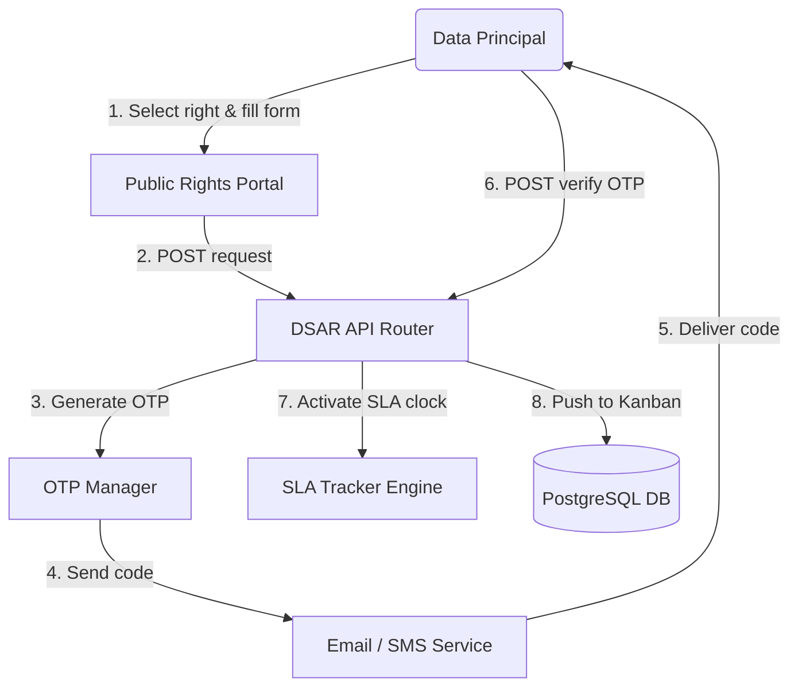
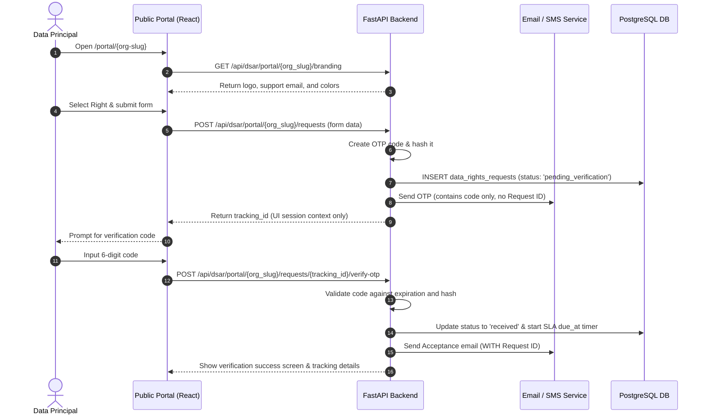
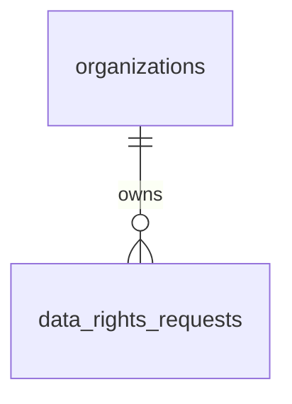

# Vajra — Rights Portal (Public) Technical Specification

This document serves as the **single source of truth** for the **Data Principal Rights Portal** module of the Vajra DPDPA compliance platform. It provides the detailed frontend, backend, database, integration, and compliance specifications required to build, test, and maintain the public-facing portal.

---

## 1. Module Overview

### 1.1 Purpose
The **Rights Portal (Public)** is an unauthenticated, white-labeled web interface that allows Data Principals (end-users, customers, employees) to exercise their statutory privacy rights. It provides customizable forms, an identity verification layer using OTP (One-Time Password) via email or SMS, and a secure request tracking sandbox.

### 1.2 Business Objective
To provide a secure, self-service entry point for data requests, reducing operational overhead. It automates request ingestion, validates requester identity before initiating internal workflows, and allows users to track request status directly.

### 1.3 DPDPA Compliance Objective
*   **Sections 11–14**: Empowers Data Principals with rights to access processing summaries, request corrections or erasure, appoint nominees, withdraw consent, and submit grievances.
*   **Section 6**: Ensures requests are authenticated (via verified email/SMS OTP) before fiduciaries process them, protecting personal data from unauthorized access or theft.

### 1.4 Architectural Context
The public portal is the external gateway that channels requests into the internal compliance workflow:



### 1.5 Target Users
*   **Data Principals (Public Users)**: Customers or employees who wish to access, correct, delete, or withdraw consent for their personal data.
*   **DPOs & Compliance Admins**: Customize form schemas and view public portal settings.

---

## 2. DPDPA Mapping & Compliance Matrix

| DPDPA Section | Regulatory Requirement | Portal Implementation |
| :--- | :--- | :--- |
| **Section 11** | Right of Data Principal to access summaries, identities, and categories. | Portal right type: `access`. Dynamic fields collect specific scope details. |
| **Section 12** | Right to correction, completion, and erasure. | Portal right types: `correction` and `erasure`. |
| **Section 13** | Right of grievance redressal. | Portal right type: `grievance`. Initiates quick grievance acknowledgement SLA clocks. |
| **Section 14** | Right to nominate a representative in case of death or incapacity. | Portal right type: `nomination`. Collects nominee identification details. |
| **Section 6** | Right to withdraw consent as easily as it was given. | Portal right type: `withdraw_consent`. Maps to active consent registers. |

---

## 3. End-to-End User Journey



### 3.1 Scenario Workflows
*   **Verification Channels Selection**:
    *   If form has *Email only*: System triggers Email OTP (`verification_method: email`).
    *   If form has *Phone only*: System triggers SMS OTP (`verification_method: sms`).
    *   If form has *Both*: Data principal chooses their preferred OTP channel at submission.
*   **Request Status Tracking**: Data Principal enters their email/phone + tracking ID ➜ System validates matching records ➜ Displays current stage (`received`, `in_review`, `response_ready`, `completed`) and remaining SLA days.

---

## 4. Detailed Screen Specification

The public portal is unauthenticated and responsive for mobile/web access.

### 4.1 Portal Home Page
*   **Branding Header**: Organization Logo, title (e.g. *"Data Principal Rights Portal"*), and support contact information.
*   **Selection Grid**: Cards representing available rights:
    1.  **Access Data**: Request a summary of personal data held.
    2.  **Correct / Update**: Correct inaccuracies or complete missing details.
    3.  **Delete Data**: Request erasure of personal data under Section 12.
    4.  **Nominate Representative**: Appoint someone to manage data rights.
    5.  **Submit Grievance**: Raise complaints regarding processing issues.
    6.  **Withdraw Consent**: Revoke previously granted consent notices.

### 4.2 Dynamic Request Form
*   **Fields**: Dynamic form schema loaded from `organization_settings.dsar_portal_forms`. 
*   **Default Inputs**: Requester Name, Email, Phone (enforces `+91` plus 10 digits validation), Request Details text box.
*   **OTP Verification Screen**: Displays a countdown timer, digit inputs, and a "Resend Code" link.

### 4.3 Status Check Screen
*   **Form**: Inputs for Tracking ID + Requester Email or Phone.
*   **Dashboard Result**: Displays a timeline progress tracker, calculated SLA countdown banner, DPO contact details, and a download link for the PDF closure letter once resolved.

---

## 5. Custom Form Schema (`dsar_portal_forms`)
Forms are customized per organization. The configuration schema is defined as:

```json
{
  "right_type": "access",
  "fields": [
    {
      "field_key": "requester_name",
      "label": "Full Name",
      "type": "text",
      "required": true
    },
    {
      "field_key": "requester_email",
      "label": "Email Address",
      "type": "email",
      "required": true
    }
  ]
}
```

---

## 6. Relationships with Other Modules

*   **Workspace Settings**: Inherits organization slug, DPO contact emails, logos, and custom portal style configs.
*   **SLA Tracker**: Pushes verified requests directly into the internal tracker dashboard queue.

---

## 7. Frontend Architecture

### 7.1 Component Structure
```
DataRightsPortalPublic.tsx (Public Orchestrator component)
  ├── PortalBrandingHeader.tsx (Organization identity block)
  ├── RightsSelectionGrid.tsx (Select right type cards)
  ├── DynamicRequestForm.tsx (Form generator matching JSON schema)
  │     └── OTPVerificationPanel.tsx (Digits code inputs)
  └── StatusChecker.tsx (SLA timeline progress check)
```

---

## 8. Backend Architecture

### 8.1 Files & Layout
*   **Models**: `app/models/dsar.py` (defines `DataRightsRequest` model).
*   **Router**: `app/routers/dsar.py` (exposes public portal routes).
*   **Service**: `app/services/dsar_service.py` (handles OTP generation, verification checks, and form validation).

---

## 9. Database Design
Requests are saved in the `data_rights_requests` table.



### 9.1 Database Constraints
1.  **Tracking ID Uniqueness**:
    ```sql
    ALTER TABLE data_rights_requests 
    ADD CONSTRAINT uq_data_rights_requests_tracking_id UNIQUE (tracking_id);
    ```
2.  **Phone Format Check**:
    `requester_phone` checks format matches `^\+91[0-9]{10}$` to normalize Indian numbers.

---

## 10. API Design

### 10.1 Ingest Request
*   **Method / Route**: `POST /api/dsar/portal/{org_slug}/requests`
*   **Request Body**:
    ```json
    {
      "right_type": "access",
      "requester_name": "Rajesh Kumar",
      "requester_email": "rajesh@gmail.com",
      "request_details": "Requesting a summary of my profile data."
    }
    ```
*   **Response Body (200 OK)**:
    ```json
    {
      "tracking_id": "DR-2026-X98B",
      "verification_method": "email",
      "message": "OTP sent to rajesh@gmail.com"
    }
    ```

### 10.2 Verify OTP
*   **Method / Route**: `POST /api/dsar/portal/{org_slug}/requests/{tracking_id}/verify-otp`
*   **Request Body**:
    ```json
    {
      "code": "123456"
    }
    ```
*   **Response Body (200 OK)**:
    ```json
    {
      "tracking_id": "DR-2026-X98B",
      "verification_status": "verified",
      "status": "received",
      "message": "Identity verified. Request has been submitted to the compliance team."
    }
    ```

---

## 11. QA Verification Matrix

### 11.1 Positive Test Cases
*   **TC-01 (Submit & Issue OTP)**: Submitting a form creates a record with status `pending_verification` and dispatches an OTP.
*   **TC-02 (Verify Email OTP)**: Entering the correct code updates status to `received`, registers `received_at`, and starts the SLA clock.
*   **TC-03 (Dynamic Branding)**: Verify loading the portal with `org_slug` returns matching assets (logo, branding name).
*   **TC-04 (Status Checker)**: Verify tracking verified requests displays correct progress timeline values.

### 11.2 Negative Test Cases
*   **TC-05 (Incorrect OTP Code)**: Enter invalid OTP digits. Verify verification status remains `unverified` and `otp_attempts` increments.
*   **TC-06 (Expired OTP Token)**: Enter code past `otp_expires_at` timeframe. Assert `400 Bad Request` with appropriate message.
*   **TC-07 (Access Unverified Request)**: Attempt to search unverified request tracking status. Verify record is excluded from search index.
