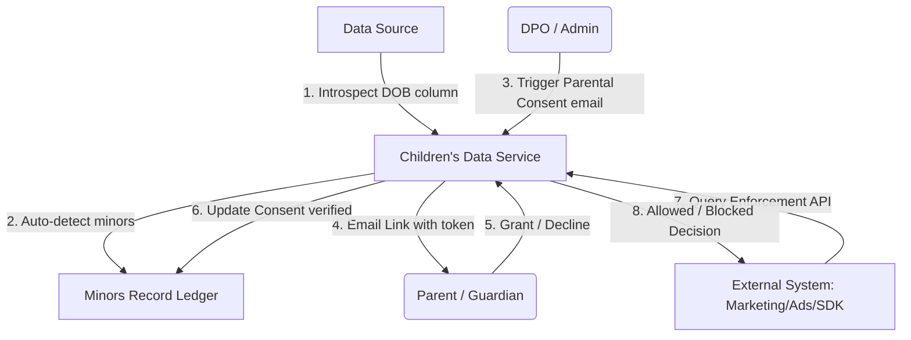
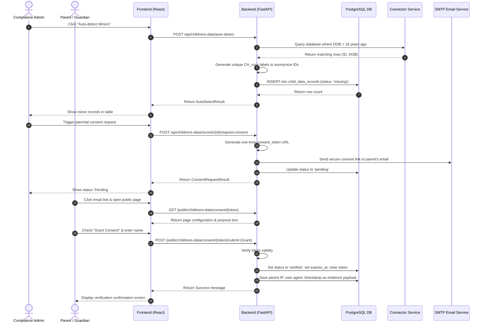
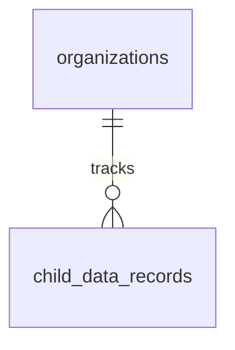

# DPDPA Shield — Children's Data Technical Specification

This document serves as the **single source of truth** for the **Children's Data** module of the ZeroShield DPDPA compliance platform. It provides the detailed frontend, backend, database, integration, and compliance specifications required to build, test, and maintain children's data protections.

---

## 1. Module Overview

### 1.1 Purpose
The **Children's Data** module provides specialized compliance safeguards for users who are minors (under the age of 18). It automates the discovery of minors' records, manages self-service **verifiable parental consent**, and enforces processing bans on profiling and targeted advertising via an external decision API.

### 1.2 Business Objective
To prevent heavy regulatory penalties associated with child data processing. It allows businesses to safely identify minors and enforce DPDPA-required restrictions across all internal services.

### 1.3 DPDPA Compliance Objective
*   **Section 9(1)**: Requires verifiable parental consent (or consent of a lawful guardian) before processing any personal data of a child.
*   **Section 9(3)**: Prohibits processing of children's data that is likely to cause a detrimental effect on their well-being, and explicitly bans **behavioral tracking, profiling, and targeted advertising** directed at children.

### 1.4 Architectural Context
The Children's Data module sits as a security sentinel between user directories and external systems:



### 1.5 Target Users
*   **Data Protection Officers (DPOs)**: Oversee the minors register, review parental consent statuses, audit verification logs, and generate compliance reports.
*   **Software Engineers / Integrators**: Call the Enforcement API from marketing, advertising, and analytics platforms to verify if processing is allowed.

---

## 2. DPDPA Mapping & Compliance Matrix

| DPDPA Section | Regulatory Requirement | Children's Data Implementation |
| :--- | :--- | :--- |
| **Section 9(1)** | Verifiable parental consent required for processing. | Email-based self-service link captures parent verification. Connects with DigiLocker details. |
| **Section 9(3)** | No targeted advertising directed at children. | Enforcement API returns `allowed = false` when an external system requests `ad_targeting` for a minor. |
| **Section 9(3)** | No tracking or behavioral profiling of children. | Enforcement API returns `allowed = false` when an external system requests `profiling` for a minor. |

---

## 3. End-to-End User Journey



### 3.1 Scenario Workflows
*   **Enforcement Decision Workflow**: External ad server calls `/api/childrens-data/enforce` ➜ Backend looks up user by `external_ref` ➜ Finds matching record ➜ Evaluates requested purpose ➜ If purpose is `ad_targeting`, returns `allowed = false` with Section 9(3) legal citation.
*   **Parent Consent Self-Service**: User enters parental email ➜ Backend generates token and sends link ➜ Parent grants consent ➜ Token is cleared immediately to prevent reuse.
*   **Age Out / Expiry Maintenance**: Daily scheduler sweeps the database ➜ Checks birthdays ➜ If child turned 18, sets status to `aged_out`, lifts restrictions (`profiling_blocked = false`), and writes an audit note. If consent lapses past `expires_at`, transitions status to `expired`.

---

## 4. Detailed Screen Specification

The cockpit consists of an interactive dashboard, minors register, and developer API console.

### 4.1 Dashboard Overview
*   **Summary Indicators**: Total Minors, Missing Consent, Pending Requests, Verified.
*   **Minors Register Table**: Columns: Ref (non-identifying), External Ref, Age/DOB, Detection Method, Parental Consent (Missing, Pending, Verified, Expired), Restrictions (Icons showing profiling/ads are blocked).
*   **Action Panel**:
    *   *Add Record*: Manual input form (Reference, DOB/Age, notes).
    *   *Record Consent*: Manual override modal (Parent Name, email, relationship, verification method).
    *   *Request Consent*: Email popup (Parent Email, Name, validity duration, purpose text).

### 4.2 Developer Integration Page
*   Exposes documentation for the external Enforcement API.
*   **Playground Test Area**: Input box to enter `User ID` and select `Purpose` ➜ Click "Check" ➜ Displays JSON decision payload (allowed: true/false, reason).

---

## 5. Form Schema

### 5.1 Enforcement Request (`EnforcementRequest`)

| Field Name | Type | Description | Validation | Example Value |
| :--- | :--- | :--- | :--- | :--- |
| `subject_ref` | String | External user ID or child reference | Required, Min 1 | `"usr_98f12b"` |
| `purpose` | Enum | Processing purpose type | processing, profiling, ad_targeting | `'ad_targeting'` |

### 5.2 Enforcement Decision (`EnforcementDecision`)

| Field Name | Type | Description | Validation | Example Value |
| :--- | :--- | :--- | :--- | :--- |
| `allowed` | Boolean | True if processing is legally allowed | Required | `false` |
| `purpose` | Enum | Evaluated purpose type | Required | `'ad_targeting'` |
| `matched` | Boolean | True if subject was found in minor register | Required | `true` |
| `is_minor` | Boolean | True if subject is verified minor | Required | `true` |
| `consent_status`| Enum | Active consent state | missing, pending, verified, expired | `'missing'` |
| `reason` | String | Compliance reason / legal citation | Required | `"Blocked: ad-targeting children is banned."` |

---

## 6. Relationships with Other Modules

*   **Data Sources**: Connected databases are queried during auto-detect scans to identify birthdates.
*   **Data Inventory**: Maps the metadata location of date-of-birth (DOB) columns to target scans.

---

## 7. Frontend Architecture

### 7.1 Component Structure
```
ChildrensData.tsx (Main Coordinator Component)
  ├── SummaryCards.tsx (Metrics dashboard)
  ├── AutoDetectModal.tsx (Scan configurations)
  ├── MinorsTable.tsx (Minors register)
  │     ├── RecordConsentModal.tsx (Manual verification)
  │     └── RequestConsentModal.tsx (Self-service email sender)
  └── EnforcementTester.tsx (Developer play console)
```

---

## 8. Backend Architecture

### 8.1 Files & Layout
*   **Models**: `app/models/child_data.py` (defines `ChildDataRecord` and status enums).
*   **Router**: `app/routers/childrens_data.py` (exposes endpoints).
*   **Service**: `app/services/child_data_service.py` (coordinates age calculations, auto-detect loops, token generation, email SMTP senders, and decision engines).

### 8.2 Enforcement Decision Logic
The core enforcement logic inside `check_enforcement_for_org()` evaluates the subject against the rules:

```python
# app/services/child_data_service.py
if record is None:
    return Allowed(True, "Subject is not a known minor.")

if not is_minor:
    return Allowed(True, "Subject has aged out.")

if purpose == "ad_targeting":
    return Allowed(not record.ad_targeting_blocked, "Targeted ads blocked under Section 9(3).")
elif purpose == "profiling":
    return Allowed(not record.profiling_blocked, "Behavioral profiling blocked under Section 9(3).")
else: # general processing
    return Allowed(consent_status == "verified", "Processing requires parental consent under Section 9(1).")
```

---

## 9. Database Design



---

## 10. API Design

All endpoints require authorization via JWT Bearer Token.

### 10.1 Check Enforcement (Decision API)
*   **Method / Route**: `POST /api/childrens-data/enforce`
*   **Request Body**:
    ```json
    {
      "subject_ref": "usr_98f12b",
      "purpose": "ad_targeting"
    }
    ```
*   **Response Body (200 OK)**:
    ```json
    {
      "allowed": false,
      "purpose": "ad_targeting",
      "matched": true,
      "is_minor": true,
      "consent_status": "verified",
      "profiling_blocked": true,
      "ad_targeting_blocked": true,
      "child_ref": "CH_8b9f1a2c",
      "reason": "Blocked: targeted advertising directed at children is prohibited (DPDPA s.9(3))."
    }
    ```

---

## 11. QA Verification Matrix

### 11.1 Positive Test Cases
*   **TC-01 (Auto-Detect Minors)**: Run scan on a table containing users born after 2010. Verify minor records are added to the table with `consent_status = "missing"`.
*   **TC-02 (Parent Consent Verification)**: Submit Parent Consent form via public token link; verify record transitions to `verified` and token is deleted.
*   **TC-03 (Age Out Sweep)**: Run lifecycle maintenance; verify child turning 18 transitions to `aged_out` and restrictions are deactivated.
*   **TC-04 (API Key Enforcement)**: Call enforce endpoint using active API key. Verify decision returned resolves correctly.

### 11.2 Negative Test Cases
*   **TC-05 (Expired Consent Link)**: Attempt to load the public parent page using a token whose expiry date has passed. Assert `410 Gone`.
*   **TC-06 (Duplicate Submissions)**: Submit parent consent multiple times on the same token. Assert `404 Not Found` for subsequent attempts.
*   **TC-07 (Unauthorized Manual Override)**: Attempt to record consent manually using a `viewer` role token. Assert `403 Forbidden`.
