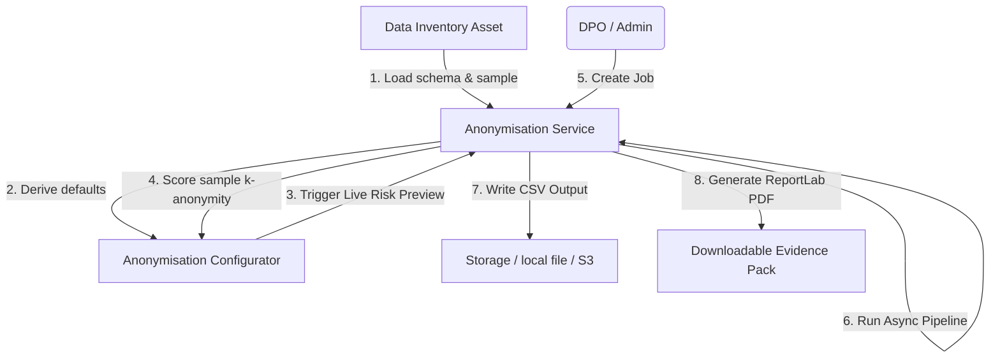
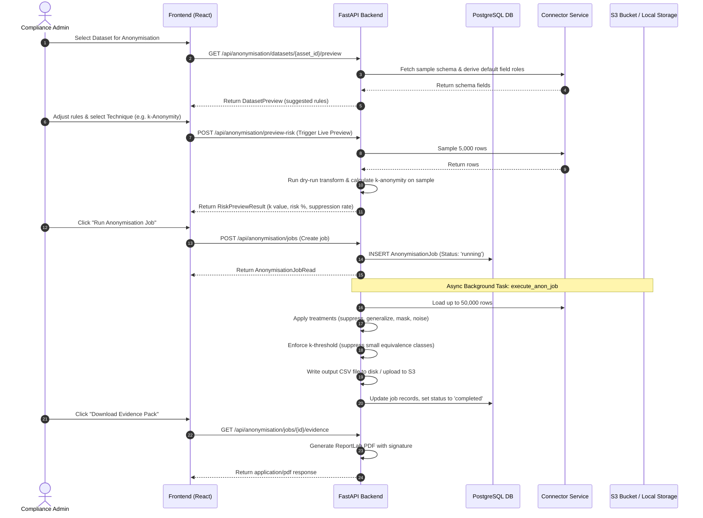
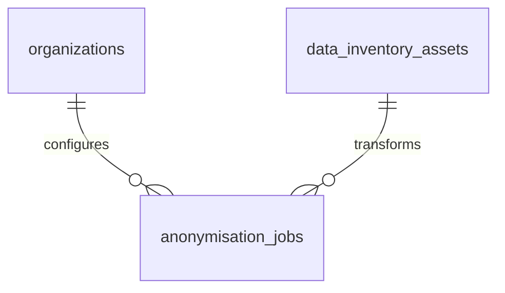

# DPDPA Shield — Data Anonymisation Technical Specification

This document serves as the **single source of truth** for the **Data Anonymisation** module of the ZeroShield DPDPA compliance platform. It provides the detailed frontend, backend, database, integration, and compliance specifications required to build, test, and maintain the data anonymisation pipelines.

---

## 1. Module Overview

### 1.1 Purpose
The **Data Anonymisation** module enables organizations to scrub personal identifiers permanently from datasets (databases, tables, file uploads) before they are shared for analytics, testing, or archiving. It applies mathematical anonymisation models—including **k-Anonymity**, **l-Diversity**, and **Differential Privacy**—to verify that records cannot be re-associated with real individuals.

### 1.2 Business Objective
To make data sharing compliance frictionless. Compliance teams can generate anonymised exports that are legally exempt from the DPDPA's obligations, while preserving the analytical and statistical value of the dataset.

### 1.3 DPDPA Compliance Objective
*   **Section 8 (Data Minimisation)**: Mandates the destruction of personal data once the purpose of processing is fulfilled. Anonymisation serves as a legal alternative to deletion: once data is fully anonymised (irreversible), it is no longer considered "personal data" under the DPDPA, exempting it from compliance obligations.

### 1.4 Architectural Context
Data Anonymisation reads from active Data Inventory assets, processes data asynchronously in background workers, and outputs anonymised files alongside compliance audit certificates:



### 1.5 Target Users
*   **Data Protection Officers (DPOs)**: Define target k-anonymity thresholds, check re-identification risk metrics, and download audit-ready compliance certificates.
*   **Data Analysts & Engineers**: Configure field treatments, select anonymisation presets, run cleaning pipelines, and download CSV exports.

---

## 2. DPDPA Mapping & Compliance Matrix

| DPDPA Section | Regulatory Requirement | Data Anonymisation Implementation |
| :--- | :--- | :--- |
| **Section 8** | Irreversible anonymisation removes compliance burden. | Guarantees mathematically verified **k-Anonymity** and **l-Diversity**, removing the link to the Data Principal. |
| **Section 8(1)** | Burden of proof on Data Fiduciary for compliance. | Generates a signed **Evidence Pack PDF** containing job parameters, field treatments, and achieved privacy metrics. |

---

## 3. End-to-End User Journey



### 3.1 Scenario Workflows
*   **Job Creation & Async Run**: User defines the rule set and runs the job ➜ API responds immediately with status `running` ➜ Background worker processes the full dataset ➜ Resulting CSV and PDF reports are written to disk.
*   **Scheduled Runs**: Job is set to `daily` ➜ The background scheduler runs nightly checks ➜ If due, clones rules, loads current source database tables, anonymises the new records, and pushes the output CSV to S3.
*   **Risk Drift Warnings**: Over time, new rows added to the database can erode k-anonymity (drift) ➜ The scheduler monitors jobs, recalculates k against current live data, and flags job as `drift` status if `measured_k < k_threshold`.

---

## 4. Detailed Screen Specification

The cockpit consists of an configuration wizard and a historical jobs dashboard.

### 4.1 Configuration Step
*   **Preset Selector**: Technique dropdown (k-Anonymity, l-Diversity, Generalization, Suppression, Differential Privacy, Date Shifting, Pseudonymization).
*   **Field Mapping Grid**: Columns: Field Name, Data Type, Classification, Field Role (Select: Identifier, Quasi-Identifier, Sensitive, Insensitive), Field Treatment (Select: Keep, Suppress, Pseudonymize, Generalize, Mask, Date Shift, DP Noise).
*   **Threshold Settings**: Target `k` input (Min 2) + Target `l` input + Epsilon ($\epsilon$) input slider.
*   **Live Risk Preview Card (Sticky RHS)**:
    *   *Predicted k*: Measured anonymity size.
    *   *Re-identification Risk*: Percentage representation ($100 / k$).
    *   *Risk Level*: Color-coded badge (Low = Green, Medium = Orange, High = Red).
    *   *Estimated Suppression*: Counts and percentage rate of dropped rows.

### 4.2 Job History Dashboard
*   **Summary Indicators**: Total Jobs, Failed Runs, Active Drift Alerts.
*   **History Table**: Columns: Name, Date, Technique, Achieved k, Risk Level, Status (Running/Completed/Failed/Drift), Actions ("Download CSV", "Download Evidence PDF").

---

## 5. Form Schema

### 5.1 Anonymisation Job Create (`AnonymisationJobCreate`)

| Field Name | Type | Description | Validation | Example Value |
| :--- | :--- | :--- | :--- | :--- |
| `name` | String | User-defined job title | Min 1, Max 255 | `"User Analytics Q3"` |
| `asset_id` | UUID | Data Inventory asset ID | Required | `uuid` |
| `technique` | Enum | Core privacy algorithm | k_anonymity, l_diversity, differential_privacy, etc. | `'k_anonymity'` |
| `k_threshold` | Integer | Minimum equivalence size | Required, Default 25 | `15` |
| `l_threshold` | Integer | Target l-diversity distinct count | Default 2 | `3` |
| `epsilon` | Float | Differential privacy parameter | Optional, lower is noisier | `0.5` |
| `schedule` | Enum | Running frequency | one_time, daily, weekly, monthly | `'weekly'` |
| `output_destination`| String | Destination identifier | download, s3 | `'s3'` |
| `output_source_id` | UUID | S3 connector data source ID | Optional | `uuid` |
| `field_rules` | List | Custom array of field treatments | Optional | `[{"field": "age", "role": "quasi_identifier", "treatment": "generalize"}]` |

---

## 6. Relationships with Other Modules

*   **Data Inventory**: Reads field classification records to populate default role suggestions.
*   **Data Sources**: Connected databases are read for extraction and S3 connectors are used for file delivery.

---

## 7. Frontend Architecture

### 7.1 Component Structure
```
DataAnonymisation.tsx (Main Coordinator Component)
  ├── AnonymisationWizard.tsx (Stepper config view)
  │     ├── FieldMappingTable.tsx (Rules config)
  │     └── LiveRiskPreviewCard.tsx (Simulation scoring card)
  └── AnonymisationJobsList.tsx (Historical table with downloads)
```

---

## 8. Backend Architecture

### 8.1 Files & Layout
*   **Models**: `app/models/anonymisation.py` (defines `AnonymisationJob`).
*   **Router**: `app/routers/anonymisation.py` (exposes endpoints).
*   **Service**: `app/services/anonymisation_service.py` (handles database connector queries, Laplace noise, suppression checks, and ReportLab PDF generation).
*   **Scheduler**: `app/services/anonymisation_scheduler.py` (handles background cron verification).

### 8.2 Anonymisation Algorithms
1.  **k-Anonymity Enforcement**:
    Group rows by quasi-identifier values. Suppress (drop) any equivalence group containing fewer than `k_threshold` records.
2.  **l-Diversity Enforcement**:
    Group rows by quasi-identifiers. If the number of distinct values for any sensitive column within a group is less than `l_threshold`, drop the entire group.
3.  **Differential Privacy**:
    Adds Laplace-distributed noise to numeric columns. The scale is determined as:
    $$\text{Scale} = \frac{1}{\epsilon}$$
    $$\text{Noisy Value} = x + \text{Laplace}(\text{Scale})$$

---

## 9. Database Design



---

## 10. API Design

All endpoints require authorization via JWT Bearer Token.

### 10.1 Trigger Risk Preview
*   **Method / Route**: `POST /api/anonymisation/preview-risk`
*   **Request Body**:
    ```json
    {
      "asset_id": "c1387d89-9831-419b-a010-8b630f9a2de0",
      "technique": "k_anonymity",
      "k_threshold": 10,
      "l_threshold": 2,
      "epsilon": 1.0,
      "field_rules": [
        {
          "field": "city",
          "role": "quasi_identifier",
          "treatment": "generalize"
        }
      ]
    }
    ```
*   **Response Body (200 OK)**:
    ```json
    {
      "sample_rows": 5000,
      "predicted_k": 12,
      "risk_percent": 8.33,
      "risk_level": "low",
      "estimated_suppressed": 24,
      "estimated_suppression_rate": 0.48,
      "quasi_identifiers": ["city"],
      "sensitive_fields": [],
      "rules": []
    }
    ```

---

## 11. QA Verification Matrix

### 11.1 Positive Test Cases
*   **TC-01 (Risk Prediction)**: Confirm that POST `/api/anonymisation/preview-risk` returns a computed re-identification risk score based on the sampled rows.
*   **TC-02 (k-Anonymity Suppression)**: Verify that running a job drops equivalence classes with sizes below the threshold.
*   **TC-03 (DP Laplace Noise)**: Verify that applying differential privacy noise shifts numeric columns (e.g. salary values) by adding Laplace noise.
*   **TC-04 (Evidence PDF Generation)**: Confirm GET `/api/anonymisation/jobs/{id}/evidence` returns a valid, non-empty PDF binary response.

### 11.2 Negative Test Cases
*   **TC-05 (Unauthorized Run)**: Attempt to trigger a job using a `viewer` role token. Assert `403 Forbidden`.
*   **TC-06 (Insufficient Data for l-diversity)**: Attempt l-diversity on columns with insufficient distinct values. Verify the job runs and reports high suppression rates.
*   **TC-07 (Access Other Tenant Job)**: Attempt to download anonymised outputs belonging to another organization. Assert `404 Not Found`.
