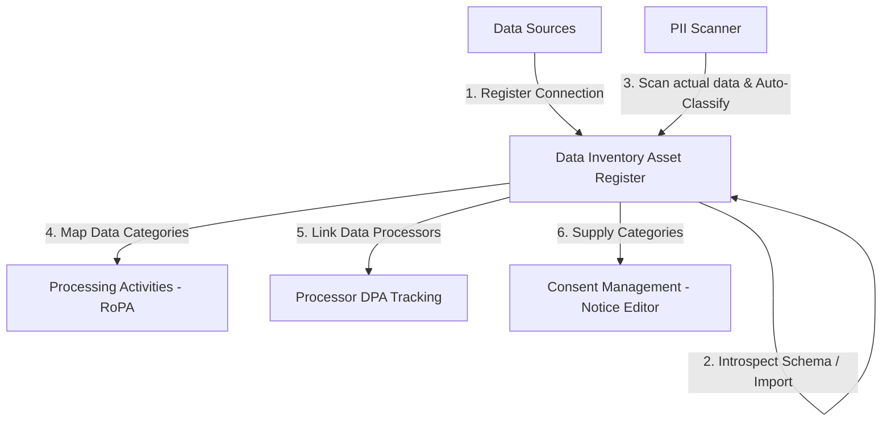
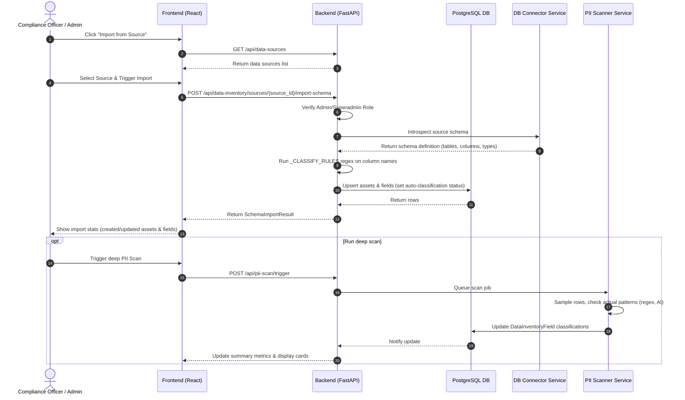
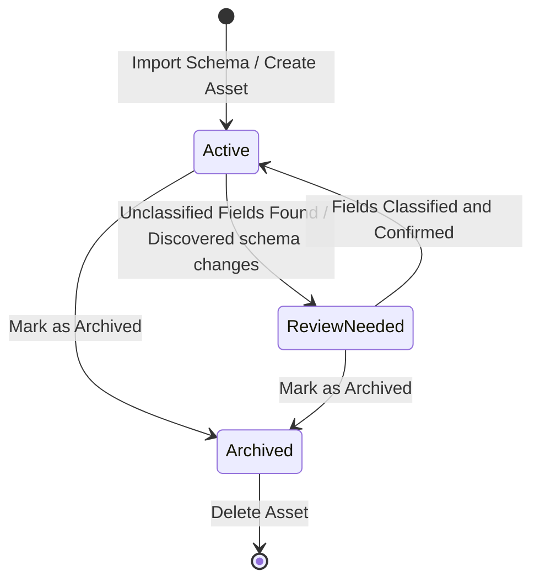
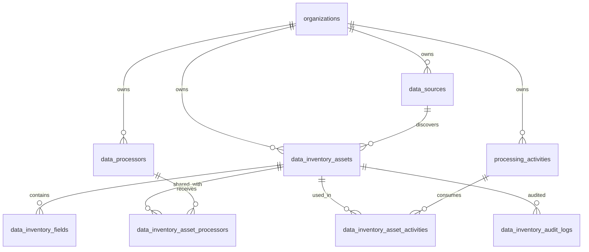

# Vajra — Data Inventory Technical Specification

This document serves as the **single source of truth** for the **Data Inventory** module of the Vajra DPDPA compliance platform. It provides the detailed frontend, backend, database, integration, and compliance specifications required to build, test, and maintain the data catalog, Record of Processing Activities (RoPA) sync, and Data Processor Agreement (DPA) tracking.

---

## 1. Module Overview

### 1.1 Purpose
The **Data Inventory** module serves as the primary system of record for cataloging **what** personal data an organization processes, **where** it is stored, **how** it is classified, **who** owns it, and **which** third-party processors are involved. It translates raw operational structures (databases, tables, APIs, folders) into structured compliance registers.

### 1.2 Business Objective
To automate data mapping and schema discovery, reducing the manual burden on DPOs and compliance teams. It enables organizations to keep their data assets continuously mapped, automatically detect PII, evaluate vendor risks, and generate ready-for-audit compliance logs.

### 1.3 DPDPA Compliance Objective
Under the Indian Digital Personal Data Protection Act, 2023 (DPDPA), compliance dictates that:
*   **Section 8(1)**: A Data Fiduciary must comply with the provisions of the Act for all processing undertaken on its behalf (requiring complete visibility of all data assets).
*   **Section 8(2)**: Engagement of Data Processors must be done only under a valid contract (requiring Processor DPA Tracking).
*   **Section 8(5)**: Reasonable security safeguards must be implemented to protect personal data (requiring encryption audit and security score tracking).
*   **Section 9(1)**: Verifiable parental consent and additional reviews are required for child or special category data processing.
*   **Section 11(1)**: Data Principals have the right to obtain a summary of their personal data being processed and the identities of all other Data Fiduciaries/Processors with whom it has been shared (requiring asset-level field classification and RoPA/DPA linkages).

### 1.4 Architectural Context
The Data Inventory is the structural foundation of the Vajra compliance suite:



### 1.5 Target Users
*   **Data Protection Officers (DPOs)**: Oversee classifications, approve vendor risk metrics, verify DPA statuses, and review schema change logs.
*   **IT & Systems Administrators**: Hook up data sources, configure schema introspections, set asset locations, and maintain credentials.
*   **Compliance Managers**: Verify business unit mapping, associate data processors with activities, and trace fields for DSAR response packets.

---

## 2. DPDPA Mapping & Compliance Matrix

| DPDPA Section | Regulatory Requirement | Data Inventory Implementation |
| :--- | :--- | :--- |
| **Section 8(1)** | Accountability of Data Fiduciary for all processing operations. | Real-time cataloging of data assets in the **Asset Register**, tracking location, owners, status, and size. |
| **Section 8(2)** | Data Fiduciaries must execute a valid contract when engaging Data Processors. | **Processor DPA Tracking** monitors the contract execution, sign dates, and risk levels of third-party vendors. |
| **Section 8(5)** | Obligation to take reasonable security safeguards to prevent data breaches. | The **Field Classification** system tracks encryption status (`is_encrypted`) and highlights unencrypted PII. |
| **Section 9(1)** | Prohibitions & restrictions on processing children's personal data. | Custom classifications flag child/special category data, triggering review prompts. |
| **Section 11(1)** | Right of Data Principal to confirm processing, get a summary of data, and list shared fiduciaries/processors. | Consolidates all fields categorized as `personal` or `sensitive` into a single report, linked to processors via **asset↔processor links** and purposes via enforcement mappings. |
| **Section 16** | Cross-border data transfer restrictions. | Asset-level `country`, `cross_border_transfer`, and `transfer_mechanism` fields. |
| **DPDP Rules 2025** | Security safeguards (encryption, masking, obfuscation, tokenization). | Field-level `security_safeguard` enum replaces binary `is_encrypted` alone. |
| **Section 10 (SDF)** | Periodic audits and DPIA for high-risk processing. | `dpia_required` flag on assets; **audit log** tracks classification changes. |

---

## 3. End-to-End User Journey



### 3.1 Scenario Workflows
*   **Manual Cataloging Path**: Admin clicks "Add Asset" ➜ Inputs basic metadata ➜ Saves to draft/active status ➜ Manually appends fields/columns with data types and PII classification.
*   **Automated Schema Scan Path**: Connect a data source (Postgres, Snowflake) ➜ Click "Import from Source" ➜ Service pulls schemas ➜ Applies keyword heuristic classifications ➜ Populates Asset Register automatically.
*   **PII Audit & Review Path**: Newly imported fields default to `personal` or `sensitive` based on regex. If unclassified, the asset status transitions to `review_needed` until a DPO reviews, edits, or confirms the schema.
*   **Vendor DPA Execution**: Vendor register tracks if a Data Processor Agreement is `none`, `under_review`, `signed`, or `expired`. Flagging an active processor as `none` or `expired` prompts a notification.

---

## 4. Detailed Screen Specification

The screen is built as a three-tab view: **Asset Register**, **Processing Activities**, and **Processor DPA Tracking**.

### 4.1 Header & Summary Row
*   **Purpose**: Display overall state of organizational data.
*   **Summary Cards**:
    1.  **Data Assets**: Total count of active `DataInventoryAsset` rows.
    2.  **Personal Fields**: Count of fields classified as `personal`. (Info blue badge)
    3.  **Sensitive Fields**: Count of fields classified as `sensitive`. (Danger red badge)
    4.  **Needs Review**: Count of assets in `review_needed` status. (Warning orange badge)

### 4.2 Tab 1: Asset Register
*   **Controls**: Search bar (assets search) + Dropdown filter (Database, Application, File System, API, Table, Collection, Warehouse, Other) + Action Buttons ("Import from source", "Add Asset").
*   **Table Columns**:
    *   **Name**: Asset title, plus record count (e.g. "1.2M records"). Clicking rows opens the detail drawer.
    *   **Type**: Icon and type label.
    *   **Location**: Physical region or hosting service.
    *   **Data Categories**: Tags of categories represented (e.g. `email`, `phone`, `pan`).
    *   **Fields**: Total field count + sensitive fields count in red (e.g. `12 (2 sensitive)`).
    *   **Owner**: Appointed department lead or system owner.
    *   **Status**: Active (Green check), Review Needed (Orange alert), Archived (Grey badge).
*   **Add/Edit Asset Modal**:
    *   *Inputs*: Name (required), Asset Type (select, required), Location (text), Owner (text), Record Count (text), Status (select), Data Source (select), Description (textarea).
*   **Asset Details Drawer**:
    *   Slides out from right.
    *   Header shows asset metadata, status dropdown, delete button.
    *   Main section has the **Field Register**: A table with Columns: Name, Type, Classification (Select: Unclassified, Non-personal, Personal, Sensitive), PII Category (Text), Encryption (Checkbox/Icon).
    *   Footer contains "Add Field" quick inputs (Name, Data Type, Classification).

### 4.3 Tab 2: Processing Activities (RoPA Sync)
*   **Controls**: Add Processing Activity button.
*   **Table Columns**: Activity Ref, Title & Description, Risk Level, Business Unit, Status.
*   **Add Processing Activity Modal**:
    *   *Inputs*: Title (required), Description (textarea), Business Unit (select, required), Department (select), Team (select).

### 4.4 Tab 3: Processor DPA Tracking (TPRM Sync)
*   **Controls**: Add DPA button.
*   **Table Columns**: Processor Name, Category, Role, DPA Status, Signed Date.
*   **Add DPA Modal**:
    *   *Inputs*: Name (required), Category (select/text), Processor Role (text), Purpose (textarea), Data Categories (text), Location (text), Contact Email (email), DPA Status (select), Signed Date (date), Risk Level (select).

---

## 5. Schemas

### 5.1 Asset Schema (`DataInventoryAsset`)

| Field Name | Type | Description | Validation | Example Value |
| :--- | :--- | :--- | :--- | :--- |
| `name` | String | Unique descriptive name | Min 1, Max 255 | `"customer_billing_db"` |
| `asset_type` | Enum | System classification | database, application, file_system, api, table, collection, warehouse, other | `'database'` |
| `location` | String | Hosting location or cloud region | Max 255, Optional | `"AWS ap-south-1"` |
| `owner` | String | Person or team responsible | Max 255, Optional | `"Finance Operations"` |
| `record_count` | String | Text description of scale | Max 64, Optional | `"1.5M"` |
| `description` | String | Description of contents | Optional | `"Core transaction records"` |
| `status` | Enum | Verification state | active, review_needed, archived | `'active'` |
| `data_categories`| JSON Array | Category tags | Array of strings | `["email", "financial"]` |
| `data_source_id` | UUID | Link to registered data source | Optional | `uuid` |
| `country` | String | ISO 3166-1 alpha-3 country code | Max 3, Optional | `'IND'` |
| `cross_border_transfer` | Boolean | Whether data is transferred outside India | Default false | `true` |
| `transfer_mechanism` | String | Legal basis for cross-border transfer | Max 255, Optional | `'Standard contractual clauses'` |
| `dpia_required` | Boolean | High-risk asset requiring DPIA (Sec 10) | Default false | `true` |
| `contains_child_data` | Boolean | Asset holds children's personal data (Sec 9) | Default false | `false` |
| `last_imported_at` | DateTime | Last schema import timestamp | Optional | ISO 8601 |

### 5.2 Field Schema (`DataInventoryField`)

| Field Name | Type | Description | Validation | Example Value |
| :--- | :--- | :--- | :--- | :--- |
| `name` | String | Column/property key name | Min 1, Max 255 | `"pan_number"` |
| `data_type` | String | Schema data type | Max 128, Optional | `"varchar(20)"` |
| `classification`| Enum | Compliance assessment | unclassified, non_personal, personal, sensitive | `'sensitive'` |
| `pii_category` | String | Detailed tag mapping | Max 64, Optional | `"pan"` |
| `is_encrypted` | Boolean | True if values are encrypted (legacy; synced with security_safeguard) | Required, Default false | `true` |
| `security_safeguard` | Enum | DPDP Rules 2025 safeguard type | none, encryption, masking, obfuscation, tokenization | `'encryption'` |
| `classification_source` | Enum | How classification was determined | manual, heuristic, pii_scanner | `'heuristic'` |
| `is_child_data` | Boolean | Field holds children's personal data (Sec 9) | Default false | `false` |
| `notes` | String | Audit notes / justification | Optional | `"Encrypted using KMS AES-256"` |

---

## 6. Asset & Field Lifecycles & State Transitions

### 6.1 Asset Lifecycle



### 6.2 State Transition Rules
1.  **Active**: Ready to be associated with RoPA activities and mapped to Consent Banners. All fields must have a classification.
2.  **Review Needed**: Triggered automatically when a schema scan imports new/modified columns, or when a user adds unclassified fields. Asset is flagged in summary statistics.
3.  **Archived**: Excluded from active statistics and scanner updates. Retained for audit trailing unless explicitly deleted.

---

## 7. Relationships with Other Modules

*   **PII Scan Engine**:
    *   *Triggers*: When schema scanning finishes, the PII scan engine queues a deeper data profiling job.
    *   *Updates*: Scanners write back verified classifications to the `DataInventoryField` table and toggle status out of `review_needed`.
*   **Purpose Registry & Consent Management**:
    *   *Binding*: The data categories (`data_categories` tags) verified in Data Inventory must align with purposes configured inside the Consent Notice Editor to prevent processing unmapped categories.
*   **RoPA module**:
    *   *Linkage*: Processing Activities map data assets to business flows, validating that every processing workflow has a corresponding asset in the register.
*   **Workspace Settings (Processors)**:
    *   *Sync*: Changes to third-party processors automatically update the vendor risk ledger in DPA Tracking.

---

## 8. Frontend Architecture

### 8.1 Page Component Structure
```
DataInventory.tsx (Main Routing Page / State Orchestrator)
  ├── SummaryCard.tsx (Visual metrics container)
  ├── AssetRegisterTab.tsx (Controls & table layout)
  │     ├── ImportSchemaModal.tsx (List connected data sources)
  │     ├── AssetFormModal.tsx (Create / Edit wizard)
  │     └── AssetDetailDrawer.tsx (Slide-out field panel)
  │           └── AddFieldInlineForm.tsx (Quick add field controls)
  ├── ProcessingActivitiesTab.tsx (Table + Add modal)
  └── ProcessorDpaTrackingTab.tsx (Table + Add modal)
```

### 8.2 Client-Side Functionality
*   **Introspection Status Tracker**: Displays spinning progress loader when import schema is processing asynchronously.
*   **Draft Cache**: Caches manual field addition forms so workspace state isn't lost if the drawer is closed.

---

## 9. Backend Architecture

### 9.1 Files & Modules Layout
*   **Models**: `app/models/data_inventory.py` maps data structures to the database.
*   **Router**: `app/routers/data_inventory.py` defines API routes and enforces RBAC roles.
*   **Service**: `app/services/data_inventory_service.py` houses database transaction rules, schema mapping, and heuristic classification patterns.

### 9.2 Heuristic Classification Engine
When a schema is imported, columns are passed through a regex-based classification classifier to assign a best-guess tag.

```python
# app/services/data_inventory_service.py
_CLASSIFY_RULES = [
    (re.compile(r"\b(aadhaar|aadhar|uidai)\b"), FieldClassification.sensitive, "aadhaar"),
    (re.compile(r"\bpan\b|pan[_ ]?(no|number|card)"), FieldClassification.sensitive, "pan"),
    (re.compile(r"health|medical|diagnos|disease|blood[_ ]?group"), FieldClassification.sensitive, "health"),
    (re.compile(r"salary|income|bank|account[_ ]?(no|number)|ifsc|card[_ ]?(no|number)|cvv|credit"), FieldClassification.sensitive, "financial"),
    (re.compile(r"password|passwd|secret|api[_ ]?key|token"), FieldClassification.sensitive, "credential"),
    (re.compile(r"email|e[_ ]?mail"), FieldClassification.personal, "email"),
    (re.compile(r"phone|mobile|msisdn|contact[_ ]?(no|number)"), FieldClassification.personal, "phone"),
    (re.compile(r"\b(dob|birth)\b|date[_ ]?of[_ ]?birth"), FieldClassification.personal, "date_of_birth"),
    (re.compile(r"(first|last|middle|full|user|customer)?[_ ]?name\b|fname|lname"), FieldClassification.personal, "name"),
]
```

---

## 10. Database Design



### 10.1 Indexes and Constraints
1.  **Organization Scoping Constraint**:
    ```sql
    ALTER TABLE data_inventory_assets 
    ADD CONSTRAINT fk_assets_organization FOREIGN KEY (organization_id) REFERENCES organizations(id) ON DELETE CASCADE;
    ```
2.  **Cascade Actions**:
    - Deleting a `DataInventoryAsset` cascades deletion to all child `DataInventoryField` records.
    - Deleting a `DataSource` sets the `data_source_id` foreign key on the asset to `NULL` to preserve historical documentation catalogs.

---

## 11. API Design

All endpoints require authorization via JWT Bearer Token (`Authorization: Bearer <token>`).

### 11.1 Fetch Summary Metrics
*   **Method / Route**: `GET /api/data-inventory/summary?org_id=<org_id>`
*   **Response Body (200 OK)**:
    ```json
    {
      "total_assets": 14,
      "total_fields": 158,
      "personal_fields": 42,
      "sensitive_fields": 12,
      "unclassified_fields": 104,
      "assets_needing_review": 3
    }
    ```

### 11.2 Import Schema from Source
*   **Method / Route**: `POST /api/data-inventory/sources/{source_id}/import-schema`
*   **Response Body (200 OK)**:
    ```json
    {
      "source_id": "a9a460b1-4bb2-466d-961f-cfa8448f2b1d",
      "tables_found": 8,
      "assets_created": 3,
      "assets_updated": 5,
      "fields_created": 24,
      "fields_updated": 32,
      "auto_classified": 6,
      "message": "Imported 8 tables from 'PostgreSQL Live': 3 new, 24 new fields (6 auto-classified)."
    }
    ```

### 11.3 Add Manual Field
*   **Method / Route**: `POST /api/data-inventory/assets/{asset_id}/fields`
*   **Request Body**:
    ```json
    {
      "name": "aadhar_card",
      "data_type": "varchar(12)",
      "classification": "sensitive",
      "pii_category": "aadhaar",
      "security_safeguard": "encryption",
      "is_child_data": false,
      "mandatory_retention": true,
      "mandatory_retention_days": 365,
      "notes": "Encrypted using KMS envelop decryption key."
    }
    ```

### 11.4 Export Register (CSV)
*   **Method / Route**: `GET /api/data-inventory/export?org_id=<org_id>`
*   **Response**: CSV attachment with asset + field rows including compliance metadata.

### 11.5 Asset Usage Map
*   **Method / Route**: `GET /api/data-inventory/assets/{asset_id}/usage`
*   **Response Body (200 OK)**:
    ```json
    {
      "asset_id": "uuid",
      "asset_name": "customer_billing_db",
      "purpose_count": 2,
      "processor_count": 1,
      "activity_count": 3,
      "purposes": [{ "purpose_id": "uuid", "purpose_name": "Marketing", "legal_basis": "consent", "field_ids": [], "field_names": ["email"] }],
      "processors": [{ "id": "uuid", "processor_name": "AWS", "processor_dpa_status": "signed" }],
      "activities": [{ "id": "uuid", "activity_title": "Billing", "activity_ref": "PA-001" }]
    }
    ```

### 11.6 Processor / Activity Links
*   `POST /api/data-inventory/assets/{asset_id}/processors` — link a Data Processor
*   `GET /api/data-inventory/assets/{asset_id}/processors` — list linked processors
*   `DELETE /api/data-inventory/assets/{asset_id}/processors/{link_id}` — unlink
*   `POST /api/data-inventory/assets/{asset_id}/activities` — link a RoPA processing activity
*   `GET /api/data-inventory/assets/{asset_id}/activities` — list linked activities
*   `DELETE /api/data-inventory/assets/{asset_id}/activities/{link_id}` — unlink

### 11.7 Audit Log
*   **Method / Route**: `GET /api/data-inventory/assets/{asset_id}/audit-log?limit=100`
*   Returns classification and metadata change history for DPDPA Sec 10 audit evidence.

### 11.8 Bulk Status Update
*   **Method / Route**: `PATCH /api/data-inventory/assets/bulk-status`
*   **Request Body**: `{ "asset_ids": ["uuid", ...], "status": "active" }`

---

## 15. Data Inventory Playbook

The **Data Inventory Playbook** (`DataInventoryPlaybook.tsx`) is accessible via the **Playbook** button on the Data Inventory page header. It follows the same right-drawer pattern as the Consent Enforcement Playbook.

**Static sections:**
* What this module does + DPDPA section chips (Sec 8/9/10/11/16)
* Roles & responsibilities (DPO, Data/Platform, Engineering, Legal/Vendor)
* Prerequisites checklist
* Implementation steps (Connect sources → Import → Classify → Link → Cross-border → DPO review)
* Go-live checklist
* Troubleshooting

**Live section — Data Usage Map:**
* Asset picker dropdown
* Real-time counts of linked purposes (from `purpose_data_mappings`), processors, and RoPA activities
* Pulled from `GET /assets/{id}/usage`

**In-app Used In panel** (asset detail drawer) provides the same linkage management: add/remove processors and processing activities per asset, with audit log collapsible below the field register.

---

## 16. Consent Enforcement Integration

Data Inventory fields are central to the Consent Enforcement withdrawal remediation pipeline.

### 16.1 Purpose Badges on Fields
Each field row in the asset detail modal displays a badge stack showing which purposes reference this field and each purpose's legal basis. Badge colors reuse classification tokens:
*   Consent-based purposes: blue "Consent" pill
*   Contract purposes: green "Contract" pill
*   Legitimate use: amber "Legit Use" pill

### 16.2 Purpose → Field Mappings
Configured in either:
*   **Consent Enforcement Setup Wizard** (Step 3: Map inventory fields)
*   **Purpose Registry → Enforcement tab** (inline field picker)
*   **Data Inventory field detail** (purpose badge management)

Each mapping (`purpose_data_mappings`) links:
*   `purpose_id` → Purpose Registry entry
*   `inventory_field_id` → Data Inventory field
*   `withdrawal_action` → mask, anonymize, delete, pseudonymize, suppress, or flag_manual_review

### 16.3 Withdrawal Remediation Flow
When consent is withdrawn for a purpose:
1. System queries `purpose_data_mappings` for the withdrawn purpose.
2. For each mapped field with a connected data source → creates targeted `RetentionRun` with `TriggerEvent.consent_withdrawal`.
3. For unconnected systems → creates manual remediation task in Consent Enforcement queue.
4. Completion sealed in Proof Vault.

### 16.4 Coverage Metric
Consent Enforcement "Coverage" metric = % of consent-based purposes with at least one `purpose_data_mapping` row. Unmapped purposes show amber "Unmapped" badge in Collection Points table.

---

## 12. Security & Compliance Requirements

*   **Tenant Isolation**: All database transactions enforce an explicit `organization_id` check resolving from the active JWT context to verify tenant isolation.
*   **RBAC Enforcement**:
    *   Role `admin` or `superadmin` required for POST, PATCH, and DELETE operations.
    *   Role `viewer` allowed only for GET actions.
*   **Encryption Traceability**: Audits must track and report fields carrying personal or sensitive tags that are configured with `is_encrypted = false`.

---

## 13. Analytics & Dashboard Metrics

*   **Sensitivity Ratio**: Tracks the proportion of critical fields.
    $$\text{Sensitivity Ratio} = \frac{\text{Sensitive Fields} + \text{Personal Fields}}{\text{Total Fields}} \times 100$$
*   **Backlog Index**: Score of assets waiting classification review.
    $$\text{Review Backlog} = \frac{\text{Assets Needing Review}}{\text{Total Assets}} \times 100$$

---

## 14. QA Verification Matrix

### 14.1 Positive Test Cases
*   **TC-01 (Create Asset)**: Verify manual asset creation initializes it in `active` state and scoped to the user's organization.
*   **TC-02 (Schema Import)**: Introspect database schema and verify heuristic classifications parse naming styles correctly (e.g. `aadhaar_no` flags as `sensitive`).
*   **TC-03 (Add Field)**: Ensure manual additions increment the total field count metrics inside the summary card panel.
*   **TC-04 (Status Update)**: Check that manual verification of all unclassified columns updates asset status from `review_needed` to `active`.

### 14.2 Negative Test Cases
*   **TC-05 (Import from Non-Introspectable Source)**: Attempt schema import from static text data source. Verify API throws `400 Bad Request` with appropriate message.
*   **TC-06 (Cross-Tenant Theft)**: Attempt to read details of an asset from another organization. Verify API returns `404 Not Found`.
*   **TC-07 (Viewer Restriction)**: Attempt to add a field using a token carrying the `viewer` role. Verify API returns `403 Forbidden`.
*   **TC-08 (Invalid Data Source Link)**: Try to create an asset with `data_source_id` belonging to a different tenant organization. Assert `400 Bad Request`.
