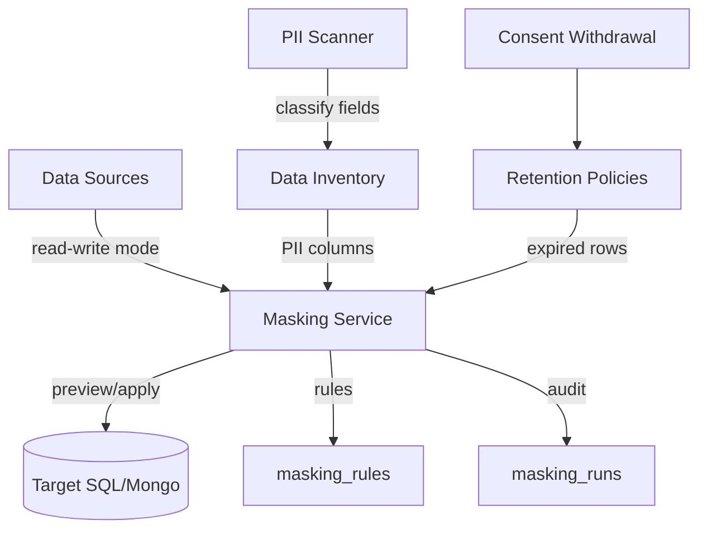

# DPDPA Shield — Data Masking Technical Specification

This document is the **single source of truth** for the **Data Masking** module. It covers DPDPA mapping, API contracts, frontend UX, and operational safety for in-place PII transforms on connected databases.

---

## 1. Module Overview

### 1.1 Purpose
**Data Masking** applies organization-wide masking strategies to PII columns discovered by the PII Scanner. It supports preview (non-destructive) and apply (destructive in-place rewrite) on SQL and MongoDB sources in read-write integration mode.

### 1.2 DPDPA Compliance Objective
| Section | Requirement | Implementation |
| :--- | :--- | :--- |
| **Sec 8(5)** | Reasonable security safeguards | Category rules (mask, hash, redact, encrypt) applied to personal data at rest |
| **DPDP Rules 2025** | Safeguard types incl. masking | Inventory `security_safeguard` field; apply history in `masking_runs` |
| **Sec 8(7)** | Storage limitation | Retention engine reuses masking transforms for `anonymize`/`mask` actions |
| **Sec 6(6)** | Cease processing on withdrawal | Withdrawal remediation → retention → masking rules |
| **Sec 8(1) / 6(10)** | Accountability | `masking_runs` ledger + Proof Vault seal + audit log on apply |

### 1.3 Architectural Context

### 1.4 Masking vs Anonymisation
| Module | Route | Use case |
| :--- | :--- | :--- |
| **Data Masking** | `/data/masking` | In-place safeguard on live DB columns (SQL/Mongo) |
| **Data Anonymisation** | `/scanner/anonymisation` | Export/transform datasets for analytics (all source types) |

**Note:** Strategies like `hash` and `redact` are **irreversible** — not "reversible masking." Only `encrypt` is reversible with key custody.

---

## 2. API Surface

Base prefix: `/api/masking`

| Method | Endpoint | Auth | Description |
| :--- | :--- | :--- | :--- |
| GET | `/capabilities` | User | Presidio availability, strategies |
| GET | `/rules` | User | List rules (merged with defaults) |
| PUT | `/rules` | Admin | Upsert rule per `pii_category` |
| GET | `/pii-columns` | User | Classified columns ready to mask |
| GET | `/summary` | User | Org KPIs and compliance gaps |
| GET | `/runs` | User | Apply history (paginated) |
| POST | `/preview` | User | Single-value sandbox |
| POST | `/preview-field` | Admin | Sample column before/after |
| POST | `/apply` | Admin | Destructive apply (`confirm: true` required) |
| POST | `/anonymize-text` | User | Free-text NER anonymization |

---

## 3. Database Models

### 3.1 `masking_rules`
Per-organization strategy per PII category (`email`, `aadhaar`, `*`, etc.).

### 3.2 `masking_runs`
Audit ledger: source, table, column, strategy, rows updated, trigger (`manual` | `retention` | `withdrawal`), Proof Vault reference.

---

## 4. Default Rules

| Category | Strategy | Params |
| :--- | :--- | :--- |
| email | mask | — |
| phone | mask | keep_last: 2 |
| aadhaar | hash | — |
| pan | mask | keep_last: 0 |
| financial | hash | — |
| * | mask | keep_last: 2 |

Coverage metrics count **defaults + wildcard**, not only explicit DB rows.

---

## 5. Frontend

### 5.1 Page (`/data/masking`)
- Summary metrics + compliance signals
- Category rules editor (enabled toggle, params)
- Detected PII columns table with env/mode/purpose/safeguard columns
- Column detail drawer with live usage map
- Production apply: typed `APPLY` + DPO checkbox
- Rule tuning lab (collapsed sandbox)
- **Data Masking Playbook** (right drawer)

### 5.2 Playbook sections
What / Roles / Prerequisites / Steps / Mask vs delete matrix / Live usage map / Checklist / Troubleshooting

---

## 6. Operational Safety

1. **Discovery mode** — apply blocked; promote to read-write after DPO sign-off.
2. **Production** — frontend requires DPO acknowledgment + type APPLY.
3. **50k row cap** — synchronous apply; larger columns need batching (future).
4. **Proof Vault** — every manual apply sealed when vault available.
5. **File/API sources** — redirect to Data Anonymisation module.

---

## 7. Go-Live Checklist

- [ ] PII Scanner run on all production sources
- [ ] 100% PII category rule coverage (or documented exception)
- [ ] Read-write mode only where masking/retention required
- [ ] Purpose mappings for sensitive columns
- [ ] Retention policies for sensitive categories
- [ ] Withdrawal remediation tested on mask-mapped fields
- [ ] Apply history reviewed in last 30 days
