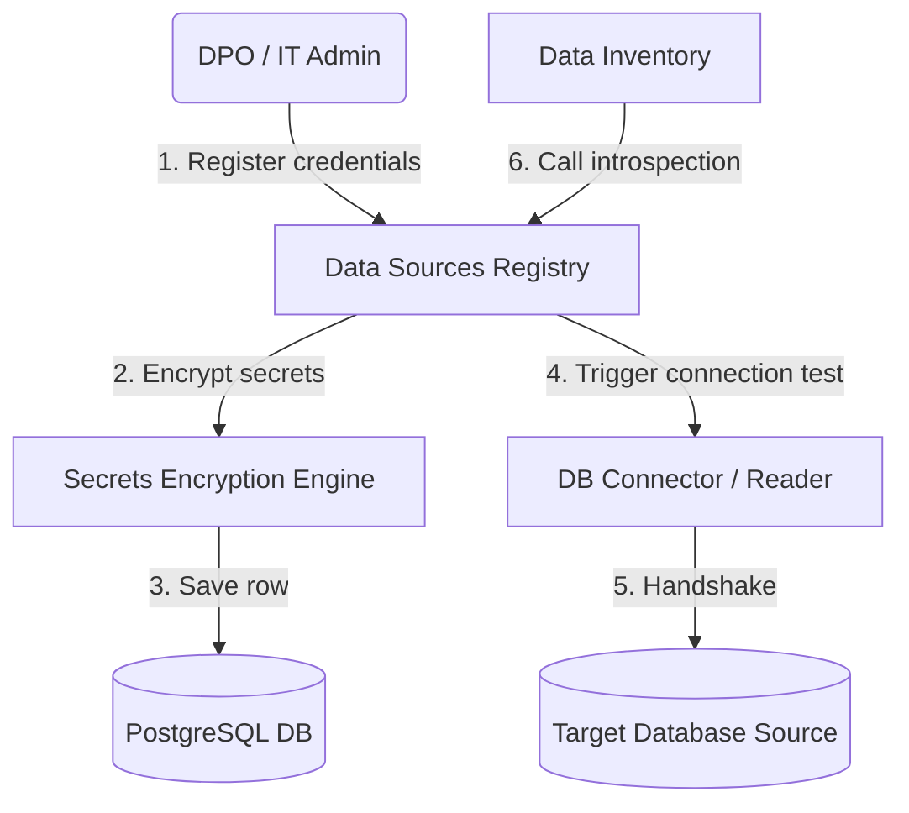
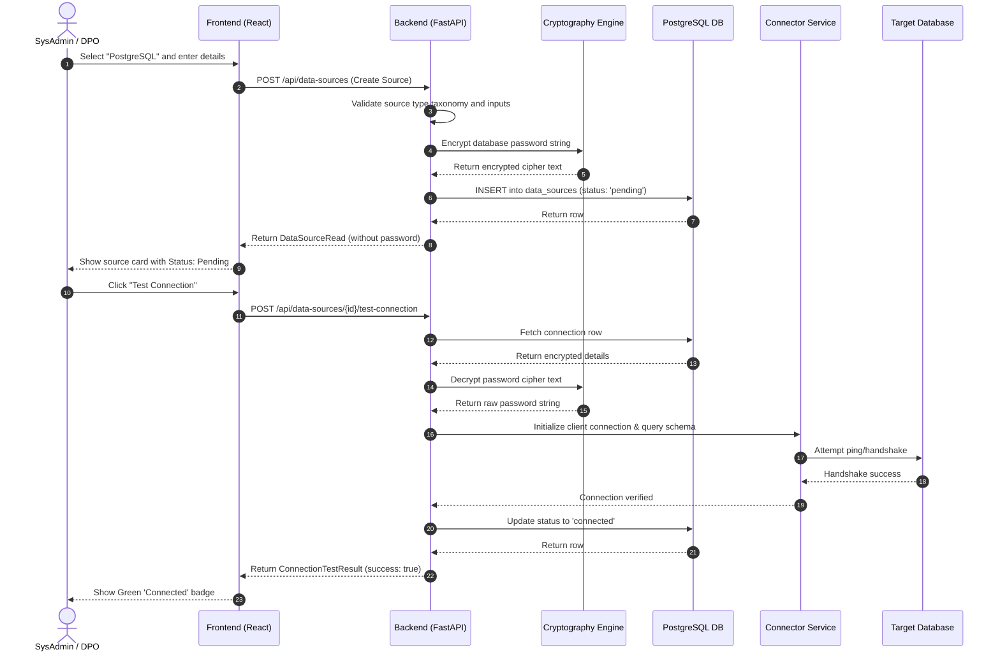
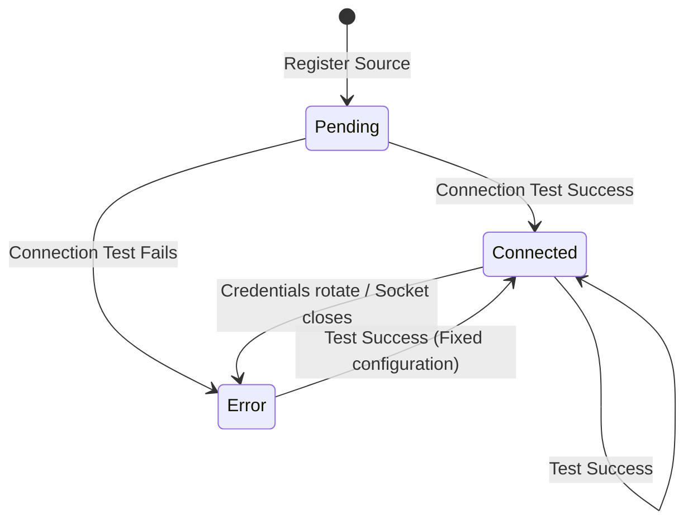
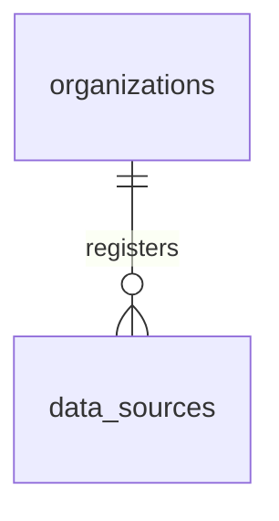

# DPDPA Shield — Data Sources Technical Specification

This document serves as the **single source of truth** for the **Data Sources** module of the ZeroShield DPDPA compliance platform. It provides the detailed frontend, backend, database, integration, and compliance specifications required to build, test, and maintain the registry of data connections.

---

## 1. Module Overview

### 1.1 Purpose
The **Data Sources** module is the connection registry of **where** an organization's data assets reside. It enables DPOs and IT administrators to register database servers, cloud file stores, log streams, API endpoints, and raw file uploads. 

### 1.2 Business Objective
To establish a secure, unified connection panel that maps the physical location of organizational data assets. It forms the foundational plumbing that allows down-stream modules (Data Inventory, PII Scanner, Data Masking, and Retention Policies) to safely connect to, sample, inspect, and clean live enterprise data.

### 1.3 DPDPA Compliance Objective
*   **Section 8(1)**: Provides the connectivity needed to map, verify, and document data flows for complete Fiduciary oversight.
*   **Section 8(5)**: Integrates with secure transmission standards (SSL/TLS verification) and handles credentials cryptographically to enforce security safeguards.

### 1.4 Architectural Context
Data Sources acts as the network and credential gateway for all data-aware services:



### 1.5 Target Users
*   **IT Administrators / SysAdmins**: Configure network settings, register credentials, test connection channels, and rotate credentials.
*   **Data Protection Officers (DPOs)**: Document data source locations and categories for compliance audits.

---

## 2. DPDPA Mapping & Compliance Matrix

| DPDPA Section | Regulatory Requirement | Data Sources Implementation |
| :--- | :--- | :--- |
| **Section 8(1)** | Ultimate fiduciary accountability for all personal data. | Registers and maps all organizational databases, file stores, and systems in one central ledger to prevent "shadow databases". |
| **Section 8(5)** | Mandate to protect data via security safeguards. | Enforces SSL encryption toggles (`ssl_enabled`) and encrypts stored passwords using cryptographic wrappers. |

---

## 3. End-to-End User Journey



### 3.1 Scenario Workflows
*   **Database Integration Workflow**: Admin enters host details and credentials ➜ Clicks "Test Connection" ➜ Backend tests socket reachability ➜ Status becomes `connected`.
*   **Upload Source Workflow**: Admin uploads a raw CSV or Excel sheet ➜ System stores the file locally in `/uploads/` ➜ Creates a file-type data source in the database pointing to the file path.
*   **Connection Failure Recovery**: Credential test fails ➜ Backend captures connection error logs ➜ Status is set to `error` ➜ Raw driver error message is written to `last_error` and displayed on the card to help troubleshoot.

---

## 4. Detailed Screen Specification

The cockpit is a grid layout of connection cards with a wizard to add new connectors.

### 4.1 Grid View
*   **Summary Cards**: Connected Sources, Error/Offline status count, Unlinked sources.
*   **Connector Grid**: Shows registered cards displaying:
    *   **Category Icon**: Icon based on source type (e.g. database socket, cloud folder, file paper).
    *   **Metadata**: Name, category label, host address/location, last test timestamp.
    *   **Status Badge**: `Connected` (Green check), `Error` (Red alert), `Pending` (Grey check).
    *   **Action Drawer**: "Test Connection", "Scan Schema" (links to Data Inventory), "Scan PII", "Edit", and "Delete".

### 4.2 Add Connector Modal
*   **Step 1: Select Type**: Icon selector grid categorized by:
    *   *Database*: PostgreSQL, MySQL, MariaDB, MongoDB, Oracle, MSSQL, SQLite.
    *   *Cloud*: AWS RDS, Azure SQL, GCP SQL, MongoDB Atlas.
    *   *Files*: AWS S3, Azure Blob, Google Cloud Storage, Google Drive, SFTP.
    *   *API*: REST, GraphQL, SOAP.
    *   *Logs*: CloudWatch, Azure Monitor, GCP Logging, Splunk.
*   **Step 2: Connection Details**: Form fields: Name, Host, Port, Database Name, Username, Password (input hidden), SSL toggle (checkbox), Description.

---

## 5. Form Schema

### 5.1 Create Source (`DataSourceCreate`)

| Field Name | Type | Description | Validation | Example Value |
| :--- | :--- | :--- | :--- | :--- |
| `name` | String | User friendly label | Min 1, Max 255 | `"Production PG"` |
| `source_type` | String | Granular slug | PostgreSQL, S3, REST, etc. | `"postgresql"` |
| `host` | String | Connection host URL/IP | Max 255, Optional | `"10.0.1.5"` |
| `port` | Integer | Connection port number | Optional | `5432` |
| `database_name`| String | Target database name | Max 255, Optional | `"billing_db"` |
| `username` | String | Authentication user | Max 255, Optional | `"shield_read"` |
| `password` | String | Authentication secret | Max 512, Optional | `"admin123"` |
| `ssl_enabled` | Boolean | Force SSL handshake | Default `false` | `true` |
| `extra_config` | JSON | Additional driver metadata | Default `{}` | `{"session_token": "aws_token"}` |

---

## 6. Connection Lifecycles

### 6.1 Status State Machine


---

## 7. Relationships with Other Modules

*   **Data Inventory**: Reads source connection data to run database schema introspection.
*   **PII Scanner**: Fetches database credentials to query tables and profile values.
*   **Data Masking**: Feeds connection details to run destructive, in-place update statements on columns.
*   **Retention Policies**: Connects to the target database to execute dry-run counts and destructive row deletions.

---

## 8. Frontend Architecture

### 8.1 Component Structure
```
DataSources.tsx (Main Connector Registry Grid)
  ├── EmptyStateDataSources.tsx (Display card when grid is empty)
  ├── AddSourceWizard.tsx (Connector wizard modal)
  │     ├── TypeSelectorGrid.tsx (Step 1 grid selection)
  │     └── ConnectionForm.tsx (Step 2 form elements)
  └── SourceCard.tsx (Active grid block showing status badges & triggers)
```

---

## 9. Backend Architecture

### 9.1 Files & Layout
*   **Models**: `app/models/data_source.py` (defines `DataSource` schemas and type mappings).
*   **Router**: `app/routers/data_sources.py` (exposes endpoints).
*   **Service**: `app/services/data_source_service.py` (coordinates database writes, test queries, and triggers encryption).
*   **Drivers**: `app/services/db_connector.py` (contains engine connection wrappers for PostgreSQL).

### 9.2 Secrets Encryption Engine
To prevent credential theft, database passwords are encrypted before database insertion:

```python
# app/core/crypto.py
def encrypt_secret(plain_text: str) -> str:
    # Uses cryptography Fernet engine and falls back to app secret
    ...
```

---

## 10. Database Design



### 10.1 Cascade Actions
When a `DataSource` is deleted:
*   Any associated `data_inventory_assets` set their `data_source_id` to `NULL` (preserving the catalog structure).
*   Any `pii_scan_jobs` set their `data_source_id` to `NULL`.
*   Any `retention_policies` set their `data_source_id` to `NULL`.

---

## 11. API Design

All endpoints require authorization via JWT Bearer Token.

### 11.1 Create Source
*   **Method / Route**: `POST /api/data-sources`
*   **Request Body**:
    ```json
    {
      "name": "Production Postgres",
      "source_type": "postgresql",
      "host": "localhost",
      "port": 5432,
      "database_name": "users_prod",
      "username": "postgres",
      "password": "secret_password",
      "ssl_enabled": true
    }
    ```
*   **Response Body (201 Created)**:
    ```json
    {
      "id": "e294cfbf-d018-47bc-ad74-3ee2f507b51b",
      "organization_id": "c1387d89-9831-419b-a010-8b630f9a2de0",
      "name": "Production Postgres",
      "source_type": "postgresql",
      "category": "database",
      "host": "localhost",
      "port": 5432,
      "database_name": "users_prod",
      "username": "postgres",
      "ssl_enabled": true,
      "status": "pending",
      "last_tested_at": null,
      "last_error": null,
      "created_at": "2026-06-25T12:00:00Z"
    }
    ```

### 11.2 Connection Test
*   **Method / Route**: `POST /api/data-sources/{id}/test-connection`
*   **Response Body (200 OK)**:
    ```json
    {
      "source_id": "e294cfbf-d018-47bc-ad74-3ee2f507b51b",
      "success": true,
      "message": "Connection test succeeded.",
      "tested_at": "2026-06-25T12:01:00Z",
      "error": null
    }
    ```

---

## 12. Data Source Governance (DPDPA §8(1), §8(2), §8(5))

Each data source supports governance metadata beyond connection details:

| Field | Type | Purpose |
| :--- | :--- | :--- |
| `owner_user_id` / `owner_name` | UUID / String | Accountable person for the source (DPDPA §8(1)) |
| `environment` | Enum | `production`, `staging`, `development`, `test` |
| `criticality` | Enum | `low`, `medium`, `high`, `critical` |
| `data_processor_id` | UUID FK | Linked third-party processor (DPDPA §8(2)) |
| `region` | String | Geographic region for residency checks |
| `integration_mode` | Enum | `discovery` (read-only) or `read_write` (masking/retention) |
| `encryption_at_rest` | Boolean | Whether data is encrypted in the target system |
| `credential_rotated_at` | Timestamp | Last credential rotation date |
| `tags` | JSON array | Custom organizational tags |

### 12.1 Residency Flag
Computed automatically from `region` against organization's `allowed_regions` and `data_residency` settings:
*   `approved` — region matches allowed list
*   `outside_approved_residency` — region outside approved destinations (feeds Cross-Border Transfer module)
*   `unknown` — no region set or no residency policy configured

### 12.2 Source Detail Drawer — "Used In" Panel
The `SourceDetailDrawer` component shows cross-module linkages:
*   **Data Inventory** assets linked to this source
*   **PII Scanner** jobs run against this source
*   **Retention Policies** targeting this source
*   **Data Masking** rules applied to fields in this source
*   **Cross-Border Transfer** assessments involving this source
*   **Masking coverage** percentage (fields with masking rules / total PII fields)

### 12.3 Activity Audit Trail
`DataSourceActivity` table logs lifecycle events: created, updated, connection tested, credential rotated, deleted. Visible in source detail drawer.

---

## 13. In-App Playbook

The **Data Sources Playbook** (right drawer on the Data Sources page) provides:

**What this module does** — connection registry for all organizational data locations.

**Roles** — IT Admin (configure connections), DPO (document and audit).

**Prerequisites** — network access to target systems, credentials with appropriate permissions.

**Implementation steps:**
1. Select connector type from catalog (database, cloud, files, API, logs).
2. Enter connection details and test connection.
3. Assign owner and set environment/criticality.
4. Link data processor if third-party managed.
5. Set region for residency tracking.
6. Choose integration mode (discovery vs read_write).
7. Trigger Data Inventory schema introspection.

**Go-live checklist** — all production sources registered, owners assigned, connections tested, regions set.

**Troubleshooting** — connection failures, SSL issues, credential rotation, residency flag mismatches.

---

## 14. QA Verification Matrix

### 14.1 Positive Test Cases
*   **TC-01 (Create Database)**: Register a PG database; verify status is set to `pending` and password is not returned in the JSON response.
*   **TC-02 (Test Socket)**: Click test connection on a valid running database; assert result returns `success: true`.
*   **TC-03 (Upload File)**: Upload a valid CSV file; verify file source is created and stored path matches `/uploads/` folder.
*   **TC-04 (Update Connection)**: Modify database host address; verify status changes back to `pending`.
*   **TC-05 (Governance)**: Assign owner and processor; verify Used In panel shows linkages.
*   **TC-06 (Residency)**: Set region to `ap-south-1` with India in allowed regions; verify `approved` flag.

### 14.2 Negative Test Cases
*   **TC-07 (Failed Handshake)**: Run test connection on a database with an invalid password. Verify status is set to `error` and `last_error` details are populated.
*   **TC-08 (Unauthorized Mutations)**: Attempt to delete a data source with a `viewer` role token. Assert `403 Forbidden`.
*   **TC-09 (Cross-Tenant Retrieval)**: Query details of a data source belonging to a different tenant. Assert `404 Not Found`.
*   **TC-10 (Residency Warning)**: Set region to `us-east-1` with only India approved; verify `outside_approved_residency` flag.
