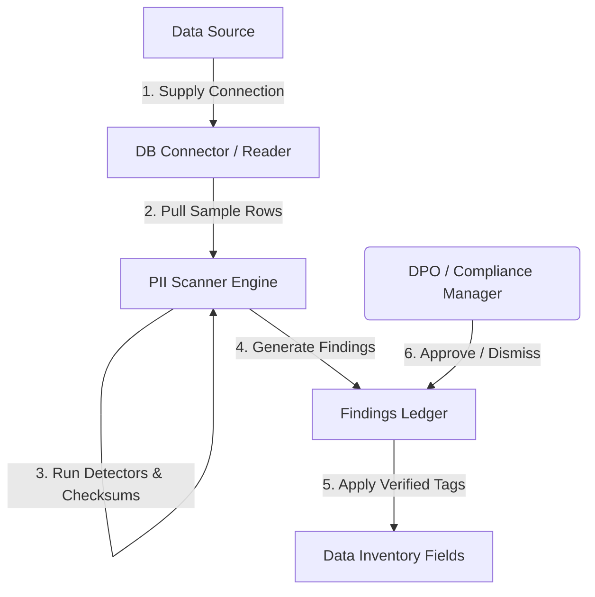
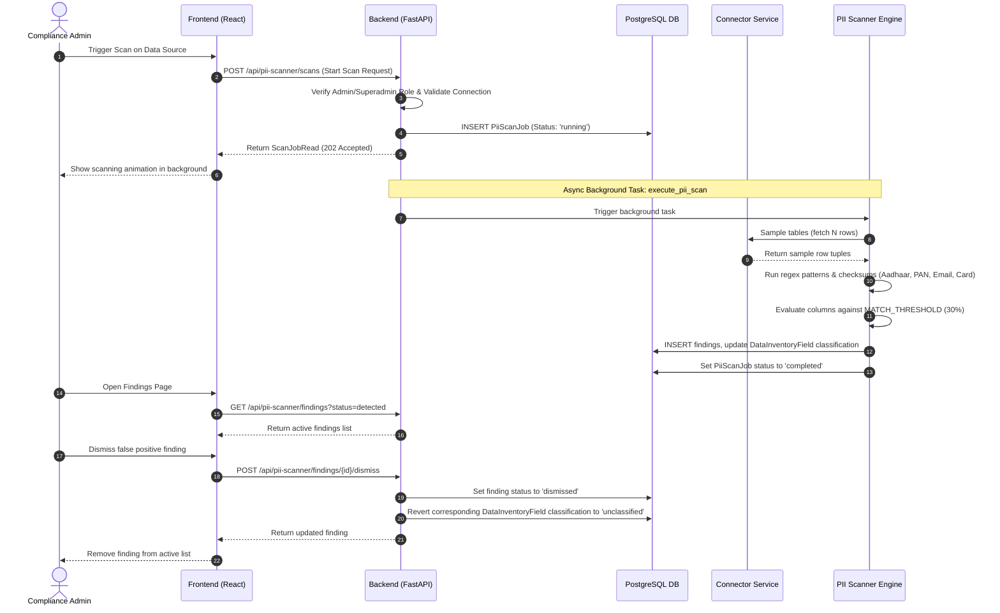
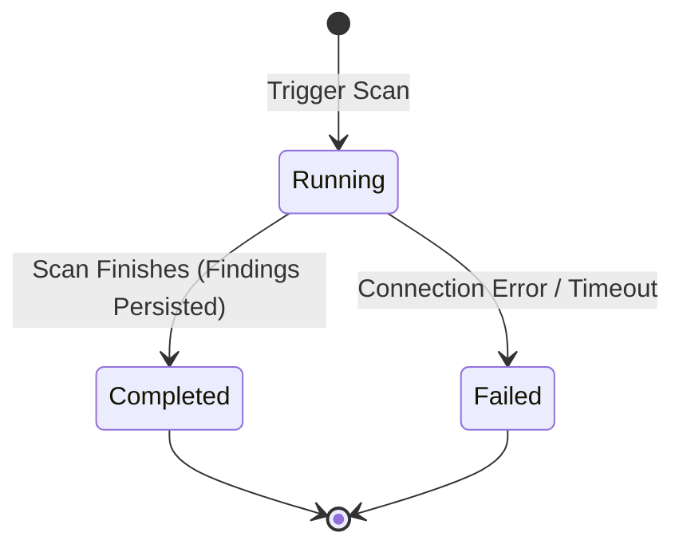
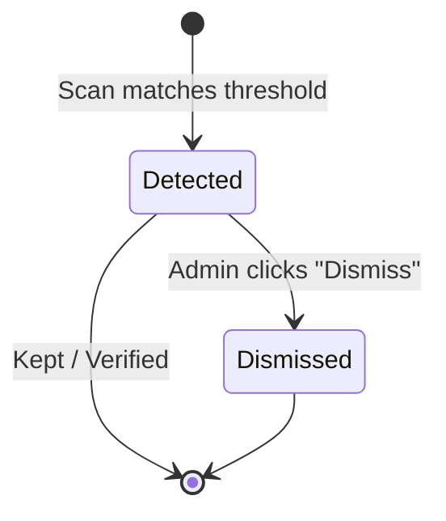
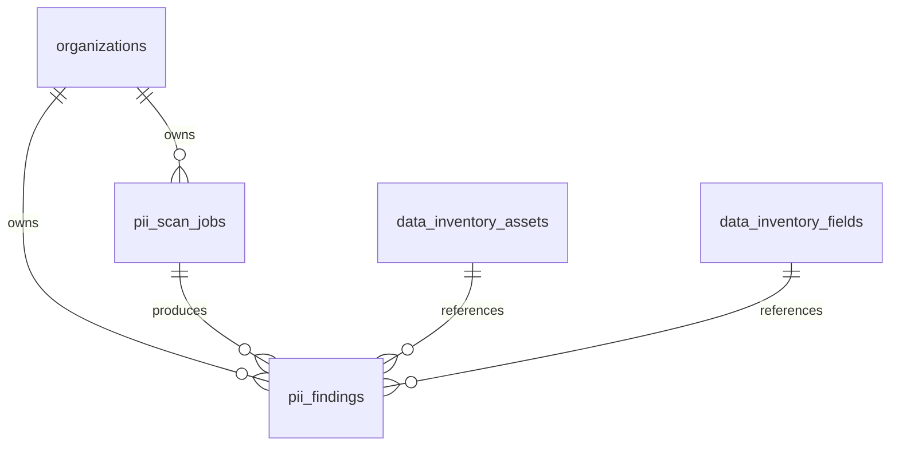

# Vajra — PII Scanner Technical Specification

This document serves as the **single source of truth** for the **PII Scanner** module of the Vajra DPDPA compliance platform. It provides the detailed frontend, backend, database, integration, and compliance specifications required to build, test, and maintain the automated PII scanner.

---

## 1. Module Overview

### 1.1 Purpose
The **PII Scanner** is an automated detective engine that profiles real data values inside connected databases, structured file uploads, cloud file stores, logs, and APIs. It identifies personal and sensitive personal data types, generates compliance findings, and dynamically updates the platform's Data Inventory register with verified classification tags.

### 1.2 Business Objective
Manual data mapping is prone to human error and becomes stale quickly. The PII Scanner helps organizations inspect their actual database contents programmatically to verify what personal data they collect, eliminating reliance on column names alone.

### 1.3 DPDPA Compliance Objective
*   **Section 8(1)**: Automates the discovery and cataloging of personal data to enforce Fiduciary accountability.
*   **Section 8(5)**: Scans for raw, unprotected, and unencrypted personal data values to check for security safeguard compliance.
*   **Section 11(1)**: Provides the granular, field-level cataloging of personal data required to assemble accurate summaries of processed data for Data Principals.

### 1.4 Architectural Context
The PII Scanner acts as the dynamic verification layer on top of the static database connections:



### 1.5 Target Users
*   **Data Protection Officers (DPOs)**: Review scan jobs, validate automated findings, and dismiss false positives.
*   **Compliance Engineers**: Configure scan frequencies, define sample sizes, and monitor active database scanning tasks.

---

## 2. DPDPA Mapping & Compliance Matrix

| DPDPA Section | Regulatory Requirement | PII Scanner Implementation |
| :--- | :--- | :--- |
| **Section 8(1)** | Fiduciary accountability for all processing activities. | Discovers hidden or forgotten PII columns (e.g. text in logs or comments) to ensure they are captured in the catalog. |
| **Section 8(5)** | Secure personal data from unauthorized access or leakage. | Generates findings for unencrypted columns containing highly sensitive fields (e.g., Aadhaar, PAN, bank accounts). |
| **Section 11(1)(a)** | Right of Data Principal to get a summary of their processed personal data. | Identifies all data types mapped to a user's record, allowing automated assembly of DSAR summaries. |

---

## 3. End-to-End User Journey



### 3.1 Scenario Workflows
*   **Happy Scanning Path**: Scan triggered ➜ Background worker samples database ➜ Column matches `MATCH_THRESHOLD` (e.g. 35% of values look like Aadhaar) ➜ `PiiFinding` created ➜ Data Inventory is updated ➜ DPO reviews and retains.
*   **Dismissal/Correction Path**: False positive detected (e.g., random 10-digit integers classified as phone numbers) ➜ Admin clicks "Dismiss" ➜ State changes to `dismissed` ➜ Data Inventory classification reverts back to `unclassified`.
*   **Failure Recovery Path**: Connection drop during scan ➜ Job state transitions to `failed` ➜ Error details written to `error` text column ➜ DPO notified of connection failure.

---

## 4. Detailed Screen Specification

The PII Scanner interface is built as a monitoring dashboard.

### 4.1 Dashboard Overview
*   **Key Metrics Cards**:
    *   **Total Scans Run**: Count of jobs.
    *   **Flagged Fields**: Distinct count of fields currently carrying active findings.
    *   **Sensitive Findings**: Total sensitive PII records discovered.
    *   **Last Scan Time**: Timestamp of the latest completed run.
*   **Doughnut Chart**: Distribution of discovered PII categories (e.g. Name, Phone, Aadhaar).
*   **Recent Scan Jobs Table**: Columns: Triggered By, Date, Status (Completed/Running/Failed), Scope (Tables/Columns Scanned), Flagged Fields, Action (View Log).

### 4.2 Findings Review List
*   **Table Columns**:
    *   **Asset & Field**: Table name + Column name.
    *   **PII Category**: Identified type (e.g. Email, Aadhaar) with classification level badge.
    *   **Match Details**: Ratio of matches (e.g. `95 / 100 values matching`).
    *   **Confidence**: Percentage matching accuracy.
    *   **Masked Sample**: Safely masked preview (e.g. `98••••••10` for Aadhaar).
    *   **Actions**: "Dismiss" button to reject finding.

---

## 5. Form Schema

### 5.1 Scan Trigger Request (`ScanStartRequest`)

| Field Name | Type | Description | Validation | Example Value |
| :--- | :--- | :--- | :--- | :--- |
| `data_source_id` | UUID | Target data source connection | Required | `uuid` |
| `sample_size` | Integer | Rows to sample per table | Min 10, Max 5000, Default 100 | `250` |

---

## 6. Scan & Finding Lifecycles

### 6.1 Scan Job States


### 6.2 Finding States


---

## 7. Relationships with Other Modules

*   **Data Sources**: Queries database configuration metadata and reads connection properties to perform queries.
*   **Data Inventory**: Upserts discovered assets and fields, and updates classifications (`FieldClassification`) from unclassified to personal/sensitive.
*   **Data Masking**: Uses identified PII categories to apply masking rules during column masking preview and database masking jobs.

---

## 8. Frontend Architecture

### 8.1 Component Structure
```
PIIScannerDashboard.tsx (Dashboard View)
  ├── SummaryCards.tsx (Metrics dashboard)
  ├── CategoryDistributionChart.tsx (Doughnut diagram)
  ├── StartScanModal.tsx (Trigger popup)
  ├── ScanJobsTable.tsx (Historical jobs)
  └── FindingsReviewList.tsx (Table of PII alerts with Dismiss buttons)
```

---

## 9. Backend Architecture

### 9.1 Files & Modules Layout
*   **Models**: `app/models/pii_scan.py` implements the SQLAlchemy structures.
*   **Router**: `app/routers/pii_scanner.py` declares API endpoints.
*   **Service**: `app/services/pii_scan_service.py` runs the sampling, maps columns to detectors, and executes background tasks.
*   **Detectors**: `app/services/pii_detectors.py` contains regex validators and Luhn checksum algorithms for IDs.

### 9.2 Verification Match Threshold
A column is flagged only when:
$$\text{Match Ratio} = \frac{\text{Matching Non-Null Values}}{\text{Total Sampled Non-Null Values}} \geq 0.30$$

---

## 10. Database Design



### 10.1 Indexes and Constraints
1.  **Job Cascading**:
    `pii_findings` table uses `ON DELETE CASCADE` referencing `pii_scan_jobs.id`.
2.  **Asset Reference Protection**:
    If an asset/field is deleted, findings set their references to `NULL` to preserve job analytics history.

---

## 11. API Design

All endpoints require authorization via JWT Bearer Token.

### 11.1 Trigger Scan
*   **Method / Route**: `POST /api/pii-scanner/scans`
*   **Request Body**:
    ```json
    {
      "data_source_id": "a9a460b1-4bb2-466d-961f-cfa8448f2b1d",
      "sample_size": 100
    }
    ```
*   **Response Body (202 Accepted)**:
    ```json
    {
      "id": "e294cfbf-d018-47bc-ad74-3ee2f507b51b",
      "organization_id": "c1387d89-9831-419b-a010-8b630f9a2de0",
      "data_source_id": "a9a460b1-4bb2-466d-961f-cfa8448f2b1d",
      "status": "running",
      "sample_size": 100,
      "tables_scanned": 0,
      "columns_scanned": 0,
      "fields_flagged": 0,
      "started_at": "2026-06-25T12:00:00Z",
      "finished_at": null,
      "error": null,
      "triggered_by": "compliance@vajra.dev"
    }
    ```

### 11.2 Dismiss Finding
*   **Method / Route**: `POST /api/pii-scanner/findings/{finding_id}/dismiss`
*   **Response Body (200 OK)**:
    ```json
    {
      "id": "b9a460b1-4bb2-466d-961f-cfa8448f2b1d",
      "status": "dismissed",
      "column_name": "random_int_column"
    }
    ```

---

## 12. Security & Compliance Requirements

*   **Tenant Isolation**: All operations filter by the current user's `organization_id` resolved from JWT.
*   **RBAC Gates**: Only `admin` and `superadmin` users can trigger scans or dismiss findings.
*   **Data Minimization**: The scanner never stores raw database samples. It only stores a one-way masked value (e.g. `98••••••10`) inside `example_masked` for display purposes.

---

## 13. QA Verification Matrix

### 13.1 Positive Test Cases
*   **TC-01 (Start Scan)**: Triggering a scan returns status code `202` and creates a background task.
*   **TC-02 (Flag Aadhaar)**: Scan a table containing Aadhaar numbers; verify finding is created with `pii_category = "aadhaar"` and confidence $\geq 90\%$.
*   **TC-03 (Inventory Update)**: Verify that completing a successful scan updates the Data Inventory column classification dynamically.
*   **TC-04 (Dismiss Finding)**: Dismissing a finding changes status to `dismissed` and restores the inventory classification to `unclassified`.

### 13.2 Negative Test Cases
*   **TC-05 (Unauthorized Action)**: Attempt to trigger a scan using a `viewer` role token. Assert `403 Forbidden`.
*   **TC-06 (Scans Non-existent Source)**: Request a scan with an invalid `data_source_id`. Assert `404 Not Found`.
*   **TC-07 (Cross-Tenant Dismissal)**: Dismiss a finding belonging to another organization. Assert `404 Not Found`.
