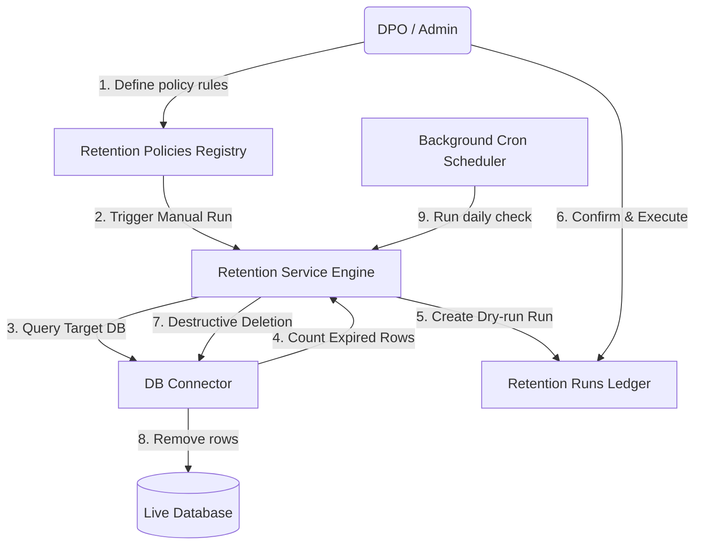
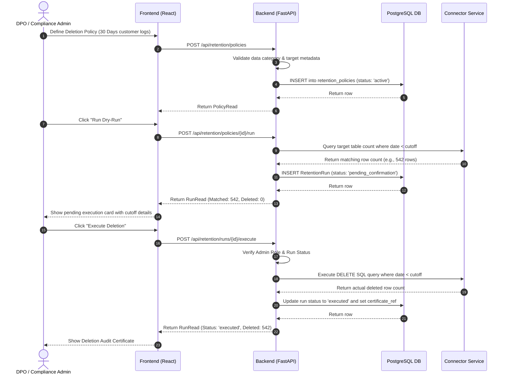
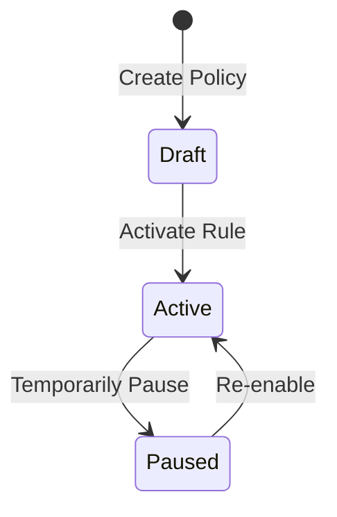
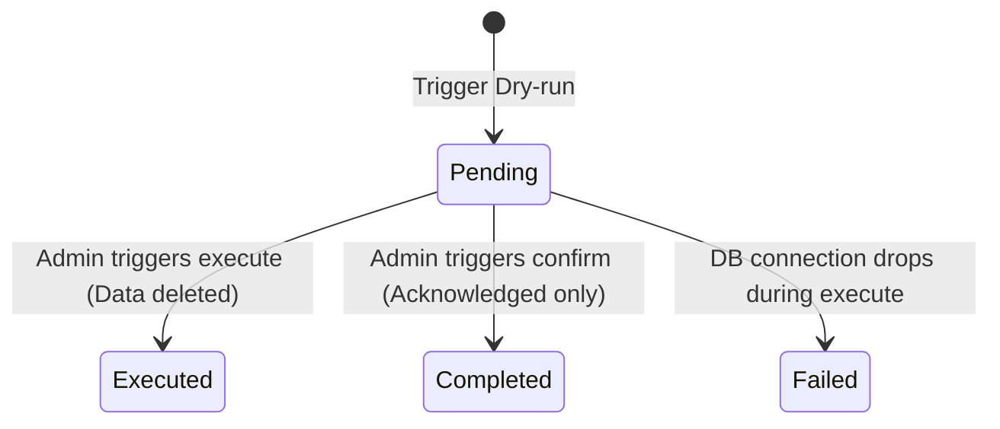
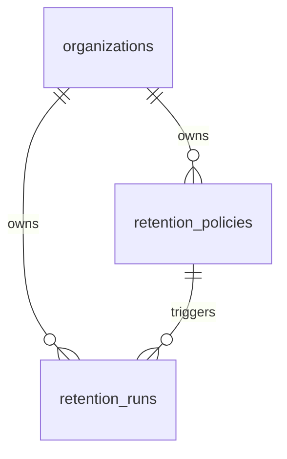

# DPDPA Shield — Retention Policies Technical Specification

This document serves as the **single source of truth** for the **Retention Policies** module of the ZeroShield DPDPA compliance platform. It provides the detailed frontend, backend, database, integration, and compliance specifications required to build, test, and maintain the data retention engine.

---

## 1. Module Overview

### 1.1 Purpose
The **Retention Policies** module automates the tracking, review, and deletion of personal data once its operational purpose is complete. It allows compliance teams to define rules (e.g. *"Delete customer logs after 3 months"*), preview expiring records through dry-runs, execute deletions on live databases, and record tamper-evident audit logs.

### 1.2 Business Objective
To prevent data bloat and compliance liability. Organizations must delete data they no longer have a legal basis to process, minimizing exposure in the event of a breach.

### 1.3 DPDPA Compliance Objective
*   **Section 8(7)**: Mandates the erasure of personal data by the Data Fiduciary once the specified purpose is fulfilled or when the principal withdraws consent.

### 1.4 Architectural Context
The retention engine bridges DPDPA legal limits with active database cleanups:



### 1.5 Target Users
*   **Data Protection Officers (DPOs)**: Author policies, verify legal bases, review logs, and issue deletion confirmation certificates.
*   **Database Administrators (DBAs)**: Inspect dry-run counts and manually authorize deletion jobs.

---

## 2. DPDPA Mapping & Compliance Matrix

| DPDPA Section | Regulatory Requirement | Retention Policies Implementation |
| :--- | :--- | :--- |
| **Section 8(7)** | Erase personal data once purpose is complete. | Automated calculation of data age against retention rules, executing deletions on live targets. |
| **Section 8(7)** | Erase data upon consent withdrawal. | Policies triggered by the `consent_withdrawal` event delete user records immediately. |
| **Section 8(1)** | Burden of proof on Data Fiduciary. | Generates a permanent **Retention Run Certificate** reference (`DEL-YYYY-XXXX`) for audit. |

---

## 3. End-to-End User Journey



### 3.1 Scenario Workflows
*   **Auto-Delete Execution Workflow**: Policy is marked `auto_delete = true` ➜ Background scheduler sweeps daily ➜ Evaluates cutoff date ➜ Queries count and immediately executes DELETE ➜ Records run directly as `executed` ➜ Emits audit event.
*   **Manual Deletion Workflow**: Policy requires confirmation ➜ Engine runs dry-run, sets status to `pending_confirmation` ➜ Admin views run dashboard ➜ Click "Execute" ➜ System deletes database rows and signs the certificate.
*   **Anonymisation in Place Workflow**: Policy action set to `anonymize` ➜ Admin runs execution ➜ System queries target table ➜ Applies masking rules configured for the tenant's PII categories ➜ Overwrites PII columns with masked values for expired rows.

---

## 4. Detailed Screen Specification

The screen is built as a management panel with list views.

### 4.1 Statistics Header
*   **Active Policies**: Number of active rules.
*   **Pending Deletions**: Count of runs awaiting verification.
*   **Flagged Records**: Sum of `records_matched` in pending runs.
*   **Deleted Records**: Total records deleted/scrubbed historically.

### 4.2 Policies List & Form
*   **Policies Table**: Columns: Name, Data Category, Target (Source/Asset), Period (e.g. "3 Years"), Auto-Delete status, Status (Draft, Active, Paused).
*   **Add Policy Modal**:
    *   *Inputs*: Name, Data Category (text/select), Target Source (select), Target Asset (select), Date Column (select/text), Period (Value + Unit: Days, Months, Years), Trigger Event (select: creation_date, consent_withdrawal, etc.), Legal Basis (text), Action (select: delete, anonymize, archive, manual_review), Auto-delete (checkbox), Notes.

### 4.3 Deletion Audit Trail
*   **Audit Table**: Columns: Date, Policy Name, Cutoff Date, Matched, Cleared, Status (Pending, Completed, Executed, Failed), Certificate Ref, Actions ("Execute", "Confirm/Acknowledge").

---

## 5. Form Schema

### 5.1 Create Policy (`PolicyCreate`)

| Field Name | Type | Description | Validation | Example Value |
| :--- | :--- | :--- | :--- | :--- |
| `name` | String | Internal policy rule label | Min 1, Max 255 | `"Support Chat Cleanup"` |
| `data_category`| String | Associated PII category | Optional | `"support_history"` |
| `data_source_id`| UUID | Connected target database | Optional | `uuid` |
| `asset_id` | UUID | Connected target asset/table | Optional | `uuid` |
| `trigger_field`| String | Date column for calculation | Max 128, Optional | `"created_at"` |
| `period_value` | Integer | Value of duration | Required | `6` |
| `period_unit` | Enum | Unit of duration | days, months, years | `'months'` |
| `trigger_event`| Enum | Lifecycle boundary event | creation_date, contract_end, consent_withdrawal, etc. | `'creation_date'` |
| `action` | Enum | Compliance scrubbing action | delete, anonymize, archive, manual_review | `'delete'` |
| `auto_delete` | Boolean | Allow background deletion | Required | `false` |
| `status` | Enum | Rule enablement state | draft, active, paused | `'active'` |

---

## 6. Rules Lifecycles

### 6.1 Policy States


### 6.2 Run Execution States


---

## 7. Relationships with Other Modules

*   **Data Sources**: Connected database is audited for row counts and cleaned using DELETE statements.
*   **Data Inventory**: References registered assets and specific date fields.
*   **Data Masking**: Supplies default masking algorithms for policies utilizing the `anonymize` action in place.

---

## 8. Frontend Architecture

### 8.1 Component Structure
```
RetentionPolicyManager.tsx (Main Retention panel)
  ├── SummaryCards.tsx (Dashboard metrics)
  ├── PolicyFormModal.tsx (Create / Edit Wizard)
  ├── PoliciesTable.tsx (Management grid)
  └── DeletionAuditTrail.tsx (Table of runs with confirm/delete triggers)
```

---

## 9. Backend Architecture

### 9.1 Files & Layout
*   **Models**: `app/models/retention.py` (defines `RetentionPolicy` and `RetentionRun` tables).
*   **Router**: `app/routers/retention.py` (exposes endpoints).
*   **Service**: `app/services/retention_service.py` (runs date arithmetic, handles dry-run queries, processes SQL execution, maps masking-in-place updates).

### 9.2 Anonymisation in Place Logic
When executing an `anonymize` retention run, the system:
1. Queries the Data Inventory to identify all fields under the target asset carrying a classification of `personal` or `sensitive`.
2. Resolves the active masking strategy rules for each field.
3. Performs in-place masking updates on the expired rows.

---

## 10. Database Design



---

## 11. API Design

All endpoints require authorization via JWT Bearer Token.

### 11.1 Create Policy
*   **Method / Route**: `POST /api/retention/policies`
*   **Request Body**:
    ```json
    {
      "name": "Audit Logs Removal",
      "data_category": "system_logs",
      "data_source_id": "a9a460b1-4bb2-466d-961f-cfa8448f2b1d",
      "asset_id": "c1387d89-9831-419b-a010-8b630f9a2de0",
      "trigger_field": "logged_at",
      "period_value": 30,
      "period_unit": "days",
      "trigger_event": "creation_date",
      "action": "delete",
      "auto_delete": true,
      "status": "active"
    }
    ```
*   **Response Body (201 Created)**: Notice schema detailing `retention_days = 30`.

### 11.2 Run Deletion Execution
*   **Method / Route**: `POST /api/retention/runs/{run_id}/execute`
*   **Response Body (200 OK)**:
    ```json
    {
      "id": "b9a460b1-4bb2-466d-961f-cfa8448f2b1d",
      "policy_id": "e294cfbf-d018-47bc-ad74-3ee2f507b51b",
      "run_at": "2026-06-25T12:00:00Z",
      "cutoff_date": "2026-05-26T12:00:00Z",
      "records_matched": 125,
      "records_deleted": 125,
      "action": "delete",
      "status": "executed",
      "certificate_ref": "DEL-2026-F982",
      "executed_by": "admin@zeroshield.in",
      "detail": " EXECUTED: deleted 125 row(s)."
    }
    ```

---

## 12. Consent Withdrawal Integration

Retention policies now support automated remediation triggered by consent withdrawal events.

### 12.1 TriggerEvent.consent_withdrawal
When a data principal withdraws consent for a purpose, the `ConsentWithdrawalRemediationService` queries `purpose_data_mappings` and creates targeted retention runs:

| Mapping Action | Retention Action | Effect |
| :--- | :--- | :--- |
| `delete` | `delete` | Permanently remove records for the principal |
| `mask` | `mask` | Mask field values in connected data source |
| `anonymize` | `anonymize` | Irreversibly anonymize field values |
| `pseudonymize` | `pseudonymize` | Replace with pseudonymous identifier |
| `suppress` | Manual flag | Stop future processing; retain existing data |
| `flag_manual_review` | `manual_review` | Create manual task for unconnected systems |

### 12.2 source_purpose_id
Retention policies can be auto-generated from `purpose_data_mappings` rows via the `source_purpose_id` column on `retention_policies`. This links a retention policy directly to a Purpose Registry entry, so withdrawal automatically triggers the correct policy without manual configuration per purpose.

### 12.3 Remediation Queue
Withdrawal-triggered retention runs appear in the Consent Enforcement **Remediation Queue** (kanban board) with status tracking: Pending → In Progress → Completed. Each completed remediation is sealed in Proof Vault.

### 12.4 Dual Trigger Paths
Retention runs can be triggered by:
1. **Scheduled trigger** — `creation_date`, `contract_end`, `last_accessed` (standard retention lifecycle)
2. **Event trigger** — `consent_withdrawal` (immediate, per-principal, scoped to mapped fields)

---

## 13. QA Verification Matrix

### 12.1 Positive Test Cases
*   **TC-01 (Dry-Run Count)**: Run dry-run on a table containing 10 expired records; verify run reports `records_matched = 10` and deletes zero rows.
*   **TC-02 (Execute Deletion)**: Execute a pending delete run; verify rows are permanently removed from database and `records_deleted` equals 10.
*   **TC-03 (Auto-Delete Cron)**: Trigger `run-due` API; verify policies marked as auto-delete bypass pending approval and execute instantly.
*   **TC-04 (Anonymise in Place)**: Execute an anonymise run; verify expired rows have their PII columns replaced by masked values while preserving other data.

### 12.2 Negative Test Cases
*   **TC-05 (Re-Run Executed Task)**: Attempt to execute an already completed/executed run. Assert `400 Bad Request`.
*   **TC-06 (Execute Unconfirmed Run as Viewer)**: Attempt run execution using a `viewer` role token. Assert `403 Forbidden`.
*   **TC-07 (Policy Mismatch)**: Attempt execute action on a run carrying the `manual_review` action. Assert `400 Bad Request`.
