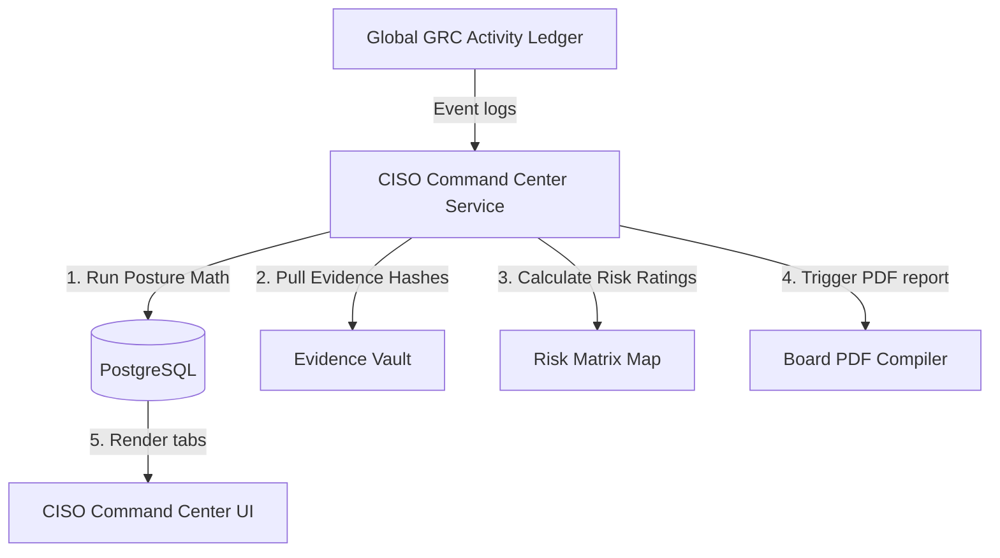
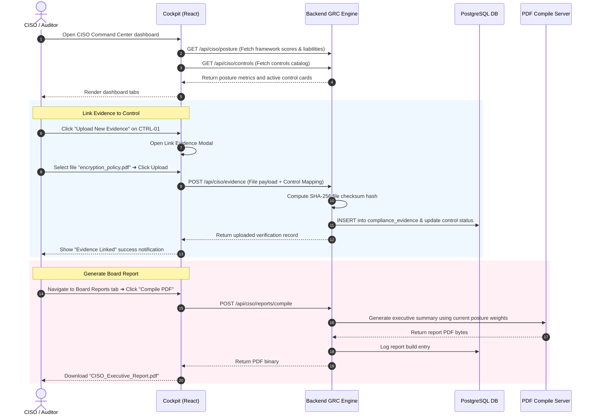
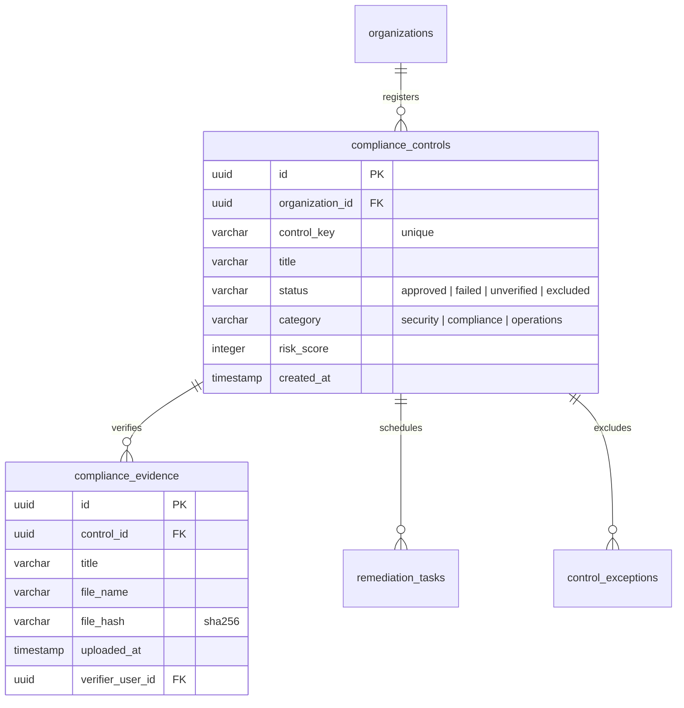

# Vajra — CISO Command Center Technical Specification

This document serves as the **single source of truth** for the **CISO Command Center** module of the Vajra DPDPA compliance platform. It provides the detailed frontend, backend, database, integration, and compliance specifications required to build, test, and maintain this module.

---

## 1. Module Overview

### 1.1 Purpose
The **CISO Command Center** serves as the executive security cockpit and GRC (Governance, Risk, and Compliance) dashboard. It aggregates compliance alignment metrics across multiple regulatory frameworks (DPDPA, ISO 27001, CIS Controls, NIST CSF), calculates statutory fine exposures, and maps security controls to active evidence logs, exclusions, and remediation tasks.

### 1.2 Business Objective
To provide the Chief Information Security Officer (CISO), Data Protection Officer (DPO), and security team with a real-time compliance posture overview. It allows security leadership to quickly view control gaps, estimate financial liabilities, assign remediation tasks, and compile executive posture reports for the board.

### 1.3 DPDPA Compliance Objective
*   **Security Safeguards (Section 8(5))**: Fiduciaries must implement technical, organizational, and physical security measures to protect personal data. The Command Center maps, audits, and verifies these active controls.
*   **Statutory Penalty Analysis**: Dynamically evaluates the financial risks of missing controls against the penalty limits specified under the DPDPA schedule.

### 1.4 Architectural Context
The CISO Command Center consolidates evidence from all compliance subsystems:



---

## 2. DPDPA Mapping & Compliance Matrix

| DPDPA Section | Regulatory Requirement | CISO Command Center Implementation |
| :--- | :--- | :--- |
| **Section 8(5)** | Secure personal data using standard security safeguards. | Active controls mapping workspace. Monitors coverage and logs auditor approvals. |
| **Section 8(6)** | Reporting of data breaches. | Breach Incident tracker showing detection time (MTTD) and resolution time (MTTR) statistics. |
| **Schedule Penalties** | Statutory fines for non-compliance. | Evaluates financial penalty liability metrics based on missing controls linked to specific sections. |

---

## 3. End-to-End User Journey



---

## 4. Detailed Screen Specification

The cockpit dashboard is divided into nine modular screens selected via a dual-row segmented button bar:

### 4.1 Cockpit Pages (Tabs)
1.  **Overview Posture Page**:
    *   *Framework Gauges*: Overall Compliance, DPDPA, ISO 27001, CIS Controls, and NIST CSF alignment percentages.
    *   *DPDPA Penalty Liability*: Alert panel showing estimated fine exposures dynamically based on failing controls.
    *   *Incident MTTR Tracker*: MTTD (Mean Time to Detect) and MTTR (Mean Time to Resolve) breach incident logs.
    *   *DPO Posture Summary*: Markdown text panel summarizing active threats.
2.  **Security Controls Page**:
    *   *Control Cards Grid*: Shows unique keys (e.g. `CTRL-01`), category, status, and evidence count.
    *   *Action*: "Add Control" button opens the Register Custom Control modal.
3.  **Evidence Vault Page**:
    *   *Evidence Table*: Columns for Title, File Name, SHA-256 Checksum Hash, Verifiers Audit, and Verification Date.
    *   *Action*: "Upload New Evidence" opens the Link New Compliance Evidence modal.
4.  **Risk Register Page**:
    *   *5x5 Risk Matrix Map*: Interactive Likelihood vs. Impact grid plotting count densities in HSL colors.
    *   *Threats Table*: Columns for Risk ID, Title, Matrix Score, Status, and Remediation.
    *   *Action*: "Register New Risk" opens the Register Custom Threat Risk modal.
5.  **Remediation Plans Page**:
    *   *Tasks Table*: Columns for Task Ref, Title, Priority, SLA Status, and Progress.
    *   *Action*: "Create Remediation Task" opens the Assign Remediation Task modal.
6.  **Exclusions Log Page**:
    *   *Exceptions Table*: Columns for Control Mapped, Exception Type, Expiry date, Justification, and Compensating Controls.
    *   *Action*: "Request Exception" opens the Request Policy Control Exception modal.
7.  **Board Reports Page**:
    *   *Compilation History*: Lists generated reports with compilation dates and posture scores.
    *   *Actions*: "Compile Executive Posture PDF" and "Download PDF".
8.  **Historical Analytics Page**:
    *   *Posture Area Chart*: Area graph tracking posture score over 30, 90, or 180 days.
9.  **Calculations Settings Page**:
    *   *Tuning Weight Sliders*: Ranges from 0 to 1.0 for Controls, Evidence, Risks, Policies, Vendors, and Incidents weights.
    *   *Sum Verification Indicator*: Warning banner checks if weights total exactly 100%.

### 4.2 Control Details Drill-down Screen
Triggered by clicking any control card:
*   **Mappings (RACI)**: VPC/SaaS Assets covered, mapped Policies, and Vendor assignments.
*   **Drill-down Sub-tabs**:
    *   *Linked Evidence Table*: Evidence list with delete/unlink options.
    *   *Remediation Tasks Checklist*: Sub-task checkboxes.
    *   *Vajra AI Copilot*: "Generate Blueprint" button to output customized compliance implementation checklists.
    *   *Compliance Verification Review*: Dropdown selector (Approved / Rejected), notes textarea, and "Submit Verification Outcome" button.
    *   *Control Discussion Feed*: Interactive operator comments feed.
    *   *Version Vault*: History list of changes made to the control over time.

---

## 5. Scoring & Calculations Settings Schema

### 5.1 Posture Score Formula
$$\text{Overall Posture Score} = (W_{ctrl} \times S_{ctrl}) + (W_{ev} \times S_{ev}) + (W_{risk} \times S_{risk}) + (W_{pol} \times S_{pol}) + (W_{vend} \times S_{vend}) + (W_{inc} \times S_{inc})$$

Where $W$ is the category weight, and $S$ is the compliance status score ($0.0$ to $100.0$) calculated within that sub-category.

### 5.2 Settings Schema
| Field Name | Type | Description | Validation | Example Value |
| :--- | :--- | :--- | :--- | :--- |
| `weight_controls` | Float | Weight of controls implementation | 0.0 to 1.0 | `0.30` |
| `weight_evidence` | Float | Weight of evidence coverage | 0.0 to 1.0 | `0.20` |
| `weight_risks` | Float | Weight of risk register cleanup | 0.0 to 1.0 | `0.15` |
| `weight_policies` | Float | Weight of policy alignments | 0.0 to 1.0 | `0.15` |
| `weight_vendors` | Float | Weight of vendor assessments | 0.0 to 1.0 | `0.10` |
| `weight_incidents`| Float | Weight of breach MTTR metrics | 0.0 to 1.0 | `0.10` |

---

## 6. Database Design



---

## 7. API Design

### 7.1 Compile Executive Posture Report
*   **Method / Route**: `POST /api/ciso/reports/compile`
*   **Response Body (200 OK)**:
    ```json
    {
      "report_id": "c1387d89-9831-419b-a010-8b630f9a2de0",
      "status": "compiled",
      "posture_snapshot_score": 88.42,
      "compiled_at": "2026-06-25T00:10:00Z"
    }
    ```

---

## 8. QA Verification Matrix

### 8.1 Positive Test Cases
*   **TC-01 (Evidence Checksum Integrity)**: Upload an evidence file. Verify the server calculates the SHA-256 hash automatically and saves it in the `compliance_evidence` table.
*   **TC-02 (Weights Validation Check)**: Adjust weights on the settings tab to total exactly 100%. Verify the warning banner resolves and configuration is saved.

### 8.2 Negative Test Cases
*   **TC-03 (Failed Weights Sum Warning)**: Adjust weights on the settings tab to total 90%. Assert the save button triggers validation error `422 Unprocessable Entity` with message `Weights must sum to exactly 100%`.
*   **TC-04 (Control Exception Expiry Enforcement)**: Add a temporary exception with an expiry date in the past. Verify the exception status is marked as `expired` and the control defaults back to `failed` posture calculations.
