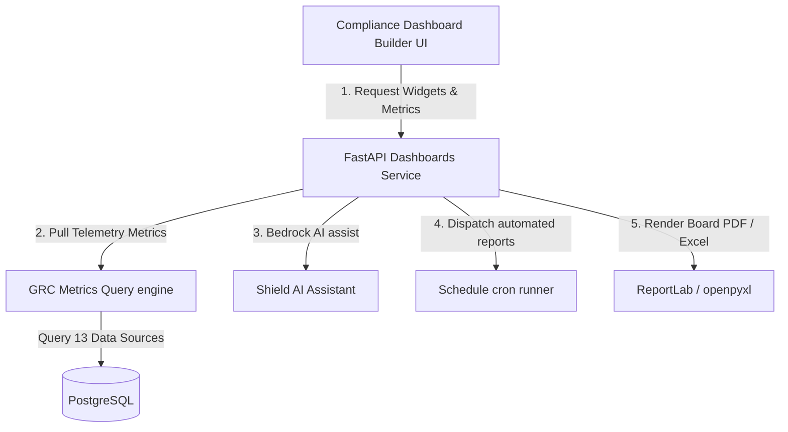
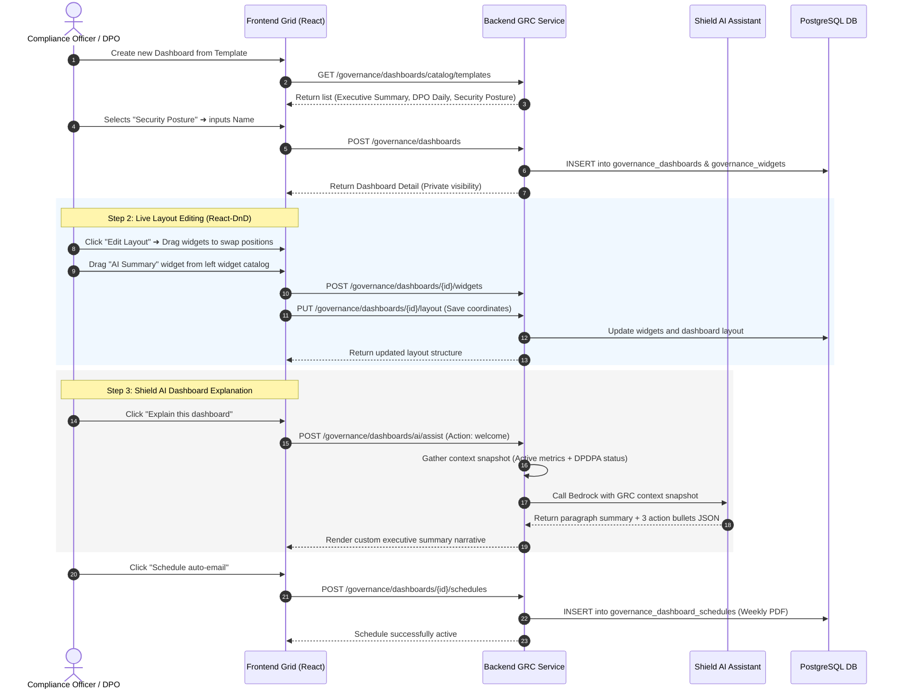
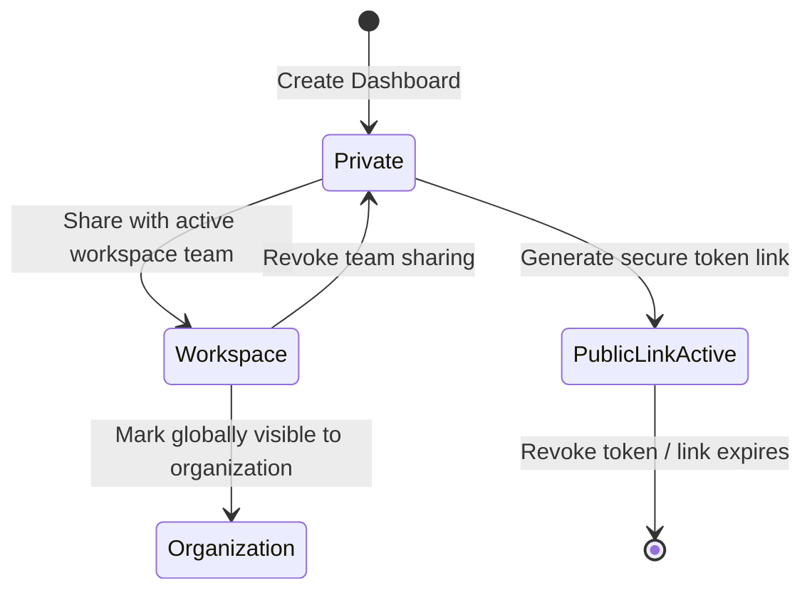

# DPDPA Shield — Compliance Dashboards Technical Specification

This document serves as the **single source of truth** for the **Compliance Dashboards** module of the ZeroShield DPDPA compliance platform. It provides the detailed frontend, backend, database, integration, and compliance specifications required to build, test, and maintain this module.

---

## 1. Module Overview

### 1.1 Purpose
The **Compliance Dashboards** module is the central reporting cockpit and dynamic GRC visualization workspace of the ZeroShield platform. It consolidates risk metrics, consent collection rates, DSAR SLA tracking, vendor risk scorecards, and audit logs into customizable dashboard layouts. It enables DPOs, executive boards, and regulators to verify compliance status at a glance.

### 1.2 Business Objective
To replace manual GRC audit formatting with automated, real-time metrics, interactive charts, and board-ready evidence packs. The platform implements drag-and-drop widget organization (12-column grid), contextual Bedrock-powered AI analytics (Shield AI Assistant), scheduled report delivery (PDF/XLSX), and secure public sharing links.

### 1.3 DPDPA Compliance Objective
*   **Proof of Compliance & Accountability (Section 6(10) & Section 10)**: Automates the continuous collection and presentation of operational compliance scores, proving data protection practices to the Data Protection Board of India (DPBI).
*   **Executive Board Disclosures**: Generates a combined 12-page "Board Reports" export containing key risk posture summaries, penalty exposure forecasts, and incident audits.
*   **Security Control Monitoring (Section 8(5))**: Integrates live health scorecards mapping back to active controls seeded in the CISO Command Center.

### 1.4 Architectural Context
The Compliance Dashboards module sits at the top of the GRC stack, pulling telemetry data from 13 different platform sources and interacting with AWS Bedrock for context-aware AI summaries:



### 1.5 Target Users
*   **Executive Board & CEOs**: Access executive summary views, penalty trends, and download quarterly board report PDF packs.
*   **Data Protection Officers (DPOs)**: Customize operational grids, schedule weekly audits, configure thresholds, and ask questions to the AI assistant.
*   **External Auditors & Regulators**: View secure, read-only public sharing dashboards validating evidence trails.

---

## 2. DPDPA Mapping & Compliance Matrix

| DPDPA Section | Regulatory Requirement | Compliance Dashboard Implementation |
| :--- | :--- | :--- |
| **Section 6(10)** | Fiduciary must demonstrate compliance (Burden of proof). | Consolidated `compliance_card` widgets showing real-time scores, delta logs, and evidence audits. |
| **Section 10(2)** | SDF independent compliance audits. | Dynamic `scorecard` widget tracks overall module health mapping to active audits and remediation deadlines. |
| **Section 8(5)** | Technical and administrative security controls safeguards. | Maps live status tables of security breaches, open incidents, and control checks directly from CISO inputs. |
| **Section 13** | Redressal of grievances within statutory timelines. | Tracks DSAR request response metrics (SLA performance pie charts, pending requests list). |

---

## 3. End-to-End User Journey



### 3.1 Scenario Workflows
*   **Template Cloning**:
    *   Creating a dashboard clones pre-configured widget groups (e.g. `executive-summary` seeds 10 widgets; `security-posture` seeds 5 widgets).
    *   Admins can click "Clone Dashboard" (`POST /governance/dashboards/{id}/clone`) to copy custom layout modifications into a new board.
*   **Secure Public Link Sharing**:
    *   To share metrics with external auditors, users click "Create Public Link" (`POST /governance/dashboards/{id}/public-link`).
    *   This generates a secure token with password hash verification (`password_hash`) and an optional expiry timestamp (`expires_at`).
*   **Report Delivery Campaign Execution**:
    *   A background worker evaluates active dashboard schedules (`is_active = true` and `next_run_at <= now`).
    *   It queries metrics for all dashboard widgets, compiles them into the specified format (PDF, XLSX, CSV, JSON), and emails them to the recipient list.

---

## 4. Detailed Screen Specification

The Compliance Dashboards module consists of a dynamic grid builder and configuration slide-outs:

### 4.1 Dashboard Grid Canvas (Split Interface)
*   **Top Header Bar**:
    *   **My Dashboards**: Dropdown selector of user and organizational dashboards.
    *   **Pins/Favourites**: Star icon toggling priority dashboards into the top horizontal scroller.
    *   **Action Actions**: "Edit Layout" (toggles DnD state), "+ New Dashboard", "Share", "Schedule", "Export Board Report".
*   **Main Canvas Grid**:
    *   12-column grid rendering active widgets (`WidgetRenderer`).
    *   In edit mode, drag handles appear. Elements are draggable and droppable using HTML5 drag-and-drop boundaries.
    *   *Empty State*: "Grid is empty. Drag widgets from the left library to start building."

### 4.2 Left Widget Library Catalog Drawer
*   **Collapsible Categories**:
    *   *Metrics & KPIs*: KPI Card, Progress Bar, Scorecard.
    *   *Charts*: Line Chart, Bar Chart, Pie Chart, Donut Chart, Heatmap.
    *   *Tables & Lists*: Table, List, Incident Timeline.
    *   *Compliance-specific*: Compliance Card, Deadlines, Risk Matrix, AI Summary, Markdown.
*   **Action**: Clicking or dragging a widget seeds it onto the dashboard canvas with a default grid span (e.g., AI Summary defaults to 12-cols; KPI Card to 4-cols).

### 4.3 Sharing & Public Link Config Modal
*   **Internal Shares**: Select Users or Roles (Superadmin, Admin, Auditor, Compliance Officer) and set permissions (`read`, `editor`, `owner`).
*   **Public Shared Link**:
    *   *Toggle*: "Enable public link access".
    *   *Expiry presets*: Never, 7 days, 30 days.
    *   *Secure Password Protection*: Optional input field generating password validation constraints.

### 4.4 Report Delivery Scheduler modal
*   **Form Inputs**:
    *   **Report Name**: String reference.
    *   **Frequency**: Dropdown (daily, weekly, monthly, quarterly, custom cron).
    *   **Delivery Channel**: Email, Slack, Teams, Webhook.
    *   **Export Format**: PDF, XLSX, CSV.
    *   **Recipient list**: Comma-separated email addresses.

### 4.5 Shield AI Assistant drawer
*   Violet-branded sliding sidebar widget triggered by clicking the floating violet pill.
*   **Features**:
    *   **Welcome Insights**: Auto-generates a 3-sentence executive posture summary and exactly 3 priority bullets.
    *   **Context-Aware Chat**: Prompt box for direct questions (e.g., *"How does our vendor risk score impact the overall compliance percentage?"*), querying AWS Bedrock with active metrics context.

---

## 5. Database Schema & API Schema

### 5.1 Dashboard Persistence Schema (`governance_dashboards`)

| Column Name | Type | Description | Constraints |
| :--- | :--- | :--- | :--- |
| `id` | UUID | Primary Key | Default uuid_generate_v4() |
| `organization_id` | UUID | Link to Organization | ForeignKey, Cascades, Indexed |
| `owner_user_id` | UUID | Link to Owner User | ForeignKey, Nullable, Indexed |
| `name` | String(255) | Dashboard display name | Not Null |
| `description` | Text | Overview notes | Nullable |
| `slug` | String(120) | URL friendly slug | Indexed, Unique with org_id |
| `visibility` | Enum | private, workspace, organization | Default "private" |
| `is_template` | Boolean | True if shared layout template | Default false |
| `template_key` | String(80) | Preset template identifier | Nullable, Indexed |
| `is_pinned` | Boolean | Display priority list | Default false |
| `is_favourite` | Boolean | Mark dashboard | Default false |
| `layout_json` | JSONB | Custom widget layout grid positions | Not Null |
| `filters_json` | JSONB | Global filters (time range, BU, dept) | Not Null |
| `auto_refresh_seconds`| Integer | Timer configuration | Nullable |
| `version` | Integer | Layout schema revision | Default 1 |
| `last_refreshed_at` | DateTime | Timestamp of data fetch | Nullable |

### 5.2 Widget Configuration Schema (`governance_widgets`)

| Column Name | Type | Description | Constraints |
| :--- | :--- | :--- | :--- |
| `id` | UUID | Primary Key | Not Null |
| `dashboard_id` | UUID | Dashboard relationship | ForeignKey, Cascade, Indexed |
| `widget_type` | Enum | Widget design layout (e.g., line_chart) | Not Null |
| `data_source` | Enum | GRC database link (e.g., consent) | Not Null |
| `title` | String(255) | Widget title | Not Null |
| `config_json` | JSONB | Specific filters, metrics mapping | Not Null |
| `layout_json` | JSONB | Coordinates: col, row, col_span, row_span | Not Null |

### 5.3 Metrics Query API Payload (`POST /governance/dashboards/metrics/query`)
Used by frontend widgets to request structured dataset points:
```json
{
  "data_source": "consent",
  "metric_type": "rate_over_time",
  "time_range": "90d",
  "business_unit_id": "90d79611-...",
  "filters": {
    "status": "live"
  }
}
```

---

## 6. Dashboard Lifecycle & State Transitions

### 6.1 Dashboard Visibility & Access


---

## 7. Relationships with Other Modules

*   **RoPA Module**: Supplies active processing activity metrics (number of active tasks, missing mappings, database volumes).
*   **DPIA Module**: Feeds risk evaluation scores, pending audits count, and approved impact matrices.
*   **Vendor Risk Intelligence**: Feeds composite vendor risk grades into the policy health scores.
*   **Consent Management**: Supplies notice status metrics and active user opt-in/opt-out rates.
*   **CISO Command Center**: Maps active compliance score calculation rules and security safeguards evidence checks.

---

## 8. Frontend Architecture

### 8.1 Component Directory Structure
```
governance-dashboards/
  ├── GovernanceDashboardPage.tsx (Stepper/Workspace grid)
  ├── WidgetRenderer.tsx (Directs data payloads to React Chart components)
  ├── WidgetEditorDrawer.tsx (Configures title, ranges, and thresholds per widget)
  ├── GovernanceAiAssistantModal.tsx (Bedrock Chat interface drawer)
  ├── ExportModal.tsx (Trigger Board Report compiled options)
  └── ShareModal.tsx (Invite users/roles and generate public links)
```

---

## 9. Backend Architecture

### 9.1 File Layout
*   `app/routers/governance_dashboards.py`: REST routes for dashboards, templates, widgets, schedules, sharing, and AI assist.
*   `app/services/governance_dashboard_service.py`: CRUD logic, cloning, and template configurations.
*   `app/services/governance_metrics_service.py`: Consolidated query engine pulling telemetry fields from 13 different GRC modules.
*   `app/services/governance_ai_service.py`: Generates Bedrock AI welcome alerts and quick chats.
*   `app/services/governance_export_service.py` & `governance_export_renderers.py`: Report compile manager converting data metrics arrays into ReportLab PDFs, openpyxl sheets, and standard formats.

### 9.2 PDF Generation Exporter Snippet (`governance_export_renderers.py`)
Generates structured ReportLab pages outlining dashboard telemetry for audit handoffs:
```python
from reportlab.lib.pagesizes import letter
from reportlab.platypus import SimpleDocTemplate, Paragraph, Spacer, Table, TableStyle
from reportlab.lib.styles import getSampleStyleSheet, ParagraphStyle
from reportlab.lib import colors

def render_pdf(dashboard_name: str, description: str | None, widgets_data: list[dict]) -> bytes:
    buffer = io.BytesIO()
    doc = SimpleDocTemplate(buffer, pagesize=letter)
    styles = getSampleStyleSheet()
    
    story = [
        Paragraph(f"Compliance Dashboard: {dashboard_name}", styles["Title"]),
        Spacer(1, 10)
    ]
    
    summary_rows = [["Widget Title", "Data Source", "Key Metrics"]]
    for item in widgets_data:
        widget = item.get("widget") or {}
        metrics = item.get("metrics") or {}
        summary_rows.append([
            widget.get("title", ""),
            str(widget.get("data_source", "")),
            str(metrics.get("data", ""))[:100]
        ])
        
    t = Table(summary_rows)
    t.setStyle(TableStyle([
        ('BACKGROUND', (0, 0), (-1, 0), colors.HexColor('#1E3A8A')),
        ('TEXTCOLOR', (0, 0), (-1, 0), colors.white),
        ('GRID', (0, 0), (-1, -1), 0.5, colors.grey),
    ]))
    story.append(t)
    doc.build(story)
    return buffer.getvalue()
```
