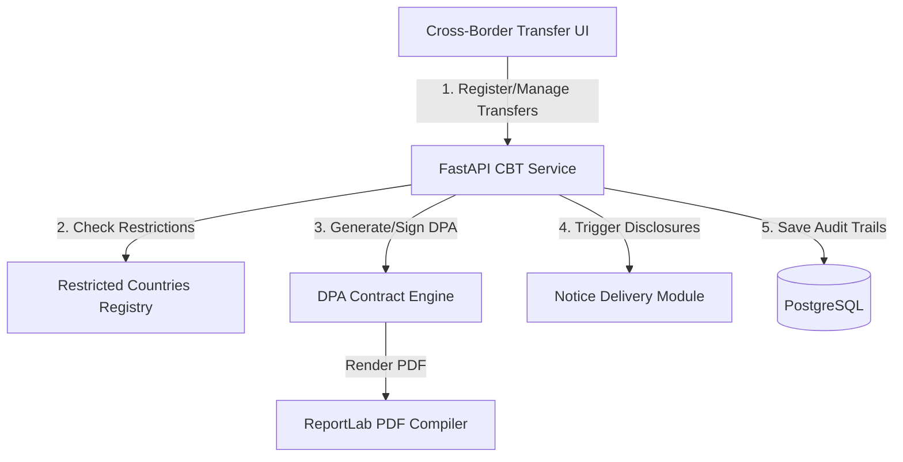
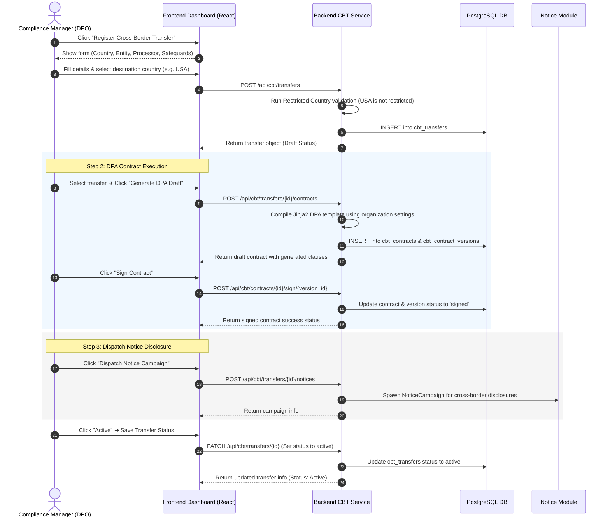
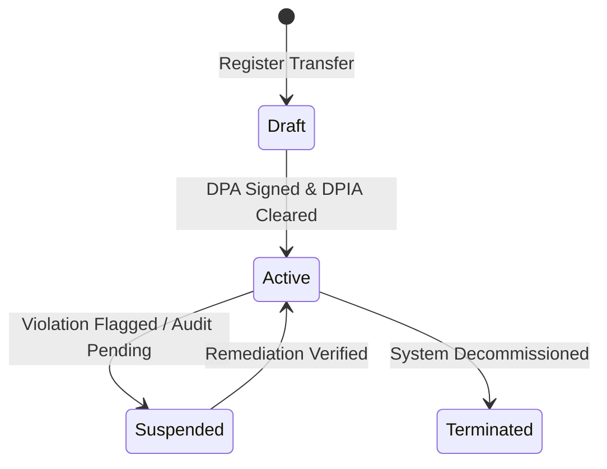
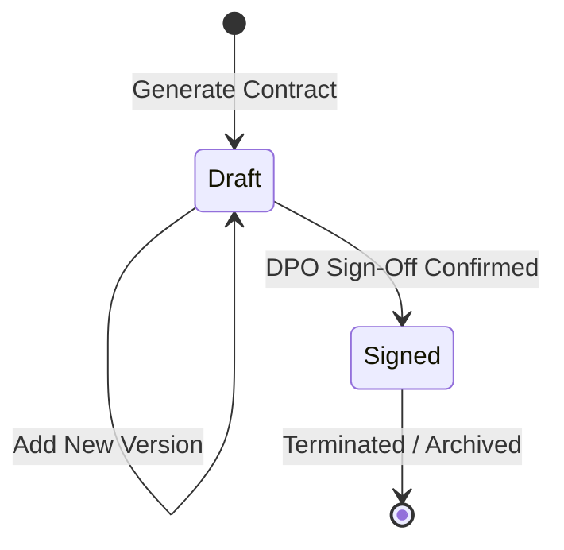

# Vajra — Cross-Border Transfer Technical Specification

This document serves as the **single source of truth** for the **Cross-Border Transfer (CBT)** module of the Vajra DPDPA compliance platform. It provides the detailed frontend, backend, database, integration, and compliance specifications required to build, test, and maintain this module.

---

## 1. Module Overview

### 1.1 Purpose
The **Cross-Border Transfer (CBT) Module** provides a comprehensive registry and governance workspace to track, evaluate, and restrict personal data transferred outside the territorial boundaries of India. It ensures compliance with Section 15 and Section 10 of the Digital Personal Data Protection Act (DPDPA), 2023.

### 1.2 Business Objective
To give compliance officers complete visibility and control over foreign data exposures, offshore vendor operations, and third-party data processing contracts. The platform tracks data destinations, monitors restricted regions, evaluates regulatory adequacy status, executes Data Processing Agreements (DPAs), and records independent significant audits.

### 1.3 DPDPA Compliance Objective
*   **Transfer Restrictions (Section 15)**: Restricts transfer of personal data outside India to countries blacklisted or not whitelisted by the Central Government.
*   **Significant Data Fiduciary (SDF) Obligations (Section 10)**: Places enhanced obligations on SDFs to undergo periodic independent audits and risk mitigation evaluations for any cross-border operations.
*   **Notice Disclosures (Section 6(3))**: Requires data fiduciaries to inform data principals about cross-border transfers and the categories of personal data being processed offshore.

### 1.4 Architectural Context
The CBT module integrates the Transfers Registry, DPA contract builder, notice delivery campaign manager, and the SDF compliance audit log:



### 1.5 Target Users
*   **Data Protection Officers (DPOs)**: Register cross-border transfers, draft and sign DPA contracts, review restricted country alerts, and perform SDF compliance audits.
*   **Vendor Managers**: Link cross-border transfers to active data processors/vendors.
*   **Legal Officers**: Author and version contract templates to enforce Section 8 compliance covenants.

---

## 2. DPDPA Mapping & Compliance Matrix

| DPDPA Section | Regulatory Requirement | Cross-Border Transfer Implementation |
| :--- | :--- | :--- |
| **Section 15** | Transfer of personal data outside India restricted. | Validates destination countries against blacklisted codes (`"PRK"`, `"SYR"`, `"IRN"`, `"CUB"`). Active status transfers to these countries are blocked. |
| **Section 10** | SDF audit and risk evaluations. | Automated "SDF Compliance" tab allowing independent auditors to record risk levels, findings, and mitigation controls for high-risk transfers. |
| **Section 8(5)** | Security safeguards and contract obligations. | Built-in Data Processing Agreement (DPA) manager that generates and cryptographically tracks signed, PDF-exportable legal contracts. |
| **Section 6(3)** | Disclosure notices. | Direct integration to trigger `NoticeCampaign` dispatches automatically to notify data principals of new cross-border flows. |

---

## 3. End-to-End User Journey



### 3.1 Scenario Workflows
*   **Restricted Country Warning & Block**:
    *   If a transfer is created or edited with a country code on the restricted blacklist (North Korea: `PRK`, Syria: `SYR`, Iran: `IRN`, Cuba: `CUB`), the system flags a warning.
    *   If the user attempts to save/set the transfer status to `active` while mapped to a restricted country, the backend rejects it with `HTTP 400 Bad Request` ("Cannot activate transfer. Destination country code is restricted").
*   **SDF Enhanced Auditing Flow**:
    *   If the organization is flagged as a Significant Data Fiduciary (SDF), all registered cross-border transfers are automatically marked as `is_sdf_transfer = true` and `dpia_required = true`.
    *   Upon transfer creation, a baseline pending audit assessment (`CbtSdfAssessment`) is generated automatically.
    *   DPOs must conduct an assessment, providing assessor credentials, risk ratings, findings, and mitigations via the "SDF Compliance" tab.
*   **Contract Versioning Flow**:
    *   To modify contract terms, DPOs create new drafts using `POST /api/cbt/contracts/{id}/versions`.
    *   Draft versions can be downloaded as PDFs, verified, and signed, which archives the old live version and marks the new version as active and signed.

---

## 4. Detailed Screen Specification

The Cross-Border Transfer module is organized into five tabs inside a unified dashboard:

### 4.1 Transfers Registry Tab
*   **Purpose**: Registry of all registered, active, and retired cross-border transfers.
*   **Grid Columns**: Transfer Name, Offshore Entity, Country (ISO), Associated Processor, Legal Basis, Adequacy Mechanism, Status, Next Audit Date, Linked DPIA.
*   **Form Input Fields**:
    1.  **Transfer Registry Name**: Mandatory. E.g., "Customer Analytics Pipeline".
    2.  **Offshore Entity**: Mandatory name of receiving corporate entity.
    3.  **Associated Processor**: Optional dropdown list mapping to registered processors/vendors.
    4.  **Destination Country**: Auto-complete search matching standard country lists.
    5.  **Country Code (ISO)**: 2-3 characters. E.g., `USA`, `DEU`, `SGP`.
    6.  **Transfer Purpose**: Textarea details of the business case.
    7.  **Legal Basis**: E.g., "consent", "contract", "legitimate_use".
    8.  **Adequacy Mechanism**: E.g., "adequacy_decision", "standard_contractual_clauses".
    9.  **Safeguards and Security Measures**: Plain-text description of technical safeguards.
    10. **Status**: Draft, Active, Suspended, Terminated.
    11. **DPIA Required / Audit Completed**: Checkbox toggle flags.
    12. **Next Review Audit Date**: Date picker.
    13. **Associated DPIA Case File**: Dropdown matching active records in the DPIA module.

### 4.2 DPA Contracts Tab
*   **Purpose**: Draft, version, sign, and export Data Processing Agreements.
*   **Actions**:
    *   **Generate DPA Draft**: Loads a markdown template containing standard DPDPA Section 8 obligations, binds Jinja2 organization placeholders, and inserts it as version `1`.
    *   **Add Contract Version**: Create a new draft revision.
    *   **Sign Contract**: Confirms sign-off by the DPO, marking the status as `signed`.
    *   **Download PDF**: Exports the signed DPA version as a professionally formatted PDF.

### 4.3 Notice Dispatches Tab
*   **Purpose**: Trigger notice dispatches detailing the cross-border transfer details to customers.
*   **Actions**:
    *   **Trigger Notice Campaign**: Spawns a scheduled SMS/Email disclosure campaign using smart strategies or email-only fallbacks.

### 4.4 SDF Compliance Tab
*   **Purpose**: Log mandatory assessments for organizations registered as Significant Data Fiduciaries (SDF).
*   **Actions**:
    *   **Submit Audit**: Form fields for Assessor Name, Risk Level (low, medium, high, critical), Findings, and Mitigations. Resolves pending baseline logs.

### 4.5 Activity Log Tab
*   **Purpose**: Chronological audit trail of all actions performed inside the module. Tracks `transfer.created`, `transfer.updated`, `contract.signed`, `sdf.assessment_completed`, etc.

---

## 5. Form Schema

### 5.1 Cross-Border Transfer Payload (`CbtTransferCreate`/`CbtTransferUpdate`)

| Field Name | Type | Description | Validation | Example Value |
| :--- | :--- | :--- | :--- | :--- |
| `name` | String | Registry reference name | Min 1, Max 255 | `"User Analytics Hub"` |
| `destination_country` | String | Destination country name | Min 1, Max 128 | `"Singapore"` |
| `country_code` | String | ISO country code | Min 2, Max 3 | `"SGP"` |
| `destination_entity` | String | Remote data recipient | Min 1, Max 255 | `"Cloud Analytics SGP Pte Ltd"` |
| `data_processor_id` | UUID | Processor/Vendor ID | Optional, valid UUID | `"4a3b2c1d-..."` |
| `transfer_purpose` | String | Description of business purpose | Optional | `"Offshore data parsing"` |
| `legal_basis` | String | Regulatory processing basis | Default `"contract"` | `"consent"` |
| `adequacy_status` | String | Regulatory adequacy type | Default `"unknown"` | `"standard_clauses"` |
| `safeguard_mechanism` | String | Specific safeguards | Optional | `"ISO 27001 + encryption"` |
| `status` | String | Activity lifecycle state | `draft`, `active`, `suspended`, `terminated` | `"draft"` |
| `dpia_required` | Boolean | True if risk evaluation required | Boolean | `true` |
| `dpia_completed_at` | DateTime | Timestamp of risk clearance | Optional | `"2026-07-08T10:00:00Z"` |
| `next_review_date` | Date | Target audit review date | Optional | `"2027-07-08"` |
| `dpia_id` | UUID | Associated DPIA link | Optional | `"8c7b6a5d-..."` |

### 5.2 SDF Compliance Audit Payload (`CbtSdfAssessmentCreate`)

| Field Name | Type | Description | Validation | Example Value |
| :--- | :--- | :--- | :--- | :--- |
| `assessor_name` | String | Credentials of auditor | Min 1, Max 255 | `"KPMG Compliance Lead"` |
| `risk_level` | String | Risk categorization | `low`, `medium`, `high`, `critical` | `"medium"` |
| `findings` | String | Assessment notes | Optional | `"Adequate technical controls."` |
| `mitigation_measures` | String | Remediation plans | Optional | `"Mandatory TLS 1.3 enforced."` |

---

## 6. Lifecycle & State Transitions

### 6.1 Transfer Lifecycle


### 6.2 DPA Contract Lifecycle


---

## 7. Relationships with Other Modules

*   **RoPA Module**: Cross-border transfer flags mapped to active data categories link back to registered entries inside the CBT registry.
*   **Vendor Risk Intelligence**: Gathers vendor profiles to populate data processors associated with specific transfers.
*   **DPIA Module**: High-risk profiles require executing impact assessments, linking specific DPIA entries directly.
*   **Consent Management**: Disclosures are automatically pushed to user-facing consent notices when new cross-border routing is established.

---

## 8. Frontend Architecture

### 8.1 Component Layout
```
CrossBorderTransfer.tsx (Dashboard Tabs & Master Grid Layout)
  ├── RegisterTransferModal.tsx (Registry Creator/Editor)
  ├── ContractModal.tsx (DPA generator version scheduler)
  └── SdfAssessmentModal.tsx (Auditor credential logger)
```

---

## 9. Backend Architecture

### 9.1 File Layout
*   `app/routers/cross_border_transfer.py`: API controllers and routing endpoints.
*   `app/services/cbt_service.py`: Whitelist validations, DPA Jinja2 template compiler, ReportLab PDF exporter.
*   `app/models/cross_border_transfer.py`: SQL Alchemy models for transfers, contracts, assessments, and activity logs.
*   `app/schemas/cross_border_transfer.py`: Pydantic models mapping requests, updates, and KPI responses.

### 9.2 DPA Template Markdown Structure (`backend/app/templates/cbt_dpa_template.md`)
The service compiles DPA drafts dynamically using a Jinja2 template containing core obligations mapping to Section 8 of DPDPA:
```markdown
# DATA PROCESSING AGREEMENT & CROSS-BORDER TRANSFER CONTRACT

This Data Processing Agreement ("DPA") is entered into by and between:
1. **{{ organization_name }}** (the "Data Fiduciary")
2. **{{ destination_entity }}** (the "Offshore Data Processor")

### 1. Scope and Purpose of Transfer
The Data Fiduciary is transferring personal data of Indian Data Principals to the Offshore Data Processor in {{ destination_country }} ({{ country_code }}).
- **Purpose of processing:** {{ transfer_purpose }}
- **Legal Basis under DPDPA:** {{ legal_basis }}
- **Safeguard Mechanisms:** {{ safeguard_mechanism }}

### 2. DPDPA 2023 Section 8 Compliance Obligations
The Offshore Data Processor agrees to:
- Process the personal data only on documented instructions from the Data Fiduciary.
- Implement technical and organizational security measures to prevent unauthorized data breaches.
- Promptly notify the Data Fiduciary of any security incident or breach.
- Ensure that sub-processors are bound by equivalent data protection obligations.
- Erase personal data upon target fulfillment or termination of agreement (Section 8(7)).


### 3. Significant Data Fiduciary (SDF) Enhanced Auditing Clause
As the Data Fiduciary is registered as an SDF, the Offshore Data Processor agrees to submit to periodic independent compliance audits.

```

### 9.3 PDF Document Exporter Logic
Backend pdf renderer compiles the signed markdown contracts to professional PDFs using **ReportLab** platypus documents:
```python
from reportlab.lib.pagesizes import letter
from reportlab.platypus import SimpleDocTemplate, Paragraph, Spacer, Table, TableStyle
from reportlab.lib.styles import getSampleStyleSheet, ParagraphStyle
from reportlab.lib import colors
import io

def export_contract_to_pdf(contract_data: dict, version_content: str) -> io.BytesIO:
    buffer = io.BytesIO()
    doc = SimpleDocTemplate(buffer, pagesize=letter)
    styles = getSampleStyleSheet()
    
    # Custom styles
    title_style = ParagraphStyle(
        name="Title", parent=styles["Title"], textColor=colors.HexColor("#1E1B4B")
    )
    body_style = ParagraphStyle(
        name="Body", parent=styles["Normal"], textColor=colors.HexColor("#334155")
    )
    
    story = [
        Paragraph("DIGITAL PERSONAL DATA PROTECTION ACT (DPDPA) COMPLIANCE", title_style),
        Spacer(1, 12),
        Paragraph(version_content.replace("\n", "<br/>"), body_style)
    ]
    
    doc.build(story)
    buffer.seek(0)
    return buffer
```
