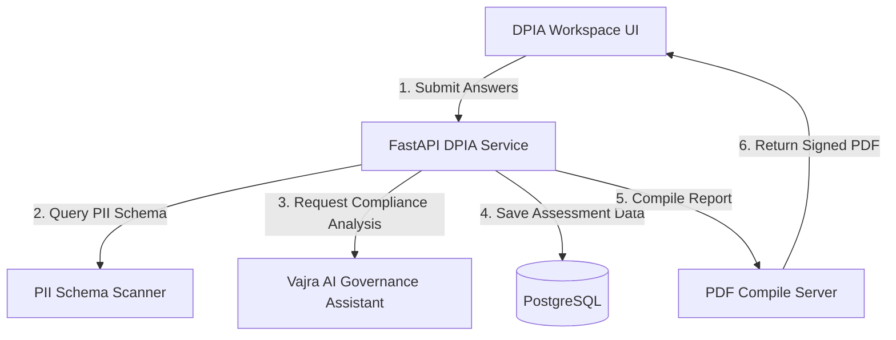
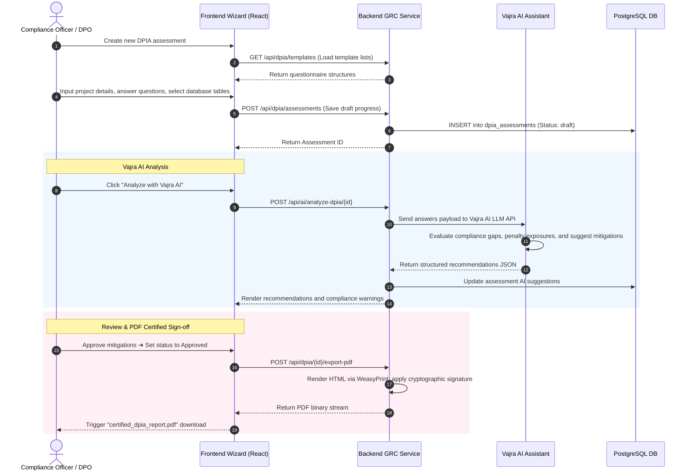
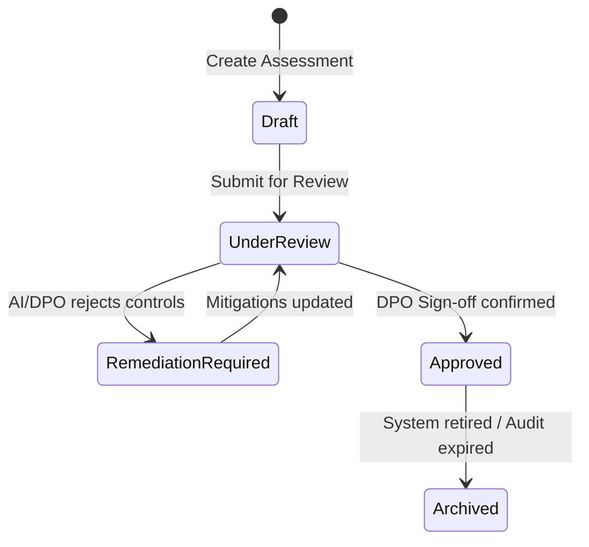
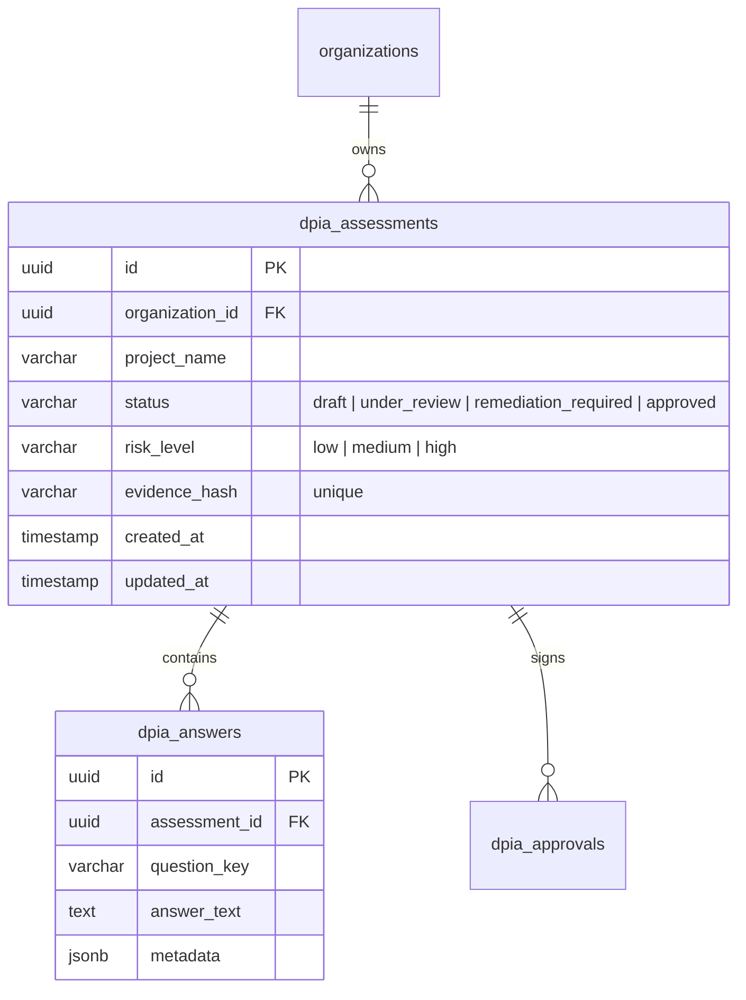

# Vajra — DPIA Module Technical Specification

This document serves as the **single source of truth** for the **DPIA (Data Protection Impact Assessment)** module of the Vajra DPDPA compliance platform. It provides the detailed frontend, backend, database, integration, and compliance specifications required to build, test, and maintain this module.

---

## 1. Module Overview

### 1.1 Purpose
The **DPIA Module** is an automated risk assessment workspace designed for compliance and product engineering teams. It allows organizations to evaluate, document, and mitigate high-risk data processing activities (such as processing children's data or sensitive biometrics), validating processing activities against DPDPA boundaries before deployment.

### 1.2 Business Objective
To establish a repeatable, auditable methodology for assessing new systems. The platform integrates a compliance wizard, database scans, and AI analysis to determine the severity of processing risks, generate action items, and compile legally defensible compliance files.

### 1.3 DPDPA Compliance Objective
*   **Obligations of Data Fiduciary (Section 8)**: Fiduciaries must implement appropriate security safeguards and perform impact evaluations when processing activities present elevated risk profiles (such as children's health, financial datasets, or automated profiling).
*   **Burden of Proof & Audit Preparedness (Section 6(10) & Section 10)**: Every approved DPIA generates a cryptographically signed, court-admissible PDF file to demonstrate accountability to the Data Protection Board of India (DPBI).

### 1.4 Architectural Context
The DPIA module integrates questionnaires, AI audit tools, PII database scanners, and a PDF compile server:



### 1.5 Target Users
*   **Data Protection Officers (DPOs)**: Design templates, audit risk calculations, verify mitigations, and submit final approvals.
*   **Product Owners & System Engineers**: Complete assessments, link data inventories, and execute remediation tasks.

---

## 2. DPDPA Mapping & Compliance Matrix

| DPDPA Section | Regulatory Requirement | DPIA Module Implementation |
| :--- | :--- | :--- |
| **Section 9(1)** | Special obligations in relation to children's data. | Mandatory DPIA trigger whenever the PII Scanner detects age identifiers or child-centric content. |
| **Section 8(5)** | Security safeguards mapping. | Checks if processing tasks link to approved security controls registered inside the CISO Command Center. |
| **Sec 65B (Evidence Act)** | Admissible electronic records. | Generates SHA-256 evidence hashes and cryptographic signatures on final exported compliance PDFs. |

---

## 3. End-to-End User Journey



---

## 4. Detailed Screen Specification

The DPIA module contains three view pages:

### 4.1 DPIA Dashboard
*   **Assessment Status Indicators**: Cards showing total assessments in: `Draft`, `Under Review`, `Remediation Required`, and `Approved` states.
*   **DPIA Audits Table**: Columns for Project Name, Risk Level (High/Med/Low), Target System, Date Created, DPO Sign-off status, and Chevron actions.
*   **Create Assessment Button**: Opens the template selector modal.

### 4.2 Questionnaire Wizard (Split Screen)
*   **Left Side - Form Stepper**:
    *   *Step 1: Processing Profile*: Input description, legal bases, volume of records, and user demographics (including check for child data).
    *   *Step 2: Data Elements Mapping*: Map database fields. Includes a **Run PII Schema Scan** button to scan columns.
    *   *Step 3: Risk Evaluation*: Interactive sliders for Likelihood and Impact (1-5 scale). Input fields for justifying risk ratings.
    *   *Step 4: Remediation Plan*: Link security controls from the CISO Command Center.
*   **Right Side - Vajra AI Panel**:
    *   Floating drawer displaying compliance advice based on current form answers.
    *   Lists automated DPDPA gaps (e.g. *"Missing age verification trigger for child data"*).
    *   Click-to-apply action items to auto-populate risk remediations.

### 4.3 Sign-off & Export Workspace
*   **Approver Log**: Displays DPO identity verification.
*   **Evidence Hash Block**: Monospace text box displaying the SHA-256 fingerprint hash of the final database record.
*   **Download Certified PDF Report**: Button triggering download of the signed PDF.

---

## 5. Form Schema (DPIA Assessment Payload)

| Field Name | Type | Description | Validation | Example Value |
| :--- | :--- | :--- | :--- | :--- |
| `project_name` | String | Title of the assessed project | Min 1, Max 255 | `"New Patient Health Portal"` |
| `processes_child_data` | Boolean | Flag indicating child data collection | Boolean, Mandatory | `true` |
| `data_volume_range`| String | Scale of database operations | Standard ranges select | `"10k - 100k records"` |
| `pii_fields` | Array | Categories detected in database | List of strings | `["Aadhaar", "Biometrics"]` |
| `initial_impact` | Integer | Assessed potential business impact | Integer 1 to 5 | `4` |

---

## 6. DPIA Lifecycle & Transitions



---

## 7. Relationships with Other Modules

*   **RoPA Module**: Pulls processing activities from the master registry to form the baseline of new assessment profiles.
*   **CISO Command Center**: Maps remediation plans directly to registered security controls.
*   **Policy Manager**: Cross-references answers with internal data retention policy parameters.

---

## 8. Frontend Architecture

### 8.1 Component Structure
```
DPIADashboard.tsx (Master Grid View)
  ├── TemplateSelectorModal.tsx (Create prompt)
  ├── DPIAFormWizard.tsx (Stepper orchestrator)
  │     ├── Steps/ProfileStep.tsx
  │     ├── Steps/PIIScannerMap.tsx (PII column map UI)
  │     ├── Steps/RiskScoring.tsx (Likelihood/Impact sliders)
  │     └── Steps/MitigationLinker.tsx (CISO control mapping)
  ├── AIShieldAssistant.tsx (Vajra AI panel)
  └── CertifiedPDFExporter.tsx (Signature and compile actions)
```

---

## 9. Backend Architecture

### 9.1 File Layout
*   `app/routers/dpia.py`: Route handlers.
*   `app/services/dpia_service.py`: Risk calculations, PDF document formatting.
*   `app/services/ai_service.py`: LLM API calls, compliance checks parsing.
*   `app/models/dpia.py`: Database assessment schemas.

### 9.2 PDF Generation Logic (Python Implementation Pattern)
```python
from weasyprint import HTML
import hashlib

def generate_signed_dpia_pdf(assessment_data: dict, signing_key: str) -> bytes:
    # 1. Compile assessment answers into clean HTML
    html_content = f"""
    <html>
        <body>
            <h1>DPDPA Compliance Assessment Certificate</h1>
            <p>Project Name: {assessment_data['project_name']}</p>
            <p>Risk Level: {assessment_data['calculated_risk_level']}</p>
            <p>Verification Date: {assessment_data['approved_at']}</p>
            <div class='hash'>SHA-256 Evidence: {assessment_data['evidence_hash']}</div>
        </body>
    </html>
    """
    
    # 2. Render to PDF
    pdf_bytes = HTML(string=html_content).write_pdf()
    
    # 3. Calculate PDF Hash
    pdf_hash = hashlib.sha256(pdf_bytes).hexdigest()
    
    # 4. Apply digital signature (mock/real HSM signature step)
    # signed_signature = hsm_sign(pdf_hash, signing_key)
    
    return pdf_bytes
```

---

## 10. Database Design



---

## 11. API Design

### 11.1 Trigger AI Assessment Review
*   **Method / Route**: `POST /api/ai/analyze-dpia/{dpia_id}`
*   **Response Body (200 OK)**:
    ```json
    {
      "dpia_id": "c1387d89-9831-419b-a010-8b630f9a2de0",
      "compliance_score": 78.5,
      "detected_gaps": [
        {
          "severity": "high",
          "message": "Processes Child Data but lacks verifiable age-verification checks.",
          "section_citation": "DPDPA Section 9(1)"
        }
      ],
      "recommended_mitigations": [
        {
          "control_key": "CTRL-42",
          "description": "Deploy Parental Consent Gateway"
        }
      ]
    }
    ```

---

## 12. Event Architecture

*   `dpia.created`: Logged when an assessment initializes.
*   `dpia.analysis_completed`: Fired when Vajra AI completes a scan.
*   `dpia.approved`: Triggers the PDF generator and updates linked RoPA records.

---

## 13. QA Verification Matrix

### 13.1 Positive Test Cases
*   **TC-01 (Create Assessment Wizard)**: Step through the wizard, linking database columns and submitting answers. Assert assessment maps to `under_review` status.
*   **TC-02 (PDF Export and Cryptographic Sign)**: Click "Download Certified Report". Verify a PDF document downloads, matches inputs, and contains a valid SHA-256 signature block.

### 13.2 Negative Test Cases
*   **TC-03 (Child Data Verification Warning)**: Set `processes_child_data` to `true` while linking zero age-gate security mitigations. Assert Vajra AI returns a `high` severity warning citation mapping Section 9(1).
*   **TC-04 (Double Approval Block)**: Attempt to approve a DPIA that has open critical remediation actions. Verify API returns a `400 Bad Request`.
