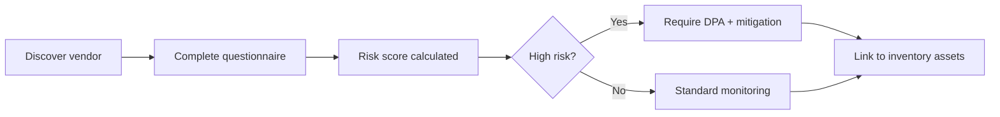

# DPDPA Shield — Governance Guide

This guide provides an onboarding path for the **Governance** module cluster, helping organizations establish accountability frameworks, document processing activities, and manage third-party risks.

**Route:** `/governance/guide`

---

## 1. What is Governance in DPDPA Shield?

The Governance cluster provides the structural accountability layer for DPDPA compliance — documenting *who* processes data, *why*, *with whom*, and *under what safeguards*.

---

## 2. Module Map

| Module | Route | What It Does |
| :--- | :--- | :--- |
| **RoPA Module** | `/data/ropa` | Records of Processing Activities register |
| **DPIA Module** | `/data/dpia` | Data Protection Impact Assessments |
| **Policy Manager** | `/data/policies` | Corporate governance policy documents |
| **Vendor Risk Intelligence** | `/data/vendors` | Third-party processor risk assessment |
| **Cross-Border Transfer** | `/governance/cross-border-transfer` | International data transfer tracking |
| **CISO Command Center** | `/security/ciso` | Security posture dashboard for CISOs |
| **Compliance Dashboards** | `/compliance/dashboards` | Custom compliance reporting dashboards |

---

## 3. Recommended Setup Order

### Step 1: Records of Processing Activities (RoPA)
Start with **RoPA Module** — the foundation of governance:
1. Review auto-discovered processing activities from Data Inventory.
2. Accept or dismiss Shield AI suggestions.
3. Document each activity: purpose, data categories, lawful basis, recipients, retention.
4. Link activities to Data Inventory assets and Purpose Registry entries.

### Step 2: Vendor Risk Assessment
Move to **Vendor Risk Intelligence**:
1. Register third-party data processors (cloud providers, SaaS tools, analytics).
2. Complete risk questionnaires for each vendor.
3. Track DPA (Data Processing Agreement) status and expiry.
4. Link vendors to Data Inventory assets they process.

### Step 3: Data Protection Impact Assessments
Use **DPIA Module** for high-risk processing:
1. Identify processing activities requiring DPIA (children's data, large-scale profiling, sensitive data).
2. Complete DPIA templates with Shield AI assistance.
3. Document mitigation measures and residual risks.
4. Obtain DPO sign-off on completed assessments.

### Step 4: Policy Management
**Policy Manager**:
1. Generate privacy policy draft from RoPA (Shield AI assisted).
2. Review and customize with legal counsel.
3. Publish policy versions with acknowledgment tracking.
4. Schedule periodic policy reviews.

### Step 5: Cross-Border & Security
*   **Cross-Border Transfer**: Document international data flows and approved destinations.
*   **CISO Command Center**: Monitor security controls and incident trends.
*   **Compliance Dashboards**: Build custom reports for board and regulator presentations.

---

## 4. RoPA Auto-Discovery

Shield AI can suggest RoPA entries by analyzing:
*   Data Inventory assets and field classifications
*   Connected data sources and their types
*   PII Scanner findings
*   Existing RoPA entries (to avoid duplicates)
*   Detected trackers and cookies

Review suggestions in the RoPA Module → "AI Suggestions" panel. Accept relevant entries and dismiss false positives.

---

## 5. Policy Generation from RoPA

Shield AI can draft governance policies from your RoPA:
1. Open Policy Manager → "Generate from RoPA".
2. Select policy type (Privacy Policy, Cookie Policy, Retention Schedule, etc.).
3. Shield AI drafts a complete policy document based on your processing activities.
4. Review, edit, and publish with legal counsel approval.

Supported policy types: Privacy Policy, Cookie Policy, Children's Privacy Notice, Employee Data Protection Policy, Data Retention & Erasure Schedule, Incident Response Plan, Vendor DPA, Acceptable Use Policy.

---

## 6. Vendor Risk Workflow

Risk levels: Low, Medium, High, Critical. High-risk vendors require DPA execution and periodic re-assessment.

---

## 7. Cross-Border Transfer Tracking

For organizations transferring data outside India:
1. Document each cross-border flow in the Cross-Border Transfer module.
2. Specify source country, destination country, legal mechanism (contract, adequacy, consent).
3. Link to Data Inventory assets and data sources with region metadata.
4. Monitor for flows to non-approved destinations (flagged automatically).

Data Sources with region metadata feed into residency checks. Sources outside approved regions show `outside_approved_residency` flag.

---

## 8. DPDPA Sections Addressed

| Section | Requirement | Governance Module |
| :--- | :--- | :--- |
| **Section 8(1)** | Accountability | RoPA register |
| **Section 8(2)** | Processor contracts | Vendor Risk + DPA tracking |
| **Section 10** | SDF duties | DPIA module, auditor reporting |
| **Section 11(1)** | Right to know recipients | RoPA recipient documentation |
| **Section 16** | Cross-border transfer | Cross-Border Transfer module |

---

## 9. Common Questions

**Q: Is RoPA mandatory under DPDPA?**
A: While DPDPA doesn't use the term "RoPA" explicitly, Section 8(1) requires fiduciaries to demonstrate accountability for all processing — which effectively requires a processing register.

**Q: When is a DPIA required?**
A: For Significant Data Fiduciaries (Section 10), and recommended for high-risk processing: children's data, large-scale sensitive data, systematic profiling, cross-border transfers to non-approved countries.

**Q: How does Shield AI help with governance?**
A: RoPA auto-discovery, policy drafting from RoPA, DPIA recommendation cards, and vendor risk suggestions — all powered by workspace context and platform documentation.

**Q: Can I export governance documents for regulators?**
A: Yes. RoPA, DPIA, and Policy Manager all support PDF/CSV export. Compliance Dashboards can be configured for board presentations.
