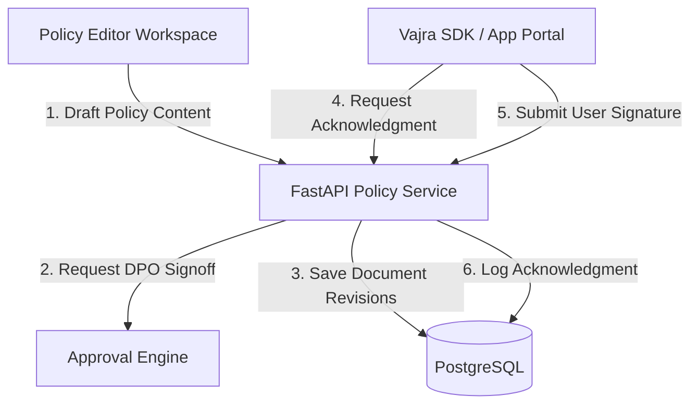
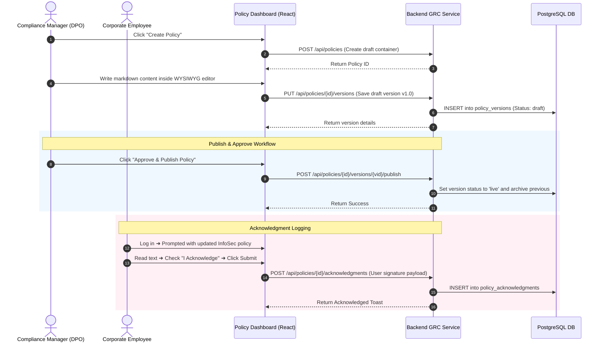
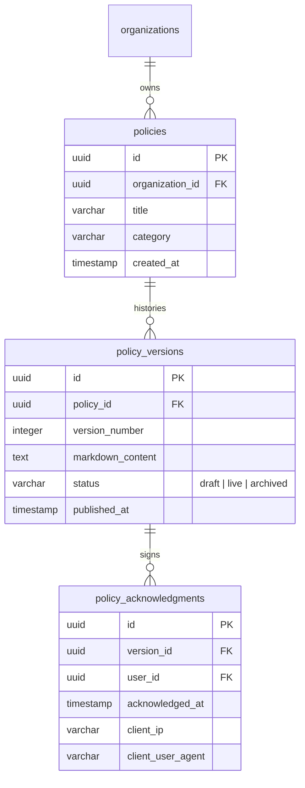

# Vajra — Policy Manager Technical Specification

This document serves as the **single source of truth** for the **Policy Manager** module of the Vajra DPDPA compliance platform. It provides the detailed frontend, backend, database, integration, and compliance specifications required to build, test, and maintain this module.

---

## 1. Module Overview

### 1.1 Purpose
The **Policy Manager** is a GRC document registry and authoring portal. It allows compliance teams to draft, translate, review, publish, and audit corporate governance documents (e.g. Privacy Policies, Data Retention Policies, Employee InfoSec Standards, and Grievance Redressal Procedures). It provides formal version controls and audits user acknowledgment statistics.

### 1.2 Business Objective
To establish a centralized repository of organizational policies. The system automates publication updates, pushes notices to employees, and records individual reading acceptances, ensuring corporate procedures align with regulatory updates and can be easily verified during audits.

### 1.3 DPDPA Compliance Objective
*   **Notice and Right to Redressal (Section 6(3) & Section 13)**: Requires fiduciaries to publish notice and make information about grievance redressal procedures easily accessible. The Policy Manager hosts and versions these public-facing documents.
*   **Employee Compliance Training & Standard Safeguards**: Establishes auditable proof that company staff have read and signed corporate InfoSec guidelines, demonstrating operational accountability.

### 1.4 Architectural Context
The Policy Manager manages policy draft revisions and tracks acknowledgment campaigns:



### 1.5 Target Users
*   **DPOs & Compliance Admins**: Draft policy texts, manage translations, review revisions, and monitor acknowledgment coverage.
*   **Corporate Staff & Users**: Review corporate policies and record sign-off acknowledgments.

---

## 2. DPDPA Mapping & Compliance Matrix

| DPDPA Section | Regulatory Requirement | Policy Manager Implementation |
| :--- | :--- | :--- |
| **Section 6(3)** | Notice details of DPO and DPBI. | Standardized policy templates enforcing mandatory inclusion of DPO name, email, and complaint procedures. |
| **Section 13** | Redressal of grievances. | Tracks the Grievance Redressal policy publication status, ensuring public web directories link to active versions. |
| **Section 8(5)** | Security safeguards and training. | Audit logs tracking employee sign-offs on InfoSec policies. |

---

## 3. End-to-End User Journey



---

## 4. Detailed Screen Specification

The Policy Manager features a workspace dashboard divided into three areas:

### 4.1 Master Policy Table
*   **Columns**:
    1. `Policy Name` (e.g. *InfoSec Standards*)
    2. `Active Version` (e.g. *v2.4*)
    3. `Category` (e.g. *Internal Security*, *Public Notice*)
    4. `Audience` (e.g. *All Staff*, *Website Visitors*)
    5. `Acknowledgment Rate` (Progress bar showing % of target audience signed)
    6. `Status` (Badges: `Draft`, `Published`, `Archived`)
    7. `Last Modified` (Timestamp)
*   **Action**: "Create Policy" button opens the blank authoring canvas.

### 4.2 Rich-Text Policy Editor Canvas
*   **Editor Panel**: Split view with a WYSIWYG markdown editor on the left and live HTML preview on the right.
*   **Properties Sidebar**:
    *   Target Audience selector (e.g., specific departments or all).
    *   Expirations rules (e.g., triggers review alert every 12 months).
    *   Language translations tabs (integrates with Multi-Language Editor).

### 4.3 Acknowledgment Audit Logs
*   **Visual Layout**: Charts plotting signing statistics over time.
*   **Logs Table**: Searchable ledger of employee names, department, policy version signed, timestamp, and IP address.

---

## 5. Form Schema (Policy Metadata Input)

| Field Name | Type | Description | Validation | Example Value |
| :--- | :--- | :--- | :--- | :--- |
| `title` | String | Corporate policy name | Min 1, Max 255 | `"Data Retention & Destruction"` |
| `category` | String | Classification of document | `internal`, `public` | `"internal"` |
| `target_audience` | String | User segment required to sign | Multi-select / String | `"All Employees"` |
| `review_cycle_months`| Integer | Frequency of mandated reviews | Min 1, Max 36 | `12` |

---

## 6. Database Design



---

## 7. API Design

### 7.1 Submit Policy Acknowledgment
*   **Method / Route**: `POST /api/policies/{policy_id}/acknowledgments`
*   **Request Body**:
    ```json
    {
      "version_id": "c1387d89-9831-419b-a010-8b630f9a2de0",
      "user_signature": "Signed by Amit Sharma",
      "fingerprint": "7ac98b11118..."
    }
    ```
*   **Response Body (201 Created)**:
    ```json
    {
      "acknowledgment_id": "8b9e67d4-89d8-4fbb-ba86-fa8ccff88c22",
      "status": "recorded",
      "timestamp": "2026-06-25T00:10:00Z"
    }
    ```

---

## 8. QA Verification Matrix

### 8.1 Positive Test Cases
*   **TC-01 (Create and Publish Revision)**: Draft a policy v1.0, edit content, submit approval, and publish. Verify previous live versions are moved to `archived` status.
*   **TC-02 (Log Acknowledgment Event)**: Submit a user acknowledgment. Assert a new record is added to the `policy_acknowledgments` table with correct user and version links.

### 8.2 Negative Test Cases
*   **TC-03 (Draft Version Conflict)**: Attempt to create a new draft version when an active draft version already exists. Verify API returns a `409 Conflict`.
*   **TC-04 (Double Acknowledgment)**: Attempt to log acknowledgment for the same policy version twice by the same user. Verify the request returns a `200 OK` but updates the existing record without duplicating database entries.
