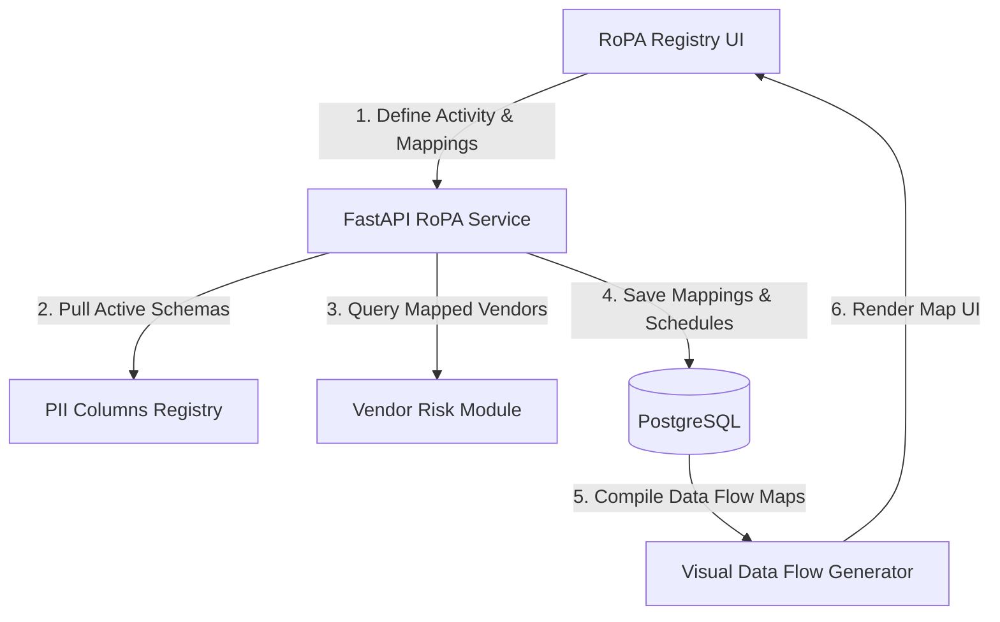
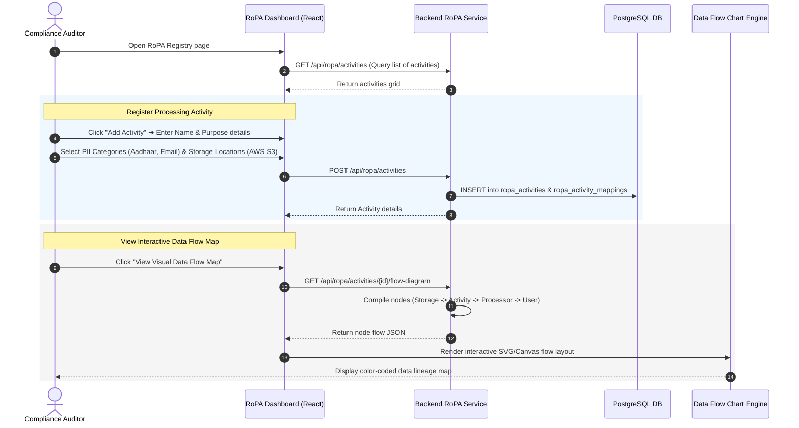
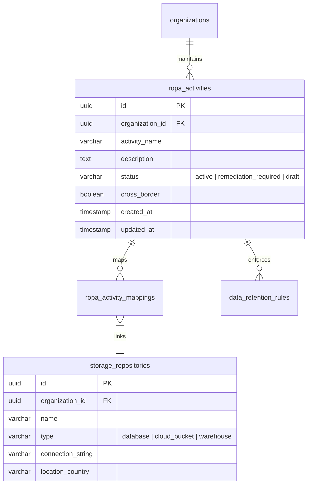

# DPDPA Shield — RoPA Module Technical Specification

This document serves as the **single source of truth** for the **RoPA (Record of Processing Activities)** module of the ZeroShield DPDPA compliance platform. It provides the detailed frontend, backend, database, integration, and compliance specifications required to build, test, and maintain this module.

---

## 1. Module Overview

### 1.1 Purpose
The **RoPA Module** is the core inventory and data mapping engine of the GRC stack. It maintains the official registry of all personal data processing activities conducted by the organization. It tracks what PII is collected, why it is processed, where it is stored, who has access to it, how long it is retained, and what third-party vendors process it.

### 1.2 Business Objective
To establish a centralized, queryable inventory of data operations. RoPA translates raw databases and user flows into structured, business-friendly processing records, ensuring compliance teams have immediate visibility in the event of audit reviews or data principal inquiries.

### 1.3 DPDPA Compliance Objective
*   **Obligation to Maintain Records (Section 10 / General GRC Audits)**: Fiduciaries must maintain accurate records of processing activities, including descriptions of personal data categories, purposes of processing, data transfers, and security measures.
*   **Data Retention and Erasure (Section 8(7))**: Tracks retention lifecycles across datasets, triggering automated erasure warnings when processing purposes are fulfilled or consent is withdrawn.

### 1.4 Architectural Context
The RoPA registry maps logical business operations to raw database schemas and cloud assets:



### 1.5 Target Users
*   **Compliance Officers & Auditors**: Review data mappings, verify retention compliance, and export statutory registries.
*   **Database Admins & Devs**: Map columns to processing activities and configure retention trigger endpoints.

---

## 2. DPDPA Mapping & Compliance Matrix

| DPDPA Section | Regulatory Requirement | RoPA Module Implementation |
| :--- | :--- | :--- |
| **Section 8(7)** | Erase personal data when purpose is completed. | Maps strict `retention_period` parameters per activity and logs actual erasure completion tokens. |
| **Section 10 / Audits** | Maintain verifiable catalogs of processing activities. | Unified, search-indexed GRC database tables recording descriptions, data categories, and transfers. |
| **Section 15** | Cross-border transfer boundaries. | Flags any data transfer mapping to repositories or processors situated outside whitelisted geographies. |

---

## 3. End-to-End User Journey



---

## 4. Detailed Screen Specification

The RoPA Module consists of two primary views:

### 4.1 RoPA Master Registry Table
*   **Filters**:
    *   Filter by risk status, PII sensitivity, storage location, and linked DPIA.
*   **Columns**:
    1. `Activity Name` (e.g. *Customer Onboarding*)
    2. `Processing Purpose` (e.g. *Identity Verification*)
    3. `Data Principal Categories` (e.g. *Employees, Customers*)
    4. `PII Categories` (e.g. *Aadhaar, PAN, Phone Number*)
    5. `Storage Repositories` (e.g. *Postgres DB patient_table*)
    6. `Retention Policy` (e.g. *7 Years post-termination*)
    7. `Linked DPIA` (Badge link: Approved / Missing)
*   **Export Action**: "Export RoPA Audit Ledger" (outputs Excel/CSV matching regulatory formats).

### 4.2 Activity Mapping Workspace (Editor Panel)
A detailed sidebar drawer mapping metadata:
*   **Purpose & Legal Basis Selector**: Dropdown selection of registered business purposes.
*   **Data Item Selector**: Tree selector mapping standard PII categories to discovered columns.
*   **Data Processor (Vendor) Selector**: Map which external vendor handles data for this activity (linked to Vendor Risk Module).
*   **Cross-Border Flag**: Toggle indicating if data crosses national boundaries. If active, shows a destination whitelist selector.

---

## 5. Form Schema (RoPA Activity Input)

| Field Name | Type | Description | Validation | Example Value |
| :--- | :--- | :--- | :--- | :--- |
| `activity_name` | String | Internal business process name | Min 1, Max 255, Unique | `"Employee Payroll Processing"` |
| `description` | String | Plain-text details of processing | Max 1000 chars | `"Managing salary disbursals and taxes."` |
| `retention_months` | Integer | Max months to store before deletion | Min 1, Max 1200 | `84` |
| `cross_border` | Boolean | True if data exits India boundaries | Boolean, Mandatory | `false` |
| `pii_categories` | Array | List of PII types collected | Non-empty list | `["Identity", "Financial"]` |

---

## 6. Relationships with Other Modules

*   **DPIA Module**: Approved assessments automatically update the status badges in the RoPA registry. Gaps found in DPIAs trigger "Remediation Required" status flags on RoPA activities.
*   **Vendor Risk Intelligence**: Linked vendor risk rankings determine the composite risk score of RoPA activities.
*   **CISO Command Center**: Displays the global count of mapped RoPA activities and penalty risks.

---

## 7. Frontend Architecture

### 7.1 Component Structure
```
RoPADashboard.tsx (Registry Table & Search UI)
  ├── ActivityEditorDrawer.tsx (Slide-out config panel)
  │     ├── MappingTree.tsx (Asset / PII Selector)
  │     └── RetentionForm.tsx (Schedule controls)
  ├── FlowMapCanvas.tsx (SVG diagram wrapper)
  │     └── FlowNode.tsx (Visual element nodes)
  └── AuditExporterButton.tsx (CSV/XLS compilers)
```

---

## 8. Backend Architecture

### 8.1 File Layout
*   `app/routers/ropa.py`: Route handlers.
*   `app/services/ropa_service.py`: Schema mappings, graph builders, data flow JSON compiling.
*   `app/models/ropa.py`: Database models mapping activities, storage, and retention parameters.

---

## 9. Database Design



---

## 10. API Design

### 10.1 Fetch RoPA Activities
*   **Method / Route**: `GET /api/ropa/activities`
*   **Response Body (200 OK)**:
    ```json
    {
      "activities": [
        {
          "id": "c1387d89-9831-419b-a010-8b630f9a2de0",
          "activity_name": "Customer Support Tickets",
          "description": "Managing customer complaints and queries.",
          "status": "active",
          "cross_border": false,
          "pii_categories": ["Name", "Email", "Phone"],
          "retention_months": 36,
          "linked_dpia_id": "8b9e67d4-89d8-4fbb-ba86-fa8ccff88c22",
          "linked_dpia_status": "approved"
        }
      ],
      "total_count": 1
    }
    ```

---

## 11. QA Verification Matrix

### 11.1 Positive Test Cases
*   **TC-01 (Add Activity Mapping)**: Create a RoPA activity, map it to a DB database, S3 bucket, and assign retention schedules. Assert mapped databases and buckets are successfully recorded.
*   **TC-02 (Audit Report Compile)**: Trigger a CSV export of the RoPA registry. Verify file contains all required statutory headers.

### 11.2 Negative Test Cases
*   **TC-03 (Cross-border Whitelist Violation)**: Set cross-border to `true` and select a restricted storage destination. Verify the validation engine raises a `high` severity boundary warning mapping Section 15.
*   **TC-04 (Duplicate Activity Name)**: Submit a payload with an existing activity name. Verify API returns a `409 Conflict`.
