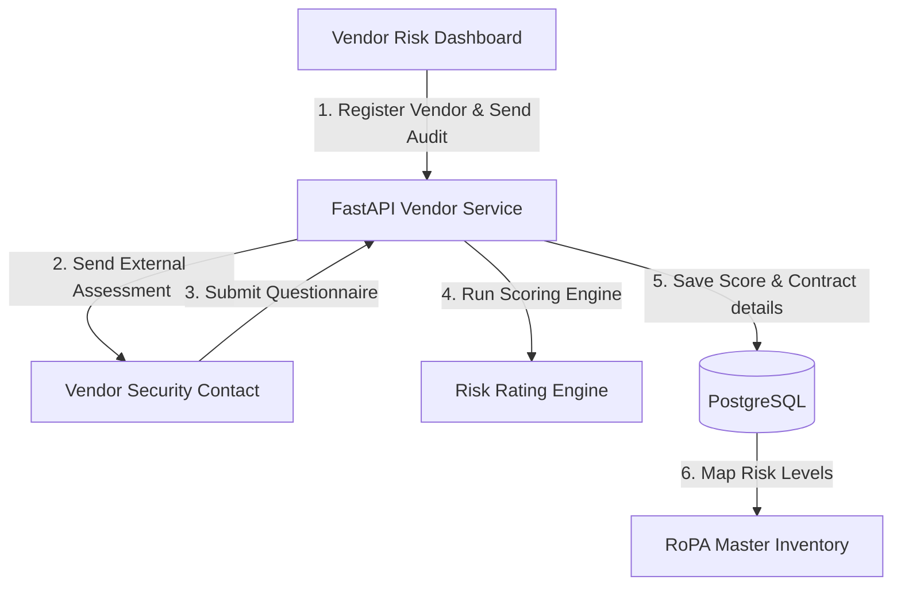
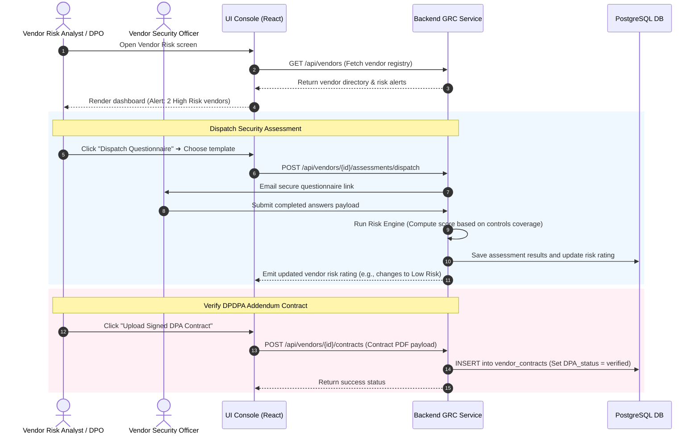
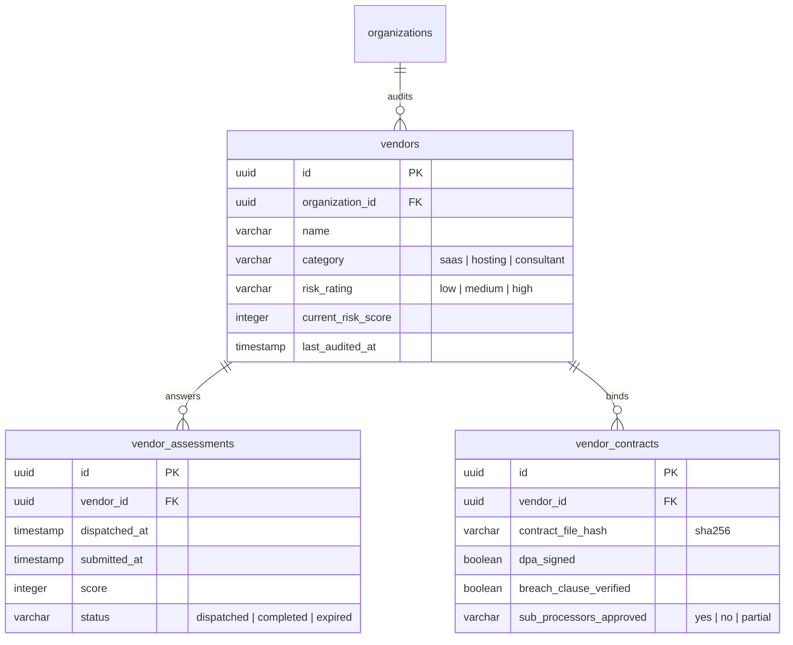

# DPDPA Shield — Vendor Risk Intelligence Technical Specification

This document serves as the **single source of truth** for the **Vendor Risk Intelligence** (Third-Party Processor Audits) module of the ZeroShield DPDPA compliance platform. It provides the detailed frontend, backend, database, integration, and compliance specifications required to build, test, and maintain this module.

---

## 1. Module Overview

### 1.1 Purpose
The **Vendor Risk Intelligence** module is a third-party risk assessment (TPRM) platform. It allows organizations to inventory data processors (vendors) handling personal data, dispatch compliance questionnaires, verify data processing addendums (DPAs), and calculate vendor risk ratings to protect data pipelines under DPDPA requirements.

### 1.2 Business Objective
To automate vendor compliance auditing. By standardizing security questionnaires, scoring outcomes, and verifying contract clauses, the module replaces manual spreadsheets with real-time risk profiles linked directly to business data activities.

### 1.3 DPDPA Compliance Objective
*   **Obligations when Delegating Processing (Section 8)**: Data Fiduciaries remain liable for personal data processed by any Data Processor acting on their behalf. Fiduciaries must execute binding contracts containing clear processing boundaries and security commitments.
*   **Audit Accountability**: The system tracks and logs vendor security postures, providing auditable documentation that the organization has vetted and verified third-party processors.

### 1.4 Architectural Context
The Vendor Risk Intelligence engine analyzes external processor risks and integrates them with GRC logs:



### 1.5 Target Users
*   **Vendor Risk Analysts & DPOs**: Register vendors, review questionnaire answers, audit contract clauses, and assign risk mitigation tasks.
*   **Procurement Admins**: Review vendor risk scores during the boarding lifecycle.

---

## 2. DPDPA Mapping & Compliance Matrix

| DPDPA Section | Regulatory Requirement | Vendor Risk Implementation |
| :--- | :--- | :--- |
| **Section 8(1)** | Processors must act under a valid contract. | Tracks vendor contract upload status, auditing for standard clauses (e.g. breach reporting timelines, data erasure bounds). |
| **Section 8(2)** | Fiduciary remains accountable for processor actions. | Continuous risk scoring. Flags data pipelines (in RoPA) that route personal data to degraded or high-risk processors. |

---

## 3. End-to-End User Journey



---

## 4. Detailed Screen Specification

The Vendor Risk dashboard provides three core screens:

### 4.1 Vendor Directory Inventory
*   **High-Risk Banner Alert**: Prominent warning strip showing counts of high-risk processors (e.g. `2 high risk` badge notification) with shortcut links to view them.
*   **Vendors Table**:
    *   *Columns*: Vendor Name, Category, Risk Classification (High/Medium/Low, color-coded), Active Assessment Status, Contract Check Status (Verified/Missing), Last Audit Date, and Actions.
    *   *Action*: "Register Vendor" opens the creation modal.

### 4.2 Questionnaire Dispatch Tool
*   **Trigger**: Click "Dispatch Assessment" inside Vendor profile.
*   **Form Controls**:
    *   Select Template dropdown (e.g. *DPDPA Basic Assessment*, *ISO 27001 Checklist*).
    *   Security Contact Email text input.
    *   Deadline Date picker.

### 4.3 Vendor Details & Risk Panel
Triggers on clicking a row chevron:
*   **Activity Mapping Profile**: Displays mapped business processes (linked from RoPA) showing what PII categories this vendor handles.
*   **Assessments History**: Table listing past questionnaire submissions, scores, and answered details.
*   **Contract Checklist**: Details of DPA status, breach reporting clause verification, data deletion procedures, and sub-processor approvals.

---

## 5. Vendor Risk Scoring Parameters

The Risk Engine calculates a composite rating score ($0.0$ to $100.0$) using weighted attributes:

$$\text{Vendor Risk Score} = (0.50 \times \text{Questionnaire Score}) + (0.30 \times \text{Contract DPA Score}) + (0.20 \times \text{Historical Incident Score})$$

### 5.1 Risk Score Classifications
*   **Low Risk**: Score $\le 30.0$ (Green)
*   **Medium Risk**: Score $30.1$ to $70.0$ (Orange)
*   **High Risk**: Score $> 70.0$ (Red)

---

## 6. Database Design



---

## 7. API Design

### 7.1 Fetch Vendor Risk Profile
*   **Method / Route**: `GET /api/vendors/{vendor_id}/profile`
*   **Response Body (200 OK)**:
    ```json
    {
      "vendor_id": "c1387d89-9831-419b-a010-8b630f9a2de0",
      "name": "CloudHosting Ltd",
      "risk_rating": "high",
      "current_risk_score": 82,
      "mapped_ropa_activities": [
        {
          "activity_name": "Customer Database Storage",
          "pii_categories": ["Name", "Aadhaar"]
        }
      ],
      "contract": {
        "dpa_signed": false,
        "breach_clause_verified": false
      }
    }
    ```

---

## 8. QA Verification Matrix

### 8.1 Positive Test Cases
*   **TC-01 (Dispatch Assessment Email)**: Dispatch an assessment to a test vendor contact. Verify a unique dispatch record is created and email is queued.
*   **TC-02 (Risk Engine Update)**: Upload a signed contract and mark `dpa_signed = true` and `breach_clause_verified = true`. Verify the risk engine recalculates the score and updates the rating accordingly.

### 8.2 Negative Test Cases
*   **TC-03 (High-Risk Pipeline Warning)**: Associate a High-Risk vendor with a RoPA activity that processes sensitive biometrics. Verify that the system generates a high-priority warning flag on that activity.
*   **TC-04 (Expired Assessment Alert)**: Set the questionnaire deadline to the past. Verify the worker changes assessment status to `expired` and triggers a follow-up notification.
