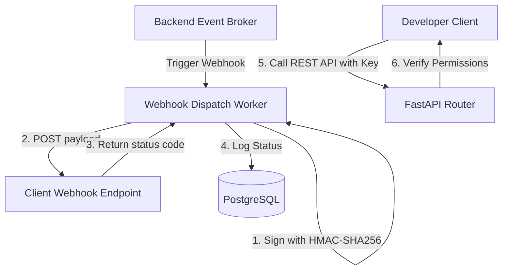
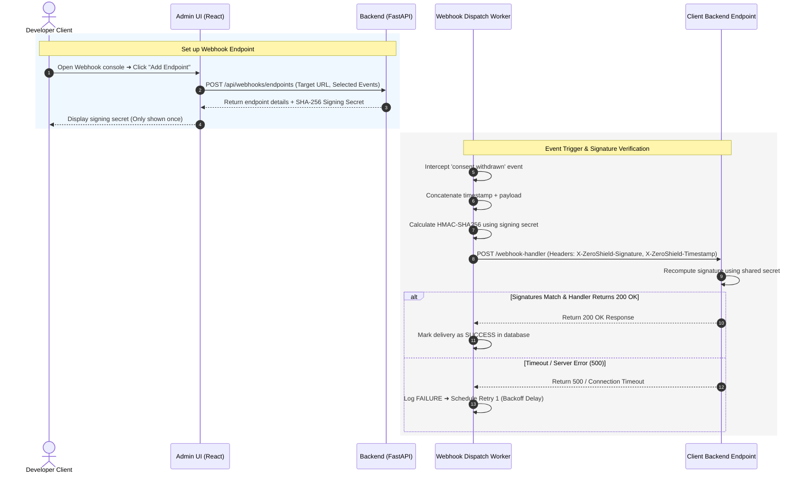

# DPDPA Shield — API & Webhooks Technical Specification

This document serves as the **single source of truth** for the **API & Webhooks** (Developer API & Outbound Integrations) module of the ZeroShield DPDPA compliance platform. It provides the detailed frontend, backend, database, integration, and compliance specifications required to build, test, and maintain this module.

---

## 1. Module Overview

### 1.1 Purpose
The **API & Webhooks** module provides developers with access keys to integrate ZeroShield programmatically with backend systems (e.g. CRM, ERP, User databases) and registers outbound **Webhook Listeners** to receive real-time updates when consent states change or notices are updated.

### 1.2 Business Objective
To support bidirectional compliance synchronization across the enterprise. It allows systems like Salesforce, HubSpot, or internal databases to immediately catch and respect data principal consent choices (especially opt-outs and withdrawals) without manual batch exports.

### 1.3 DPDPA Compliance Objective
*   **Withdrawal Enforcement (Section 6(3)(a))**: When a user revokes consent, data processing must stop immediately. Webhooks dispatch a `consent.withdrawn` payload within seconds, allowing downstream database jobs to purge or mask the user's records.
*   **Burden of Proof Audit (Section 6(10))**: Integrates external backend actions with Proof Vault ledger sequences, establishing consistent audit trails for actions executed by automated scripts.

### 1.4 Architectural Context
The API & Webhooks module serves as the outbound communications gateway:



### 1.5 Target Users
*   **Software Engineers & Integrators**: Build backend synchronization pipelines, register endpoints, and rotate credentials.
*   **Compliance Auditors**: Review webhook delivery logs to confirm opt-outs sync correctly across downstream systems.

---

## 2. DPDPA Mapping & Compliance Matrix

| DPDPA Section | Regulatory Requirement | API & Webhook Implementation |
| :--- | :--- | :--- |
| **Section 6(3)(a)** | Revocation of consent must stop data processing. | Outbound `consent.withdrawn` webhooks trigger instant sync tasks in client CRM/data-warehouse systems. |
| **Section 8(6)** | Obligation to report data breaches. | Automated alerts on webhook dispatch failures warn admins of integration breakdown risk. |

---

## 3. End-to-End User Journey



---

## 4. Technical Architecture

### 4.1 HMAC-SHA256 Signature Verification
To prevent spoofing, ZeroShield signs webhook payloads. Client handlers must verify this signature before processing.

#### Signature Steps:
1. Concatenate the timestamp header and raw JSON string: `payload_string = timestamp + "." + raw_json_payload`.
2. Compute the HMAC using SHA-256 with the endpoint's Signing Secret:
   `signature = hmac_sha256(payload_string, secret)`.
3. Compare the calculated value with the `X-ZeroShield-Signature` header value using a constant-time comparison to prevent timing attacks.

#### Python Verification Example:
```python
import hmac
import hashlib

def verify_webhook_signature(payload: bytes, secret: str, signature: str, timestamp: str) -> bool:
    expected_msg = f"{timestamp}.".encode('utf-8') + payload
    calculated = hmac.new(
        secret.encode('utf-8'),
        expected_msg,
        hashlib.sha256
    ).hexdigest()
    
    return hmac.compare_digest(calculated, signature)
```

### 4.2 Exponential Backoff Retry Manager
If a client webhook endpoint times out or returns a non-2xx status code, the dispatcher schedules a retry using an exponential backoff sequence:

$$\text{Retry Delay} = \text{Initial Interval} \times (\text{Multiplier})^{\text{attempt}}$$

*   *Initial Interval*: 10 seconds.
*   *Multiplier*: 3x.
*   *Maximum Retries*: 5 attempts (spread across ~12 hours: 10s, 30s, 90s, 270s, 810s).
*   If all 5 attempts fail, the endpoint status is changed to `degraded` and a system alert is triggered.

---

## 5. UI Panel Specification

The Developer Settings panel contains two tabs:

### 5.1 API Keys Table
*   **Metrics**: Shows key label, created date, last used date, status (active/revoked).
*   **Generate Key Button**: Opens modal to create a new token, displaying the value once.
*   **Revoke Action**: Disables the API key instantly.

### 5.2 Webhooks Console
*   **Add Endpoint Button**: Modal to enter URL target and check boxes for event types.
*   **Webhook Log Table**: Lists ID, Event type, Target URL, Status Code, Date, Duration (ms).
*   **Expansion Drawer**: Displays raw JSON request payload, client response payload (first 1000 characters), and a "Redeliver Event" button.

---

## 6. Outgoing Webhook Event Schemas

The webhook body contains unified root fields:

```json
{
  "event_id": "evt_92831aef-891d-4bb2",
  "event_type": "consent.withdrawn",
  "timestamp": "2026-06-25T00:00:00Z",
  "payload": {
    "data_principal_id": "usr_71829aef",
    "notice_version_id": "c1387d89-9831-419b-a010-8b630f9a2de0",
    "withdrawn_purposes": ["marketing"],
    "ip_address": "192.168.1.1",
    "proof_vault_block_number": 1420
  }
}
```

### 6.1 Consent Enforcement Public APIs

In addition to consent capture and webhooks, integration properties expose server-side consent enforcement endpoints:

| Endpoint | Method | Purpose |
| :--- | :--- | :--- |
| `/public/v1/integrations/{property_id}/consent/decision` | POST | Evaluate consent for a purpose (fallback path) |
| `/public/v1/integrations/{property_id}/consent/decision-token` | GET | Mint fresh decision token |
| `/public/v1/integrations/{property_id}/consent/decision/verify` | POST | Verify decision token server-side |

**Decision API request** (send raw identifiers — server hashes):
```json
{
  "principal_email": "user@example.com",
  "principal_phone": "+919876543210",
  "purpose_key": "marketing_sms",
  "collection_point": "checkout.newsletter"
}
```

**Webhook event types** now include:
*   `consent.granted` — new consent captured
*   `consent.withdrawn` — purpose withdrawn (triggers remediation)
*   `consent.modified` — consent preferences changed
*   `enforcement.denied` — server-side enforcement blocked a write (shadow or enforced mode)

---

## 7. QA Verification Matrix

### 7.1 Positive Test Cases
*   **TC-01 (API Key Verification)**: Make a request to `/api/v1/consent/summary` using a valid Bearer API key. Assert the server returns `200 OK`.
*   **TC-02 (Successful Webhook Handshake)**: Trigger a consent withdrawal. Verify that the webhook worker sends a signed POST payload to the registered URL and registers a `SUCCESS` delivery.

### 7.2 Negative Test Cases
*   **TC-03 (Invalid Webhook Signature Reject)**: Send a modified payload to the client handler using a fake signature. Verify the client handler returns `401 Unauthorized`.
*   **TC-04 (Retry Sequence Trigger)**: Route webhook calls to a server that returns `503 Service Unavailable`. Verify the worker schedules retry attempts matching the exponential backoff timeline (10s, 30s, 90s...).
