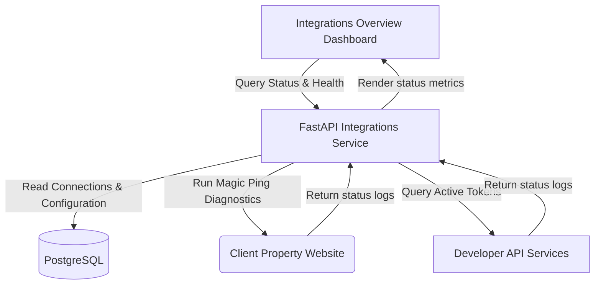
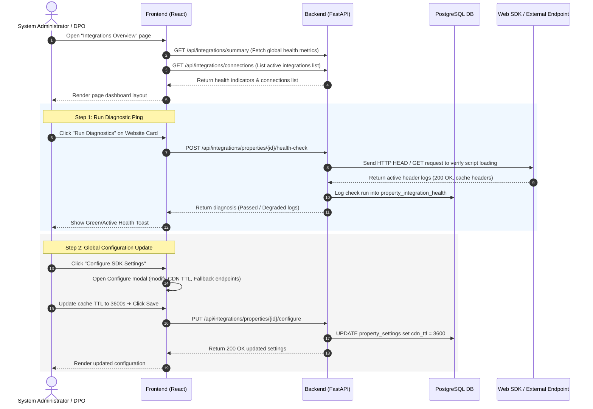
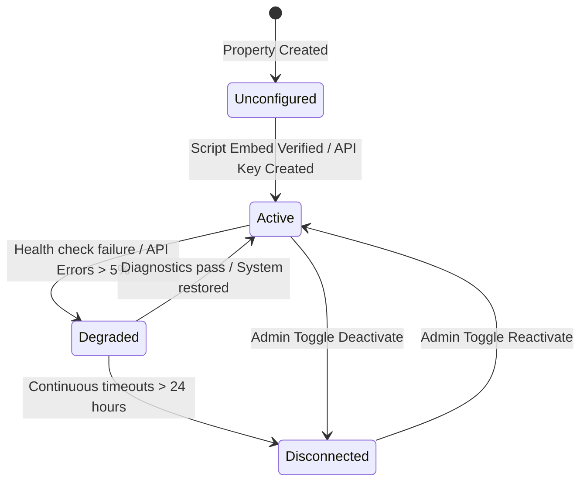
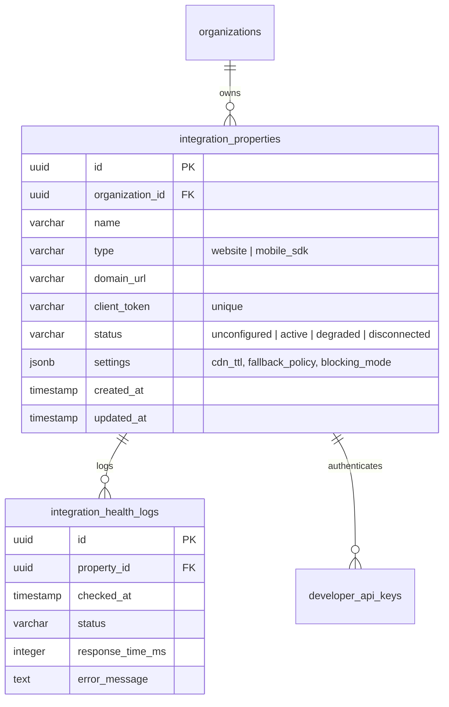

# DPDPA Shield — Integrations Overview Technical Specification

This document serves as the **single source of truth** for the **Integrations Overview** module of the ZeroShield DPDPA compliance platform. It provides the detailed frontend, backend, database, integration, and compliance specifications required to build, test, and maintain this module.

---

## 1. Module Overview

### 1.1 Purpose
The **Integrations Overview** dashboard is the centralized admin cockpit for managing, monitoring, and configuring all outbound consent delivery channels (Websites, Mobile SDKs, Tag Managers, and Custom Developer API Webhooks) across the organization's digital assets.

### 1.2 Business Objective
To provide compliance and operations teams with real-time status tracking and administrative control over technical endpoints that collect and process data principal consent. It allows users to verify script connections, check integration health, copy public script URLs, and manage API tokens from a single screen.

### 1.3 DPDPA Compliance Objective
*   **Notice and Choice Integrity (Section 6)**: Ensures that the banner scripts and mobile SDK versions loaded by the client properties are active and sync correctly with the notice versions authorized by the legal team.
*   **Security Safeguards (Section 8(5))**: Provides immediate visualization of channel health and connection status, ensuring that any integration downtime or data pipeline degradation is flagged and corrected immediately to prevent non-compliant data collection.

### 1.4 Architectural Context
The Integrations Overview console serves as the orchestrator and registry for external technical pathways:



### 1.5 Target Users
*   **System Administrators**: Set up integrations, review API keys, configure custom endpoints, and verify overall channel connectivity.
*   **DPOs & Compliance Managers**: Audit active properties, check connection logs, and monitor integration health trends.

### 1.6 Consent Enforcement Integration
Each integration property supports server-side consent enforcement:
*   **Enforcement mode** per property (`disabled` / `shadow` / `enforced`)
*   **Decision signing secret** for local JWT verification by customer backends
*   **Decision API** fallback endpoint for server-side consent evaluation
*   **Decision token** minted on consent capture (15-minute TTL)

Configure enforcement from **Consent Management → Consent Enforcement** (`/consent/enforcement`). See `Consent Management/consent_enforcement.md` for full documentation.

---

## 2. DPDPA Mapping & Compliance Matrix

| DPDPA Section | Regulatory Requirement | Integrations Overview Implementation |
| :--- | :--- | :--- |
| **Section 6(1)** | Consent must be specific and informed. | Tracks active version mappings, ensuring only current, approved notice schemas are served via CDNs. |
| **Section 8(5)** | Secure personal data using standard security safeguards. | Continuous health diagnostic checks. Alerts admins immediately if dynamic script blocking is disabled or failing. |
| **Section 8(6)** | Obligation to report data breaches. | Automated alerts trigger on API/webhook delivery failures, warning of data flow pipeline disruptions. |

---

## 3. End-to-End User Journey



---

## 4. Detailed Screen Specification

The Integrations Overview page consists of three functional regions:

### 4.1 Header Health Summary
*   **System Status Pill**: Displays overall status (`System Healthy`, `Degraded Channels Alert`, or `Disconnected Alert`).
*   **Active Properties Metric**: Number of websites and apps currently connected to ZeroShield (e.g. `24 active`).
*   **Global Connection Success Rate**: Percentage of webhook and API requests completing successfully over the past 24 hours (e.g. `99.94%`).
*   **Diagnostics Log Shortcut**: Link to view the central raw health event history.

### 4.2 Integration Channels Grid
Displays individual integration cards for the four technical endpoints:

1.  **Website Integration Card**:
    *   *Status*: Active/Inactive.
    *   *Metrics*: Total pageviews tracked, active scripts loaded.
    *   *Actions*: Run Diagnostics, Copy Script Tag, View Details.
2.  **Mobile SDK Card**:
    *   *Status*: Active/Inactive.
    *   *Metrics*: Active sessions, initialized instances (iOS vs. Android).
    *   *Actions*: Download SDK packages, Copy Auth Keys.
3.  **Tag Manager Card**:
    *   *Status*: Configured/Unconfigured.
    *   *Metrics*: Triggers fired, tags blocked.
    *   *Actions*: Configure GTM, Download Template JSON.
4.  **API & Webhooks Card**:
    *   *Status*: Connected/Degraded (Red badge if > 0 failures).
    *   *Metrics*: Active webhook endpoints, API keys, error rate.
    *   *Actions*: Manage API Keys, View Webhook Logs.

### 4.3 Diagnostic & Configuration Logs Table
*   **Table Columns**: Time, Target Property, Integration Type, Action, Duration, Status (Success/Failure/Timeout), Details.
*   **Search**: Filter logs by Property Name or status code.

---

## 5. Form Schema (SDK Configuration Modal)

| Field Name | Type | Description | Validation | Example Value |
| :--- | :--- | :--- | :--- | :--- |
| `cdn_ttl` | Integer | CDN cache TTL age in seconds | Min 60, Max 86400 | `3600` |
| `fallback_policy` | String | Logic when endpoints timeout | `allow_all`, `block_all`, `cache_last` | `"cache_last"` |
| `script_blocking_mode`| String | Method for stopping trackers | `dynamic_dom`, `blocking_wrapper` | `"dynamic_dom"` |
| `analytics_debug` | Boolean | Emit console logs on clients | Boolean value | `false` |

---

## 6. Integration Lifecycle & Status Transitions



---

## 7. Relationships with Other Modules

*   **Consent Notices Manager**: Integration properties are mapped directly to live Consent Notices. Changing a notice pushes a webhook event to flush corresponding CDN caches.
*   **Cookie Tracker blocker**: Script blocking mode rules configured inside Website settings dictate the scripts evaluated by the local browser script blocker.
*   **Proof Vault**: Collected consents from Web and Mobile SDK integrations write sealed receipts to the Proof Vault ledger.

---

## 8. Frontend Architecture

### 8.1 Page Component Structure
```
IntegrationsOverview.tsx (Dashboard Page Orchestrator)
  ├── GlobalMetricsStrip.tsx (System status and success rates)
  ├── IntegrationCardsGrid.tsx (Channel wrapper grid)
  │     ├── WebsiteIntegrationCard.tsx
  │     ├── MobileSDKCard.tsx
  │     ├── TagManagerCard.tsx
  │     └── WebhookCard.tsx
  ├── DiagnosticLogsTable.tsx (Historical activity list)
  └── SDKSettingsModal.tsx (Configure CDN & policies modal)
```

---

## 9. Backend Architecture

### 9.1 File Layout
*   `app/routers/integrations.py`: API route handlers.
*   `app/services/integration_service.py`: Magic ping HTTP validation routines, cache purge orchestrations, diagnostics logging.
*   `app/models/integration.py`: DB schemas for IntegrationProperty, HealthLogs, and AppConfiguration.

### 9.2 Service Logic Pattern (Diagnostics Run)
```python
import httpx
import time
from datetime import datetime

async def execute_property_diagnostics(db, property_id: str) -> dict:
    property = db.query(IntegrationProperty).filter_by(id=property_id).first()
    if not property:
        return {"success": False, "error": "Property not found"}
        
    start_time = time.time()
    status = "failed"
    error_log = None
    
    try:
        async with httpx.AsyncClient(timeout=5.0) as client:
            # Check script loader URL
            response = await client.get(f"https://cdn.zeroshield.in/sdk/{property.client_token}.js")
            if response.status_code == 200:
                status = "active"
            else:
                status = "degraded"
                error_log = f"CDN returned status {response.status_code}"
    except httpx.RequestError as e:
        status = "disconnected"
        error_log = str(e)
        
    duration = time.time() - start_time
    
    # Save diagnostic history
    log_entry = IntegrationHealthLog(
        property_id=property_id,
        checked_at=datetime.utcnow(),
        status=status,
        response_time_ms=int(duration * 1000),
        error_message=error_log
    )
    db.add(log_entry)
    db.commit()
    
    return {
        "success": status == "active",
        "status": status,
        "response_time_ms": int(duration * 1000),
        "error": error_log
    }
```

---

## 10. Database Design



---

## 11. API Design

### 11.1 Fetch Integrations Summary
*   **Method / Route**: `GET /api/integrations/summary`
*   **Response Body (200 OK)**:
    ```json
    {
      "system_status": "healthy",
      "active_properties_count": 24,
      "global_success_rate": 99.94,
      "last_checked_at": "2026-06-25T00:00:00Z"
    }
    ```

### 11.2 Trigger Diagnostic Health Check
*   **Method / Route**: `POST /api/integrations/properties/{property_id}/health-check`
*   **Response Body (200 OK)**:
    ```json
    {
      "property_id": "c1387d89-9831-419b-a010-8b630f9a2de0",
      "status": "active",
      "response_time_ms": 128,
      "error": null,
      "timestamp": "2026-06-25T00:05:00Z"
    }
    ```

---

## 12. Event Architecture

*   `integration.connected`: Emitted when a property begins writing consent reports.
*   `integration.health_degraded`: Fired when a diagnostic run fails or script timeouts exceed limits.
*   `integration.settings_updated`: Triggers CDN cache flushes to push updated variables to edge servers.

---

## 13. Security Requirements

*   **Token Isolation**: Client-facing tokens (`client_token`) are public and only permit read-only fetch requests for notices and consent submissions.
*   **Role-Based Access Control (RBAC)**:
    *   Only `admin` and `superadmin` can edit properties or generate client keys.
    *   `viewer` roles can review health metrics and check log tables.

---

## 14. QA Verification Matrix

### 14.1 Positive Test Cases
*   **TC-01 (Create Property)**: Configure a website property. Verify it defaults to `unconfigured` and generates a valid unique `client_token`.
*   **TC-02 (Successful Diagnostics Check)**: Trigger health diagnostics on an active website. Assert server receives a `200 OK` status and logs the run.

### 14.2 Negative Test Cases
*   **TC-03 (Failed Health Scan)**: Target an unreachable test domain URL. Run diagnostics. Verify connection status changes to `degraded` and logs the timeout error.
*   **TC-04 (Unauthorized Configuration Update)**: Post configurations with a `viewer` token. Verify response code is `403 Forbidden`.
