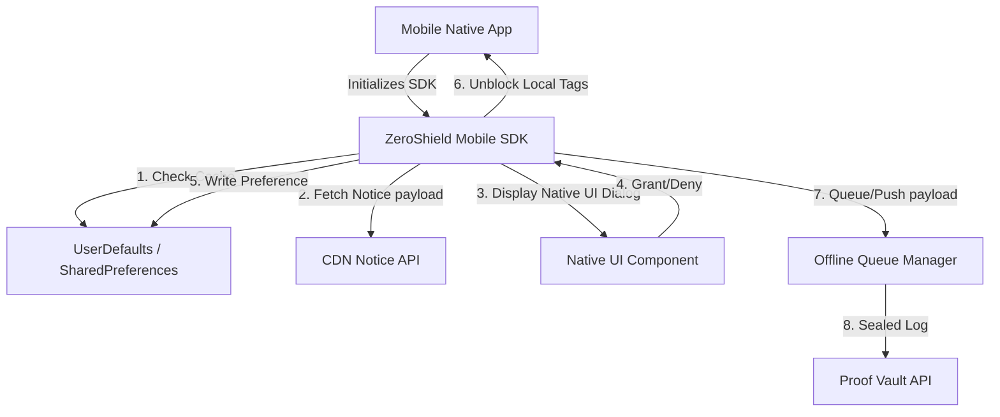
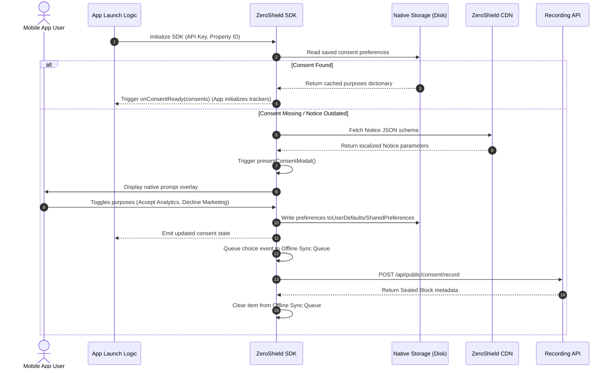

# DPDPA Shield — Mobile SDK Integration Technical Specification

This document serves as the **single source of truth** for the **Mobile SDK Integration** (Native iOS & Android Libraries) module of the ZeroShield DPDPA compliance platform. It provides the detailed frontend, backend, database, integration, and compliance specifications required to build, test, and maintain this module.

---

## 1. Module Overview

### 1.1 Purpose
The **Mobile SDK Integration** module provides native mobile libraries for iOS (Swift) and Android (Kotlin) platforms. It enables mobile applications to display DPDPA-compliant notices and consent preference dialogs, persist user preferences locally, enforce tracking opt-in controls inside mobile environments, and synchronize choices with the central compliance server.

### 1.2 Business Objective
To support native mobile applications under a single compliance dashboard. Developers install the library to ensure native tracking triggers (e.g. Firebase Analytics, AppsFlyer, Facebook SDK) respect user preferences, minimizing compliance risk without compromising app startup performance.

### 1.3 DPDPA Compliance Objective
*   **Prior Notice (Section 6(3))**: Banners must be presented in clear, plain language before tracking starts. The SDK prevents initialization of third-party analytics trackers until a consent decision is registered.
*   **Withdrawal Ease (Section 6(3)(a))**: Users must be able to change or withdraw their preferences. Mobile apps must render a "Privacy Center" or "Consent Preference" option inside their Settings menus to reopen the native SDK dialog.

### 1.4 Architectural Context
The native SDK manages consent data structures inside mobile sandboxes:



### 1.5 Target Users
*   **Mobile App Developers**: Add library dependencies, initialize the SDK, query consent states, and build custom settings menus.
*   **DPOs & Internal Auditors**: Audit consent compliance logs originating from mobile devices.

---

## 2. DPDPA Mapping & Compliance Matrix

| DPDPA Section | Regulatory Requirement | Mobile SDK Implementation |
| :--- | :--- | :--- |
| **Section 6(3)** | Notice must accompany the request for consent. | Mobile SDK fetches dynamic JSON notice translation objects to populate localized text inside native screens. |
| **Section 6(1)** | Consent must be specific and informed. | Native dialogue forms list toggle switches mapping directly to specific purpose scopes. |
| **Section 6(3)(a)** | Principal has the right to withdraw consent easily. | SDK exposes programmatic triggers (e.g. `ZeroShield.showConsentCenter()`) to reopen the preferences screen from any App settings menu. |

---

## 3. End-to-End User Journey



---

## 4. Native Technical Architecture

The SDK handles consent configurations inside mobile platform storage:

### 4.1 iOS (Swift) Integration Pattern
Developers initialize the SDK in the `AppDelegate` or main App structure:

```swift
import ZeroShield

@main
struct MyApp: App {
    init() {
        ZeroShield.initialize(
            clientToken: "zs_prop_e3b0c442",
            fallbackPolicy: .cacheLast
        )
    }
    
    var body: some Scene {
        WindowGroup {
            ContentView()
                .onAppear {
                    // Check if prompt is needed
                    if ZeroShield.shouldPromptUser() {
                        ZeroShield.presentConsentController()
                    }
                }
        }
    }
}
```

*Preferences are persisted under `UserDefaults.standard` using encrypted key pathways.*

### 4.2 Android (Kotlin) Integration Pattern
Developers initialize the SDK in their `Application` file:

```kotlin
import class io.zeroshield.android.ZeroShield

class MyApplication : Application() {
    override fun onCreate() {
        super.onCreate()
        ZeroShield.initialize(
            context = this,
            clientToken = "zs_prop_e3b0c442",
            fallbackPolicy = FallbackPolicy.CACHE_LAST
        )
    }
}
```

*Preferences are written to encrypted SharedPreferences using Android Keystore APIs.*

### 4.3 Offline Queue Manager (WORM Resilience)
If a device loses connectivity:
1. Consent decisions are saved locally on disk (using a lightweight SQLite database or local file stream).
2. The SDK registers a background sync worker (using iOS `BGAppRefreshTask` or Android `WorkManager`).
3. When the network returns, the worker uploads queued events to the backend sequentially, ensuring transaction logs reach the `Proof Vault` without loss.

---

## 5. Mobile SDK Form Schema (Notice Data)

The dynamic notice payload is returned in standard JSON format:

```json
{
  "notice_version": 12,
  "last_updated": "2026-06-24T23:55:00Z",
  "display_name": "Consent Options",
  "purposes": [
    {
      "id": "analytics",
      "name": "Analytics & Statistics",
      "required": false,
      "description": "Helps us improve our mobile application features."
    },
    {
      "id": "marketing",
      "name": "Targeted Ads",
      "required": false,
      "description": "Displays relevant advertising inside the app."
    }
  ]
}
```

---

## 6. QA Verification Matrix

### 6.1 Positive Test Cases
*   **TC-01 (Clean Launch Presentation)**: Install mobile app for the first time. Launch app. Verify the native ZeroShield modal displays automatically before other features load.
*   **TC-02 (State Memory Sync)**: Close app after granting consent. Relaunch. Verify `shouldPromptUser()` returns `false` and preferences match the previous session.

### 6.2 Negative Test Cases
*   **TC-03 (Offline Queue Persistence)**: Set mobile device to Airplane Mode. Interact with consent banner. Verify choices are cached in native storage. Turn off Airplane Mode. Verify worker executes and posts choices to `/api/public/consent/record`.
*   **TC-04 (Notice Version Enforcement)**: Increment the server-side notice version. Verify that on the next app relaunch, the SDK detects the version mismatch, triggers a new prompt, and updates local settings.
