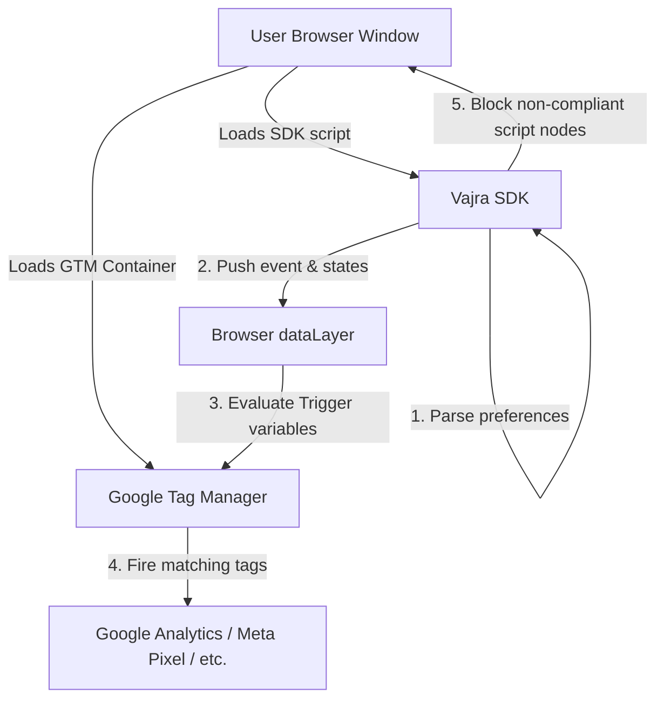
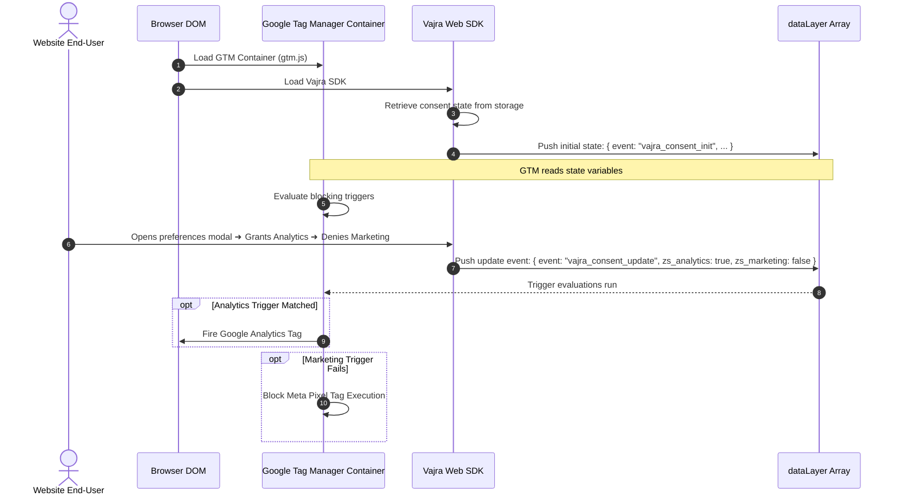

# Vajra — Tag Manager Integration Technical Specification

This document serves as the **single source of truth** for the **Tag Manager Integration** (Google Tag Manager custom templates and triggers) module of the Vajra DPDPA compliance platform. It provides the detailed frontend, backend, database, integration, and compliance specifications required to build, test, and maintain this module.

---

## 1. Module Overview

### 1.1 Purpose
The **Tag Manager Integration** module enables organizations using tag container services—primarily Google Tag Manager (GTM)—to sync customer consent preferences with dynamic tag firing rules. It provides pre-built GTM Custom Templates, updates the browser `dataLayer` dynamically, and establishes standard trigger definitions based on specific DPDPA processing purposes.

### 1.2 Business Objective
To allow compliance and marketing teams to configure and manage tag triggers from a single interface. By integrating GTM with Vajra, third-party marketing and tracking pixels only fire when the specific consent category is authorized, avoiding manual custom code updates across tag configurations.

### 1.3 DPDPA Compliance Objective
*   **Granular Consent (Section 6(1))**: Ensures tag containers differentiate between analytics, advertising, and functional tracking pixels, only executing script snippets for purposes explicitly accepted by the data principal.
*   **Tamper-Proof Audit Trails**: Maps GTM container IDs to notice revisions, ensuring the tags fired correlate directly with the notice text version presented to the user.

### 1.4 Architectural Context
The Tag Manager Integration acts as a bridge between the browser window's global data layers and the Vajra JS SDK:



### 1.5 Target Users
*   **Marketing Operations & Analysts**: Manage tag deployments, map tracking tools to purposes, and configure trigger bindings.
*   **Web Developers**: Install GTM templates and configure standard GTM custom variables.

---

## 2. DPDPA Mapping & Compliance Matrix

| DPDPA Section | Regulatory Requirement | Tag Manager Implementation |
| :--- | :--- | :--- |
| **Section 6(1)** | Consent must be specific and informed. | Configures GTM triggers mapped to specific purpose variables (e.g. `zs_consent_marketing = true`) to prevent mixed tag executions. |
| **Section 6(3)(a)** | Simple withdrawal mechanisms. | When consent is withdrawn, the SDK pushes an update to GTM (`vajra_consent_update` event), triggering immediate pause tags. |

---

## 3. End-to-End User Journey



---

## 4. Technical Architecture & Templates

The integration uses standard GTM patterns to communicate state:

### 4.1 Custom Template Definition
Vajra publishes a custom variable template for GTM. The template is defined using sandboxed JavaScript:

```javascript
// GTM Custom Variable Sandboxed JS
const queryPermission = require('queryPermission');
const getWindowProperty = require('getWindowProperty');

if (queryPermission('get', 'read_interface')) {
  const vajraState = getWindowProperty('Vajra');
  if (vajraState && vajraState.consent) {
    // Return consent status for requested purpose (e.g., 'marketing')
    return vajraState.consent[data.purposeName] === true;
  }
}
return false;
```

### 4.2 dataLayer Push Event Structures
The SDK communicates consent adjustments by pushing standard events onto the `window.dataLayer` array:

#### 4.2.1 Initialization Event
```json
{
  "event": "vajra_consent_init",
  "vajra_consent": {
    "analytics": true,
    "marketing": false,
    "functional": true
  }
}
```

#### 4.2.2 Live Update Event (Consent Adjusted)
```json
{
  "event": "vajra_consent_update",
  "vajra_consent": {
    "analytics": true,
    "marketing": true,
    "functional": true
  }
}
```

### 4.3 Trigger Formulations in GTM
To enforce consent rules, marketers set up GTM triggers using custom events:
*   **Trigger Name**: `Vajra - Analytics Granted`
*   **Trigger Type**: Custom Event
*   **Event Name**: `vajra_consent_update` or `vajra_consent_init`
*   **Trigger Conditions**: `zs_consent_analytics` equals `true`

---

## 5. UI Panel Specification (Platform Admin Panel)

The Tag Manager screen in the Vajra admin panel provides setup assistance:

### 5.1 GTM Template Exporter
*   **Download Template Button**: Downloads a pre-configured `.tpl` file (GTM Custom Template) ready for import into GTM workspaces.
*   **Variable Quick-Copy**: Monospace code blocks copy tags like `{{Vajra - Analytics Status}}`.

### 5.2 Container Mapping Panel
*   **Purpose**: Maps GTM container IDs to tracking properties.
*   **Fields**:
    *   `GTM Container ID`: Text input (`GTM-XXXXXXX`).
    *   `Map Purposes Grid`: List mapping internal purposes (e.g. `analytics`) to GTM variables names (e.g. `zs_analytics`).

---

## 6. QA Verification Matrix

### 6.1 Positive Test Cases
*   **TC-01 (dataLayer Event Verification)**: Load target page with GTM and Vajra integrated. Assert the browser console logs a `vajra_consent_init` event containing accurate current consent states.
*   **TC-02 (Tag Execution Trigger)**: Enable GTM Preview Mode. Grant "Marketing" consent in the banner. Verify the Meta Pixel fires and the trigger `Vajra - Marketing Granted` registers as activated.

### 6.2 Negative Test Cases
*   **TC-03 (No Consent Tag Blocking)**: Open page for the first time (no consent). Audit the list of executed tags in GTM Debug mode. Verify that tags requiring `marketing` or `analytics` remain in "Tags Not Fired" status.
*   **TC-04 (Consent Revocation Event)**: Decline "Analytics" consent after it was previously granted. Verify `vajra_consent_update` pushes `analytics: false` and any custom GTM cleanup tags execute.
